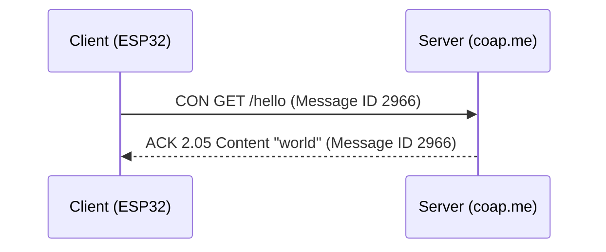
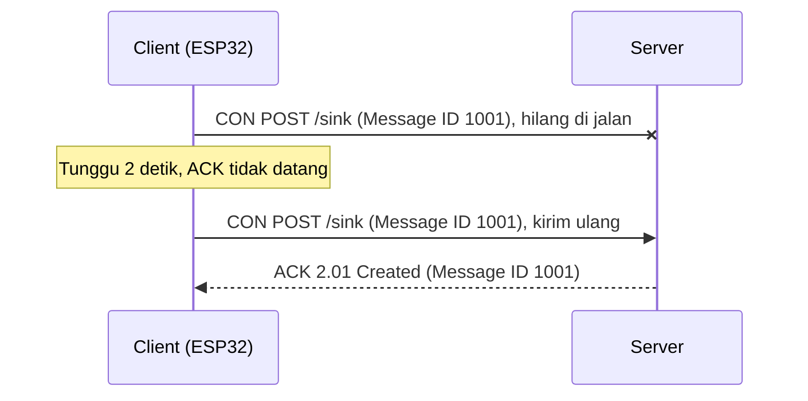
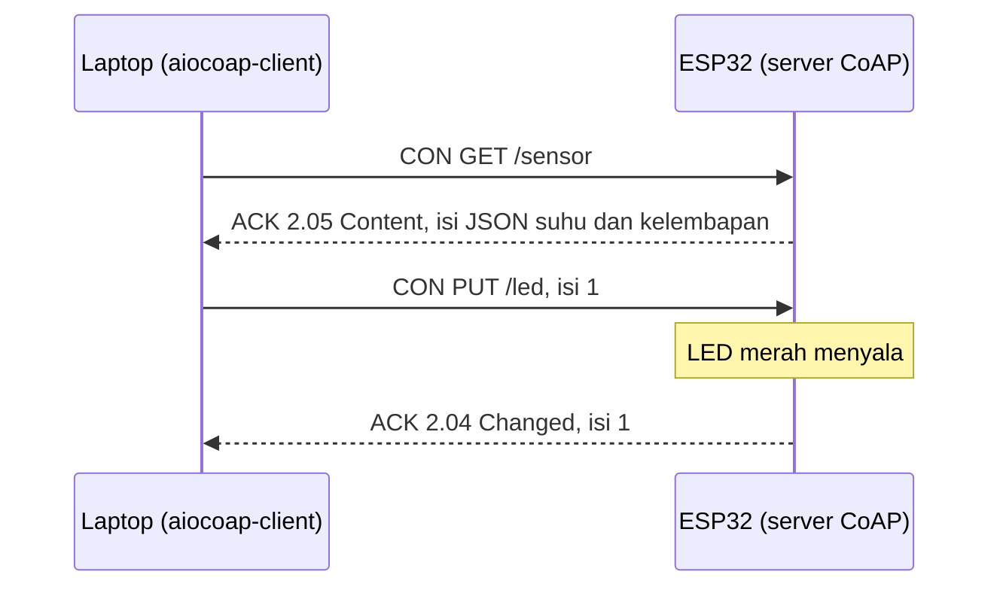
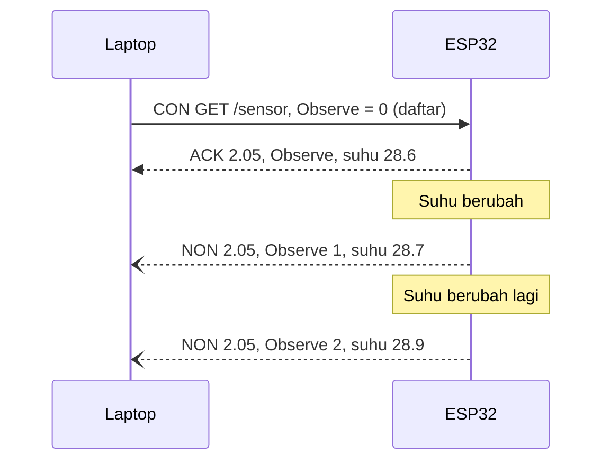

# BAB 51: CoAP

> ✅ **Prasyarat:** Selesaikan **BAB 42 (WiFi Station Mode — Koneksi Internet ESP32)** — ESP32-mu sudah bisa tersambung ke WiFi dan kamu tahu cara melihat alamat IP-nya — dan **BAB 46 (Web Server — Dashboard IoT Berbasis Browser)**, karena CoAP memakai konsep *request*, *response*, *method*, kode status, dan JSON yang sama. Program 2 dan 3 memakai sensor dari **BAB 26 (DHT11 — Suhu & Kelembapan)** dan pola `struct Timer` dari **BAB 16 (Non-Blocking Programming)**. Sebagai pembanding, BAB ini juga merujuk ke **BAB 48 (HTTP Client & REST API — ESP32 Pergi ke Internet)** dan **BAB 50 (MQTT)**, tetapi keduanya tidak wajib diselesaikan lebih dulu.

Bayangkan HTTP sebagai surat resmi: ada kop, salam pembuka, dan berbagai keterangan sebelum isi yang sebenarnya. Untuk *browser* dan laptop itu tidak masalah, tetapi untuk sensor kecil bertenaga baterai, "surat" sepanjang itu boros. **CoAP** (*Constrained Application Protocol*) adalah "HTTP versi saku": cara kerjanya mirip HTTP — ada alamat, GET, PUT, dan kode status — tetapi pesannya dikemas sangat ringkas dan dikirim lewat UDP, bukan TCP. Di BAB ini kamu belajar konsep CoAP, mencobanya dari laptop ke *server* uji di internet, lalu membuat ESP32 menjadi *client* CoAP (mengambil dan mengirim data) sekaligus *server* CoAP yang menyediakan suhu DHT11 dan tombol virtual untuk LED merah.

## 📌 Tujuan Pembelajaran

Setelah mempelajari BAB ini, kamu bisa:

- Menjelaskan apa itu CoAP, kenapa memakai UDP (*port* 5683), dan kemiripannya dengan HTTP.
- Menjelaskan *resource* dan URI `coap://`, *method* GET/POST/PUT/DELETE, kode respons seperti 2.05 dan 4.04, serta Content-Format.
- Membedakan empat jenis pesan CoAP (CON, NON, ACK, RST) dan peran Message ID serta *token*.
- Membandingkan CoAP dengan HTTP dan MQTT, lalu memilih protokol yang cocok untuk sebuah proyek.
- Memasang dan memakai alat uji `aiocoap-client` (atau `coap-client`) untuk mengirim *request* CoAP dari laptop.
- Memakai *library* **CoAP simple library** di ESP32 sebagai *client* (GET dan POST, termasuk mengirim ulang pesan yang tidak dibalas) dan sebagai *server* yang melayani data sensor serta kontrol LED.
- Memahami batasan *library* dan risiko keamanan CoAP tanpa enkripsi.

## 🧰 Yang Perlu Disiapkan

| Kebutuhan | Keterangan |
|---|---|
| *Hardware* | Kit Bluino ESP32 IoT Starter Shield + kabel USB **data** |
| Kabel *jumper* | 2 kabel *female-female* (sudah ada di kit): `DHT` → IO27 untuk Program 2 dan 3, `LED1` (merah) → IO4 untuk Program 3. Program 1 tidak perlu kabel |
| Komponen tambahan | Tidak ada |
| *Software* | Arduino IDE 2.x + *board package* **esp32** versi 3.3.x (lihat [BAB 5](../BAB-05/README.md)). Di laptop: **Python 3.10** ke atas untuk alat uji `aiocoap-client` (cara memasangnya di [51.5](#515-alat-untuk-menguji-coap)) |
| *Library* | **CoAP simple library** by Hirotaka Niisato (versi 1.4.0), **DHT sensor library** by Adafruit + **Adafruit Unified Sensor** (lihat [BAB 26](../BAB-26/README.md)), dan **ArduinoJson** by Benoit Blanchon versi 7. `WiFi` dan `WiFiUdp` sudah bawaan *board package* |
| Alat uji | **Serial Monitor** Arduino IDE (baud 115200); `aiocoap-client` di **Command Prompt** (Windows) atau **Terminal** (macOS/Linux). Alternatif untuk macOS/Linux: `coap-client` dari libcoap |
| Jaringan | WiFi **2,4 GHz** (ESP32 tidak mendukung 5 GHz). Program 1 dan 2 butuh internet dan jaringan yang tidak memblokir UDP *port* 5683 (*server* uji `coap.me`). Program 3 cukup jaringan lokal: laptop harus tersambung ke WiFi yang **sama** dengan ESP32 |

## 📑 Daftar Isi

- [51.1 Apa Itu CoAP?](#511-apa-itu-coap)
- [51.2 Resource, Method, dan Kode Respons](#512-resource-method-dan-kode-respons)
- [51.3 Empat Jenis Pesan CoAP](#513-empat-jenis-pesan-coap)
- [51.4 CoAP, HTTP, atau MQTT?](#514-coap-http-atau-mqtt)
- [51.5 Alat untuk Menguji CoAP](#515-alat-untuk-menguji-coap)
- [51.6 Library CoAP simple library](#516-library-coap-simple-library)
- [51.7 Program 1: CoAP GET ke Server Publik](#517-program-1-coap-get-ke-server-publik)
- [51.8 Program 2: Kirim Data DHT11 dengan CoAP POST](#518-program-2-kirim-data-dht11-dengan-coap-post)
- [51.9 Program 3: ESP32 sebagai CoAP Server](#519-program-3-esp32-sebagai-coap-server)
- [51.10 Keamanan dan Batasan CoAP](#5110-keamanan-dan-batasan-coap)
- [51.11 Troubleshooting](#5111-troubleshooting)
- [📝 Rangkuman](#-rangkuman)
- [💪 Latihan](#-latihan)
- [📚 Referensi](#-referensi)

---

## 51.1 Apa Itu CoAP?

**CoAP** (*Constrained Application Protocol*, protokol aplikasi untuk perangkat terbatas) adalah protokol komunikasi yang dirancang untuk perangkat "terbatas": memorinya kecil, prosesornya lambat, sering bertenaga baterai, dan jaringannya lambat atau sering kehilangan data. Standarnya disusun oleh IETF (*Internet Engineering Task Force*, lembaga yang juga menyusun standar internet seperti HTTP) dan terbit sebagai **RFC 7252** pada tahun 2014.

### 51.1.1 TCP dan UDP: Menelepon dan Mengirim Kartu Pos

HTTP ([BAB 46](../BAB-46/README.md)) dan MQTT ([BAB 50](../BAB-50/README.md)) berjalan di atas **TCP** (*Transmission Control Protocol*). CoAP berjalan di atas **UDP** (*User Datagram Protocol*). Perbedaannya mirip menelepon dan mengirim kartu pos:

| | TCP (dipakai HTTP dan MQTT) | UDP (dipakai CoAP) |
|---|---|---|
| Analogi | Menelepon: sambungkan dulu, baru bicara, lalu tutup telepon | Mengirim kartu pos: tulis alamat, langsung masukkan ke kotak pos |
| Membuka koneksi | Wajib, lewat ***handshake*** (jabat tangan) tiga langkah | Tidak ada koneksi |
| Data hilang di jalan | Dikirim ulang otomatis oleh TCP | Hilang begitu saja — aplikasinya yang harus mengurus |
| Urutan data | Dijamin urut | Bisa tiba tidak urut |
| Beban untuk perangkat | Lebih berat (koneksi harus dijaga) | Ringan |

CoAP memilih UDP supaya ringan, lalu menambahkan sendiri mekanisme sederhana untuk pesan yang penting: pesan bisa ditandai "wajib dibalas", dan kalau balasannya tidak datang, pengirim mengirim ulang. Mekanisme ini dibahas di [51.3](#513-empat-jenis-pesan-coap).

> 📌 **Catatan:** *Port* adalah nomor "pintu" layanan di sebuah perangkat. CoAP memakai **UDP *port* 5683**. Sebagian jaringan kampus atau kantor memblokir UDP ke internet, sehingga CoAP ke *server* di internet gagal walaupun *browser* lancar. Cara mengujinya ada di [51.5](#515-alat-untuk-menguji-coap).

### 51.1.2 CoAP: "HTTP Mini" di Atas UDP

CoAP sengaja meniru cara kerja HTTP yang sudah kamu kenal di BAB 46. Ada ***client*** yang meminta (*request*) dan ***server*** yang menjawab (*response*); setiap data punya alamat; ada *method* GET, POST, PUT, dan DELETE; dan setiap jawaban membawa kode status. Gaya komunikasi seperti ini disebut **REST** (*Representational State Transfer*). Bedanya, CoAP mengemas semuanya dalam format biner yang sangat ringkas.

| Di HTTP (BAB 46) | Di CoAP (BAB ini) |
|---|---|
| `http://192.168.1.23/api/sensor` | `coap://192.168.1.23/sensor` |
| TCP *port* 80 | UDP *port* 5683 |
| *Method* GET, POST, PUT, DELETE | Sama: GET, POST, PUT, DELETE |
| Kode status `200 OK` | Kode respons `2.05 Content` |
| Kode status `404 Not Found` | Kode respons `4.04 Not Found` |
| *Header* `Content-Type: application/json` | Opsi `Content-Format: 50` (angka 50 = JSON) |
| *Header* berupa teks, puluhan sampai ratusan *byte* | *Header* biner 4 *byte* + opsi singkat |
| Bisa dibuka langsung dari *browser* | Perlu alat khusus (lihat [51.5](#515-alat-untuk-menguji-coap)) |

Contoh nyata: *request* GET dari Program 1 ke `coap://coap.me/hello` hanya berukuran 26 *byte*, dan jawabannya (teks `world`) hanya 11 *byte* — sudah termasuk *header*. Sebagai pembanding, *request* HTTP dari *browser* biasa berukuran ratusan *byte* karena *header* teksnya panjang.

CoAP dipakai antara lain di **LwM2M** (*Lightweight M2M*, standar untuk mengelola perangkat IoT dari jarak jauh, banyak dipakai di jaringan seluler NB-IoT) dan di jaringan **Thread** untuk urusan pengelolaan jaringan (Thread dibahas di [BAB 56](../BAB-56/README.md)).

---

## 51.2 Resource, Method, dan Kode Respons

### 51.2.1 Resource dan URI

***Resource*** (sumber daya) adalah setiap "benda" yang bisa diakses lewat CoAP, misalnya data suhu, status LED, atau tempat penitipan data. Setiap *resource* punya alamat berbentuk **URI** (*Uniform Resource Identifier*), contohnya `coap://192.168.1.23:5683/sensor?satuan=c`. Bagian-bagiannya:

| Bagian | Contoh | Arti |
|---|---|---|
| Skema | `coap://` | CoAP biasa tanpa enkripsi. `coaps://` berarti CoAP terenkripsi DTLS (lihat [51.10](#5110-keamanan-dan-batasan-coap)) |
| *Host* | `192.168.1.23` atau `coap.me` | Alamat IP atau nama *server* |
| *Port* | `:5683` | Boleh tidak ditulis, karena 5683 adalah *port* bawaan CoAP (`coaps://` memakai 5684) |
| *Path* | `/sensor` | Nama *resource* di *server* itu |
| *Query* | `?satuan=c` | Parameter tambahan (opsional) |

Ada satu alamat istimewa: **`/.well-known/core`**. *Server* CoAP yang baik menyediakan daftar semua *resource*-nya di alamat ini (standar RFC 6690), seperti papan menu di depan warung. Program 3 juga menyediakannya.

### 51.2.2 Method

| *Method* | Kode di paket | Arti | Contoh di BAB ini |
|---|---|---|---|
| GET | 0.01 | Membaca isi *resource* | `GET /sensor` → minta data suhu dan kelembapan |
| POST | 0.02 | Mengirim data baru untuk diproses atau ditambahkan | `POST /sink` → menitipkan data DHT11 di *server* uji `coap.me` |
| PUT | 0.03 | Mengganti atau mengatur nilai *resource* | `PUT /led` dengan isi `1` → menyalakan LED merah |
| DELETE | 0.04 | Menghapus *resource* | `DELETE /sink` → mengosongkan tempat penitipan di `coap.me` |

### 51.2.3 Kode Respons

Kode respons CoAP ditulis dengan format `kelas.detail`, misalnya `2.05`. Angka pertama (kelas) langsung memberi tahu hasilnya: **2 = berhasil**, **4 = kesalahan di pihak *client*** (permintaanmu yang salah), **5 = kesalahan di pihak *server***.

| Kode | Nama | Mirip HTTP | Kapan muncul |
|---|---|---|---|
| 2.01 | Created | 201 | POST berhasil menambahkan data baru |
| 2.02 | Deleted | 200/204 | DELETE berhasil |
| 2.04 | Changed | 204 | PUT berhasil mengubah *resource* (misalnya LED) |
| 2.05 | Content | 200 | GET berhasil, jawaban berisi data |
| 4.00 | Bad Request | 400 | Isi permintaan tidak dimengerti *server* |
| 4.04 | Not Found | 404 | *Resource* dengan alamat itu tidak ada |
| 4.05 | Method Not Allowed | 405 | *Resource*-nya ada, tetapi tidak mendukung *method* itu |
| 5.00 | Internal Server Error | 500 | Terjadi kesalahan di *server* |
| 5.03 | Service Unavailable | 503 | *Server* sedang tidak bisa melayani, misalnya sensornya belum terbaca |

> 💡 **Tips:** Kenapa ditulis `2.05`, bukan `205`? Di dalam paket, kode disimpan dalam 1 *byte*: 3 bit pertama untuk kelas (2) dan 5 bit sisanya untuk detail (05). Nilai *byte*-nya 2 × 32 + 5 = 69 (heksadesimal `0x45`). Penulisan dengan titik memperlihatkan kedua bagian itu. *Method* juga memakai format yang sama dengan kelas 0, misalnya GET = `0.01`.

### 51.2.4 Content-Format

Seperti *header* `Content-Type` di HTTP, CoAP memberi tahu jenis isi (*payload*) lewat opsi **Content-Format**. Bedanya, jenis isi ditulis sebagai angka supaya hemat tempat:

| Angka | Jenis isi | Contoh |
|---|---|---|
| 0 | `text/plain` (teks biasa, UTF-8) | `world`, `1` |
| 40 | `application/link-format` (daftar *resource*) | Isi `/.well-known/core` |
| 50 | `application/json` | `{"suhu":28.6,"kelembapan":70}` |
| 60 | `application/cbor` (JSON versi biner) | — |

---

## 51.3 Empat Jenis Pesan CoAP

Karena UDP tidak menjamin pesan sampai, CoAP punya empat jenis pesan. Jenis pesan ini tertulis di setiap paket:

| Jenis | Kepanjangan | Arti | Analogi |
|---|---|---|---|
| **CON** | *Confirmable* | Pesan yang **wajib** dibalas ACK. Kalau tidak dibalas, dikirim ulang | Paket kiriman yang butuh tanda terima |
| **NON** | *Non-confirmable* | Pesan yang tidak perlu dibalas ACK. Kalau hilang, ya sudah | Brosur yang diselipkan ke kotak surat |
| **ACK** | *Acknowledgement* | Tanda terima untuk sebuah CON — bisa sekaligus membawa jawaban | Tanda tangan penerima paket |
| **RST** | *Reset* | Penolakan: "pesanmu tidak bisa kuproses" | Surat dikembalikan: "alamat tidak dikenal" |

Pola yang paling sering kamu temui di BAB ini: *client* mengirim *request* sebagai **CON**, lalu *server* membalas dengan **ACK** yang sekaligus membawa jawabannya. Jawaban yang "menumpang" di ACK seperti ini disebut ***piggybacked response***.



*Gambar 51.1 — Request CON dibalas ACK yang sekaligus membawa jawaban (piggybacked response). Sumber: dibuat untuk materi ini.*

Kalau CON hilang di jalan (atau ACK-nya yang hilang), pengirim menunggu sebentar lalu mengirim ulang pesan yang sama:



*Gambar 51.2 — Pengiriman ulang (retransmisi) pesan CON yang tidak dibalas. Sumber: dibuat untuk materi ini.*

Aturan kirim ulang menurut RFC 7252:

- Tunggu ACK sekitar **2–3 detik** (nilai acak supaya banyak perangkat tidak mengirim ulang bersamaan).
- Kalau ACK belum datang, kirim ulang dan **gandakan** waktu tunggunya (2 → 4 → 8 → 16 detik, dan seterusnya).
- Kirim ulang paling banyak **4 kali**. Secara keseluruhan, pengirim bisa menunggu sampai sekitar **93 detik** sebelum menyerah.

> ⚠️ **Perhatian:** *Library* yang kita pakai di ESP32 (CoAP simple library) **tidak** mengirim ulang secara otomatis. Kalau pesan hilang, *callback* jawaban tidak pernah dipanggil. Program 2 menunjukkan cara membuat pengiriman ulang sendiri.

Pesan **NON** cocok untuk data yang dikirim berkala dan boleh sesekali hilang, misalnya pembacaan suhu setiap 10 detik — kalau satu hilang, data berikutnya segera datang. Jawaban untuk *request* NON biasanya juga dikirim sebagai NON.

Ada juga kasus ketika *server* butuh waktu lama untuk menyiapkan jawaban. *Server* boleh membalas **ACK kosong** dulu ("pesanan diterima, tunggu ya"), lalu mengirim jawabannya belakangan sebagai pesan CON tersendiri (***separate response***). *Library* kita hanya memahami jawaban yang menumpang di ACK, jadi pola ini tidak dibahas lebih jauh.

### 51.3.1 Message ID dan Token

Setiap pesan CoAP membawa dua "nomor" yang fungsinya berbeda:

| | **Message ID** | ***Token*** |
|---|---|---|
| Ukuran | 16 bit (0–65535), selalu ada | 0–8 *byte*, boleh kosong |
| Dipilih oleh | Pengirim pesan | *Client* |
| Fungsi | Memasangkan CON dengan ACK/RST-nya, dan mendeteksi pesan ganda | Memasangkan *request* dengan *response*-nya |
| Analogi | Nomor resi paket | Nomor antrean di restoran cepat saji |

Kenapa perlu deteksi pesan ganda? Misalnya *server* sudah menerima CON dan membalas ACK, tetapi ACK-nya hilang. *Client* lalu mengirim ulang CON dengan **Message ID yang sama**. *Server* yang baik mengenali nomor itu dan tidak memproses permintaannya dua kali — ia cukup mengirim ulang jawaban yang sama. Ini penting untuk perintah seperti "tambahkan data" supaya data tidak tercatat ganda.

*Token* bekerja seperti nomor antrean: *client* menuliskannya di *request*, dan *server* wajib menyalin *token* yang sama ke *response*. *Client* yang mengirim beberapa *request* sekaligus jadi tahu jawaban mana untuk *request* mana. Karena itu, *server* di Program 3 selalu menyalin *token* dari *request* ke *response*.

<details>
<summary><b>🔬 Pendalaman (opsional): Isi paket CoAP <i>byte</i> demi <i>byte</i></b></summary>

Setiap pesan CoAP diawali *header* tetap sepanjang 4 *byte*:

| Bagian | Ukuran | Isi |
|---|---|---|
| Ver | 2 bit | Versi CoAP, selalu 1 |
| T | 2 bit | Jenis pesan: 0 = CON, 1 = NON, 2 = ACK, 3 = RST |
| TKL | 4 bit | Panjang *token* (0–8 *byte*) |
| Code | 8 bit | *Method* (0.01–0.04) atau kode respons (misalnya 2.05) |
| Message ID | 16 bit | Nomor pesan |

Setelah *header* menyusul *token* (kalau ada), lalu **opsi** (misalnya Uri-Path dan Content-Format), lalu satu *byte* penanda `FF`, dan terakhir isi pesan (*payload*).

Sebagai contoh, berikut jawaban asli dari `coap.me` untuk `GET /hello` (11 *byte*, ditulis dalam heksadesimal):

```text
60 45 0B 96 C0 FF 77 6F 72 6C 64
```

| *Byte* | Biner / arti |
|---|---|
| `60` | `01 10 0000` → Ver = 1, T = 2 (ACK), TKL = 0 (tanpa *token*) |
| `45` | `010 00101` → kode 2.05 Content |
| `0B 96` | Message ID = 2966, sama dengan Message ID *request*-nya |
| `C0` | Opsi nomor 12 (Content-Format) dengan panjang 0 → nilai 0 = `text/plain` |
| `FF` | Penanda: setelah ini isi pesan |
| `77 6F 72 6C 64` | Teks `world` |

Bandingkan dengan HTTP: baris status `HTTP/1.1 200 OK` saja sudah 15 *byte*, belum termasuk *header* lain.

</details>

---

## 51.4 CoAP, HTTP, atau MQTT?

Ketiganya sama-sama dipakai di IoT. Tabel berikut membandingkannya:

| Aspek | HTTP ([BAB 46](../BAB-46/README.md), [BAB 48](../BAB-48/README.md)) | MQTT ([BAB 50](../BAB-50/README.md)) | CoAP (BAB ini) |
|---|---|---|---|
| Transport | TCP | TCP | UDP |
| Pola komunikasi | *Request–response* | *Publish–subscribe* lewat *broker* | *Request–response*; ada perluasan Observe untuk "berlangganan" |
| Perantara | Tidak perlu | Wajib ada *broker* | Tidak perlu |
| Koneksi | Dibuka untuk *request*, lalu ditutup atau dipakai ulang sebentar | Terus tersambung ke *broker*, dijaga dengan *keep-alive* | Tanpa koneksi |
| Ukuran *header* | Teks, puluhan sampai ratusan *byte* | Biner, minimal 2 *byte* (ditambah nama topik) | Biner, 4 *byte* ditambah opsi |
| *Port* bawaan | 80 (HTTP), 443 (HTTPS) | 1883, 8883 (TLS) | 5683, 5684 (DTLS) |
| Enkripsi | TLS (HTTPS, [BAB 49](../BAB-49/README.md)) | TLS | DTLS atau OSCORE |
| Bisa dibuka dari *browser* | Ya | Tidak, perlu aplikasi MQTT | Tidak, perlu alat CoAP |
| Kekuatan | Paling umum, didukung semua layanan *cloud* | Banyak perangkat bertukar data *real-time* | Ringan, langsung antarperangkat tanpa *broker*, cocok untuk jaringan lambat |
| Kelemahan | Paling "berat" | Bergantung pada *broker* | Dukungan layanan *cloud* dan alat uji lebih sedikit; UDP sering diblokir |

Kapan memilih yang mana?

- **HTTP** — kalau datanya ingin dibuka dari *browser*, atau dikirim ke layanan *cloud* dan REST API. Pilihan paling aman kalau ragu.
- **MQTT** — kalau banyak perangkat perlu saling berbagi data lewat satu *broker*, misalnya *dashboard* IoT yang menerima data dari puluhan sensor dan mengirim perintah balik secara *real-time*.
- **CoAP** — kalau perangkatnya sangat terbatas atau jaringannya lambat dan hemat daya (misalnya 6LoWPAN, Thread, atau NB-IoT), atau kalau kamu ingin perangkat di jaringan lokal saling berkomunikasi dengan gaya REST tanpa *broker*.

> 📌 **Catatan:** Di ESP32 yang memakai WiFi, radio WiFi menyedot arus jauh lebih besar daripada urusan protokol. Jadi, jangan berharap baterai otomatis bertahan berbulan-bulan hanya karena mengganti HTTP dengan CoAP. Keuntungan CoAP paling terasa di jaringan yang memang dirancang hemat daya. Untuk ESP32 di jaringan WiFi, alasan memilih CoAP lebih sering soal kesederhanaan (tanpa *broker*) dan kecocokan dengan sistem lain yang sudah memakai CoAP.

---

## 51.5 Alat untuk Menguji CoAP

*Browser* tidak bisa membuka alamat `coap://`. Untuk mengirim *request* CoAP dari laptop, kamu butuh aplikasi *client* CoAP. BAB ini memakai **`aiocoap-client`** karena bisa dipakai di Windows, macOS, dan Linux dengan perintah yang sama.

| Alat | Sistem operasi | Catatan |
|---|---|---|
| **`aiocoap-client`** (dari paket Python aiocoap) | Windows, macOS, Linux | Dipakai di seluruh BAB ini. Butuh Python 3.10 ke atas |
| `coap-client` (dari libcoap) | Linux, macOS | Alternatif tanpa Python. Tidak ada paket siap pakai untuk Windows |
| Copper (Cu), *add-on* Firefox | — | Dulu populer, tetapi **tidak bisa dipakai lagi** sejak Firefox 56 (2017) karena Firefox mengubah sistem *add-on*-nya. Abaikan tutorial lama yang memakainya |

> 💡 **Tips:** Kalau belum pernah memakai Command Prompt atau Terminal: di Windows, tekan tombol Start → ketik `cmd` → Enter. Di macOS, tekan Cmd+Spasi → ketik `Terminal` → Enter. Di Linux (Ubuntu), tekan Ctrl+Alt+T. Setiap perintah di bawah diketik di jendela itu, lalu diakhiri dengan Enter.

### 51.5.1 Memasang aiocoap-client

**Windows:**

1. Buka **Command Prompt**, lalu ketik `python --version`. Kalau muncul `Python 3.10` atau lebih baru, lanjut ke langkah 3.
2. Kalau muncul pesan bahwa `python` tidak dikenali (atau Microsoft Store terbuka), pasang Python dulu dari [python.org/downloads](https://www.python.org/downloads/). Untuk Python 3.14 ke atas, python.org menyediakan **Python install manager**; ikuti petunjuknya dan jawab **Yes** kalau ditanya apakah folder perintah Python boleh ditambahkan ke PATH. Kalau memakai *installer* klasik, centang **Add python.exe to PATH** sebelum mengeklik **Install Now**. Setelah selesai, tutup Command Prompt, buka lagi, lalu ulangi `python --version`.
3. Pasang aiocoap:

   ```bash
   python -m pip install aiocoap
   ```

4. Kalau kamu memasang Python lewat **Python install manager**, jalankan juga `py install --refresh` supaya perintah `aiocoap-client` dibuatkan jalan pintasnya. Tutup lalu buka lagi Command Prompt.
5. Uji dengan perintah di [51.5.2](#5152-percobaan-pertama-dengan-coapme).

> 📌 **Catatan:** Kalau muncul pesan `'aiocoap-client' is not recognized as an internal or external command`, folder tempat perintah itu dipasang belum masuk PATH. Cara paling mudah: ganti `aiocoap-client` dengan `python -m aiocoap.cli.client` di semua perintah BAB ini, misalnya `python -m aiocoap.cli.client coap://coap.me/hello`. Kalau muncul tulisan `DeprecationWarning`, abaikan saja — itu hanya peringatan untuk pembuat aiocoap.

> 📌 **Catatan:** Kalau Windows menampilkan jendela **Windows Defender Firewall** untuk Python, pilih **Private networks** lalu klik **Allow access**, supaya jawaban CoAP dari ESP32 tidak diblokir.

**macOS:**

1. Buka **Terminal**, lalu ketik `python3 --version`. Kalau belum ada atau versinya di bawah 3.10, pasang Python dari [python.org/downloads](https://www.python.org/downloads/).
2. Pasang aiocoap dengan `python3 -m pip install aiocoap`.
3. Kalau muncul *error* `externally-managed-environment` (biasanya pada Python dari Homebrew), pakai **pipx**: `brew install pipx`, lalu `pipx ensurepath`, tutup dan buka lagi Terminal, lalu `pipx install aiocoap`.

**Linux (Ubuntu 24.04, Debian 12, dan sejenisnya):**

```bash
sudo apt install pipx
pipx ensurepath
```

Tutup lalu buka lagi Terminal, kemudian ketik `pipx install aiocoap`. Di distribusi Linux baru, `pip install` langsung ke sistem sengaja diblokir; pipx memasang aplikasi Python di lingkungannya sendiri.

### 51.5.2 Percobaan Pertama dengan coap.me

**`coap.me`** adalah *server* uji CoAP publik yang gratis dan tidak perlu akun. *Server* ini dikelola oleh Carsten Bormann (TZI, Universitas Bremen) — salah satu penyusun standar CoAP — dan saat BAB ini ditulis (Oktober 2026) masih aktif. Beberapa *resource* yang berguna untuk belajar:

| *Resource* | Isi |
|---|---|
| `/hello` | Menjawab teks `world` |
| `/test` | Kalimat sambutan dan waktu perubahan terakhir |
| `/sink` | Tempat penitipan data: POST menambahkan, PUT mengganti, GET membaca, DELETE mengosongkan |
| `/large` | Teks panjang yang dikirim per blok (*block-wise transfer*) |
| `/.well-known/core` | Daftar semua *resource* di `coap.me` |

Sebelum memprogram ESP32, coba dulu dari laptop. Ketik perintah berikut satu per satu (laptop harus tersambung ke internet):

```bash
aiocoap-client coap://coap.me/hello
```

Kalau berhasil, muncul satu kata:

```text
world
```

Untuk melihat detail jawaban, termasuk kode respons dan Content-Format, tambahkan `-v` (*verbose*):

```bash
aiocoap-client -v coap://coap.me/hello
```

```text
INFO:coap.aiocoap-client:Sending request:
INFO:coap.aiocoap-client:GET to coap://coap.me
INFO:coap.aiocoap-client:- Uri-Host (3): 'coap.me'
INFO:coap.aiocoap-client:- Uri-Path (11): 'hello'
INFO:coap.aiocoap-client:No payload
INFO:coap.aiocoap-client:Received response:
INFO:coap.aiocoap-client:2.05 Content from coap://coap.me
INFO:coap.aiocoap-client:- Content-Format (12): <ContentFormat 0, media_type='text/plain; charset=utf-8'>
INFO:coap.aiocoap-client:Payload: 776f726c64 (5 bytes)
world
```

Coba juga alamat yang tidak ada. `aiocoap-client` hanya menampilkan kode respons kalau hasilnya bukan sukses:

```bash
aiocoap-client coap://coap.me/abc
```

```text
4.04 Not Found
Not found
```

Lalu titipkan teks ke `/sink` dengan POST dan baca kembali dengan GET. Opsi `-m` memilih *method*, dan `--payload` berisi data yang dikirim:

```bash
aiocoap-client -m POST --payload "halo dari laptop" coap://coap.me/sink
aiocoap-client coap://coap.me/sink
```

```text
Location options indicate new resource: /location1/location2/location3
POST OK
you put here: halo dari laptop
```

Baris pertama dan kedua adalah jawaban POST (kode 2.01 Created; `coap.me` sekaligus memberi tahu lokasi "data baru"), baris ketiga adalah jawaban GET. Kalau orang lain juga sedang menitipkan data, baris ketiga lebih panjang, misalnya `you put here: ..., and you put here: halo dari laptop`.

> ⚠️ **Perhatian:** `/sink` di `coap.me` dipakai bersama oleh **semua orang** di internet. Isinya bisa bercampur dengan data orang lain dan bisa dikosongkan siapa saja kapan saja. Jangan pernah menitipkan data pribadi atau kata sandi di sana.

### 51.5.3 Alternatif: coap-client dari libcoap

Di Linux dan macOS, kamu juga bisa memakai `coap-client` dari libcoap:

| Sistem operasi | Cara memasang | Nama perintah |
|---|---|---|
| Ubuntu 24.04 / Debian 12 | `sudo apt install libcoap3-bin` | `coap-client-notls` |
| macOS (Homebrew) | `brew install libcoap` | `coap-client` |

Padanan perintahnya:

| Tujuan | `aiocoap-client` | `coap-client` (libcoap) |
|---|---|---|
| GET | `aiocoap-client coap://coap.me/hello` | `coap-client -m get coap://coap.me/hello` |
| PUT dengan isi `1` | `aiocoap-client -m PUT --payload 1 coap://IP/led` | `coap-client -m put -e 1 coap://IP/led` |
| POST teks | `aiocoap-client -m POST --payload "halo" coap://coap.me/sink` | `coap-client -m post -e halo coap://coap.me/sink` |
| Kirim sebagai NON | tambahkan `--non` | tambahkan `-N` |

Di Ubuntu/Debian, ganti `coap-client` dengan `coap-client-notls`.

### 51.5.4 Kalau Tidak Ada Jawaban

Kalau `aiocoap-client coap://coap.me/hello` diam lama lalu (setelah sekitar satu sampai satu setengah menit) menampilkan:

```text
Network error: ConRetransmitsExceeded
```

artinya *request* CON sudah dikirim ulang berkali-kali tetapi tidak ada jawaban. Penyebab yang paling sering:

- **Jaringan memblokir UDP** — umum di WiFi kampus, kantor, atau WiFi publik. Coba sambungkan laptop ke *hotspot* HP, lalu ulangi.
- **Laptop tidak tersambung ke internet**, atau alamatnya salah ketik.
- **VPN atau *firewall*** di laptop menahan UDP. Matikan VPN sementara.

Kalau dari laptop saja gagal, ESP32 di jaringan yang sama hampir pasti juga gagal. Selesaikan dulu masalah jaringannya sebelum mencoba Program 1 dan 2. Program 3 tidak terpengaruh, karena laptop dan ESP32 berkomunikasi di jaringan lokal tanpa internet.

---

## 51.6 Library CoAP simple library

Untuk ESP32, kita memakai *library* **CoAP simple library** buatan Hirotaka Niisato (versi 1.4.0). *Library* ini kecil — hanya dua *file* — dan bisa berperan sebagai *client* maupun *server*.

**Cara memasang:** buka **Sketch → Include Library → Manage Libraries…**, ketik `CoAP simple library` di kotak pencarian, pilih yang pembuatnya **Hirotaka Niisato**, lalu klik **INSTALL**. Nama *file* yang di-*include* adalah `coap-simple.h`.

### 51.6.1 Pola Dasar

Potongan kode berikut menunjukkan kerangka yang dipakai semua program di BAB ini:

```cpp
#include <WiFi.h>
#include <WiFiUdp.h>
#include <coap-simple.h>

WiFiUDP udp;           // "kotak pos" UDP milik ESP32
Coap coap(udp, 256);   // objek CoAP dengan buffer 256 byte (bawaan 128)

// Dipanggil saat JAWABAN datang (peran client)
void terimaJawaban(CoapPacket &paket, IPAddress ip, int port) {
  // paket.code, paket.messageid, paket.payload, paket.payloadlen, ...
}

// Dipanggil saat ada REQUEST ke coap://IP-ESP32/led (peran server)
void tanganiLed(CoapPacket &paket, IPAddress ip, int port) {
  coap.sendResponse(ip, port, paket.messageid, "1", 1,
                    COAP_CONTENT, COAP_TEXT_PLAIN, paket.token, paket.tokenlen);
}

// Di setup(), setelah WiFi tersambung:
//   coap.response(terimaJawaban);    // daftarkan callback jawaban
//   coap.server(tanganiLed, "led");  // daftarkan resource /led
//   coap.start();                    // buka UDP port 5683
//
// Di loop():
//   coap.loop();                     // WAJIB dipanggil terus-menerus
```

Semua pekerjaan *library* terjadi di dalam `coap.loop()`: fungsi ini membaca paket UDP yang masuk, lalu memanggil *callback* yang sesuai. *Callback* adalah fungsi milikmu yang "dipanggil balik" oleh *library* saat sesuatu terjadi (lihat [BAB 18](../BAB-18/README.md)). Karena itu `loop()` tidak boleh tertahan oleh `delay()` panjang — selama `delay()`, jawaban dan *request* yang datang hanya mengantre.

### 51.6.2 Fungsi dan Konstanta Penting

| Fungsi | Kegunaan |
|---|---|
| `Coap coap(udp, ukuran)` | Membuat objek CoAP. `ukuran` = besar *buffer* kirim dan *buffer* terima masing-masing (bawaan 128 *byte*). Paket masuk yang lebih besar akan terpotong; paket keluar yang lebih besar tidak dikirim |
| `coap.start()` | Membuka UDP *port* 5683. `coap.start(port)` untuk *port* lain |
| `coap.response(fungsi)` | Mendaftarkan *callback* untuk jawaban (paket ACK yang masuk) |
| `coap.server(fungsi, "path")` | Mendaftarkan *resource*, misalnya `"led"` atau `"sensor/suhu"`. Maksimal 10 *resource* |
| `coap.loop()` | Memproses semua paket yang masuk. Panggil di setiap putaran `loop()` |
| `coap.get(ip, port, "path")` | Mengirim GET (jenis CON). Menghasilkan Message ID, atau 0 kalau paket gagal disusun (misalnya terlalu besar untuk *buffer*) |
| `coap.put(ip, port, "path", "isi")` | Mengirim PUT (jenis CON) berisi teks |
| `coap.send(ip, port, "path", jenis, method, token, panjangToken, isi, panjangIsi, contentFormat, messageId)` | Fungsi serba bisa: untuk POST, DELETE, pesan NON, Content-Format, atau Message ID pilihan sendiri. Dua parameter terakhir boleh tidak ditulis |
| `coap.sendResponse(ip, port, messageId, isi, panjangIsi, kode, contentFormat, token, panjangToken)` | Mengirim jawaban dari *server* (selalu berjenis ACK) |

| Kelompok | Konstanta |
|---|---|
| Jenis pesan | `COAP_CON`, `COAP_NONCON`, `COAP_ACK`, `COAP_RESET` |
| *Method* | `COAP_GET`, `COAP_POST`, `COAP_PUT`, `COAP_DELETE` |
| Kode respons | `COAP_CREATED` (2.01), `COAP_CHANGED` (2.04), `COAP_CONTENT` (2.05), `COAP_BAD_REQUEST` (4.00), `COAP_NOT_FOUND` (4.04), `COAP_METHOD_NOT_ALLOWED` (4.05), `COAP_SERVICE_UNAVAILABLE` (5.03), dan lainnya |
| Content-Format | `COAP_TEXT_PLAIN` (0), `COAP_APPLICATION_LINK_FORMAT` (40), `COAP_APPLICATION_JSON` (50), `COAP_NONE` (tanpa Content-Format) |

Isi `CoapPacket` yang diterima *callback*: `type` (jenis pesan), `code` (*method* atau kode respons), `messageid`, `token` dan `tokenlen`, serta `payload` dan `payloadlen`.

### 51.6.3 Hal yang Perlu Diwaspadai

- **Tidak ada `coap.post()` dan `coap.del()`.** Tutorial lama sering memakainya, tetapi di versi 1.4.0 keduanya tidak ada sehingga program gagal di-*compile*. Pakai `coap.send()` dengan `COAP_POST` atau `COAP_DELETE` (Program 2).
- **Isi pesan bukan *string* C.** `paket.payload` tidak diakhiri karakter nol (`'\0'`). Cetak dengan `Serial.write(paket.payload, paket.payloadlen)`, atau salin dulu ke *array* `char` sambil membatasi panjangnya.
- **Tulis *path* tanpa garis miring di depan:** `"hello"`, bukan `"/hello"`. Dengan garis miring di depan, *library* menambahkan segmen *path* kosong (alamatnya menjadi `//hello`). `coap.me` kebetulan tetap menerimanya, tetapi *server* lain bisa menjawab 4.04.
- **Tidak ada pengiriman ulang otomatis.** Kalau CON atau ACK-nya hilang, *library* diam saja. Program 1 mendeteksi jawaban yang tidak datang, dan Program 2 mengirim ulang sendiri.
- **Hanya jawaban yang menumpang di ACK yang sampai ke *callback* jawaban.** Jawaban berjenis NON atau *separate response* diperlakukan sebagai *request* baru dan tidak sampai ke `terimaJawaban()`.
- **Selalu daftarkan `coap.response()`, walaupun ESP32 hanya menjadi *server*.** Kalau ada paket ACK masuk sementara *callback* jawaban belum didaftarkan, program *crash* dan ESP32 *restart*. Biasakan mendaftarkan semua *callback* sebelum `coap.start()`.
- **Alamat yang tidak terdaftar dijawab 4.04 secara otomatis, tetapi tanpa *token*.** Akibatnya, alat uji seperti `aiocoap-client` tidak mengenali jawaban itu dan terus menunggu sampai kamu menekan Ctrl+C, sedangkan `coap-client` menunggu sekitar 90 detik lalu berhenti tanpa pesan. Kalau alat uji "diam saja", periksa dulu ejaan alamatnya.
- **Fitur yang tidak didukung:** enkripsi DTLS (`coaps://`), *block-wise transfer* (data besar dipecah menjadi beberapa blok — dari `coap.me/large` hanya blok pertama yang diterima), dan Observe di sisi *client*. Observe di sisi *server* tersedia sebagai fitur eksperimental (lihat [51.10](#5110-keamanan-dan-batasan-coap)).

---

## 51.7 Program 1: CoAP GET ke Server Publik

**Tujuan:** ESP32 menjadi *client* CoAP dan mengirim GET ke `coap://coap.me/hello` saat menyala. Setelah itu, kamu bisa mengetik nama *resource* lain (misalnya `test` atau `abc`) di Serial Monitor untuk mengirim GET berikutnya. Program menampilkan jenis pesan, Message ID, kode respons, isi jawaban, dan waktu tempuhnya — serta memberi tahu kalau jawaban tidak datang dalam 5 detik.

**Rangkaian:**

*Tidak perlu merangkai — program hanya memakai WiFi dan Serial Monitor.*

**Cara Menjalankan:**

1. Pastikan dulu laptopmu bisa mendapat jawaban dari `coap.me` ([51.5.2](#5152-percobaan-pertama-dengan-coapme)). Kalau dari laptop gagal, perbaiki jaringannya dulu ([51.5.4](#5154-kalau-tidak-ada-jawaban)).
2. Pasang *library* **CoAP simple library** by Hirotaka Niisato lewat **Sketch → Include Library → Manage Libraries…** (lihat [51.6](#516-library-coap-simple-library)).
3. Buka **File → New Sketch**, hapus isinya, lalu salin kode di bawah. Kode yang sama juga tersedia di *file* [`p1_coap_get.ino`](p1_coap_get/p1_coap_get.ino).
4. Ganti `NamaWiFiKamu` dan `PasswordWiFiKamu` dengan nama dan kata sandi WiFi kamu. Keduanya peka huruf besar-kecil, dan WiFi-nya harus 2,4 GHz serta tersambung ke internet.
5. Pastikan **Tools → Board** = **ESP32 Dev Module** dan **Tools → Port** = *port* ESP32 kamu (misalnya `COM5` di Windows atau `/dev/ttyUSB0` di Linux).
6. Klik tombol **Upload** (ikon panah →) dan tunggu sampai muncul tulisan **Done uploading**.
7. Buka **Serial Monitor** (**Tools → Serial Monitor**), pilih baud **115200** dan *line ending* **New Line**. Kalau tulisan awal terlewat, tekan tombol **EN** di *board* ESP32.
8. Ketik `test` di kolom pesan Serial Monitor lalu tekan Enter. Coba juga `abc` (alamat yang tidak ada).

**Kode Program:**

<!-- sketch: p1_coap_get -->
```cpp
/*
 * BAB 51 - Program 1: CoAP GET ke Server Publik
 * ESP32 menjadi client CoAP dan mengirim GET ke coap://coap.me/<resource>.
 * - Saat menyala: GET coap://coap.me/hello
 * - Ketik nama resource di Serial Monitor (line ending: New Line),
 *   misalnya test atau abc, lalu tekan Enter untuk mengirim GET lain.
 * - Kalau jawaban tidak datang dalam 5 detik, program memberi tahu.
 * Rangkaian: tidak perlu. Butuh WiFi 2,4 GHz yang tersambung ke internet.
 */

#include <WiFi.h>
#include <WiFiUdp.h>
#include <coap-simple.h>

const char *NAMA_WIFI = "NamaWiFiKamu";          // ← ganti dengan WiFi kamu
const char *PASSWORD_WIFI = "PasswordWiFiKamu";  // ← ganti dengan WiFi kamu

const char *SERVER_COAP = "coap.me";      // server uji CoAP publik
const int PORT_COAP = 5683;               // port bawaan CoAP
const unsigned long BATAS_TUNGGU = 5000;  // ms, batas menunggu jawaban

WiFiUDP udp;
Coap coap(udp, 256);  // buffer kirim & terima masing-masing 256 byte

// Data request yang sedang menunggu jawaban
bool menunggu = false;
uint16_t idDitunggu = 0;
unsigned long waktuKirim = 0;

// Nama jenis pesan CoAP
const char *namaJenis(uint8_t jenis) {
  switch (jenis) {
    case COAP_CON: return "CON";
    case COAP_NONCON: return "NON";
    case COAP_ACK: return "ACK";
    case COAP_RESET: return "RST";
    default: return "?";
  }
}

// Arti beberapa kode respons yang sering muncul
const char *artiKode(uint8_t kode) {
  switch (kode) {
    case 0: return "Empty (ACK kosong, jawaban menyusul terpisah)";
    case COAP_CREATED: return "Created (berhasil dibuat)";
    case COAP_DELETED: return "Deleted (berhasil dihapus)";
    case COAP_CHANGED: return "Changed (berhasil diubah)";
    case COAP_CONTENT: return "Content (berhasil, ada isi)";
    case COAP_BAD_REQUEST: return "Bad Request (permintaan tidak dimengerti)";
    case COAP_NOT_FOUND: return "Not Found (resource tidak ada)";
    case COAP_METHOD_NOT_ALLOWED: return "Method Not Allowed (method tidak didukung)";
    case COAP_INTERNAL_SERVER_ERROR: return "Internal Server Error (kesalahan di server)";
    case COAP_SERVICE_UNAVAILABLE: return "Service Unavailable (server sedang tidak bisa melayani)";
    default: return "(lihat tabel kode respons)";
  }
}

// Callback: dipanggil oleh coap.loop() saat paket ACK (jawaban) datang
void terimaJawaban(CoapPacket &paket, IPAddress ip, int port) {
  if (!menunggu || paket.messageid != idDitunggu) {
    Serial.printf("[INFO] Jawaban untuk Message ID %u tidak sedang ditunggu, diabaikan.\n",
                  paket.messageid);
    return;
  }
  menunggu = false;

  Serial.printf("[JAWABAN] %s, Message ID %u, %lu ms\n",
                namaJenis(paket.type), paket.messageid, millis() - waktuKirim);
  Serial.printf("[JAWABAN] kode %d.%02d = %s\n",
                paket.code >> 5, paket.code & 0x1F, artiKode(paket.code));
  Serial.printf("[JAWABAN] isi (%u byte): ", (unsigned)paket.payloadlen);
  if (paket.payloadlen > 0) {
    Serial.write(paket.payload, paket.payloadlen);  // payload TIDAK diakhiri '\0'
  } else {
    Serial.print("(kosong)");
  }
  Serial.println();
}

// Mengirim GET ke coap://coap.me/<resource>
void kirimGet(const String &resource) {
  if (WiFi.status() != WL_CONNECTED) {
    Serial.println("[GAGAL] WiFi belum tersambung.");
    return;
  }

  // DNS: ubah nama "coap.me" menjadi alamat IP (menunggu sebentar)
  IPAddress ipServer;
  if (!WiFi.hostByName(SERVER_COAP, ipServer)) {
    Serial.printf("[GAGAL] Alamat IP %s tidak ditemukan (DNS gagal).\n", SERVER_COAP);
    return;
  }

  // Path ditulis TANPA '/' di depan, misalnya "hello"
  uint16_t id = coap.get(ipServer, PORT_COAP, resource.c_str());
  if (id == 0) {
    Serial.println("[GAGAL] Paket tidak bisa disusun (nama resource terlalu panjang?).");
    return;
  }

  menunggu = true;
  idDitunggu = id;
  waktuKirim = millis();
  Serial.println();
  Serial.printf("[GET] coap://%s/%s (IP %s), Message ID %u\n",
                SERVER_COAP, resource.c_str(), ipServer.toString().c_str(), id);
}

// Membaca nama resource yang diketik di Serial Monitor
void bacaSerial() {
  if (!Serial.available()) return;

  String masukan = Serial.readStringUntil('\n');
  masukan.trim();
  if (masukan.startsWith("/")) masukan.remove(0, 1);  // buang '/' di depan
  if (masukan.length() == 0) return;

  if (menunggu) {
    Serial.println("[INFO] Masih menunggu jawaban sebelumnya. Coba lagi sebentar.");
    return;
  }
  kirimGet(masukan);
}

// Memberi tahu kalau jawaban tidak datang dalam BATAS_TUNGGU
void periksaBatasWaktu() {
  if (menunggu && millis() - waktuKirim >= BATAS_TUNGGU) {
    menunggu = false;
    Serial.printf("[GAGAL] Tidak ada jawaban untuk Message ID %u dalam %lu detik.\n",
                  idDitunggu, BATAS_TUNGGU / 1000);
    Serial.println("        Paket hilang, atau jaringan memblokir UDP. Coba kirim lagi.");
  }
}

void sambungkanWiFi() {
  WiFi.mode(WIFI_STA);
  WiFi.begin(NAMA_WIFI, PASSWORD_WIFI);
  Serial.printf("Menyambung ke WiFi \"%s\"", NAMA_WIFI);

  unsigned long mulai = millis();
  while (WiFi.status() != WL_CONNECTED) {
    if (millis() - mulai > 20000) {  // menyerah setelah 20 detik
      Serial.println("\nGagal tersambung. Periksa nama/password WiFi dan pastikan 2,4 GHz.");
      Serial.println("ESP32 restart dalam 5 detik...");
      delay(5000);
      ESP.restart();
    }
    delay(500);
    Serial.print(".");
  }
  Serial.println(" tersambung!");
  Serial.print("Alamat IP ESP32: ");
  Serial.println(WiFi.localIP());
}

void setup() {
  Serial.begin(115200);
  delay(1000);
  Serial.println("\nBAB 51 - Program 1: CoAP GET ke Server Publik");

  sambungkanWiFi();

  coap.response(terimaJawaban);  // daftarkan callback SEBELUM start()
  coap.start();                  // buka UDP port 5683
  Serial.println("CoAP siap (UDP port 5683).");
  Serial.println("Ketik nama resource lalu tekan Enter, misalnya: hello, test, abc");

  kirimGet("hello");
}

void loop() {
  coap.loop();          // tugas 1: proses paket CoAP yang masuk (memanggil callback)
  bacaSerial();         // tugas 2: cek apakah ada nama resource yang diketik
  periksaBatasWaktu();  // tugas 3: cek jawaban yang terlalu lama
}
```

**Penjelasan Kode:**

- **`Coap coap(udp, 256)`** membuat objek CoAP di atas "kotak pos" UDP (`WiFiUDP`). Angka 256 adalah ukuran *buffer* kirim dan terima. Ukuran bawaan 128 *byte* sudah cukup untuk `hello`, tetapi 256 memberi ruang untuk jawaban yang lebih panjang.
- **`WiFi.hostByName()`** adalah DNS: mengubah nama `coap.me` menjadi alamat IP, karena `coap.get()` hanya menerima alamat IP. Fungsi ini menunggu sampai jawaban DNS datang (biasanya kurang dari satu detik).
- **`coap.get(ipServer, PORT_COAP, "hello")`** menyusun paket GET berjenis CON lalu langsung mengirimnya — fungsi ini **tidak menunggu** jawaban. Hasilnya adalah Message ID paket itu, yang disimpan di `idDitunggu`.
- **`terimaJawaban()`** adalah *callback* yang dipanggil oleh `coap.loop()` saat paket ACK masuk. Message ID jawaban dicocokkan dengan `idDitunggu`, supaya jawaban terlambat dari *request* lama tidak tertukar dengan jawaban yang sedang ditunggu.
- **`paket.code >> 5` dan `paket.code & 0x1F`** memecah kode 1 *byte* menjadi kelas (3 bit atas) dan detail (5 bit bawah), lalu dicetak dengan format `%d.%02d` sehingga tampil seperti `2.05`.
- **`Serial.write(paket.payload, paket.payloadlen)`** mencetak isi jawaban sepanjang `payloadlen` *byte*. Jangan memakai `Serial.print((char *)paket.payload)`, karena isi pesan tidak diakhiri karakter nol sehingga yang tercetak bisa ikut sampah memori.
- **`periksaBatasWaktu()`** memakai pola `millis()` ([BAB 16](../BAB-16/README.md)) untuk mendeteksi jawaban yang tidak datang dalam 5 detik. Ingat, *library* tidak mengirim ulang otomatis.
- **`loop()`** hanya berisi tiga tugas pendek tanpa `delay()`, sehingga `coap.loop()` dipanggil ribuan kali per detik dan jawaban langsung diproses begitu tiba.

**Contoh Output:**

```text
BAB 51 - Program 1: CoAP GET ke Server Publik
Menyambung ke WiFi "NamaWiFiKamu"..... tersambung!
Alamat IP ESP32: 192.168.1.23
CoAP siap (UDP port 5683).
Ketik nama resource lalu tekan Enter, misalnya: hello, test, abc

[GET] coap://coap.me/hello (IP 134.102.218.18), Message ID 16838
[JAWABAN] ACK, Message ID 16838, 312 ms
[JAWABAN] kode 2.05 = Content (berhasil, ada isi)
[JAWABAN] isi (5 byte): world

[GET] coap://coap.me/test (IP 134.102.218.18), Message ID 23010
[JAWABAN] ACK, Message ID 23010, 298 ms
[JAWABAN] kode 2.05 = Content (berhasil, ada isi)
[JAWABAN] isi (66 byte): welcome to the ETSI plugtest! last change: 2026-10-23 22:08:02 UTC

[GET] coap://coap.me/abc (IP 134.102.218.18), Message ID 4415
[JAWABAN] ACK, Message ID 4415, 305 ms
[JAWABAN] kode 4.04 = Not Found (resource tidak ada)
[JAWABAN] isi (9 byte): Not found
```

Alamat IP, Message ID, dan waktu tempuh di atas hanya contoh — angkamu bisa berbeda. *Server* `coap.me` berada di Jerman, jadi waktu tempuh dari Indonesia sekitar ratusan milidetik. Perhatikan bahwa Message ID di baris `[JAWABAN]` selalu sama dengan Message ID di baris `[GET]` — itulah cara ACK dipasangkan dengan CON-nya.

Kalau jaringan memblokir UDP, yang muncul adalah:

```text
[GET] coap://coap.me/hello (IP 134.102.218.18), Message ID 16838
[GAGAL] Tidak ada jawaban untuk Message ID 16838 dalam 5 detik.
        Paket hilang, atau jaringan memblokir UDP. Coba kirim lagi.
```

> 🧪 **Coba Sendiri:** Ketik `large`. Isi aslinya lebih dari 1000 *byte*, tetapi yang diterima ESP32 hanya potongan pertama, karena `coap.me` mengirimnya per blok dan *library* tidak mendukung *block-wise transfer*.

**Kalau Belum Berhasil:**

- **Selalu muncul `[GAGAL] Tidak ada jawaban ...`** → jaringan memblokir UDP ke internet. Uji dulu dari laptop di jaringan yang sama ([51.5.2](#5152-percobaan-pertama-dengan-coapme)); kalau laptop juga gagal, coba *hotspot* HP.
- **`[GAGAL] Alamat IP coap.me tidak ditemukan (DNS gagal).`** → WiFi tersambung tetapi tidak ada internet, atau DNS *router* bermasalah. Coba buka situs apa pun dari HP di WiFi yang sama.
- **Mengetik nama *resource* tetapi tidak terjadi apa-apa** → *line ending* Serial Monitor masih **No Line Ending**. Pilih **New Line**.
- ***Error* `coap-simple.h: No such file or directory` saat *compile*** → *library* belum terpasang. Pasang **CoAP simple library** by Hirotaka Niisato.

---

## 51.8 Program 2: Kirim Data DHT11 dengan CoAP POST

**Tujuan:** ESP32 membaca DHT11 setiap 2 detik, lalu setiap 30 detik mengirim suhu dan kelembapan dalam format JSON ke `coap://coap.me/sink` dengan POST berjenis CON. Kalau ACK tidak datang dalam 2 detik, ESP32 mengirim ulang pesan yang sama (dengan Message ID yang sama), lalu menunggu 4 detik, kemudian 8 detik — mengikuti aturan CoAP di [51.3](#513-empat-jenis-pesan-coap), hanya dengan jumlah percobaan yang lebih sedikit. Hasilnya bisa kamu cek dari laptop.

**Rangkaian:**

| Pin **Custom** di kit | Sambungkan ke pin ESP32 |
|---|---|
| `DHT` — DHT11 (header hijau, pin ke-3 dari atas) | IO27 |


*Gambar 51.3 — Rangkaian DHT11 pada kit. Pin data tersambung ke header `DHT` dengan resistor pull-up 4,7 kΩ; sambungkan header itu ke IO27 dengan kabel jumper. Sumber: skematik ESP32 Starter Shield 3.2, [Bluino](http://www.bluino.com).*

**Cara Menjalankan:**

1. Sambungkan kabel *jumper* sesuai tabel **Rangkaian** di atas.
2. Pasang *library* yang dibutuhkan lewat **Sketch → Include Library → Manage Libraries…** (lewati yang sudah terpasang):
   - ketik `CoAP simple library`, pilih yang pembuatnya **Hirotaka Niisato**, klik **INSTALL**;
   - ketik `DHT sensor library`, pilih yang pembuatnya **Adafruit**, klik **INSTALL**, lalu klik **Install All** saat ditanya soal *library* pendukung (**Adafruit Unified Sensor**);
   - ketik `ArduinoJson`, pilih yang pembuatnya **Benoit Blanchon** versi 7.x, klik **INSTALL**.
3. Buka **File → New Sketch**, hapus isinya, lalu salin kode di bawah. Kode yang sama juga tersedia di *file* [`p2_coap_post.ino`](p2_coap_post/p2_coap_post.ino).
4. Ganti `NamaWiFiKamu` dan `PasswordWiFiKamu` dengan WiFi milikmu (2,4 GHz, tersambung ke internet). Ganti juga `NAMA_PERANGKAT` dengan nama yang unik, misalnya `"bluino-andi"`, supaya datamu mudah dikenali di antara data orang lain.
5. Pastikan **Tools → Board** = **ESP32 Dev Module** dan **Tools → Port** = *port* ESP32 kamu, lalu klik **Upload** dan tunggu sampai muncul **Done uploading**.
6. Buka **Serial Monitor** dengan baud **115200**.
7. Setelah muncul `kode 2.01 = Created`, cek datanya dari laptop dengan `aiocoap-client coap://coap.me/sink` (lihat bagian **Contoh Output**).

**Kode Program:**

<!-- sketch: p2_coap_post -->
```cpp
/*
 * BAB 51 - Program 2: Kirim Data DHT11 dengan CoAP POST
 * Setiap 30 detik ESP32 mengirim suhu & kelembapan (JSON) ke
 * coap://coap.me/sink dengan POST berjenis CON.
 * Kalau ACK tidak datang, pesan yang sama (Message ID sama) dikirim ulang:
 * tunggu 2 detik, lalu 4 detik, lalu 8 detik sebelum menyerah.
 * DHT11 dibaca setiap 2 detik tanpa delay() (struct Timer dari BAB 16).
 * Rangkaian: DHT (header hijau) -> IO27. Butuh WiFi yang tersambung ke internet.
 */

#include <WiFi.h>
#include <WiFiUdp.h>
#include <coap-simple.h>
#include <ArduinoJson.h>
#include <DHT.h>

const char *NAMA_WIFI = "NamaWiFiKamu";          // ← ganti dengan WiFi kamu
const char *PASSWORD_WIFI = "PasswordWiFiKamu";  // ← ganti dengan WiFi kamu

const char *SERVER_COAP = "coap.me";        // server uji CoAP publik
const int PORT_COAP = 5683;                 // port bawaan CoAP
const char *RESOURCE = "sink";              // tanpa '/' di depan
const char *NAMA_PERANGKAT = "bluino-kit";  // ganti dengan nama unik, misalnya "bluino-andi"

#define PIN_DHT 27
#define TIPE_DHT DHT11

const unsigned long TUNGGU_ACK_AWAL = 2000;  // ms, waktu tunggu ACK pertama
const uint8_t MAKS_KIRIM = 3;                // 1 kali kirim + 2 kali kirim ulang

// struct Timer dari BAB 16
struct Timer {
  unsigned long interval;   // ms
  unsigned long waktuLalu;  // hasil millis() saat terakhir dijalankan

  // Mengembalikan true kalau sudah waktunya, lalu mencatat waktunya
  bool sudahWaktunya(unsigned long sekarang) {
    if (sekarang - waktuLalu >= interval) {
      waktuLalu = sekarang;
      return true;
    }
    return false;
  }
};

WiFiUDP udp;
Coap coap(udp, 256);
DHT dht(PIN_DHT, TIPE_DHT);

Timer timerDHT = {2000, 0};     // baca DHT11 setiap 2 detik
Timer timerKirim = {30000, 0};  // kirim data setiap 30 detik

// Hasil bacaan DHT11 terakhir
float suhu = NAN;
float kelembapan = NAN;
bool dhtOk = false;
bool bacaanPertama = true;
bool sudahPernahKirim = false;

// Pesan yang sedang menunggu ACK
bool menungguAck = false;
uint16_t idPesan = 0;         // Message ID pesan yang sedang dikirim
uint16_t idBerikutnya = 1;    // Message ID untuk pesan baru berikutnya
uint8_t jumlahKirim = 0;      // sudah berapa kali pesan ini dikirim
unsigned long waktuKirim = 0;      // millis() saat kiriman terakhir
unsigned long waktuKirimAwal = 0;  // millis() saat kiriman pertama
unsigned long batasTunggu = 0;     // ms, waktu tunggu ACK saat ini
IPAddress ipServer;
char isiPesan[100];
size_t panjangIsi = 0;
unsigned long jumlahBerhasil = 0;
unsigned long jumlahGagal = 0;

void bacaDHT() {
  dht.read(true);  // paksa membaca sensor sekarang (±25 ms), lihat BAB 26
  float h = dht.readHumidity();
  float t = dht.readTemperature();
  bool berhasil = !isnan(h) && !isnan(t);

  // Cetak pesan hanya pada bacaan pertama atau saat status berubah
  if (bacaanPertama || berhasil != dhtOk) {
    if (berhasil) {
      Serial.printf("[DHT11] OK: %.1f °C, %.0f %%RH\n", t, h);
    } else {
      Serial.println("[DHT11] Gagal membaca. Periksa kabel DHT -> IO27.");
    }
  }
  bacaanPertama = false;
  dhtOk = berhasil;
  if (berhasil) {
    suhu = t;
    kelembapan = h;
  }
}

void cetakTotal() {
  Serial.printf("[TOTAL] berhasil %lu, gagal %lu\n", jumlahBerhasil, jumlahGagal);
}

// Mengirim (atau mengirim ulang) pesan yang tersimpan di isiPesan
void kirimPaket() {
  jumlahKirim++;
  waktuKirim = millis();
  uint16_t hasil = coap.send(ipServer, PORT_COAP, RESOURCE,
                             COAP_CON, COAP_POST,              // jenis CON, method POST
                             NULL, 0,                          // tanpa token
                             (const uint8_t *)isiPesan, panjangIsi,
                             COAP_APPLICATION_JSON,            // Content-Format 50
                             idPesan);                         // Message ID pilihan kita
  if (hasil == 0) {
    Serial.println("[GAGAL] Paket tidak bisa disusun (isi terlalu besar untuk buffer?).");
    menungguAck = false;
    jumlahGagal++;
    cetakTotal();
    return;
  }
  Serial.printf("[KIRIM] Message ID %u, percobaan %u dari %u\n", idPesan, jumlahKirim, MAKS_KIRIM);
}

// Menyiapkan pesan baru berisi data DHT11, lalu mengirimnya
void mulaiKirimData() {
  if (menungguAck) {
    Serial.println("[INFO] Pesan sebelumnya belum selesai, data kali ini dilewati.");
    return;
  }
  if (!dhtOk) {
    Serial.println("[INFO] Belum ada bacaan DHT11 yang valid, pengiriman dilewati.");
    return;
  }
  if (WiFi.status() != WL_CONNECTED) {
    Serial.println("[INFO] WiFi terputus, pengiriman dilewati.");
    return;
  }
  if (!WiFi.hostByName(SERVER_COAP, ipServer)) {  // DNS: nama -> alamat IP
    Serial.printf("[GAGAL] Alamat IP %s tidak ditemukan (DNS gagal).\n", SERVER_COAP);
    return;
  }

  // Susun JSON, misalnya {"id":"bluino-kit","suhu":28.6,"kelembapan":70}
  JsonDocument doc;
  doc["id"] = NAMA_PERANGKAT;
  doc["suhu"] = suhu;
  doc["kelembapan"] = kelembapan;
  panjangIsi = serializeJson(doc, isiPesan, sizeof(isiPesan));

  // Pesan baru = Message ID baru (0 tidak dipakai)
  idPesan = idBerikutnya;
  idBerikutnya++;
  if (idBerikutnya == 0) idBerikutnya = 1;

  jumlahKirim = 0;
  batasTunggu = TUNGGU_ACK_AWAL;
  menungguAck = true;
  waktuKirimAwal = millis();
  Serial.println();
  Serial.printf("[POST] coap://%s/%s, isi: %s\n", SERVER_COAP, RESOURCE, isiPesan);
  kirimPaket();
}

// Callback: dipanggil oleh coap.loop() saat paket ACK datang
void terimaJawaban(CoapPacket &paket, IPAddress ip, int port) {
  if (!menungguAck || paket.messageid != idPesan) {
    Serial.printf("[INFO] ACK untuk Message ID %u datang terlambat, diabaikan.\n",
                  paket.messageid);
    return;
  }
  menungguAck = false;

  int kelas = paket.code >> 5;
  int detail = paket.code & 0x1F;
  Serial.printf("[ACK] Message ID %u, %lu ms sejak kiriman pertama\n",
                paket.messageid, millis() - waktuKirimAwal);
  Serial.printf("[ACK] kode %d.%02d", kelas, detail);
  if (paket.code == COAP_CREATED) Serial.print(" = Created (berhasil dibuat)");
  Serial.print(", isi: ");
  if (paket.payloadlen > 0) {
    Serial.write(paket.payload, paket.payloadlen);  // payload TIDAK diakhiri '\0'
  } else {
    Serial.print("(kosong)");
  }
  Serial.println();

  if (kelas == 2) {
    jumlahBerhasil++;
  } else {
    jumlahGagal++;  // misalnya 4.xx: permintaan ditolak server
  }
  cetakTotal();
}

// Kirim ulang kalau ACK belum datang, dengan waktu tunggu yang digandakan
void periksaAck() {
  if (!menungguAck) return;
  if (millis() - waktuKirim < batasTunggu) return;

  Serial.printf("[ULANG] Belum ada ACK setelah %lu detik.\n", batasTunggu / 1000);
  if (jumlahKirim >= MAKS_KIRIM) {
    menungguAck = false;
    jumlahGagal++;
    Serial.printf("[GAGAL] Tidak ada ACK setelah %u kali kirim. Data ini dilewati.\n", jumlahKirim);
    cetakTotal();
    return;
  }
  batasTunggu = batasTunggu * 2;  // 2 s -> 4 s -> 8 s
  kirimPaket();                   // Message ID tetap sama
}

void sambungkanWiFi() {
  WiFi.mode(WIFI_STA);
  WiFi.begin(NAMA_WIFI, PASSWORD_WIFI);
  Serial.printf("Menyambung ke WiFi \"%s\"", NAMA_WIFI);

  unsigned long mulai = millis();
  while (WiFi.status() != WL_CONNECTED) {
    if (millis() - mulai > 20000) {  // menyerah setelah 20 detik
      Serial.println("\nGagal tersambung. Periksa nama/password WiFi dan pastikan 2,4 GHz.");
      Serial.println("ESP32 restart dalam 5 detik...");
      delay(5000);
      ESP.restart();
    }
    delay(500);
    Serial.print(".");
  }
  Serial.println(" tersambung!");
  Serial.print("Alamat IP ESP32: ");
  Serial.println(WiFi.localIP());
}

void setup() {
  Serial.begin(115200);
  delay(1000);
  Serial.println("\nBAB 51 - Program 2: Kirim Data DHT11 dengan CoAP POST");

  dht.begin();
  sambungkanWiFi();

  idBerikutnya = random(1, 65536);  // Message ID awal acak (random() memakai generator acak ESP32)

  coap.response(terimaJawaban);  // daftarkan callback SEBELUM start()
  coap.start();                  // buka UDP port 5683
  Serial.printf("CoAP siap. Data dikirim ke coap://%s/%s setiap 30 detik.\n",
                SERVER_COAP, RESOURCE);
}

void loop() {
  unsigned long sekarang = millis();

  coap.loop();  // tugas 1: proses ACK yang masuk (memanggil callback)

  if (timerDHT.sudahWaktunya(sekarang)) {  // tugas 2: baca DHT11 setiap 2 detik
    bacaDHT();
  }

  // Tugas 3: kirim pertama segera setelah DHT11 terbaca, berikutnya setiap 30 detik
  if (dhtOk && !sudahPernahKirim) {
    sudahPernahKirim = true;
    timerKirim.waktuLalu = sekarang;
    mulaiKirimData();
  } else if (timerKirim.sudahWaktunya(sekarang)) {
    mulaiKirimData();
  }

  periksaAck();  // tugas 4: kirim ulang kalau ACK belum datang
}
```

**Penjelasan Kode:**

- **Empat tugas di `loop()`** berjalan bergantian tanpa `delay()`: memproses paket masuk, membaca DHT11 setiap 2 detik, mengirim data setiap 30 detik, dan memeriksa ACK. Pola `struct Timer` sama dengan [BAB 16](../BAB-16/README.md) dan [BAB 46](../BAB-46/README.md).
- **`coap.send(...)`** dipakai karena *library* versi 1.4.0 tidak punya fungsi `coap.post()`. Parameternya berurutan: alamat IP, *port*, *path*, jenis pesan (`COAP_CON`), *method* (`COAP_POST`), *token* dan panjangnya (tidak dipakai, `NULL, 0`), isi dan panjangnya, Content-Format (`COAP_APPLICATION_JSON` = 50), lalu Message ID.
- **Message ID dipilih sendiri.** Setiap pesan baru mendapat Message ID baru (`idBerikutnya`), tetapi pengiriman ulang memakai Message ID **yang sama**. Dengan begitu, kalau sebenarnya *server* sudah menerima pesan pertama dan hanya ACK-nya yang hilang, *server* bisa mengenali kiriman ulang sebagai pesan ganda dan tidak mencatat datanya dua kali.
- **`periksaAck()`** menjalankan aturan kirim ulang: tunggu 2 detik; kalau ACK belum datang, kirim ulang dan gandakan waktu tunggu (4 detik, lalu 8 detik). Setelah 3 kali kirim tanpa ACK, data itu dilewati. Standar CoAP mengizinkan sampai 4 kali kirim ulang; program ini memakai lebih sedikit supaya tidak bertumpuk dengan pengiriman 30 detik berikutnya.
- **`terimaJawaban()`** mencocokkan Message ID ACK dengan `idPesan`. ACK yang datang terlambat (setelah program menyerah) diabaikan.
- **ArduinoJson 7** menyusun JSON ([BAB 46](../BAB-46/README.md)). `serializeJson(doc, isiPesan, sizeof(isiPesan))` menulis teks JSON ke *array* `isiPesan` dan mengembalikan panjangnya, yang lalu dipakai sebagai panjang isi pesan.
- **`random(1, 65536)`** membuat Message ID awal acak setiap kali ESP32 menyala, supaya tidak selalu mulai dari angka yang sama setelah *restart*.

**Contoh Output:**

```text
BAB 51 - Program 2: Kirim Data DHT11 dengan CoAP POST
Menyambung ke WiFi "NamaWiFiKamu"..... tersambung!
Alamat IP ESP32: 192.168.1.23
CoAP siap. Data dikirim ke coap://coap.me/sink setiap 30 detik.
[DHT11] OK: 28.6 °C, 70 %RH

[POST] coap://coap.me/sink, isi: {"id":"bluino-kit","suhu":28.6,"kelembapan":70}
[KIRIM] Message ID 40213, percobaan 1 dari 3
[ACK] Message ID 40213, 301 ms sejak kiriman pertama
[ACK] kode 2.01 = Created (berhasil dibuat), isi: POST OK
[TOTAL] berhasil 1, gagal 0

[POST] coap://coap.me/sink, isi: {"id":"bluino-kit","suhu":28.7,"kelembapan":70}
[KIRIM] Message ID 40214, percobaan 1 dari 3
[ACK] Message ID 40214, 296 ms sejak kiriman pertama
[ACK] kode 2.01 = Created (berhasil dibuat), isi: POST OK
[TOTAL] berhasil 2, gagal 0
```

Kalau paket hilang atau UDP diblokir, kamu akan melihat pengiriman ulang:

```text
[POST] coap://coap.me/sink, isi: {"id":"bluino-kit","suhu":28.7,"kelembapan":71}
[KIRIM] Message ID 40215, percobaan 1 dari 3
[ULANG] Belum ada ACK setelah 2 detik.
[KIRIM] Message ID 40215, percobaan 2 dari 3
[ULANG] Belum ada ACK setelah 4 detik.
[KIRIM] Message ID 40215, percobaan 3 dari 3
[ULANG] Belum ada ACK setelah 8 detik.
[GAGAL] Tidak ada ACK setelah 3 kali kirim. Data ini dilewati.
[TOTAL] berhasil 2, gagal 1
```

Nilai suhu, kelembapan, Message ID, dan waktu tempuh hanyalah contoh — angkamu bisa berbeda.

Sekarang cek dari laptop (Command Prompt atau Terminal):

```bash
aiocoap-client coap://coap.me/sink
```

```text
you put here: {"id":"bluino-kit","suhu":28.6,"kelembapan":70}, and you put here: {"id":"bluino-kit","suhu":28.7,"kelembapan":70}
```

Setiap POST ditambahkan ke daftar. Karena `/sink` dipakai bersama, isinya bisa juga memuat data dari orang lain — cari data dengan `id` milikmu. Untuk mengosongkannya, kirim `aiocoap-client -m DELETE coap://coap.me/sink`.

**Kalau Belum Berhasil:**

- **Selalu `[GAGAL] Tidak ada ACK setelah 3 kali kirim`** → jaringan memblokir UDP ke internet. Uji dulu dari laptop ([51.5.4](#5154-kalau-tidak-ada-jawaban)) atau pakai *hotspot* HP.
- **`[INFO] Belum ada bacaan DHT11 yang valid`** dan `[DHT11] Gagal membaca` → kabel `DHT` belum tersambung ke IO27, atau tertancap di pin sebelahnya.
- ***Error* `'class Coap' has no member named 'post'`** → kamu memakai kode dari tutorial lama. Di versi 1.4.0, kirim POST dengan `coap.send()` seperti program ini.
- **Data milikmu tidak terlihat di `/sink`** → mungkin baru saja dikosongkan orang lain. Tunggu kiriman 30 detik berikutnya, lalu cek lagi.

---

## 51.9 Program 3: ESP32 sebagai CoAP Server

**Tujuan:** Sekarang perannya dibalik: ESP32 menjadi *server* CoAP, dan laptop menjadi *client*. ESP32 menyediakan tiga *resource* — `/sensor` (suhu dan kelembapan DHT11 dalam JSON), `/led` (membaca atau mengatur LED merah), dan `/.well-known/core` (daftar *resource*). Semuanya berjalan di jaringan lokal tanpa internet dan tanpa *broker*.



*Gambar 51.4 — Laptop meminta data sensor dan menyalakan LED merah lewat CoAP. Sumber: dibuat untuk materi ini.*

| *Resource* | *Method* | Isi *request* | Jawaban ESP32 |
|---|---|---|---|
| `/sensor` | GET | — | 2.05 + JSON, misalnya `{"suhu":28.6,"kelembapan":70,"waktu_nyala":95}`; 5.03 kalau DHT11 belum terbaca |
| `/led` | GET | — | 2.05 + `1` (menyala) atau `0` (padam) |
| `/led` | PUT | `1` atau `0` | 2.04 Changed + status baru; 4.00 kalau isinya bukan `1`/`0` |
| `/.well-known/core` | GET | — | 2.05 + daftar *resource* (Content-Format 40) |
| `/sensor`, `/led` | *Method* lain | — | 4.05 Method Not Allowed |

**Rangkaian:**

| Pin **Custom** di kit | Sambungkan ke pin ESP32 |
|---|---|
| `DHT` — DHT11 (header hijau, pin ke-3 dari atas) | IO27 |
| `LED1` — LED merah (header LED) | IO4 |


*Gambar 51.5 — Rangkaian 4 LED pada kit. LED1 (merah) menyala saat pinnya HIGH; sambungkan header `LED1` ke IO4. Rangkaian DHT11 sama dengan Gambar 51.3. Sumber: skematik ESP32 Starter Shield 3.2, [Bluino](http://www.bluino.com).*

**Cara Menjalankan:**

1. Sambungkan kabel *jumper* sesuai tabel **Rangkaian** di atas.
2. Pastikan *library* **CoAP simple library**, **DHT sensor library** (+ **Adafruit Unified Sensor**), dan **ArduinoJson** versi 7 sudah terpasang (langkahnya sama dengan Program 2).
3. Buka **File → New Sketch**, hapus isinya, lalu salin kode di bawah. Kode yang sama juga tersedia di *file* [`p3_coap_server.ino`](p3_coap_server/p3_coap_server.ino).
4. Ganti `NamaWiFiKamu` dan `PasswordWiFiKamu` dengan WiFi milikmu (2,4 GHz). Internet tidak wajib.
5. Pastikan **Tools → Board** = **ESP32 Dev Module** dan **Tools → Port** = *port* ESP32 kamu, lalu klik **Upload** dan tunggu sampai muncul **Done uploading**.
6. Buka **Serial Monitor** (baud **115200**) dan catat alamat IP ESP32. Tekan **EN** kalau tulisan awal sudah terlewat.
7. Sambungkan laptop ke WiFi yang **sama** dengan ESP32, lalu uji dengan `aiocoap-client` seperti di [51.9.1](#5191-menguji-dari-laptop). Ganti `192.168.1.23` dengan alamat IP ESP32-mu.

**Kode Program:**

<!-- sketch: p3_coap_server -->
```cpp
/*
 * BAB 51 - Program 3: ESP32 sebagai CoAP Server
 * Resource yang disediakan:
 *   GET coap://IP/sensor            -> JSON suhu & kelembapan DHT11
 *   GET coap://IP/led               -> status LED merah: 1 (menyala) / 0 (padam)
 *   PUT coap://IP/led  (isi 1 / 0)  -> menyalakan / memadamkan LED merah
 *   GET coap://IP/.well-known/core  -> daftar resource (CoRE Link Format)
 * DHT11 dibaca setiap 2 detik tanpa delay() (struct Timer dari BAB 16).
 * Rangkaian: DHT (header hijau) -> IO27, LED1 (merah) -> IO4
 * Uji dari laptop di WiFi yang sama: aiocoap-client coap://IP/sensor
 */

#include <WiFi.h>
#include <WiFiUdp.h>
#include <coap-simple.h>
#include <ArduinoJson.h>
#include <DHT.h>

const char *NAMA_WIFI = "NamaWiFiKamu";          // ← ganti dengan WiFi kamu
const char *PASSWORD_WIFI = "PasswordWiFiKamu";  // ← ganti dengan WiFi kamu

#define PIN_DHT 27
#define TIPE_DHT DHT11
#define LED_MERAH 4  // LED1 (merah)

// struct Timer dari BAB 16
struct Timer {
  unsigned long interval;   // ms
  unsigned long waktuLalu;  // hasil millis() saat terakhir dijalankan

  // Mengembalikan true kalau sudah waktunya, lalu mencatat waktunya
  bool sudahWaktunya(unsigned long sekarang) {
    if (sekarang - waktuLalu >= interval) {
      waktuLalu = sekarang;
      return true;
    }
    return false;
  }
};

WiFiUDP udp;
Coap coap(udp, 256);
DHT dht(PIN_DHT, TIPE_DHT);
Timer timerDHT = {2000, 0};  // baca DHT11 setiap 2 detik

// Hasil bacaan DHT11 terakhir
float suhu = NAN;
float kelembapan = NAN;
bool dhtOk = false;
bool bacaanPertama = true;

bool ledMenyala = false;
unsigned long jumlahRequest = 0;
bool wifiTersambung = true;

// Daftar resource untuk /.well-known/core (format CoRE Link Format, RFC 6690)
const char DAFTAR_RESOURCE[] =
  "</sensor>;title=\"Suhu dan kelembapan\";ct=50,"
  "</led>;title=\"LED merah (PUT 1/0)\";ct=0";

const char *namaJenis(uint8_t jenis) {
  switch (jenis) {
    case COAP_CON: return "CON";
    case COAP_NONCON: return "NON";
    case COAP_ACK: return "ACK";
    case COAP_RESET: return "RST";
    default: return "?";
  }
}

const char *namaMethod(uint8_t kode) {
  switch (kode) {
    case COAP_GET: return "GET";
    case COAP_POST: return "POST";
    case COAP_PUT: return "PUT";
    case COAP_DELETE: return "DELETE";
    default: return "?";
  }
}

// Mengirim jawaban (ACK) dengan Message ID dan token yang sama dengan request
void balas(CoapPacket &paket, IPAddress ip, int port, const char *isi,
           COAP_RESPONSE_CODE kode, COAP_CONTENT_TYPE format) {
  coap.sendResponse(ip, port, paket.messageid, isi, strlen(isi),
                    kode, format, paket.token, paket.tokenlen);
}

// Mencatat request yang baru saja dijawab ke Serial Monitor
void catat(CoapPacket &paket, IPAddress ip, int port, const char *path, uint8_t kodeJawaban) {
  jumlahRequest++;
  Serial.printf("[CoAP #%lu] %s %s %s dari %s:%d, token %u byte -> %d.%02d\n",
                jumlahRequest, namaJenis(paket.type), namaMethod(paket.code), path,
                ip.toString().c_str(), port, paket.tokenlen,
                kodeJawaban >> 5, kodeJawaban & 0x1F);
}

// Resource /sensor
void tanganiSensor(CoapPacket &paket, IPAddress ip, int port) {
  if (paket.code != COAP_GET) {
    balas(paket, ip, port, "pakai GET", COAP_METHOD_NOT_ALLOWED, COAP_TEXT_PLAIN);
    catat(paket, ip, port, "/sensor", COAP_METHOD_NOT_ALLOWED);
    return;
  }
  if (!dhtOk) {
    balas(paket, ip, port, "DHT11 belum terbaca", COAP_SERVICE_UNAVAILABLE, COAP_TEXT_PLAIN);
    catat(paket, ip, port, "/sensor", COAP_SERVICE_UNAVAILABLE);
    return;
  }

  JsonDocument doc;
  doc["suhu"] = suhu;                   // °C
  doc["kelembapan"] = kelembapan;       // %RH
  doc["waktu_nyala"] = millis() / 1000;  // detik sejak ESP32 menyala
  char json[96];
  serializeJson(doc, json, sizeof(json));

  balas(paket, ip, port, json, COAP_CONTENT, COAP_APPLICATION_JSON);
  catat(paket, ip, port, "/sensor", COAP_CONTENT);
}

// Resource /led
void tanganiLed(CoapPacket &paket, IPAddress ip, int port) {
  if (paket.code == COAP_GET) {
    balas(paket, ip, port, ledMenyala ? "1" : "0", COAP_CONTENT, COAP_TEXT_PLAIN);
    catat(paket, ip, port, "/led", COAP_CONTENT);

  } else if (paket.code == COAP_PUT) {
    // Salin isi pesan ke string C (payload TIDAK diakhiri '\0')
    char perintah[8] = "";
    size_t panjang = min(paket.payloadlen, sizeof(perintah) - 1);
    if (panjang > 0) memcpy(perintah, paket.payload, panjang);
    perintah[panjang] = '\0';

    if (strcmp(perintah, "1") == 0 || strcmp(perintah, "0") == 0) {
      ledMenyala = (perintah[0] == '1');
      digitalWrite(LED_MERAH, ledMenyala ? HIGH : LOW);
      balas(paket, ip, port, perintah, COAP_CHANGED, COAP_TEXT_PLAIN);
      catat(paket, ip, port, "/led", COAP_CHANGED);
      Serial.printf("          LED merah %s\n", ledMenyala ? "MENYALA" : "PADAM");
    } else {
      balas(paket, ip, port, "isi harus 1 atau 0", COAP_BAD_REQUEST, COAP_TEXT_PLAIN);
      catat(paket, ip, port, "/led", COAP_BAD_REQUEST);
    }

  } else {
    balas(paket, ip, port, "pakai GET atau PUT", COAP_METHOD_NOT_ALLOWED, COAP_TEXT_PLAIN);
    catat(paket, ip, port, "/led", COAP_METHOD_NOT_ALLOWED);
  }
}

// Resource /.well-known/core
void tanganiDaftar(CoapPacket &paket, IPAddress ip, int port) {
  balas(paket, ip, port, DAFTAR_RESOURCE, COAP_CONTENT, COAP_APPLICATION_LINK_FORMAT);
  catat(paket, ip, port, "/.well-known/core", COAP_CONTENT);
}

// Callback jawaban: ESP32 ini tidak mengirim request, tetapi callback ini
// WAJIB didaftarkan supaya program tidak crash kalau ada paket ACK masuk.
void abaikanJawaban(CoapPacket &paket, IPAddress ip, int port) {
  Serial.printf("[INFO] Paket ACK dari %s diabaikan.\n", ip.toString().c_str());
}

void bacaDHT() {
  dht.read(true);  // paksa membaca sensor sekarang (±25 ms), lihat BAB 26
  float h = dht.readHumidity();
  float t = dht.readTemperature();
  bool berhasil = !isnan(h) && !isnan(t);

  // Cetak pesan hanya pada bacaan pertama atau saat status berubah
  if (bacaanPertama || berhasil != dhtOk) {
    if (berhasil) {
      Serial.printf("[DHT11] OK: %.1f °C, %.0f %%RH\n", t, h);
    } else {
      Serial.println("[DHT11] Gagal membaca. Periksa kabel DHT -> IO27.");
    }
  }
  bacaanPertama = false;
  dhtOk = berhasil;
  if (berhasil) {
    suhu = t;
    kelembapan = h;
  }
}

// Memberi tahu kalau WiFi terputus atau tersambung lagi
void pantauWiFi() {
  bool tersambung = (WiFi.status() == WL_CONNECTED);
  if (tersambung == wifiTersambung) return;
  wifiTersambung = tersambung;
  if (tersambung) {
    Serial.print("[WiFi] Tersambung lagi. Alamat IP ESP32: ");
    Serial.println(WiFi.localIP());
  } else {
    Serial.println("[WiFi] Terputus. ESP32 mencoba menyambung ulang otomatis...");
  }
}

void sambungkanWiFi() {
  WiFi.mode(WIFI_STA);
  WiFi.begin(NAMA_WIFI, PASSWORD_WIFI);
  Serial.printf("Menyambung ke WiFi \"%s\"", NAMA_WIFI);

  unsigned long mulai = millis();
  while (WiFi.status() != WL_CONNECTED) {
    if (millis() - mulai > 20000) {  // menyerah setelah 20 detik
      Serial.println("\nGagal tersambung. Periksa nama/password WiFi dan pastikan 2,4 GHz.");
      Serial.println("ESP32 restart dalam 5 detik...");
      delay(5000);
      ESP.restart();
    }
    delay(500);
    Serial.print(".");
  }
  Serial.println(" tersambung!");
  WiFi.setSleep(false);  // matikan hemat daya WiFi supaya request lebih cepat dijawab
  Serial.print("Alamat IP ESP32: ");
  Serial.println(WiFi.localIP());
}

void setup() {
  Serial.begin(115200);
  pinMode(LED_MERAH, OUTPUT);
  digitalWrite(LED_MERAH, LOW);
  delay(1000);
  Serial.println("\nBAB 51 - Program 3: ESP32 sebagai CoAP Server");

  dht.begin();
  sambungkanWiFi();

  // Daftarkan semua callback SEBELUM coap.start()
  coap.server(tanganiSensor, "sensor");
  coap.server(tanganiLed, "led");
  coap.server(tanganiDaftar, ".well-known/core");
  coap.response(abaikanJawaban);
  coap.start();  // buka UDP port 5683

  String ip = WiFi.localIP().toString();
  Serial.println("CoAP server siap di UDP port 5683. Coba dari laptop di WiFi yang sama:");
  Serial.printf("  aiocoap-client coap://%s/sensor\n", ip.c_str());
  Serial.printf("  aiocoap-client -m PUT --payload 1 coap://%s/led\n", ip.c_str());
}

void loop() {
  coap.loop();  // tugas 1: layani request CoAP yang masuk

  if (timerDHT.sudahWaktunya(millis())) {  // tugas 2: baca DHT11 setiap 2 detik
    bacaDHT();
  }

  pantauWiFi();  // tugas 3: laporkan perubahan status WiFi
}
```

**Penjelasan Kode:**

- **`coap.server(tanganiSensor, "sensor")`** mendaftarkan *resource*. Setiap kali ada *request* ke `coap://IP-ESP32/sensor`, `coap.loop()` memanggil `tanganiSensor()`. *Path* ditulis tanpa garis miring di depan; *path* bertingkat seperti `".well-known/core"` juga boleh.
- **Satu *callback* untuk semua *method*.** *Library* memanggil *callback* yang sama untuk GET, PUT, POST, maupun DELETE. Karena itu setiap *callback* memeriksa `paket.code` lalu menjawab 4.05 untuk *method* yang tidak didukung.
- **`balas()`** membungkus `coap.sendResponse()`. Yang penting: Message ID dan *token* diambil dari *request* (`paket.messageid`, `paket.token`, `paket.tokenlen`). Message ID membuat jawaban ini menjadi ACK untuk CON-nya, sedangkan *token* membuat `aiocoap-client` mengenali jawaban itu sebagai jawaban untuk *request*-nya. Kalau *token* tidak disalin, *client* akan terus menunggu.
- **Data sensor sudah siap sebelum ditanya.** DHT11 dibaca setiap 2 detik di `loop()`, sedangkan `tanganiSensor()` hanya mengambil hasil bacaan terakhir. *Callback* jadi cepat selesai — penting karena selama *callback* berjalan, paket lain menunggu.
- **Kode respons yang tepat.** Sensor yang belum terbaca dijawab `5.03 Service Unavailable`, isi PUT yang salah dijawab `4.00 Bad Request`. *Client* bisa membedakan "berhasil" dan "gagal" hanya dari kelasnya (2, 4, atau 5).
- **`/.well-known/core`** berisi daftar *resource* dalam format CoRE Link Format: `</sensor>` adalah alamatnya, `title` keterangannya, dan `ct` Content-Format-nya (50 = JSON, 0 = teks).
- **`coap.response(abaikanJawaban)`** didaftarkan walaupun ESP32 tidak pernah mengirim *request*. Tanpa *callback* ini, paket ACK nyasar akan membuat program *crash* (lihat [51.6.3](#5163-hal-yang-perlu-diwaspadai)).
- **`WiFi.setSleep(false)`** mematikan mode hemat daya WiFi supaya ESP32 cepat menjawab *request* dari laptop. Konsekuensinya, arus yang dipakai lebih besar (lihat [BAB 42](../BAB-42/README.md)).

**Contoh Output:**

Di Serial Monitor, setelah kamu menjalankan beberapa perintah dari [51.9.1](#5191-menguji-dari-laptop):

```text
BAB 51 - Program 3: ESP32 sebagai CoAP Server
Menyambung ke WiFi "NamaWiFiKamu"..... tersambung!
Alamat IP ESP32: 192.168.1.23
CoAP server siap di UDP port 5683. Coba dari laptop di WiFi yang sama:
  aiocoap-client coap://192.168.1.23/sensor
  aiocoap-client -m PUT --payload 1 coap://192.168.1.23/led
[DHT11] OK: 28.6 °C, 70 %RH
[CoAP #1] CON GET /.well-known/core dari 192.168.1.10:54872, token 2 byte -> 2.05
[CoAP #2] CON GET /sensor dari 192.168.1.10:61034, token 2 byte -> 2.05
[CoAP #3] CON PUT /led dari 192.168.1.10:49522, token 2 byte -> 2.04
          LED merah MENYALA
[CoAP #4] CON GET /led dari 192.168.1.10:50117, token 2 byte -> 2.05
[CoAP #5] CON PUT /led dari 192.168.1.10:58840, token 2 byte -> 4.00
[CoAP #6] CON POST /led dari 192.168.1.10:63311, token 2 byte -> 4.05
```

Alamat IP, nomor *port* laptop, panjang *token*, dan nilai sensor hanyalah contoh — angkamu bisa berbeda. Nomor *port* laptop berganti setiap kali `aiocoap-client` dijalankan, karena setiap perintah membuka "kotak pos" UDP baru. Di kit, LED merah menyala setelah perintah `PUT /led` berisi `1` dan padam lagi setelah berisi `0`.

### 51.9.1 Menguji dari Laptop

Buka **Command Prompt** (Windows) atau **Terminal** (macOS/Linux) di laptop yang tersambung ke WiFi yang **sama** dengan ESP32. Ganti `192.168.1.23` dengan alamat IP ESP32-mu, lalu jalankan perintah berikut satu per satu:

| Perintah | Hasil yang diharapkan |
|---|---|
| `aiocoap-client coap://192.168.1.23/.well-known/core` | `</sensor>;title="Suhu dan kelembapan";ct=50,</led>;title="LED merah (PUT 1/0)";ct=0` |
| `aiocoap-client coap://192.168.1.23/sensor` | `{"suhu":28.6,"kelembapan":70,"waktu_nyala":95}` |
| `aiocoap-client -m PUT --payload 1 coap://192.168.1.23/led` | `1` — LED merah menyala |
| `aiocoap-client coap://192.168.1.23/led` | `1` |
| `aiocoap-client -m PUT --payload 0 coap://192.168.1.23/led` | `0` — LED merah padam |
| `aiocoap-client -m PUT --payload nyala coap://192.168.1.23/led` | `4.00 Bad Request` lalu `isi harus 1 atau 0` |
| `aiocoap-client -m POST coap://192.168.1.23/led` | `4.05 Method Not Allowed` lalu `pakai GET atau PUT` |

Untuk melihat kode respons yang sukses (misalnya `2.04 Changed`) dan Content-Format, tambahkan `-v` setelah `aiocoap-client`, misalnya `aiocoap-client -v -m PUT --payload 1 coap://192.168.1.23/led`. Kalau memakai libcoap di Linux/macOS, perintah padanannya:

```bash
coap-client -m get coap://192.168.1.23/sensor
coap-client -m put -e 1 coap://192.168.1.23/led
```

(Di Ubuntu/Debian, ketik `coap-client-notls`.)

> ⚠️ **Perhatian:** Kalau kamu salah mengetik alamat *resource* (misalnya `/sensr`), *library* membalas 4.04 tanpa *token*, sehingga `aiocoap-client` terus menunggu tanpa pesan apa pun. Tekan **Ctrl+C** untuk menghentikannya, lalu periksa ejaannya. Huruf besar-kecil juga berpengaruh: `/Sensor` tidak sama dengan `/sensor`.

> 🧪 **Coba Sendiri:** Jalankan `aiocoap-client --non coap://192.168.1.23/sensor`. Di Serial Monitor, jenis pesannya sekarang `NON`. Jawabannya tetap sampai, walaupun *library* selalu menjawab dengan jenis ACK.

**Kalau Belum Berhasil:**

- **`aiocoap-client` diam lalu `Network error: ConRetransmitsExceeded`** → laptop dan ESP32 tidak berada di jaringan yang sama, alamat IP salah, atau WiFi memakai isolasi klien (WiFi tamu/kampus). Pastikan laptop tersambung ke WiFi yang sama dan alamat IP sesuai Serial Monitor. Lihat juga [51.11](#5111-troubleshooting).
- **`aiocoap-client` menunggu terus tanpa pesan** → alamat *resource* salah ketik. Tekan Ctrl+C dan periksa ejaannya.
- **`/sensor` menjawab `5.03 Service Unavailable` dengan isi `DHT11 belum terbaca`** → kabel `DHT` belum tersambung ke IO27. Periksa juga pesan `[DHT11]` di Serial Monitor.
- **Perintah PUT dijawab `1`, tetapi LED tidak menyala** → kabel `LED1` belum tersambung ke IO4, atau tertancap di header LED lain (LED1 = merah).

---

## 51.10 Keamanan dan Batasan CoAP

### 51.10.1 Siapa Saja Bisa Mengontrol?

Semua program di BAB ini memakai `coap://` — pesannya dikirim **tanpa enkripsi dan tanpa kata sandi**. Sama seperti *web server* tanpa *login* di [BAB 46](../BAB-46/README.md), siapa pun yang tersambung ke WiFi yang sama bisa membaca data sensor, bahkan menyalakan dan memadamkan LED dengan `PUT /led`. Isi paketnya juga bisa dibaca dengan aplikasi penyadap jaringan seperti Wireshark.

Standar CoAP sebenarnya punya dua cara pengamanan:

| Cara | Penjelasan | Didukung CoAP simple library? |
|---|---|---|
| **DTLS** (*Datagram Transport Layer Security*) | "TLS versi UDP" — mengenkripsi seluruh komunikasi, seperti HTTPS. Alamatnya `coaps://` dan *port*-nya 5684 | Tidak |
| **OSCORE** (*Object Security for Constrained RESTful Environments*, RFC 8613) | Mengenkripsi isi pesan CoAP itu sendiri, sehingga tetap aman walaupun melewati perantara | Tidak |

Karena *library* kita tidak mendukung keduanya, ikuti aturan berikut:

- Pakai CoAP tanpa enkripsi **hanya di jaringan lokal yang kamu percaya**, misalnya WiFi rumah dengan kata sandi yang kuat.
- **Jangan** membuka *port* 5683 ESP32 ke internet lewat *port forwarding* di *router*. Selain bisa dikontrol orang asing, *server* CoAP yang terbuka ke internet pernah disalahgunakan untuk serangan DDoS (membanjiri korban dengan jawaban UDP).
- Selalu periksa isi *request* sebelum menjalankan perintah, seperti Program 3 yang hanya menerima `1` atau `0`.
- Untuk perangkat yang berisiko, misalnya *relay* yang mengendalikan listrik PLN 220 V ([BAB 37](../BAB-37/README.md)), pakai saluran yang terenkripsi: HTTPS ([BAB 49](../BAB-49/README.md)) atau MQTT dengan TLS ([BAB 50](../BAB-50/README.md)). Kalau benar-benar butuh CoAP dengan DTLS, pelajari libcoap — *library* CoAP lengkap yang juga tersedia untuk ESP-IDF.

### 51.10.2 Batasan yang Perlu Diingat

- **UDP sering diblokir** di WiFi kampus, kantor, dan WiFi publik. Program 1 dan 2 bisa gagal di jaringan seperti itu walaupun *browser* lancar.
- **ESP32 di jaringan rumah tidak bisa dihubungi dari internet** secara langsung, karena berada di belakang *router* (NAT). Untuk mengontrol dari jauh, lebih praktis memakai *broker* MQTT ([BAB 50](../BAB-50/README.md)).
- **Dukungan layanan *cloud* terbatas.** Sebagian besar platform IoT populer menyediakan HTTP dan MQTT; hanya sebagian yang menerima CoAP. Periksa dokumentasi platform yang ingin kamu pakai.
- **Batasan *library*** (lihat [51.6.3](#5163-hal-yang-perlu-diwaspadai)): tanpa pengiriman ulang otomatis, tanpa *block-wise transfer*, tanpa DTLS, dan *buffer* terbatas.

<details>
<summary><b>🔬 Pendalaman (opsional): Observe — "berlangganan" data tanpa bertanya terus</b></summary>

Dengan GET biasa, *client* harus bertanya berulang-ulang (*polling*) untuk tahu apakah suhu berubah. Perluasan **Observe** (RFC 7641) membuat *client* cukup mendaftar sekali, lalu *server* mengirim **notifikasi** setiap kali nilainya berubah — mirip *subscribe* di MQTT, tetapi langsung ke perangkatnya tanpa *broker*.



*Gambar 51.6 — Client mendaftar sekali dengan opsi Observe, lalu server mengirim notifikasi setiap kali nilainya berubah. Sumber: dibuat untuk materi ini.*

Setiap notifikasi membawa *token* yang sama dengan *request* pendaftaran dan nomor urut Observe yang terus naik, sehingga *client* tahu notifikasi itu milik langganan yang mana dan mana yang paling baru.

CoAP simple library 1.4.0 menyediakan Observe **di sisi *server* saja**, dan masih berstatus eksperimental. Contoh resminya ada di **File → Examples → CoAP simple library → coapserver-with-observe** (contoh itu memakai Ethernet; untuk ESP32, ganti bagian jaringannya dengan WiFi seperti Program 3). Polanya kira-kira seperti ini:

```cpp
// Di dalam tanganiSensor(), setelah JSON disusun di variabel json:
uint32_t nilaiObserve;
if (paket.getObserveValue(nilaiObserve) && nilaiObserve == 0) {
  // Observe = 0: client minta berlangganan
  if (coap.addObserver("sensor", ip, port, paket.token, paket.tokenlen)) {
    coap.sendObserveResponse(ip, port, paket.messageid, json, strlen(json),
                             COAP_CONTENT, COAP_APPLICATION_JSON,
                             paket.token, paket.tokenlen, 0);
  } else {
    balas(paket, ip, port, "pelanggan penuh", COAP_SERVICE_UNAVAILABLE, COAP_TEXT_PLAIN);
  }
  return;
}

// Di loop(), setiap kali suhu berubah (json berisi data terbaru):
coap.notify("sensor", json, strlen(json), COAP_APPLICATION_JSON);
```

Batasannya di versi 1.4.0:

- Paling banyak **4 pelanggan** sekaligus; pendaftaran berikutnya ditolak.
- Setiap pendaftaran **kedaluwarsa setelah 60 detik** kecuali *client* mendaftar ulang. Kalau notifikasi berhenti setelah sekitar satu menit, jalankan ulang perintah *client*-nya.
- Notifikasi dikirim sebagai **NON**, jadi bisa hilang tanpa diketahui.

Dari laptop, langganan bisa diuji dengan `aiocoap-client --observe coap://192.168.1.23/sensor`. Setiap notifikasi yang masuk ditampilkan setelah garis `---`; tekan **Ctrl+C** untuk berhenti.

</details>

---

## 51.11 Troubleshooting

| Masalah | Kemungkinan Penyebab | Solusi |
|---|---|---|
| *Error* `coap-simple.h: No such file or directory` | *Library* belum terpasang | Pasang **CoAP simple library** by Hirotaka Niisato lewat Library Manager |
| *Error* `'class Coap' has no member named 'post'` (atau `del`) | Kode dari tutorial lama; fungsi itu tidak ada di versi 1.4.0 | Pakai `coap.send()` dengan `COAP_POST`/`COAP_DELETE` seperti Program 2 |
| *Error* `'CONTENT' was not declared` atau `COAP_CONTENT_TYPE(APPLICATION_JSON)` | Penulisan konstanta dari versi/tutorial lain | Tulis konstantanya langsung: `COAP_CONTENT`, `COAP_APPLICATION_JSON`, `COAP_TEXT_PLAIN` |
| ESP32 tidak tersambung ke WiFi | Nama/kata sandi salah (peka huruf besar-kecil), atau WiFi 5 GHz | Periksa ejaan dan pakai WiFi 2,4 GHz |
| Program 1/2: jawaban tidak pernah datang | Jaringan memblokir UDP *port* 5683 ke internet | Uji dari laptop dengan `aiocoap-client coap://coap.me/hello`; coba *hotspot* HP |
| Program 1/2: `DNS gagal` | WiFi tanpa internet atau DNS *router* bermasalah | Pastikan HP di WiFi yang sama bisa membuka situs web |
| *Callback* jawaban tidak pernah dipanggil, padahal laptop bisa | `coap.loop()` tidak dipanggil, atau `loop()` tertahan `delay()` panjang | Panggil `coap.loop()` di setiap putaran `loop()` dan hindari `delay()` |
| Isi jawaban tercetak dengan karakter aneh di ujungnya | `payload` dicetak sebagai *string* C, padahal tidak diakhiri `'\0'` | Cetak dengan `Serial.write(paket.payload, paket.payloadlen)` |
| `coap.get()`/`coap.send()` menghasilkan 0 | Paket lebih besar dari *buffer* | Perbesar *buffer*: `Coap coap(udp, 512);`, atau perpendek isi/*path* |
| *Server* lain menjawab 4.04, padahal `coap.me` tidak | *Path* ditulis dengan garis miring di depan (`"/hello"`) | Tulis tanpa garis miring: `"hello"` |
| Program 3: `aiocoap-client` → `Network error: ConRetransmitsExceeded` | Laptop di jaringan lain, IP salah, isolasi klien di WiFi tamu, atau VPN aktif | Sambungkan laptop ke WiFi yang sama, cek IP di Serial Monitor, matikan VPN, jangan pakai WiFi tamu |
| Program 3: `aiocoap-client` menunggu terus tanpa pesan | Alamat *resource* salah ketik; jawaban 4.04 otomatis dari *library* tidak membawa *token* | Tekan Ctrl+C, periksa ejaan (huruf besar-kecil berpengaruh) |
| Program 3: ESP32 *restart* sendiri saat ada paket masuk | `coap.response()` tidak didaftarkan | Daftarkan *callback* jawaban walaupun ESP32 hanya menjadi *server* |
| Program 3: alamat IP ESP32 berubah setelah *restart* | DHCP memberi alamat baru | Lihat lagi di Serial Monitor, pakai reservasi DHCP, atau tambahkan mDNS ([BAB 45](../BAB-45/README.md)) |
| `aiocoap-client` tidak dikenali di Windows | Folder perintah Python belum masuk PATH | Jalankan `py install --refresh`, atau pakai `python -m aiocoap.cli.client` |
| `pip install aiocoap` gagal dengan `externally-managed-environment` (macOS/Linux) | Sistem melindungi Python bawaan | Pakai `pipx install aiocoap` ([51.5.1](#5151-memasang-aiocoap-client)) |
| *Upload* gagal (`Failed to connect to ESP32`) | *Port* salah atau kabel USB hanya untuk mengisi daya | Lihat [BAB 5](../BAB-05/README.md); tahan tombol **BOOT** saat muncul tulisan `Connecting...` |

---

## 📝 Rangkuman

- **CoAP** (*Constrained Application Protocol*, RFC 7252) adalah "HTTP versi saku" untuk perangkat terbatas: gaya REST yang sama (*resource*, URI, GET/POST/PUT/DELETE, kode respons), tetapi dikemas biner dan dikirim lewat **UDP *port* 5683**.
- Alamat *resource* ditulis `coap://host/path`. Daftar *resource* sebuah *server* bisa dibaca di `/.well-known/core`.
- Kode respons berformat `kelas.detail`: **2.xx** berhasil (2.01 Created, 2.04 Changed, 2.05 Content), **4.xx** kesalahan *client* (4.00, 4.04, 4.05), **5.xx** kesalahan *server* (5.03).
- Jenis pesan: **CON** (wajib dibalas, dikirim ulang kalau tidak dibalas), **NON** (tanpa tanda terima), **ACK** (tanda terima, bisa sekaligus membawa jawaban), **RST** (penolakan).
- **Message ID** memasangkan CON dengan ACK-nya dan mencegah pesan diproses ganda; ***token*** memasangkan *request* dengan *response*-nya. *Server* wajib menyalin keduanya ke jawaban.
- Pilih **HTTP** untuk *browser* dan layanan *cloud*, **MQTT** untuk banyak perangkat lewat *broker*, **CoAP** untuk perangkat/jaringan sangat terbatas atau komunikasi langsung antarperangkat tanpa *broker*.
- Uji CoAP dari laptop dengan `aiocoap-client` (Python, semua sistem operasi) atau `coap-client` dari libcoap (Linux/macOS). *Server* uji publik: `coap.me`.
- **CoAP simple library**: `Coap coap(udp, 256)`, daftarkan `coap.response()` dan `coap.server()`, `coap.start()`, lalu `coap.loop()` di setiap putaran `loop()`. Kirim dengan `coap.get()`, `coap.put()`, atau `coap.send()` (untuk POST/DELETE); jawab dengan `coap.sendResponse()` sambil menyalin Message ID dan *token*.
- *Library* ini tidak mengirim ulang otomatis, tidak mendukung DTLS maupun *block-wise transfer*, dan isi pesannya tidak diakhiri `'\0'`.
- CoAP tanpa DTLS/OSCORE tidak terenkripsi: pakai hanya di jaringan lokal yang dipercaya dan jangan membukanya ke internet.

| Fungsi | Kegunaan singkat |
|---|---|
| `coap.response(fungsi)` | *Callback* untuk jawaban (ACK) |
| `coap.server(fungsi, "path")` | Daftarkan *resource* |
| `coap.start()` | Buka UDP *port* 5683 |
| `coap.loop()` | Proses paket masuk (wajib di `loop()`) |
| `coap.get(ip, port, "path")` | Kirim GET (CON) |
| `coap.put(ip, port, "path", "isi")` | Kirim PUT (CON) |
| `coap.send(ip, port, "path", COAP_CON, COAP_POST, NULL, 0, isi, panjang, COAP_APPLICATION_JSON)` | Kirim POST, DELETE, atau pesan NON |
| `coap.sendResponse(ip, port, paket.messageid, isi, panjang, kode, format, paket.token, paket.tokenlen)` | Jawab *request* (dari *server*) |

Selanjutnya, di [BAB 52](../BAB-52/README.md) kamu akan berpindah dari WiFi ke **Bluetooth Classic** — komunikasi nirkabel jarak dekat yang bisa langsung tersambung ke HP tanpa *router*.

---

## 💪 Latihan

### Latihan Dasar

1. **Jelajahi `coap.me`:** Dengan `aiocoap-client`, baca `coap://coap.me/.well-known/core`, lalu pilih tiga *resource* dari daftar itu dan baca isinya. Catat kode respons masing-masing dengan opsi `-v`.
   *Petunjuk:* Lihat [51.5.2](#5152-percobaan-pertama-dengan-coapme). Beberapa *resource* sengaja dibuat "aneh" untuk menguji *client*, jadi jangan heran kalau ada yang memberi kode selain 2.05.
2. **GET dari ESP32:** Jalankan Program 1 dan ketik `test`, `abc`, lalu `hello`. Bandingkan Message ID di baris `[GET]` dan `[JAWABAN]` untuk setiap *request*.
   *Petunjuk:* Kode `4.04` untuk `abc` tetap dijawab dengan ACK — artinya pesannya sampai, hanya *resource*-nya yang tidak ada.
3. **Kendalikan LED dari laptop:** Jalankan Program 3, lalu nyalakan dan padamkan LED merah dari laptop. Coba juga dari laptop atau HP lain di WiFi yang sama.
   *Petunjuk:* Lihat tabel perintah di [51.9.1](#5191-menguji-dari-laptop). Di HP Android, `aiocoap` bisa dipasang lewat aplikasi Termux (`pkg install python`, lalu `pip install aiocoap`), tetapi laptop lebih mudah.

### Latihan Menengah

4. **POST lebih lengkap:** Ubah Program 2 supaya JSON-nya juga berisi `waktu_nyala` (detik sejak ESP32 menyala) dan `rssi` (kekuatan sinyal WiFi).
   *Petunjuk:* Tambahkan `doc["waktu_nyala"] = millis() / 1000;` dan `doc["rssi"] = WiFi.RSSI();`. Pastikan ukuran `isiPesan` dan *buffer* CoAP masih cukup.
5. **Resource `/info`:** Tambahkan *resource* `/info` di Program 3 yang menjawab JSON berisi alamat IP, alamat MAC, dan lama ESP32 menyala. Jangan lupa menambahkannya ke `DAFTAR_RESOURCE`.
   *Petunjuk:* Pakai `WiFi.localIP().toString()` dan `WiFi.macAddress()`. Daftarkan dengan `coap.server(tanganiInfo, "info");`.
6. **Potensiometer sebagai *resource*:** Tambahkan *resource* `/pot` yang menjawab posisi potensiometer dalam persen (0–100).
   *Petunjuk:* Sambungkan `VR10K` → IO34 (ADC1, aman dipakai bersama WiFi) dan baca dengan `analogRead(34)` ([BAB 11](../BAB-11/README.md)).
7. **Nama, bukan IP:** Tambahkan mDNS ke Program 3 supaya bisa diakses dengan `aiocoap-client coap://bluino.local/sensor`.
   *Petunjuk:* Ikuti [BAB 45](../BAB-45/README.md): `WiFi.setHostname("bluino")` sebelum `WiFi.mode()`, lalu `MDNS.begin("bluino")` setelah tersambung. Umumkan juga layanannya dengan `MDNS.addService("coap", "udp", 5683);`.

### Tantangan Lanjutan

8. **ESP32 ke ESP32 (butuh 2 kit):** Jalankan Program 3 di kit pertama. Di kit kedua, buat *client* yang mengirim `PUT /led` berisi `1` atau `0` setiap kali tombol S1 (IO15) ditekan, sehingga tombol di kit kedua mengendalikan LED merah di kit pertama.
   *Petunjuk:* Pakai `coap.put(ipKit1, 5683, "led", "1")`. Tombol kit ditekan = HIGH (`pinMode(15, INPUT)`), dan jangan lupa *debounce* ([BAB 9](../BAB-09/README.md)). Tampilkan kode respons di Serial Monitor.
9. **Observe:** Tambahkan Observe pada *resource* `/sensor` di Program 3 sehingga *client* mendapat notifikasi setiap kali suhu berubah minimal 0,5 °C, lalu uji dengan `aiocoap-client --observe`.
   *Petunjuk:* Ikuti pola di Pendalaman [51.10](#5110-keamanan-dan-batasan-coap). Simpan suhu yang terakhir dikirim, dan panggil `coap.notify()` hanya kalau selisihnya ≥ 0,5. Ingat batas 4 pelanggan dan masa berlaku 60 detik.
10. **PUT vs POST:** Ubah Program 2 supaya memakai PUT ke `coap.me/sink`, lalu bandingkan isi `/sink` setelah beberapa kali kirim dengan versi POST. Jelaskan perbedaannya dengan kata-katamu sendiri.
    *Petunjuk:* Ganti `COAP_POST` dengan `COAP_PUT`. Kode respons PUT dari `coap.me` adalah 2.04 Changed, dan isi `/sink` diganti, bukan ditambah.

---

## 📚 Referensi

- [RFC 7252 — The Constrained Application Protocol (CoAP), IETF](https://datatracker.ietf.org/doc/html/rfc7252) — standar CoAP: format pesan 4 *byte*, CON/NON/ACK/RST, Message ID dan *token*, kode respons, Content-Format, aturan kirim ulang (ACK_TIMEOUT 2 detik, MAX_RETRANSMIT 4), *port* 5683/5684.
- [RFC 7641 — Observing Resources in CoAP, IETF](https://datatracker.ietf.org/doc/html/rfc7641) — perluasan Observe.
- [RFC 7959 — Block-Wise Transfers in CoAP, IETF](https://datatracker.ietf.org/doc/html/rfc7959) — pengiriman data besar per blok.
- [RFC 6690 — Constrained RESTful Environments (CoRE) Link Format, IETF](https://datatracker.ietf.org/doc/html/rfc6690) — format daftar *resource* di `/.well-known/core`.
- [RFC 8613 — Object Security for Constrained RESTful Environments (OSCORE), IETF](https://datatracker.ietf.org/doc/html/rfc8613) — pengamanan isi pesan CoAP.
- [CoAP — coap.space](https://coap.space/) — situs informasi CoAP: daftar implementasi dan alat.
- [CoAP-simple-library — hirotakaster (GitHub)](https://github.com/hirotakaster/CoAP-simple-library) — kode sumber dan contoh *library* yang dipakai di BAB ini (`coap-simple.h`, `coapserver-with-observe`).
- [coap.me](http://coap.me/) — *server* uji CoAP publik dari TZI, Universitas Bremen.
- [aiocoap — dokumentasi resmi](https://aiocoap.readthedocs.io/) — *library* Python dan alat `aiocoap-client` (cara memasang dan opsi perintah).
- [libcoap](https://libcoap.net/) — implementasi CoAP dalam bahasa C beserta alat `coap-client` dan `coap-server`; mendukung DTLS.
- [Copper (Cu) CoAP user-agent — mkovatsc (GitHub)](https://github.com/mkovatsc/Copper) — penjelasan bahwa *add-on* Copper tidak didukung lagi sejak Firefox 56.
- [Using Python on Windows — Python Documentation](https://docs.python.org/3/using/windows.html) — cara memasang Python di Windows, perintah `py install --refresh`, dan pengaturan PATH.
- [libcoap formula — Homebrew](https://formulae.brew.sh/formula/libcoap) — cara memasang `coap-client` di macOS.

---

[⬅️ BAB 50: MQTT](../BAB-50/README.md) · [🏠 Daftar Isi](../README.md) · [BAB 52: Bluetooth Classic ➡️](../BAB-52/README.md)

---

## ☕ Dukung Proyek Ini

Bab ini disusun dengan dedikasi waktu dan keahlian yang tidak sedikit. Kalau materi ini bermanfaat untuk proses belajar, riset, atau proyekmu, bentuk apresiasi terbaik yang bisa kamu berikan adalah mentraktir penulis secangkir kopi:

[](https://trakteer.id/limitless7/tip)

**💬 Konsultasi & Kolaborasi:**
Punya kritik, saran, atau butuh pendampingan khusus ESP32 & IoT? Silakan hubungi:
- ✉️ **Email:** [antonprafanto@unmul.ac.id](mailto:antonprafanto@unmul.ac.id)
- 📞 **WhatsApp:** [0811-553-393](https://wa.me/62811553393) / [0852-5069-0673](https://wa.me/6285250690673)
