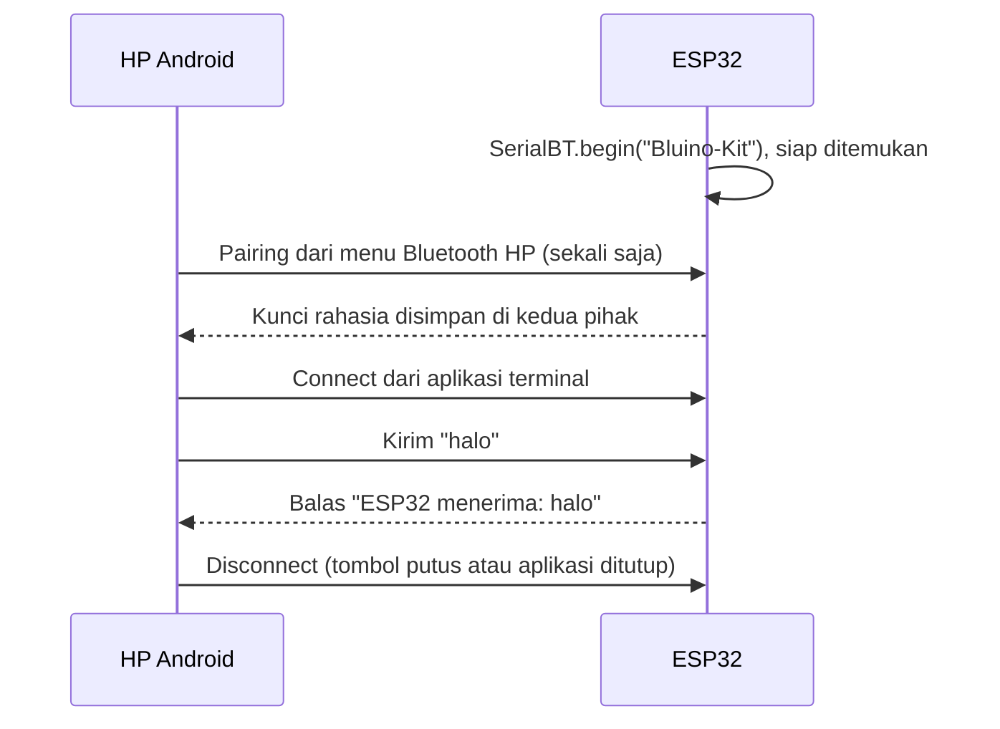
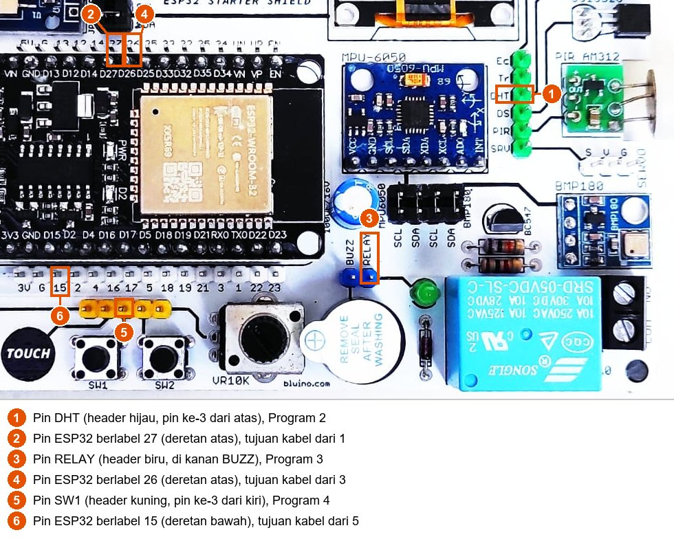
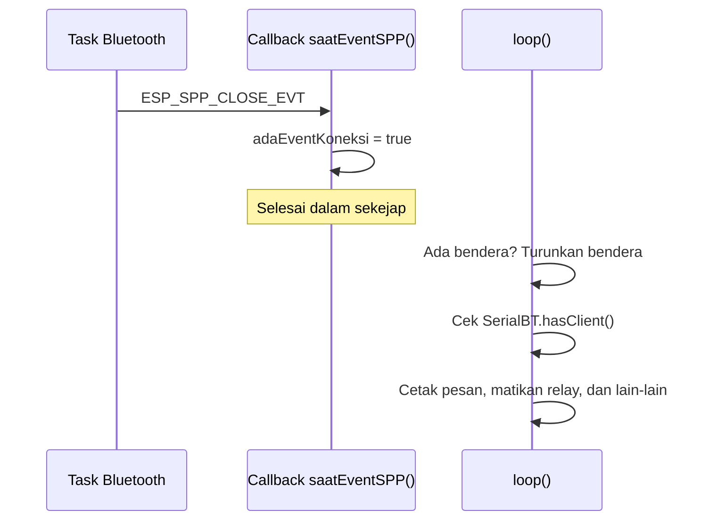

# BAB 52: Bluetooth Classic

> ✅ **Prasyarat:** Selesaikan **BAB 22 (UART / Serial Communication)** — Bluetooth Classic di BAB ini bekerja seperti *port* serial, jadi pembaca baris dan pengurai perintah dari BAB 22 dipakai lagi. Kamu juga perlu **BAB 16 (Non-Blocking Programming)** dan **BAB 18 (Callback & Event-Driven Programming)**. Program 2 memakai sensor dari **BAB 26 (DHT11 — Suhu & Kelembapan)**, Program 3 memakai *relay* beserta aturan keselamatannya dari **BAB 37 (*Relay* — Kontrol AC/DC)**, dan Program 4 memakai tombol S1 dari **BAB 9 (Digital Input — Push Button)**.

Bayangkan kabel Serial Monitor yang biasa kamu pakai diganti gelombang radio: kamu mengetik perintah di HP, lalu ESP32 menjawab — tanpa kabel, tanpa WiFi, dan tanpa internet. Itulah yang dilakukan **Bluetooth Classic** dengan profil **SPP** yang dibahas di BAB ini. Kamu akan mengenal beda Bluetooth Classic dan BLE, memahami *pairing* dan *connect*, mengobrol antara HP Android dan Serial Monitor, mengirim data DHT11 ke HP, mengendalikan *relay* dengan pengaman otomatis, lalu membuat *pairing* yang harus disetujui lewat tombol di kit. Satu hal penting sejak awal: Bluetooth Classic **tidak bisa dipakai dari iPhone** — pengguna iPhone akan memakai BLE di [BAB 53](../BAB-53/README.md).

## 📌 Tujuan Pembelajaran

Setelah mempelajari BAB ini, kamu bisa:

- Menjelaskan perbedaan Bluetooth Classic, BLE, dan WiFi, lalu memilih yang cocok untuk sebuah proyek.
- Menjelaskan SPP sebagai "kabel serial tanpa kabel" dan alasan iPhone tidak bisa memakainya.
- Membedakan *pairing* dan *connect*, serta menghapus *pairing* lama di HP maupun di ESP32.
- Memakai *library* `BluetoothSerial` bawaan *board package* esp32 dan mengatasi program yang terlalu besar dengan *partition scheme* **Huge APP**.
- Menguji ESP32 dari HP Android dengan aplikasi **Serial Bluetooth Terminal** dan dari laptop Windows lewat *port* COM Bluetooth.
- Membaca perintah dari Bluetooth tanpa menunggu (*non-blocking*) dan memeriksa argumennya.
- Mengirim data sensor secara berkala dan mengendalikan *relay* dengan pengaman saat koneksi terputus.
- Mengaktifkan *pairing* aman (SSP *numeric comparison*) yang harus dikonfirmasi lewat tombol di kit.

## 🧰 Yang Perlu Disiapkan

| Kebutuhan | Keterangan |
|---|---|
| *Hardware* | Kit Bluino ESP32 IoT Starter Shield (ESP32 DEVKIT V1 sudah terpasang di kit) + kabel USB **data**. Chip di *board* ini adalah ESP32 "klasik" yang mendukung Bluetooth Classic |
| Kabel *jumper* | 3 kabel *female-female* (sudah ada di kit): `DHT` → IO27 untuk Program 2, `RELAY` → IO26 untuk Program 3, dan `SW1` → IO15 untuk Program 4. Program 1 tidak perlu kabel |
| Komponen tambahan | **HP Android** yang punya Bluetooth (Android 5.0 atau lebih baru). Alternatif: laptop **Windows** yang punya Bluetooth. iPhone/iPad **tidak bisa** dipakai di BAB ini |
| *Software* | Arduino IDE 2.x + *board package* **esp32** versi 3.3.x (lihat [BAB 5](../BAB-05/README.md)). *Partition scheme* bawaan sudah cukup untuk semua program di BAB ini ([52.4.2](#5242-ukuran-program-dan-partition-scheme)) |
| *Library* | `BluetoothSerial` sudah bawaan *board package* esp32, tidak perlu dipasang. Program 2: **DHT sensor library** dan **Adafruit Unified Sensor** by Adafruit (cara memasang di [BAB 26](../BAB-26/README.md#265-memasang-library-dht)) |
| Alat uji | **Serial Monitor** Arduino IDE (baud 115200, *line ending* **New Line**) dan aplikasi **Serial Bluetooth Terminal** (pembuat: Kai Morich, gratis) di HP Android. Opsional: **PuTTY** di laptop Windows |
| Jaringan | Tidak perlu WiFi, *router*, maupun internet |

## 📑 Daftar Isi

- [52.1 Mengenal Bluetooth Classic](#521-mengenal-bluetooth-classic)
- [52.2 SPP: Kabel Serial Tanpa Kabel](#522-spp-kabel-serial-tanpa-kabel)
- [52.3 Pairing dan Connect: Dua Langkah Berbeda](#523-pairing-dan-connect-dua-langkah-berbeda)
- [52.4 Library BluetoothSerial](#524-library-bluetoothserial)
- [52.5 Menyiapkan HP Android: Serial Bluetooth Terminal](#525-menyiapkan-hp-android-serial-bluetooth-terminal)
- [52.6 Pembaca Baris untuk Serial dan Bluetooth](#526-pembaca-baris-untuk-serial-dan-bluetooth)
- [52.7 Program 1: Halo Bluetooth — Echo dan Obrolan](#527-program-1-halo-bluetooth--echo-dan-obrolan)
- [52.8 Menyambung dari Laptop Windows](#528-menyambung-dari-laptop-windows)
- [52.9 Program 2: Data DHT11 ke HP](#529-program-2-data-dht11-ke-hp)
- [52.10 Event Koneksi dengan register_callback()](#5210-event-koneksi-dengan-register_callback)
- [52.11 Program 3: Remote Relay dengan Pengaman](#5211-program-3-remote-relay-dengan-pengaman)
- [52.12 Keamanan Pairing: Just Works dan Numeric Comparison](#5212-keamanan-pairing-just-works-dan-numeric-comparison)
- [52.13 Program 4: Pairing dengan Konfirmasi Tombol](#5213-program-4-pairing-dengan-konfirmasi-tombol)
- [52.14 Topik Lanjutan (Opsional)](#5214-topik-lanjutan-opsional)
- [52.15 Troubleshooting](#5215-troubleshooting)
- [📝 Rangkuman](#-rangkuman)
- [💪 Latihan](#-latihan)
- [📚 Referensi](#-referensi)

---

## 52.1 Mengenal Bluetooth Classic

**Bluetooth** adalah teknologi radio jarak pendek di frekuensi 2,4 GHz — pita frekuensi yang sama dengan WiFi — untuk menghubungkan dua perangkat secara langsung, tanpa *router*. Nama "Bluetooth" sebenarnya mencakup **dua teknologi berbeda** yang tidak bisa saling bicara:

- **Bluetooth Classic** (nama resminya BR/EDR, *Basic Rate/Enhanced Data Rate*) — Bluetooth "generasi awal" yang dipakai *earphone*, *speaker*, *keyboard*, dan modul populer HC-05. Setelah tersambung, saluran datanya terus terbuka seperti orang yang sedang bertelepon, jadi cocok untuk aliran data yang terus-menerus.
- **Bluetooth Low Energy** (BLE) — Bluetooth hemat daya yang dipakai jam pintar, gelang kebugaran, dan sensor bertenaga baterai. Datanya dikirim dalam potongan kecil sesekali, seperti orang yang saling berkirim pesan singkat. BLE dibahas di [BAB 53](../BAB-53/README.md).

Chip ESP32 di kit mendukung keduanya (*dual-mode* Bluetooth 4.2). Tapi hati-hati, tidak semua anggota keluarga ESP32 begitu:

| Chip | Bluetooth Classic | BLE |
|---|---|---|
| **ESP32** (ESP32 DEVKIT V1 di kit ini) | ✅ | ✅ |
| ESP32-S3, ESP32-C3, ESP32-C6, ESP32-H2 | ❌ | ✅ |
| ESP32-S2 | ❌ | ❌ (tidak punya Bluetooth sama sekali) |

> 📌 **Catatan:** Kalau kelak kamu memakai *board* ESP32-S3 atau ESP32-C3, program di BAB ini tidak bisa di-*compile*. Untuk *board* seperti itu, pakai BLE ([BAB 53](../BAB-53/README.md)).

### 52.1.1 Bluetooth Classic, BLE, atau WiFi?

| Aspek | Bluetooth Classic (BAB ini) | BLE ([BAB 53](../BAB-53/README.md)) | WiFi ([BAB 42](../BAB-42/README.md)–[BAB 51](../BAB-51/README.md)) |
|---|---|---|---|
| Cara tersambung | Langsung HP ↔ ESP32, setelah *pairing* | Langsung HP ↔ ESP32, *pairing* tidak wajib | Lewat *router*, atau HP menyambung ke hotspot ESP32 ([BAB 43](../BAB-43/README.md)) |
| Butuh internet? | Tidak | Tidak | Tidak untuk jaringan lokal; ya untuk layanan *cloud* |
| Kecepatan | Sedang — cukup untuk teks, data sensor, bahkan audio | Rendah — cocok untuk data kecil | Tinggi |
| Konsumsi daya | Sedang; radio tetap sibuk selama tersambung | Paling hemat untuk data yang dikirim sesekali | Paling boros |
| Jangkauan | Sekitar 10 m di dalam ruangan | Sekitar 10 m di dalam ruangan | Sejauh jangkauan *router* |
| Bisa dari HP Android? | ✅ | ✅ | ✅ |
| Bisa dari iPhone? | ❌ (lihat [52.1.2](#5212-kenapa-iphone-tidak-bisa)) | ✅ | ✅ |
| *Library* di ESP32 | `BluetoothSerial` | `BLEDevice` (bawaan *board package*) | `WiFi` |
| Contoh pemakaian | Terminal teks dari HP, pengganti modul HC-05, kendali robot jarak dekat | Sensor bertenaga baterai, jam pintar, *beacon* | *Dashboard* web, MQTT, kirim data ke *cloud* |

Sebagai gambaran angka: kecepatan udara Bluetooth Classic bisa mencapai 3 Mbit/s (mode EDR), sedangkan BLE di ESP32 (Bluetooth 4.2) 1 Mbit/s. Kecepatan data yang benar-benar sampai ke aplikasi jauh lebih kecil, tetapi tetap lebih dari cukup untuk teks dan data sensor. Angka jangkauan juga hanya perkiraan: tembok, badan manusia, benda logam, dan jenis HP sangat memengaruhinya. Di ruang terbuka biasanya lebih jauh.

### 52.1.2 Kenapa iPhone Tidak Bisa?

> ⚠️ **Perhatian:** iPhone dan iPad **tidak bisa** dipakai untuk program mana pun di BAB ini.

iOS dan iPadOS hanya mendukung sejumlah profil Bluetooth Classic tertentu, misalnya untuk *headset*, *speaker*, *keyboard*, dan berbagi internet (daftar resminya ada di halaman dukungan Apple, lihat [Referensi](#-referensi)). SPP — profil yang dipakai di BAB ini — **tidak termasuk**. Aplikasi di iPhone hanya boleh berbicara lewat Bluetooth Classic dengan aksesori bersertifikat **MFi** (*Made for iPhone*) dari Apple, dan ESP32 bukan aksesori seperti itu. Jadi, aplikasi terminal apa pun di iPhone tidak akan bisa tersambung ke program di BAB ini, walaupun nama ESP32 mungkin terlihat di menu Bluetooth.

Aplikasi iPhone yang namanya mirip "Bluetooth Serial" umumnya dibuat untuk modul **BLE** (misalnya HM-10), bukan SPP. Kalau kamu hanya punya iPhone, pilihannya:

1. Pinjam HP Android, atau
2. Pakai laptop Windows yang punya Bluetooth ([52.8](#528-menyambung-dari-laptop-windows)), atau
3. Baca BAB ini sebagai teori, lalu praktikkan BLE di [BAB 53](../BAB-53/README.md) — BLE bisa dipakai dari iPhone dengan aplikasi seperti **nRF Connect for Mobile**.

---

## 52.2 SPP: Kabel Serial Tanpa Kabel

Bluetooth Classic punya banyak **profil** (*profile*), yaitu "aturan main" untuk satu jenis keperluan. Saat *earphone* menyambung ke HP, keduanya memakai profil untuk audio; saat *keyboard* Bluetooth menyambung ke laptop, keduanya memakai profil untuk perangkat input.

| Profil | Kepanjangan | Dipakai untuk |
|---|---|---|
| A2DP | *Advanced Audio Distribution Profile* | Mengalirkan musik ke *speaker*/*earphone* |
| HFP | *Hands-Free Profile* | Menelepon lewat *headset* atau mobil |
| HID | *Human Interface Device* | *Keyboard*, *mouse*, *gamepad* |
| **SPP** | ***Serial Port Profile*** | **Mengirim data seperti lewat kabel serial — dipakai di BAB ini** |

**SPP** membuat dua perangkat seolah-olah tersambung kabel serial, persis seperti UART di [BAB 22](../BAB-22/README.md), hanya saja kabelnya diganti radio. Dari sisi program, objek `SerialBT` dipakai hampir sama dengan `Serial`:


*Gambar 52.1 — ESP32 punya dua jalur serial di BAB ini: `Serial` lewat kabel USB ke Serial Monitor, dan `SerialBT` lewat radio Bluetooth ke HP. Sumber: dibuat untuk materi ini.*

| | `Serial` ([BAB 22](../BAB-22/README.md)) | `SerialBT` (BAB ini) |
|---|---|---|
| Jalur | Kabel USB ke laptop | Radio Bluetooth ke HP atau laptop |
| Memulai | `Serial.begin(115200)` — diisi *baud rate* | `SerialBT.begin("Bluino-Kit")` — diisi **nama perangkat** |
| Ada data masuk? | `Serial.available()` | `SerialBT.available()` |
| Membaca 1 *byte* | `Serial.read()` | `SerialBT.read()` |
| Mengirim teks | `Serial.println("...")` | `SerialBT.println("...")` |
| Lawan bicara | Serial Monitor | Aplikasi Serial Bluetooth Terminal, PuTTY, atau ESP32 lain |

Tiga hal yang berbeda dari kabel serial biasa:

- **Tidak ada *baud rate*.** Kecepatannya diatur oleh radio Bluetooth. Kalau aplikasi atau PuTTY menanyakan *baud rate*, isi berapa saja — tidak berpengaruh.
- **Hanya satu lawan bicara pada satu waktu.** *Library* `BluetoothSerial` melayani **satu** koneksi SPP. Kalau HP kedua mencoba tersambung saat HP pertama masih tersambung, koneksi HP kedua langsung diputus.
- **Data yang dikirim saat belum ada yang tersambung dibuang**, tidak disimpan untuk nanti.

---

## 52.3 Pairing dan Connect: Dua Langkah Berbeda

Pemula sering bingung karena HP menampilkan ESP32 sebagai "dipasangkan", tetapi aplikasi belum bisa berkirim data. Itu karena ada **dua langkah** yang berbeda:

- ***Pairing*** (memasangkan) ibarat **berkenalan dan saling menyimpan nomor telepon**. Kedua perangkat membuat kunci rahasia bersama, lalu menyimpannya. Cukup dilakukan sekali. Penyimpanan kunci ini disebut ***bonding***.
- ***Connect*** (menyambung) ibarat **menelepon**. Saluran data dibuka setiap kali kamu mau berkirim data, lalu ditutup lagi setelah selesai.

| | *Pairing* | *Connect* |
|---|---|---|
| Gunanya | Saling mengenal dan membuat kunci rahasia | Membuka saluran data SPP |
| Dilakukan di | Menu Bluetooth HP atau Windows | Aplikasi terminal (Serial Bluetooth Terminal, PuTTY, Serial Monitor) |
| Berapa kali | Sekali saja; kuncinya disimpan | Setiap kali mau berkirim data |
| Tanda berhasil | Nama ESP32 muncul di daftar perangkat yang dipasangkan | Aplikasi menulis **Connected**, ESP32 mencetak "Perangkat tersambung" |



*Gambar 52.2 — Urutan pairing, connect, berkirim data, dan disconnect. Pairing hanya sekali; connect dan disconnect bisa berulang kali. Sumber: dibuat untuk materi ini.*

Akibat yang perlu kamu ingat:

- Setelah *pairing*, menu Bluetooth HP sering **tidak** menampilkan tulisan "Terhubung". Itu normal — saluran datanya baru dibuka oleh aplikasi.
- Kunci *pairing* disimpan di **dua** tempat: di HP **dan** di memori NVS ESP32 ([BAB 39](../BAB-39/README.md)). Kunci di ESP32 tidak hilang walaupun listrik dicabut atau program di-*upload* ulang.
- Kalau salah satu pihak kehilangan kuncinya (misalnya kamu menekan **Lupakan** di HP), *pairing* harus diulang. Kadang kunci di kedua pihak perlu dihapus dulu ([52.12](#5212-keamanan-pairing-just-works-dan-numeric-comparison)).

> 📌 **Catatan soal PIN:** Banyak tutorial lama menyuruh memasukkan PIN `1234` atau `0000`. Itu cara *pairing* lama (*legacy pairing*) yang **tidak didukung** `BluetoothSerial` sejak *board package* esp32 versi 3.0. Sekarang dipakai **SSP** (*Secure Simple Pairing*). Dengan pengaturan bawaan, ESP32 menerima *pairing* secara otomatis (cara ini disebut *Just Works*): HP menampilkan kotak permintaan *pairing* — kadang disertai angka 6 digit — dan kamu cukup menekan **Sambungkan**/**Pasangkan**/**Pair**. Tidak ada PIN yang perlu diketik.

---

## 52.4 Library BluetoothSerial

*Library* `BluetoothSerial` sudah ikut terpasang bersama *board package* esp32, jadi tidak perlu dicari di Library Manager. Cukup tulis `#include <BluetoothSerial.h>` di baris paling atas program.

### 52.4.1 Fungsi yang Paling Sering Dipakai

| Kode | Gunanya |
|---|---|
| `BluetoothSerial SerialBT;` | Membuat objek bernama `SerialBT`. Namanya bebas, tetapi `SerialBT` paling umum dipakai |
| `SerialBT.begin("Bluino-Kit")` | Menyalakan Bluetooth Classic dengan nama itu. Hasilnya `true` kalau berhasil |
| `SerialBT.hasClient()` | `true` kalau saat ini ada perangkat yang tersambung |
| `SerialBT.available()` | Jumlah *byte* yang sudah diterima dan menunggu dibaca |
| `SerialBT.read()` | Mengambil 1 *byte* dari *buffer* penerima; hasilnya `-1` kalau kosong |
| `SerialBT.print()`, `println()`, `printf()` | Mengirim teks. `println()` menambahkan `\r\n` (CR lalu LF) di akhir |
| `SerialBT.write(data, panjang)` | Mengirim *byte* mentah |
| `SerialBT.register_callback(fungsi)` | Mendaftarkan *callback* untuk *event* SPP, misalnya saat perangkat tersambung atau terputus ([52.10](#5210-event-koneksi-dengan-register_callback)) |
| `SerialBT.getBtAddressString()` | Alamat MAC (*Media Access Control*) Bluetooth ESP32 — "nomor identitas" unik sepanjang 6 *byte* — dalam bentuk teks, misalnya `24:6F:28:AA:BB:CE` |
| `SerialBT.end()` | Mematikan Bluetooth Classic |

Beberapa sifat yang perlu diketahui:

- **Mengirim saat tidak ada yang tersambung tidak menimbulkan *error*.** Datanya dibuang, dan fungsi kirim melaporkan 0 *byte* terkirim.
- ***Buffer* penerima berukuran 512 *byte*.** Kalau penuh karena program jarang membacanya, data baru dibuang. Karena itu, baca data Bluetooth di setiap putaran `loop()`.
- **`readString()` dan `readStringUntil()` bisa menunggu sampai 1 detik**, sama seperti pada `Serial` di [BAB 22](../BAB-22/README.md). Selama menunggu, program tidak bisa mengerjakan hal lain. Di BAB ini kita memakai pembaca baris *non-blocking* ([52.6](#526-pembaca-baris-untuk-serial-dan-bluetooth)).
- **`SerialBT.onData(fungsi)`** adalah cara lain menerima data. Kalau dipakai, semua data masuk diserahkan ke fungsi itu dan **tidak** lagi masuk ke `available()`/`read()`. Fungsi ini tidak dipakai di BAB ini.

### 52.4.2 Ukuran Program dan Partition Scheme

Program Bluetooth Classic berukuran besar, karena seluruh "mesin" Bluetooth (*Bluetooth stack*) ikut masuk ke program. Setelah *compile*, lihat baris terakhir di panel **Output**. Untuk Program 1 yang pendek, isinya kira-kira:

```text
Sketch uses 1062316 bytes (81%) of program storage space. Maximum is 1310720 bytes.
```

Artinya, program sederhana pun sudah memakai sekitar 1 MB atau **81 %** ruang program bawaan (1280 KB; pembagian *flash* ini dibahas di [BAB 20](../BAB-20/README.md#2022-flash-4-mb-dan-tabel-partisi)). Semua program di BAB ini masih muat, jadi kamu **tidak perlu** mengubah pengaturan apa pun. Angka persisnya bisa sedikit berbeda, tergantung versi *board package* dan *library*.

Namun, begitu kamu menambah banyak fitur — misalnya menggabungkan Bluetooth Classic dengan WiFi, *web server*, dan OLED — ruangnya cepat habis dan *compile* gagal dengan pesan seperti ini:

```text
Sketch too big; see https://support.arduino.cc/hc/en-us/articles/360013825179 for tips on reducing it.
text section exceeds available space in board
```

Solusinya: pilih pembagian *flash* (*partition scheme*) yang memberi ruang program lebih besar.

1. Di Arduino IDE, pastikan **Tools → Board** = **ESP32 Dev Module**.
2. Buka **Tools → Partition Scheme**, lalu pilih **Huge APP (3MB No OTA/1MB SPIFFS)**.
3. *Compile* atau *upload* ulang.

| *Partition scheme* | Ruang program | Update program lewat WiFi (OTA) | Ruang *file* (SPIFFS/LittleFS) |
|---|---|---|---|
| `Default 4MB with spiffs (1.2MB APP/1.5MB SPIFFS)` — bawaan, dipakai di BAB ini | 1280 KB | Bisa | 1408 KB |
| `Huge APP (3MB No OTA/1MB SPIFFS)` — kalau program terlalu besar | 3072 KB | Tidak bisa | 896 KB |

> ⚠️ **Perhatian:** Pilihan **Partition Scheme** diingat Arduino IDE untuk *board* yang sedang dipilih, jadi kembalikan ke pilihan bawaan setelah selesai. Saat *partition scheme* diganti, letak area *file* ikut berubah: *file* LittleFS yang pernah kamu simpan di [BAB 40](../BAB-40/README.md) tidak akan terbaca dan area itu perlu diformat ulang. Data NVS/Preferences ([BAB 39](../BAB-39/README.md)) tetap aman karena letaknya sama di kedua pilihan.

### 52.4.3 Peringatan "deprecated" Saat Compile

Saat program Bluetooth Classic di-*compile*, panel **Output** menampilkan peringatan (*warning*) seperti ini:

```text
warning: 'BluetoothSerial' is deprecated: BluetoothSerial won't be supported in version 4.0.0 by default [-Wdeprecated-declarations]
```

Ini **bukan *error***: program tetap selesai di-*compile*, ter-*upload*, dan berjalan normal di *board package* 3.3.x. Artinya, pembuat *board package* esp32 berencana **tidak lagi menyertakan** `BluetoothSerial` secara bawaan di versi besar berikutnya (4.0.0). Untuk proyek jangka panjang, BLE ([BAB 53](../BAB-53/README.md)) adalah pilihan yang lebih aman. Untuk belajar dan untuk menggantikan modul HC-05, Bluetooth Classic tetap sangat berguna.

---

## 52.5 Menyiapkan HP Android: Serial Bluetooth Terminal

Untuk berbicara dengan ESP32, HP butuh aplikasi terminal yang mendukung SPP. Di BAB ini kita memakai **Serial Bluetooth Terminal** buatan **Kai Morich**: gratis (pembelian di dalam aplikasi hanya untuk donasi), tanpa perlu akun, dan bisa dipakai di Android 5.0 atau lebih baru.

### 52.5.1 Memasang Aplikasi

1. Buka **Google Play Store** di HP Android.
2. Cari `Serial Bluetooth Terminal`.
3. Pilih aplikasi yang pembuatnya **Kai Morich** (ikon terminal hitam). Ada beberapa aplikasi dengan nama mirip — pastikan nama pembuatnya benar.
4. Ketuk **Instal**.

> 💡 **Tips:** Saat aplikasi pertama kali dibuka atau saat kamu membuka daftar perangkat, Android bisa meminta izin **Perangkat di sekitar** (*Nearby devices*) atau izin lokasi (di Android versi lama). Pilih **Izinkan**. Tanpa izin ini, daftar perangkat Bluetooth di aplikasi akan kosong.

### 52.5.2 Pairing dari Menu Bluetooth HP

*Pairing* dilakukan dari menu Bluetooth HP, **bukan** dari aplikasi terminal. Lakukan ini setelah Program 1 ([52.7](#527-program-1-halo-bluetooth--echo-dan-obrolan)) berjalan di ESP32, karena ESP32 baru bisa ditemukan setelah programnya menyalakan Bluetooth.

1. Buka **Setelan** (*Settings*) HP → menu **Bluetooth**. Letaknya berbeda-beda antarmerek, misalnya **Perangkat terhubung** → **Sambungkan perangkat baru** (Android standar) atau **Koneksi** → **Bluetooth** (Samsung).
2. Nyalakan Bluetooth, lalu tunggu daftar **Perangkat yang tersedia** muncul. Kalau perlu, ketuk **Pindai**/**Scan**.
3. Ketuk **Bluino-Kit** di daftar itu.
4. Muncul kotak permintaan *pairing* (kadang dengan angka 6 digit). Ketuk **Sambungkan**/**Pasangkan**/**Pair**.
5. **Bluino-Kit** sekarang pindah ke daftar perangkat yang sudah dipasangkan (*paired devices*). Tulisan "Terhubung" mungkin tidak muncul — itu normal.

### 52.5.3 Connect dan Mengirim Teks

1. Buka aplikasi **Serial Bluetooth Terminal**.
2. Ketuk ikon menu **☰** di kiri atas, lalu pilih **Devices**.
3. Pilih tab **Bluetooth Classic**. Daftar ini berisi perangkat yang sudah dipasangkan di langkah sebelumnya.
4. Ketuk **Bluino-Kit**. Aplikasi kembali ke layar terminal dan menampilkan status sedang menyambung (*connecting*), lalu **Connected** kalau berhasil.
5. Ketik teks di kolom bawah, lalu ketuk tombol kirim (ikon panah) di sebelah kanannya.
6. Untuk memutus sambungan, ketuk ikon sambung/putus (bergambar steker) di bilah atas. Ikon yang sama dipakai untuk menyambung lagi ke perangkat terakhir.

> 📌 **Catatan:** Kalau **Bluino-Kit** tidak ada di tab **Bluetooth Classic**, berarti *pairing* belum dilakukan atau gagal. Ulangi [52.5.2](#5252-pairing-dari-menu-bluetooth-hp). Jangan memilih tab **Bluetooth LE** — ESP32 di BAB ini tidak memakai BLE.

### 52.5.4 Line Ending di Aplikasi

Sama seperti Serial Monitor di [BAB 22](../BAB-22/README.md#225-line-ending-di-serial-monitor), aplikasi menambahkan karakter akhir baris (*newline*) setiap kali kamu menekan tombol kirim. Pengaturannya ada di menu **☰** → **Settings**:

| Pengaturan | Pilihan | Saran untuk BAB ini |
|---|---|---|
| **Newline** di bagian **Send** (data yang kamu kirim) | **CR**, **LF**, **CR+LF**, atau **None** | **CR+LF** atau **LF**. Program di BAB ini menerima CR, LF, maupun CR+LF. **Jangan None** — tanpa akhir baris, program tidak tahu kapan perintahmu selesai |
| **Newline** di bagian **Receive** (data dari ESP32) | **CR**, **LF**, **CR+LF**, atau **None** | **CR+LF**, karena ESP32 mengakhiri setiap baris dengan `\r\n` (`println()`) |

Nama dan letak menu bisa sedikit berbeda antarversi aplikasi, tetapi kata kuncinya selalu **Newline**.

### 52.5.5 Tombol Makro (Opsional)

Di atas kolom ketik ada deretan tombol **M1**, **M2**, dan seterusnya. Tombol ini bisa diisi perintah yang sering dipakai, misalnya `nyala` dan `mati` untuk Program 3, sehingga cukup diketuk tanpa mengetik. Tekan lama sebuah tombol makro untuk mengisinya: isi **Name** (label tombol) dan **Value** (teks yang dikirim), lalu simpan.

---

## 52.6 Pembaca Baris untuk Serial dan Bluetooth

Di [BAB 22](../BAB-22/README.md#2292-pembaca-baris-non-blocking) kamu membuat fungsi `bacaBaris()` yang mengumpulkan karakter dari Serial Monitor tanpa menunggu, lalu melapor saat satu baris lengkap. Di BAB ini kita butuh dua pembaca sekaligus: satu untuk `SerialBT` (dari HP) dan satu untuk `Serial` (dari Serial Monitor). Supaya tidak menulis kode yang sama dua kali, pembacanya dibungkus dalam sebuah `struct` dengan fungsi di dalamnya — pola yang sama dengan `struct Timer` di [BAB 16](../BAB-16/README.md#1682-fungsi-di-dalam-struct):

```cpp
struct PembacaBaris {
  char isi[64];     // teks C: maksimal 63 karakter + '\0'
  int panjang = 0;  // jumlah karakter yang sudah terkumpul

  // Hasilnya true kalau satu baris lengkap sudah siap di 'isi'
  bool baca(Stream &sumber) {
    while (sumber.available() > 0) {
      char c = sumber.read();
      if (c == '\r' || c == '\n') {   // CR atau LF = akhir baris
        if (panjang == 0) continue;   // baris kosong: lewati
        isi[panjang] = '\0';          // tutup teks dengan karakter nol
        panjang = 0;                  // siap untuk baris berikutnya
        return true;
      }
      if (panjang < (int)sizeof(isi) - 1) {   // sisakan 1 tempat untuk '\0'
        isi[panjang] = c;
        panjang = panjang + 1;
      }                                       // kalau penuh, karakter dibuang
    }
    return false;                             // baris belum lengkap
  }
};

PembacaBaris dariHP;      // satu pembaca untuk Bluetooth
PembacaBaris dariLaptop;  // satu lagi untuk Serial Monitor

// di loop():
if (dariHP.baca(SerialBT))    { /* dariHP.isi berisi satu baris dari HP */ }
if (dariLaptop.baca(Serial))  { /* dariLaptop.isi berisi satu baris dari Serial Monitor */ }
```

Hal baru di sini adalah parameter `Stream &sumber`:

- **`Stream`** adalah "induk" dari semua jalur serial di Arduino. `Serial`, `Serial2`, dan `SerialBT` sama-sama turunan `Stream`, jadi semuanya punya `available()` dan `read()`. Karena itu, satu fungsi `baca()` bisa dipakai untuk jalur mana pun.
- Tanda **`&`** berarti fungsi menerima objek **aslinya** (*reference*), bukan salinan. Membaca dari `sumber` sama dengan membaca langsung dari `SerialBT` atau `Serial`.
- Setiap pembaca menyimpan `isi` dan `panjang`-nya sendiri, sehingga baris dari HP dan baris dari Serial Monitor tidak tercampur walaupun datang bersamaan.

Seperti di BAB 22, CR maupun LF dianggap akhir baris dan baris kosong dilewati. Jadi pengaturan *newline* **CR**, **LF**, atau **CR+LF** di aplikasi semuanya bekerja.

---

## 52.7 Program 1: Halo Bluetooth — Echo dan Obrolan

**Tujuan:** Menjadikan ESP32 perangkat Bluetooth Classic bernama `Bluino-Kit`. Teks yang dikirim dari HP ditampilkan di Serial Monitor, lalu dibalas kembali ke HP (*echo*). Sebaliknya, teks yang kamu ketik di Serial Monitor dikirim ke HP, sehingga laptop dan HP bisa "mengobrol" lewat ESP32. LED biru bawaan *board* menyala selama ada perangkat yang tersambung.

**Rangkaian:**

*Tidak perlu merangkai — program ini hanya memakai LED biru bawaan board ESP32 (IO2).* Kalau kabel `LED3` (biru) → IO2 dari [BAB 8](../BAB-08/README.md) masih terpasang, LED biru kit ikut menyala.

**Cara Menjalankan:**

1. Buka Arduino IDE → **File → New Sketch**, hapus isinya, lalu salin kode di bawah. Kode yang sama juga tersedia di *file* [`p1_bt_echo.ino`](p1_bt_echo/p1_bt_echo.ino).
2. Pastikan **Tools → Board** = **ESP32 Dev Module** dan **Tools → Port** = *port* ESP32 kamu (misalnya `COM5` di Windows atau `/dev/ttyUSB0` di Linux).
3. Klik tombol **Upload** (ikon panah →) dan tunggu sampai muncul tulisan **Done uploading**. *Compile* program Bluetooth lebih lama daripada biasanya. Peringatan `'BluetoothSerial' is deprecated` di panel **Output** boleh diabaikan ([52.4.3](#5243-peringatan-deprecated-saat-compile)).
4. Buka **Serial Monitor** (**Tools → Serial Monitor**), pilih baud **115200** dan *line ending* **New Line**.
5. Di HP Android: lakukan *pairing* dengan **Bluino-Kit** ([52.5.2](#5252-pairing-dari-menu-bluetooth-hp)), lalu *connect* dari aplikasi Serial Bluetooth Terminal ([52.5.3](#5253-connect-dan-mengirim-teks)).
6. Ketik `halo esp32` di aplikasi dan kirim. Lalu ketik `halo juga dari laptop` di kolom pesan Serial Monitor dan tekan **Enter**.

**Kode Program:**

<!-- sketch: p1_bt_echo -->
```cpp
/*
 * BAB 52 - Program 1: Halo Bluetooth — Echo dan Obrolan
 * ESP32 menjadi perangkat Bluetooth Classic (SPP) bernama "Bluino-Kit".
 *   - Teks dari HP ditampilkan di Serial Monitor, lalu dibalas ke HP (echo).
 *   - Teks yang diketik di Serial Monitor dikirim ke HP.
 *   - LED biru bawaan board (IO2) menyala selama ada perangkat tersambung.
 *
 * Board: ESP32 Dev Module (chip ESP32 "klasik", bukan S3/C3/C6)
 * Alat uji: Serial Monitor (115200, line ending New Line) dan aplikasi
 *           Serial Bluetooth Terminal di HP Android
 */

#include <BluetoothSerial.h>

// Pemeriksaan saat compile: Bluetooth Classic hanya ada di chip ESP32 "klasik"
#if !defined(CONFIG_BT_SPP_ENABLED)
#error "Bluetooth Classic (SPP) tidak tersedia. Pilih Tools > Board > ESP32 Dev Module."
#endif

#define LED_BIRU 2  // LED biru bawaan board (juga LED3 kit kalau disambung ke IO2)

const char *NAMA_BT = "Bluino-Kit";  // nama yang muncul saat HP mencari perangkat

BluetoothSerial SerialBT;

// Pengumpul satu baris teks tanpa menunggu (pola dari BAB 22).
// Bisa dipakai untuk Serial maupun SerialBT karena keduanya turunan Stream.
struct PembacaBaris {
  char isi[64];     // teks C: maksimal 63 karakter + '\0'
  int panjang = 0;  // jumlah karakter yang sudah terkumpul

  // Hasilnya true kalau satu baris lengkap sudah siap di 'isi'
  bool baca(Stream &sumber) {
    while (sumber.available() > 0) {
      char c = sumber.read();
      if (c == '\r' || c == '\n') {   // CR atau LF = akhir baris
        if (panjang == 0) continue;   // baris kosong: lewati
        isi[panjang] = '\0';          // tutup teks dengan karakter nol
        panjang = 0;                  // siap untuk baris berikutnya
        return true;
      }
      if (panjang < (int)sizeof(isi) - 1) {   // sisakan 1 tempat untuk '\0'
        isi[panjang] = c;
        panjang = panjang + 1;
      }                                       // kalau penuh, karakter dibuang
    }
    return false;                             // baris belum lengkap
  }
};

PembacaBaris dariHP;      // baris dari HP (lewat Bluetooth)
PembacaBaris dariLaptop;  // baris dari Serial Monitor (lewat kabel USB)
bool adaKoneksi = false;  // keadaan koneksi pada putaran loop() sebelumnya

void setup() {
  Serial.begin(115200);
  pinMode(LED_BIRU, OUTPUT);
  digitalWrite(LED_BIRU, LOW);

  Serial.println();
  Serial.println("BAB 52 - Program 1: Halo Bluetooth - Echo dan Obrolan");

  if (!SerialBT.begin(NAMA_BT)) {
    Serial.println("Bluetooth gagal dinyalakan. Tekan tombol EN untuk mencoba lagi.");
    while (true) {
      delay(1000);  // program berhenti di sini
    }
  }

  Serial.printf("Bluetooth siap. Nama: %s\n", NAMA_BT);
  Serial.printf("Alamat MAC Bluetooth: %s\n", SerialBT.getBtAddressString().c_str());
  Serial.println("Lakukan pairing dari HP, lalu connect dari aplikasi Serial Bluetooth Terminal.");
}

void loop() {
  // 1. Pantau perubahan koneksi (polling)
  bool tersambung = SerialBT.hasClient();
  if (tersambung != adaKoneksi) {
    adaKoneksi = tersambung;
    digitalWrite(LED_BIRU, tersambung ? HIGH : LOW);
    if (tersambung) {
      Serial.println("[BT] Perangkat tersambung.");
      SerialBT.printf("Halo! Kamu tersambung ke %s.\r\n", NAMA_BT);
      SerialBT.println("Ketik apa saja, ESP32 akan membalasnya.");
    } else {
      Serial.println("[BT] Perangkat terputus.");
    }
  }

  // 2. Baris dari HP: tampilkan di Serial Monitor, lalu balas ke HP
  if (dariHP.baca(SerialBT)) {
    Serial.printf("[HP] %s\n", dariHP.isi);
    SerialBT.printf("ESP32 menerima: %s\r\n", dariHP.isi);
  }

  // 3. Baris dari Serial Monitor: kirim ke HP
  if (dariLaptop.baca(Serial)) {
    if (adaKoneksi) {
      SerialBT.printf("[Laptop] %s\r\n", dariLaptop.isi);
      Serial.printf("[Terkirim ke HP] %s\n", dariLaptop.isi);
    } else {
      Serial.println("Belum ada perangkat yang tersambung - teks tidak dikirim.");
    }
  }
}
```

**Penjelasan Kode:**

- `#if !defined(CONFIG_BT_SPP_ENABLED)` … `#error` adalah pemeriksaan saat *compile*. Kalau kamu tidak sengaja memilih *board* yang tidak punya Bluetooth Classic (misalnya ESP32-S3), *compile* langsung berhenti dengan pesan yang jelas, bukan *error* panjang yang membingungkan.
- `SerialBT.begin(NAMA_BT)` menyalakan Bluetooth Classic dan membuat ESP32 bisa ditemukan dengan nama `Bluino-Kit`. Nama boleh kamu ganti; sebaiknya pendek (maksimal sekitar 20 karakter), tanpa emoji, dan berbeda dari ESP32 milik teman sekelasmu supaya tidak tertukar. Kalau `begin()` gagal, program mencetak pesan lalu berhenti, alih-alih berjalan tanpa Bluetooth.
- `getBtAddressString()` mencetak alamat MAC Bluetooth ESP32. Alamat ini berguna untuk membedakan ESP32 yang namanya sama.
- **Polling koneksi:** di setiap putaran `loop()`, `hasClient()` ditanya "ada yang tersambung?". Hasilnya dibandingkan dengan `adaKoneksi` (jawaban putaran sebelumnya). Pesan hanya dicetak saat jawabannya **berubah** — teknik deteksi perubahan yang sama dengan deteksi tombol ditekan di [BAB 9](../BAB-09/README.md). Begitu ada yang tersambung, ESP32 langsung mengirim salam ke HP.
- `dariHP.baca(SerialBT)` dan `dariLaptop.baca(Serial)` memakai pembaca baris dari [52.6](#526-pembaca-baris-untuk-serial-dan-bluetooth). Keduanya tidak pernah menunggu, jadi `loop()` terus berputar dan perubahan koneksi tetap terpantau.
- Ke HP, teks dikirim dengan `printf()` yang diakhiri `\r\n`, atau dengan `println()` yang otomatis menambahkan `\r\n`. Ke Serial Monitor cukup `\n`.
- Teks dari Serial Monitor hanya dikirim kalau ada yang tersambung. Kalau tidak, program memberi tahu bahwa teks tidak terkirim — karena `SerialBT` akan membuangnya diam-diam.

**Contoh Output:**

Di Serial Monitor:

```text
BAB 52 - Program 1: Halo Bluetooth - Echo dan Obrolan
Bluetooth siap. Nama: Bluino-Kit
Alamat MAC Bluetooth: 24:6F:28:AA:BB:CE
Lakukan pairing dari HP, lalu connect dari aplikasi Serial Bluetooth Terminal.
[BT] Perangkat tersambung.
[HP] halo esp32
[Terkirim ke HP] halo juga dari laptop
[BT] Perangkat terputus.
```

Di aplikasi Serial Bluetooth Terminal (aplikasi bisa menambahkan jam di depan setiap baris dan mewarnai teks yang kamu kirim):

```text
Connected
Halo! Kamu tersambung ke Bluino-Kit.
Ketik apa saja, ESP32 akan membalasnya.
halo esp32
ESP32 menerima: halo esp32
[Laptop] halo juga dari laptop
```

Alamat MAC di atas hanya contoh — alamat ESP32 milikmu pasti berbeda. Di kit: LED biru kecil di *board* menyala saat aplikasi tersambung dan padam lagi saat sambungan diputus. Baris `halo esp32` di aplikasi adalah teks yang kamu kirim sendiri (fitur *local echo* aplikasi), sedangkan `ESP32 menerima: ...` adalah balasan dari ESP32.

> 🧪 **Coba Sendiri:**
>
> - Putus sambungan dari aplikasi, lalu ketik sesuatu di Serial Monitor. Muncul pesan `Belum ada perangkat yang tersambung - teks tidak dikirim.`
> - Jauhkan HP dari ESP32 sambil sesekali mengirim teks. Perkirakan pada jarak berapa sambungan mulai tersendat atau terputus di tempatmu.
> - Minta teman *pairing* ke ESP32-mu saat HP-mu masih tersambung. Aplikasi temanmu akan gagal tersambung, karena `BluetoothSerial` hanya melayani satu perangkat.

**Kalau Belum Berhasil:**

- ***Compile* gagal dengan `Bluetooth Classic (SPP) tidak tersedia`** → *board* yang dipilih bukan **ESP32 Dev Module** (misalnya ESP32-S3 atau ESP32-C3). Pilih **Tools → Board → esp32 → ESP32 Dev Module**.
- **`Bluino-Kit` tidak muncul di menu Bluetooth HP** → pastikan Serial Monitor sudah menampilkan `Bluetooth siap`. Tunggu beberapa detik lalu pindai ulang, dan dekatkan HP ke kit. Kalau ESP32 sudah pernah dipasangkan, namanya tidak muncul di **Perangkat yang tersedia**, melainkan di daftar perangkat yang sudah dipasangkan.
- **Aplikasi menampilkan `Connection failed` atau sejenisnya** → pastikan kamu memilih tab **Bluetooth Classic** (bukan **Bluetooth LE**) dan tidak ada perangkat lain (misalnya laptop) yang sedang tersambung ke ESP32. Kalau tetap gagal, lakukan **Lupakan**/**Unpair** di HP, tekan tombol **EN** di *board*, lalu *pairing* ulang.
- **Teks dari HP baru muncul setelah kamu mengirim teks berikutnya, atau tidak muncul sama sekali** → *newline* pengiriman di aplikasi masih **None**. Ubah menjadi **CR+LF** atau **LF** ([52.5.4](#5254-line-ending-di-aplikasi)).

---

## 52.8 Menyambung dari Laptop Windows

Laptop Windows yang punya Bluetooth juga bisa berbicara dengan ESP32 lewat SPP. Setelah *pairing*, Windows membuat ***port* COM virtual** — *port* serial "palsu" yang datanya sebenarnya dikirim lewat Bluetooth. *Port* itu bisa dibuka dengan aplikasi terminal serial apa pun, termasuk Serial Monitor Arduino IDE. Cara ini juga berguna kalau kamu hanya punya iPhone.

> ⚠️ **Perhatian:** Ada laporan pengguna bahwa dengan *board package* esp32 versi 3.x, *port* COM Bluetooth di **Windows 11** gagal dibuka atau sambungannya putus setelah beberapa detik, sedangkan di Windows 10 dan di HP Android berjalan normal (lihat diskusi di [Referensi](#-referensi)). Belum ada perbaikan resmi. Kalau kamu mengalaminya, pakai HP Android sebagai alat uji utama.

### 52.8.1 Pairing di Windows

Jalankan Program 1 di ESP32 terlebih dahulu, lalu:

1. **Windows 11:** buka **Settings** (tombol Start → ikon roda gigi) → **Bluetooth & devices** → **Add device** → **Bluetooth**. **Windows 10:** buka **Settings** → **Devices** → **Bluetooth & other devices** → **Add Bluetooth or other device** → **Bluetooth**.
2. Tunggu sampai **Bluino-Kit** muncul, lalu klik namanya.
3. Kalau Windows menampilkan angka dan meminta konfirmasi, klik **Connect**/**Yes**. Tunggu sampai muncul tulisan seperti **Your device is ready to go**, lalu klik **Done**.

> 💡 **Tips:** Kalau **Bluino-Kit** tidak muncul di Windows 11, buka **Settings → Bluetooth & devices → Devices**, lalu ubah **Bluetooth devices discovery** menjadi **Advanced**, kemudian ulangi langkah 1.

### 52.8.2 Mencari Nomor Port COM Bluetooth

Windows biasanya membuat **dua** *port* COM untuk satu perangkat SPP: ***Outgoing*** (laptop yang memulai sambungan) dan ***Incoming*** (perangkat lain yang memulai sambungan ke laptop). Yang kamu pakai adalah ***Outgoing***.

1. Buka **Settings → Bluetooth & devices → Devices**, gulir ke bawah, lalu klik **More Bluetooth settings** (di Windows 10: **Settings → Devices → Bluetooth & other devices → More Bluetooth options**).
2. Di jendela yang muncul, buka tab **COM Ports**.
3. Cari baris dengan **Direction** = **Outgoing** dan **Name** berisi `Bluino-Kit 'ESP32SPP'` (`ESP32SPP` adalah nama layanan SPP buatan *library* `BluetoothSerial`). Catat nomor *port*-nya, misalnya `COM8`.
4. Kalau tidak ada baris *Outgoing*, klik **Add…** → pilih **Outgoing** → **Browse…** → pilih **Bluino-Kit** → pilih layanan **ESP32SPP** → **OK**.

*Port* COM Bluetooth juga terlihat di **Device Manager** (klik kanan tombol Start → **Device Manager** → **Ports (COM & LPT)**) dengan nama **Standard Serial over Bluetooth link (COM8)**. Di sana kamu tidak bisa membedakan mana yang *Outgoing*, jadi lebih mudah memakai tab **COM Ports** di atas.

### 52.8.3 Membuka Port COM Bluetooth

**Cara A — Serial Monitor Arduino IDE.** Satu jendela Arduino IDE hanya bisa membuka satu *port*. Supaya log ESP32 (lewat USB) tetap terlihat, pakai dua jendela:

1. Biarkan jendela pertama tetap memakai *port* USB ESP32 (misalnya `COM5`) dengan Serial Monitor terbuka.
2. Buka jendela kedua: **File → New Sketch**. Di jendela baru ini, pilih **Tools → Port → COM8** (*port* Bluetooth *Outgoing*), lalu buka **Tools → Serial Monitor** dengan *line ending* **New Line**. Angka baud boleh berapa saja.
3. Tunggu beberapa detik. Saat *port* dibuka, Windows menyambung ke ESP32: jendela pertama menampilkan `[BT] Perangkat tersambung.` dan jendela kedua menerima salam dari ESP32.
4. Ketik teks di Serial Monitor jendela kedua dan tekan **Enter** — teks itu dikirim lewat Bluetooth.

> ⚠️ **Perhatian:** Jangan meng-*upload* dari jendela kedua — *port* Bluetooth tidak bisa dipakai untuk *upload*. Untuk *upload*, gunakan jendela pertama yang memakai *port* USB.

**Cara B — PuTTY.** PuTTY adalah aplikasi terminal gratis untuk Windows. Unduh dari situs resminya (lihat [Referensi](#-referensi)), pasang, lalu:

1. Buka PuTTY. Di halaman **Session**, pilih **Connection type: Serial**.
2. Isi **Serial line** dengan `COM8` (nomor *port* Bluetooth *Outgoing* milikmu) dan **Speed** dengan `115200` (angka ini tidak berpengaruh untuk Bluetooth).
3. Di kategori **Terminal**, ubah **Local echo** dan **Local line editing** menjadi **Force on** supaya teks yang kamu ketik terlihat dan baru dikirim setelah menekan **Enter**.
4. Klik **Open**. Ketik teks, lalu tekan **Enter**.

Saat Serial Monitor jendela kedua atau PuTTY ditutup, sambungan Bluetooth ikut terputus. Ingat juga: ESP32 hanya melayani satu sambungan. Kalau HP sedang tersambung, laptop tidak bisa membuka *port*-nya, dan sebaliknya.

> 📌 **Catatan:** macOS dan Linux juga bisa membuat *port* serial Bluetooth, tetapi caranya berbeda di setiap versi dan tidak dibahas di sini.

---

## 52.9 Program 2: Data DHT11 ke HP

**Tujuan:** Mengirim suhu dan kelembapan dari DHT11 ke HP lewat Bluetooth secara berkala, sehingga HP menjadi "layar pemantau" tanpa internet. Dari HP, kamu juga bisa mengirim perintah untuk membaca data saat itu juga, menghentikan atau melanjutkan pengiriman, dan mengubah jarak waktu pengiriman.

**Rangkaian:**

| Pin **Custom** di kit | Sambungkan ke pin ESP32 |
|---|---|
| `DHT` — DHT11 (header hijau, pin ke-3 dari atas) | IO27 |

Kabel ini sama dengan [BAB 26](../BAB-26/README.md#264-rangkaian-dht11-di-kit). Di header hijau, `DHT` diapit `Tr` dan `DS`; di deretan pin ESP32 atas, label `27` diapit `14` dan `26`. Foto di bawah juga menunjukkan kabel untuk Program 3 dan 4, jadi kamu bisa memasang ketiganya sekaligus — kabel yang belum dipakai sebuah program boleh tetap terpasang.



*Gambar 52.3 — Letak pin yang disambung di BAB ini pada kit v3.x: `DHT` (1) ke pin 27 (2) untuk Program 2, `RELAY` (3) ke pin 26 (4) untuk Program 3, dan `SW1` (5) ke pin 15 (6) untuk Program 4. Tata letak kit v3.2 milikmu bisa sedikit berbeda. Sumber: foto produk ESP32 Starter Shield, [Bluino](http://www.bluino.com), dipotong dan diberi penanda untuk materi ini.*

**Cara Menjalankan:**

1. Cabut kabel USB, sambungkan kabel *jumper* sesuai tabel **Rangkaian** di atas, lalu sambungkan lagi kabel USB.
2. Pastikan *library* **DHT sensor library** dan **Adafruit Unified Sensor** (keduanya by Adafruit) sudah terpasang. Kalau belum, ikuti [BAB 26](../BAB-26/README.md#265-memasang-library-dht).
3. Buka Arduino IDE → **File → New Sketch**, hapus isinya, lalu salin kode di bawah. Kode yang sama juga tersedia di *file* [`p2_bt_sensor.ino`](p2_bt_sensor/p2_bt_sensor.ino).
4. Pastikan **Tools → Board** = **ESP32 Dev Module** dan **Tools → Port** = *port* ESP32 kamu.
5. Klik tombol **Upload** dan tunggu sampai muncul tulisan **Done uploading**.
6. Buka **Serial Monitor** (**Tools → Serial Monitor**) lalu pilih baud **115200**.
7. Di HP: *pairing* dengan **Bluino-Sensor** (nama ini berbeda dari Program 1, lihat catatan di bawah), lalu *connect* dari aplikasi Serial Bluetooth Terminal.
8. Amati data yang masuk setiap 5 detik, lalu coba kirim perintah `baca`, `interval 10`, `berhenti`, `mulai`, `status`, `interval 1`, dan `bantuan`.

> 📌 **Catatan:** Alamat MAC Bluetooth ESP32 tidak berubah walaupun namanya diganti. HP yang sudah *pairing* dengan `Bluino-Kit` di Program 1 biasanya langsung mengenali ESP32 yang sama. Bisa jadi namanya baru berubah menjadi `Bluino-Sensor` di daftar HP setelah tersambung sekali, atau tetap tertulis `Bluino-Kit`. Itu tidak masalah — pilih saja perangkat itu di aplikasi.

**Kode Program:**

<!-- sketch: p2_bt_sensor -->
```cpp
/*
 * BAB 52 - Program 2: Data DHT11 ke HP
 * ESP32 mengirim suhu dan kelembapan DHT11 ke HP lewat Bluetooth Classic
 * secara berkala, dan menjawab perintah teks dari HP:
 *   baca              → kirim data terbaru sekarang juga
 *   mulai / berhenti  → nyalakan / matikan pengiriman otomatis
 *   interval <detik>  → ubah jarak pengiriman otomatis (2-3600 detik)
 *   status            → tampilkan pengaturan saat ini
 *   bantuan           → tampilkan daftar perintah
 *
 * Rangkaian: DHT (header hijau) → IO27
 *            LED biru bawaan board (IO2) menyala selama HP tersambung
 * Library  : DHT sensor library + Adafruit Unified Sensor (Adafruit)
 * Board    : ESP32 Dev Module
 */

#include <BluetoothSerial.h>
#include <DHT.h>

#if !defined(CONFIG_BT_SPP_ENABLED)
#error "Bluetooth Classic (SPP) tidak tersedia. Pilih Tools > Board > ESP32 Dev Module."
#endif

#define DHT_PIN  27
#define DHT_TYPE DHT11
#define LED_BIRU 2

const char *NAMA_BT = "Bluino-Sensor";

BluetoothSerial SerialBT;
DHT dht(DHT_PIN, DHT_TYPE);

// Timer serbaguna dari BAB 16
struct Timer {
  unsigned long interval;   // ms
  unsigned long waktuLalu;  // millis() saat terakhir dijalankan

  bool sudahWaktunya(unsigned long sekarang) {
    if (sekarang - waktuLalu >= interval) {
      waktuLalu = sekarang;
      return true;
    }
    return false;
  }
};

// Pembaca baris tanpa menunggu (lihat 52.6)
struct PembacaBaris {
  char isi[64];
  int panjang = 0;

  bool baca(Stream &sumber) {
    while (sumber.available() > 0) {
      char c = sumber.read();
      if (c == '\r' || c == '\n') {
        if (panjang == 0) continue;
        isi[panjang] = '\0';
        panjang = 0;
        return true;
      }
      if (panjang < (int)sizeof(isi) - 1) {
        isi[panjang] = c;
        panjang = panjang + 1;
      }
    }
    return false;
  }
};

// Bacaan valid terakhir dari DHT11
struct DataDHT {
  float suhu;               // °C
  float kelembapan;         // %RH
  unsigned long waktuBaca;  // millis() saat data didapat
  bool adaData;             // sudah pernah berhasil membaca?
};

Timer timerDHT = {2000, 0};    // baca DHT11 setiap 2 detik (jangan kurang dari 2000)
Timer timerKirim = {5000, 0};  // kirim ke HP setiap 5 detik (bisa diubah dari HP)

DataDHT dataTerakhir = {NAN, NAN, 0, false};
int gagalBeruntun = 0;         // berapa kali DHT11 gagal dibaca berturut-turut
bool kirimOtomatis = true;     // pengiriman berkala aktif?
bool adaKoneksi = false;       // keadaan koneksi pada putaran sebelumnya
PembacaBaris dariHP;

void bacaDHT(unsigned long sekarang) {
  dht.read(true);  // paksa membaca sensor sekarang (lihat BAB 26)
  float kelembapan = dht.readHumidity();
  float suhu = dht.readTemperature();

  if (isnan(kelembapan) || isnan(suhu)) {
    gagalBeruntun = gagalBeruntun + 1;
    if (gagalBeruntun == 3) {
      Serial.println("[DHT] Gagal membaca 3 kali berturut-turut. Cek kabel DHT -> IO27.");
    }
    return;  // dataTerakhir sengaja tidak diubah
  }

  gagalBeruntun = 0;
  dataTerakhir.suhu = suhu;
  dataTerakhir.kelembapan = kelembapan;
  dataTerakhir.waktuBaca = sekarang;
  dataTerakhir.adaData = true;
}

// Mengirim satu baris data ke HP, dan salinannya ke Serial Monitor
void kirimData(unsigned long sekarang) {
  if (!dataTerakhir.adaData) {
    SerialBT.println("Belum ada data DHT11. Cek kabel DHT -> IO27.");
    Serial.println("[Kirim] Belum ada data DHT11.");
    return;
  }

  char baris[80];
  int n = snprintf(baris, sizeof(baris), "Suhu: %.1f C | Kelembapan: %.0f %%",
                   dataTerakhir.suhu, dataTerakhir.kelembapan);

  // Tandai kalau data sudah lama (DHT11 gagal dibaca beberapa kali)
  unsigned long umurDetik = (sekarang - dataTerakhir.waktuBaca) / 1000;
  if (umurDetik >= 10 && n > 0 && n < (int)sizeof(baris)) {
    snprintf(baris + n, sizeof(baris) - n, " (data lama: %lu s)", umurDetik);
  }

  SerialBT.println(baris);
  Serial.printf("[Kirim] %s\n", baris);
}

void kirimBantuan() {
  SerialBT.println("Daftar perintah:");
  SerialBT.println("  baca              data terbaru sekarang");
  SerialBT.println("  mulai / berhenti  kirim otomatis on/off");
  SerialBT.println("  interval <detik>  2-3600, contoh: interval 10");
  SerialBT.println("  status            pengaturan saat ini");
  SerialBT.println("  bantuan           daftar ini");
}

// true kalau teks berisi bilangan bulat utuh, misalnya "10" (bukan "", "10x", atau "1.5")
bool keAngka(const String &teks, long &hasil) {
  if (teks.length() == 0) return false;
  char *sisa;
  hasil = strtol(teks.c_str(), &sisa, 10);
  return *sisa == '\0';
}

void prosesPerintah(const char *teks, unsigned long sekarang) {
  String baris = teks;
  baris.trim();          // buang spasi di awal dan akhir
  baris.toLowerCase();   // "BACA" dianggap sama dengan "baca"
  if (baris.length() == 0) return;

  Serial.printf("[HP] %s\n", baris.c_str());

  // Pisahkan kata pertama (perintah) dari sisanya (argumen), seperti BAB 22
  String perintah = baris;
  String argumen = "";
  int posisiSpasi = baris.indexOf(' ');
  if (posisiSpasi >= 0) {
    perintah = baris.substring(0, posisiSpasi);
    argumen = baris.substring(posisiSpasi + 1);
    argumen.trim();
  }

  if (perintah == "baca") {
    kirimData(sekarang);
  } else if (perintah == "mulai") {
    kirimOtomatis = true;
    timerKirim.waktuLalu = sekarang;  // hitung ulang jaraknya dari sekarang
    SerialBT.printf("OK: kirim otomatis setiap %lu detik.\r\n", timerKirim.interval / 1000);
  } else if (perintah == "berhenti") {
    kirimOtomatis = false;
    SerialBT.println("OK: kirim otomatis dihentikan. Ketik 'mulai' untuk melanjutkan.");
  } else if (perintah == "interval") {
    long detik;
    if (!keAngka(argumen, detik) || detik < 2 || detik > 3600) {
      SerialBT.println("Interval harus angka 2-3600 detik, contoh: interval 10");
    } else {
      timerKirim.interval = (unsigned long)detik * 1000UL;
      timerKirim.waktuLalu = sekarang;
      SerialBT.printf("OK: interval kirim %ld detik.\r\n", detik);
    }
  } else if (perintah == "status") {
    SerialBT.printf("Kirim otomatis: %s, interval %lu detik\r\n",
                    kirimOtomatis ? "ON" : "OFF", timerKirim.interval / 1000);
    SerialBT.printf("Waktu menyala: %lu detik\r\n", sekarang / 1000);
  } else if (perintah == "bantuan") {
    kirimBantuan();
  } else {
    SerialBT.println("Perintah tidak dikenal. Ketik: bantuan");
  }
}

void setup() {
  Serial.begin(115200);
  pinMode(LED_BIRU, OUTPUT);
  digitalWrite(LED_BIRU, LOW);
  dht.begin();

  Serial.println();
  Serial.println("BAB 52 - Program 2: Data DHT11 ke HP");

  if (!SerialBT.begin(NAMA_BT)) {
    Serial.println("Bluetooth gagal dinyalakan. Tekan tombol EN untuk mencoba lagi.");
    while (true) {
      delay(1000);
    }
  }
  Serial.printf("Bluetooth siap. Nama: %s\n", NAMA_BT);
}

void loop() {
  unsigned long sekarang = millis();

  // 1. Baca DHT11 setiap 2 detik, tersambung atau tidak
  if (timerDHT.sudahWaktunya(sekarang)) {
    bacaDHT(sekarang);
  }

  // 2. Pantau perubahan koneksi
  bool tersambung = SerialBT.hasClient();
  if (tersambung != adaKoneksi) {
    adaKoneksi = tersambung;
    digitalWrite(LED_BIRU, tersambung ? HIGH : LOW);
    if (tersambung) {
      Serial.println("[BT] Perangkat tersambung.");
      SerialBT.println("=== Bluino Sensor: DHT11 lewat Bluetooth ===");
      kirimBantuan();
      kirimData(sekarang);
      timerKirim.waktuLalu = sekarang;
    } else {
      Serial.println("[BT] Perangkat terputus.");
    }
  }

  // 3. Perintah dari HP
  if (dariHP.baca(SerialBT)) {
    prosesPerintah(dariHP.isi, sekarang);
  }

  // 4. Kirim data berkala, hanya kalau ada yang tersambung
  if (adaKoneksi && kirimOtomatis && timerKirim.sudahWaktunya(sekarang)) {
    kirimData(sekarang);
  }
}
```

**Penjelasan Kode:**

- **Empat tugas di `loop()`**: membaca DHT11, memantau koneksi, membaca perintah, dan mengirim data berkala. Tidak ada `delay()`, jadi perintah dari HP langsung ditanggapi walaupun DHT11 sedang menunggu giliran dibaca. Satu-satunya jeda adalah ±25 ms saat DHT11 dibaca ([BAB 26](../BAB-26/README.md#2612-program-4-membaca-dht11-tanpa-delay)).
- **Membaca dan mengirim dipisah.** DHT11 dibaca setiap 2 detik dan hasilnya disimpan di `dataTerakhir`. Pengiriman ke HP hanya mengambil isi `dataTerakhir`. Karena itu, perintah `baca` dijawab seketika tanpa menunggu sensor, dan interval kirim paling kecil dibatasi 2 detik — lebih cepat dari itu hanya akan mengirim angka yang sama berulang-ulang.
- **Data lama ditandai.** Kalau DHT11 gagal dibaca (misalnya kabelnya lepas), `dataTerakhir` tidak diubah, sehingga yang terkirim tetap angka terakhir yang benar. Setelah berumur 10 detik atau lebih, baris data diberi tambahan `(data lama: ... s)` supaya kamu tahu angkanya tidak segar lagi.
- **`snprintf()`** menyusun teks ke dalam *array* `baris` tanpa pernah melewati ukurannya. Hasilnya (`n`) adalah panjang teks, sehingga tambahan "data lama" bisa ditulis tepat di belakangnya (`baris + n`). Tanda `%%` menghasilkan satu karakter `%`.
- **Pengurai perintah** sama polanya dengan [BAB 22](../BAB-22/README.md#228-program-2-perintah-teks-untuk-led-dan-buzzer): teks dirapikan (`trim()`, `toLowerCase()`), lalu dipecah di spasi pertama menjadi perintah dan argumen.
- **`keAngka()`** memeriksa argumen dengan `strtol()`, yang bekerja seperti `strtof()` di BAB 22 tetapi untuk bilangan bulat: teks dianggap angka sah hanya kalau pembacaannya berhenti tepat di akhir teks (`*sisa == '\0'`). Jadi `interval 10` diterima, sedangkan `interval`, `interval 10x`, dan `interval 1.5` ditolak. Setelah itu, jangkauannya (2–3600) juga diperiksa.
- Satuan suhu ditulis `C`, bukan `°C`. Karakter `°` bukan ASCII biasa dan bisa tampil sebagai simbol aneh di aplikasi terminal yang memakai pengaturan karakter berbeda.

**Contoh Output:**

Di aplikasi Serial Bluetooth Terminal:

```text
Connected
=== Bluino Sensor: DHT11 lewat Bluetooth ===
Daftar perintah:
  baca              data terbaru sekarang
  mulai / berhenti  kirim otomatis on/off
  interval <detik>  2-3600, contoh: interval 10
  status            pengaturan saat ini
  bantuan           daftar ini
Suhu: 28.6 C | Kelembapan: 70 %
Suhu: 28.6 C | Kelembapan: 71 %
interval 10
OK: interval kirim 10 detik.
interval 1
Interval harus angka 2-3600 detik, contoh: interval 10
status
Kirim otomatis: ON, interval 10 detik
Waktu menyala: 47 detik
Suhu: 28.7 C | Kelembapan: 71 %
berhenti
OK: kirim otomatis dihentikan. Ketik 'mulai' untuk melanjutkan.
baca
Suhu: 28.7 C | Kelembapan: 71 %
```

Di Serial Monitor:

```text
BAB 52 - Program 2: Data DHT11 ke HP
Bluetooth siap. Nama: Bluino-Sensor
[BT] Perangkat tersambung.
[Kirim] Suhu: 28.6 C | Kelembapan: 70 %
[Kirim] Suhu: 28.6 C | Kelembapan: 71 %
[HP] interval 10
[HP] interval 1
[HP] status
[Kirim] Suhu: 28.7 C | Kelembapan: 71 %
[HP] berhenti
[HP] baca
[Kirim] Suhu: 28.7 C | Kelembapan: 71 %
```

Angka suhu, kelembapan, dan waktu di atas hanya contoh — angkamu bisa berbeda. Baris seperti `interval 10` di aplikasi adalah teks yang kamu kirim sendiri. Kalau kabel `DHT` dicabut cukup lama, baris data di HP berubah menjadi misalnya `Suhu: 28.7 C | Kelembapan: 71 % (data lama: 12 s)`.

> 💡 **Tips:** Dengan perintah `interval`, kamu bisa mengatur pengiriman jarang-jarang (misalnya `interval 60`) saat hanya ingin memantau, lalu `baca` kapan saja saat butuh angka terbaru. Ini juga contoh kecil cara menghemat pemakaian radio.

**Kalau Belum Berhasil:**

- **HP hanya menerima `Belum ada data DHT11. Cek kabel DHT -> IO27.`** → kabel `DHT` → `27` belum terpasang atau bergeser. Cek dengan Program 1 di [BAB 26](../BAB-26/README.md).
- ***Compile* gagal dengan `DHT.h: No such file or directory` atau `Adafruit_Sensor.h: No such file or directory`** → *library* DHT atau Adafruit Unified Sensor belum terpasang ([BAB 26](../BAB-26/README.md#265-memasang-library-dht)).
- **Data tidak pernah masuk, tetapi perintah `status` dijawab** → pengiriman otomatis sedang dihentikan. Kirim `mulai`.
- **Semua perintah dijawab `Perintah tidak dikenal`** → periksa ejaan dan pastikan ada spasi di antara perintah dan angkanya (`interval 10`, bukan `interval10`).

---

## 52.10 Event Koneksi dengan register_callback()

Program 1 dan 2 memantau koneksi dengan **polling**: setiap putaran `loop()` bertanya "ada yang tersambung?" lewat `hasClient()`. Cara lain adalah ***event-driven*** seperti di [BAB 18](../BAB-18/README.md): kita mendaftarkan *callback*, lalu *library* memanggilnya setiap kali terjadi *event* SPP.

```cpp
// Nama fungsinya bebas, tetapi parameternya harus persis seperti ini
void saatEventSPP(esp_spp_cb_event_t event, esp_spp_cb_param_t *param) {
  if (event == ESP_SPP_SRV_OPEN_EVT) {
    // ada perangkat yang tersambung
  } else if (event == ESP_SPP_CLOSE_EVT) {
    // sambungan tertutup
  }
}

// Di dalam setup(), sebaiknya SEBELUM SerialBT.begin():
SerialBT.register_callback(saatEventSPP);
```

*Event* SPP yang paling sering dipakai:

| *Event* | Kapan terjadi |
|---|---|
| `ESP_SPP_INIT_EVT` | Layanan SPP selesai disiapkan (saat `begin()`) |
| `ESP_SPP_START_EVT` | ESP32 mulai menunggu sambungan |
| `ESP_SPP_SRV_OPEN_EVT` | Ada perangkat yang tersambung ke ESP32 |
| `ESP_SPP_CLOSE_EVT` | Sebuah sambungan tertutup, baik diputus dengan rapi maupun karena sinyal hilang |
| `ESP_SPP_DATA_IND_EVT` | Ada data masuk (sudah diurus *library* — kamu cukup memakai `available()` dan `read()`) |

Tiga hal penting dari kode sumber *library* `BluetoothSerial`:

- **`register_callback()` hanya menyimpan alamat fungsimu.** Kalau didaftarkan setelah `begin()`, *event* awal seperti `ESP_SPP_INIT_EVT` sudah lewat, tetapi *event* tersambung/terputus tetap sampai. Jadi daftarkan **sebelum** `begin()` supaya tidak ada yang terlewat.
- ***Callback* dijalankan oleh *task* Bluetooth, bukan oleh `loop()`.** Sama seperti *event* WiFi di [BAB 42](../BAB-42/README.md#4263-event-wifi-dengan-wifionevent), isinya harus singkat: cukup mengangkat "bendera" (variabel `volatile bool`), lalu biarkan `loop()` yang mencetak pesan, mengirim balasan, atau menyentuh *hardware*.
- ***Event* juga muncul untuk sambungan yang ditolak.** Saat perangkat kedua mencoba tersambung, *library* menolaknya, tetapi *callback*-mu tetap menerima `ESP_SPP_SRV_OPEN_EVT` lalu `ESP_SPP_CLOSE_EVT` untuk perangkat kedua itu — padahal perangkat pertama masih tersambung. Karena itu, perlakukan *event* sebagai "bel pintu": saat bel berbunyi, `loop()` memeriksa keadaan sebenarnya dengan `hasClient()`.



*Gambar 52.4 — Pola aman memakai callback SPP: callback hanya mengangkat bendera, sedangkan `loop()` memeriksa keadaan sebenarnya lalu bertindak. Sumber: dibuat untuk materi ini.*

> 📌 **Catatan:** Kalau HP dimatikan atau dibawa menjauh (bukan diputus dengan rapi dari aplikasi), ESP32 baru menyadari sambungannya hilang setelah beberapa detik tidak menerima sinyal — bisa sampai belasan detik. Selama itu, `hasClient()` masih bernilai `true`. Inilah alasan Program 3 juga memakai batas waktu nyala, bukan hanya pengaman saat terputus.

---

## 52.11 Program 3: Remote Relay dengan Pengaman

**Tujuan:** Mengendalikan *relay* kit dari HP dengan perintah teks, lengkap dengan empat pengaman: *relay* mati saat ESP32 menyala, mati saat koneksi Bluetooth terputus, mati sendiri setelah batas waktu, dan tidak bisa dinyalakan ulang terlalu cepat. Program ini juga memakai `register_callback()` dari [52.10](#5210-event-koneksi-dengan-register_callback).

> 🚨 **Bahaya:** **Jangan menyambung listrik PLN 220 V ke *relay* kit** — tidak ke terminal sekrupnya, tidak lewat kabel stopkontak, dan tidak untuk "sebentar saja". Kendali jarak jauh lewat Bluetooth justru membuat risikonya lebih besar, karena *relay* bisa aktif saat tidak ada yang mengawasi kit. Latihan cukup tanpa beban (dengar bunyi "klik" dan lihat LED indikator), atau dengan beban DC paling tinggi 12 V dan 1 A dari catu daya terpisah. Alasan lengkapnya ada di [BAB 37](../BAB-37/README.md#374-keselamatan-kit-ini-bukan-untuk-listrik-pln).

**Rangkaian:**

| Pin **Custom** di kit | Sambungkan ke pin ESP32 |
|---|---|
| `RELAY` — header biru, di **kanan** `BUZZ` | IO26 |


*Gambar 52.5 — Rangkaian driver relay pada kit. Pin `RELAY` mengendalikan transistor BC547; relay aktif saat pin bernilai HIGH. Sumber: skematik ESP32 Starter Shield 3.2, [Bluino](http://www.bluino.com).*

Letak kedua pin ini ditunjukkan penanda 3 dan 4 di [Gambar 52.3](#529-program-2-data-dht11-ke-hp). Pin `RELAY` bersebelahan dengan `BUZZ`. Kalau kabelnya tertukar, *buzzer* yang berbunyi, bukan *relay*. Di deretan pin ESP32 atas, label `26` ada di antara `27` dan `25`.

**Cara Menjalankan:**

1. Cabut kabel USB, sambungkan kabel *jumper* `RELAY` → `26` sesuai tabel **Rangkaian** di atas, lalu sambungkan lagi kabel USB. Kabel `DHT` dari Program 2 boleh tetap terpasang.
2. Buka Arduino IDE → **File → New Sketch**, hapus isinya, lalu salin kode di bawah. Kode yang sama juga tersedia di *file* [`p3_bt_relay.ino`](p3_bt_relay/p3_bt_relay.ino).
3. Pastikan **Tools → Board** = **ESP32 Dev Module** dan **Tools → Port** = *port* ESP32 kamu.
4. Klik tombol **Upload** dan tunggu sampai muncul tulisan **Done uploading**.
5. Buka **Serial Monitor** (**Tools → Serial Monitor**) lalu pilih baud **115200**.
6. Di HP: *connect* ke ESP32 dari aplikasi Serial Bluetooth Terminal (namanya sekarang `Bluino-Relay`; *pairing* ulang hanya perlu kalau ESP32 belum pernah dipasangkan).
7. Kirim `nyala 10`, tunggu 10 detik, lalu coba `nyala`, `status`, `nyala 5x`, dan `mati`. Terakhir, kirim `nyala`, lalu putus sambungan dari aplikasi dan perhatikan *relay*-nya.

> 💡 **Tips:** Isi tombol makro aplikasi ([52.5.5](#5255-tombol-makro-opsional)), misalnya **M1** = `nyala` dan **M2** = `mati`, supaya HP terasa seperti *remote control*.

**Kode Program:**

<!-- sketch: p3_bt_relay -->
```cpp
/*
 * BAB 52 - Program 3: Remote Relay dengan Pengaman
 * Mengendalikan relay kit dari HP lewat Bluetooth Classic.
 * Perintah (dikirim dari aplikasi Serial Bluetooth Terminal):
 *   nyala           → relay aktif, mati sendiri setelah 60 detik
 *   nyala <detik>   → relay aktif selama 1-3600 detik
 *   mati            → relay mati
 *   status          → keadaan relay dan sisa waktunya
 *   bantuan         → daftar perintah
 * Pengaman:
 *   1. Relay selalu mati saat ESP32 menyala atau di-reset.
 *   2. Relay langsung mati kalau tidak ada perangkat yang tersambung.
 *   3. Relay mati sendiri setelah batas waktunya habis.
 *   4. Relay baru boleh dinyalakan lagi 1 detik setelah perubahan terakhir.
 *
 * Rangkaian: RELAY (header biru, kanan BUZZ) → IO26 (aktif HIGH)
 *            LED biru bawaan board (IO2) menyala selama HP tersambung
 * JANGAN menyambung listrik PLN 220 V ke relay kit (lihat BAB 37).
 */

#include <BluetoothSerial.h>

#if !defined(CONFIG_BT_SPP_ENABLED)
#error "Bluetooth Classic (SPP) tidak tersedia. Pilih Tools > Board > ESP32 Dev Module."
#endif

#define RELAY_PIN 26  // RELAY → IO26
#define LED_BIRU  2

const char *NAMA_BT = "Bluino-Relay";
const long BATAS_BAWAAN_DETIK = 60;      // lama nyala kalau tidak disebutkan
const long BATAS_MAKS_DETIK = 3600;      // lama nyala paling panjang (1 jam)
const unsigned long JEDA_MIN_MS = 1000;  // jarak minimum sebelum relay dinyalakan lagi

BluetoothSerial SerialBT;

// Bendera dari callback Bluetooth (dijalankan task lain) untuk loop()
volatile bool adaEventKoneksi = false;

// Pembaca baris tanpa menunggu (lihat 52.6)
struct PembacaBaris {
  char isi[64];
  int panjang = 0;

  bool baca(Stream &sumber) {
    while (sumber.available() > 0) {
      char c = sumber.read();
      if (c == '\r' || c == '\n') {
        if (panjang == 0) continue;
        isi[panjang] = '\0';
        panjang = 0;
        return true;
      }
      if (panjang < (int)sizeof(isi) - 1) {
        isi[panjang] = c;
        panjang = panjang + 1;
      }
    }
    return false;
  }
};

bool relayAktif = false;
unsigned long waktuBerubah = 0;  // millis() saat relay terakhir berganti keadaan
unsigned long waktuMulai = 0;    // millis() saat hitungan batas waktu dimulai
unsigned long lamaNyalaMs = 0;   // batas lama nyala yang diminta
bool adaKoneksi = false;
PembacaBaris dariHP;

// Callback: dipanggil task Bluetooth setiap ada event SPP.
// Isinya hanya mengangkat bendera — pekerjaan lain dilakukan di loop().
void saatEventSPP(esp_spp_cb_event_t event, esp_spp_cb_param_t *param) {
  if (event == ESP_SPP_SRV_OPEN_EVT || event == ESP_SPP_CLOSE_EVT) {
    adaEventKoneksi = true;
  }
}

// Satu-satunya tempat yang menyentuh pin relay (pola BAB 37)
void aturRelay(bool aktif, const char *alasan) {
  relayAktif = aktif;
  digitalWrite(RELAY_PIN, aktif ? HIGH : LOW);
  waktuBerubah = millis();
  Serial.printf("[RELAY] %s - %s\n", aktif ? "ON" : "OFF", alasan);
  if (SerialBT.hasClient()) {
    SerialBT.printf("Relay %s - %s\r\n", aktif ? "ON" : "OFF", alasan);
  }
}

void kirimBantuan() {
  SerialBT.println("Daftar perintah:");
  SerialBT.println("  nyala            ON selama 60 detik");
  SerialBT.println("  nyala <detik>    ON selama 1-3600 detik");
  SerialBT.println("  mati             OFF");
  SerialBT.println("  status           keadaan relay");
  SerialBT.println("  bantuan          daftar ini");
}

void kirimStatus(unsigned long sekarang) {
  if (relayAktif) {
    unsigned long sisaMs = lamaNyalaMs - (sekarang - waktuMulai);
    SerialBT.printf("Relay ON, mati otomatis dalam %lu detik\r\n", (sisaMs + 999) / 1000);
  } else {
    SerialBT.println("Relay OFF");
  }
}

// true kalau teks berisi bilangan bulat utuh, misalnya "30"
bool keAngka(const String &teks, long &hasil) {
  if (teks.length() == 0) return false;
  char *sisa;
  hasil = strtol(teks.c_str(), &sisa, 10);
  return *sisa == '\0';
}

void prosesPerintah(const char *teks, unsigned long sekarang) {
  String baris = teks;
  baris.trim();
  baris.toLowerCase();
  if (baris.length() == 0) return;

  Serial.printf("[HP] %s\n", baris.c_str());

  String perintah = baris;
  String argumen = "";
  int posisiSpasi = baris.indexOf(' ');
  if (posisiSpasi >= 0) {
    perintah = baris.substring(0, posisiSpasi);
    argumen = baris.substring(posisiSpasi + 1);
    argumen.trim();
  }

  if (perintah == "nyala") {
    long detik = BATAS_BAWAAN_DETIK;
    if (argumen.length() > 0) {
      if (!keAngka(argumen, detik) || detik < 1 || detik > BATAS_MAKS_DETIK) {
        SerialBT.println("Lama nyala harus 1-3600 detik, contoh: nyala 30");
        return;
      }
    }
    if (!relayAktif && sekarang - waktuBerubah < JEDA_MIN_MS) {
      SerialBT.println("Terlalu cepat. Tunggu 1 detik, lalu coba lagi.");
      return;
    }
    waktuMulai = sekarang;
    lamaNyalaMs = (unsigned long)detik * 1000UL;
    if (relayAktif) {
      SerialBT.printf("Relay tetap ON, batas waktu diatur ulang: %ld detik\r\n", detik);
    } else {
      aturRelay(true, "perintah dari HP");
      SerialBT.printf("Mati otomatis dalam %ld detik.\r\n", detik);
    }
  } else if (perintah == "mati") {
    if (relayAktif) {
      aturRelay(false, "perintah dari HP");  // mematikan selalu boleh, tanpa jeda
    } else {
      SerialBT.println("Relay memang sudah OFF.");
    }
  } else if (perintah == "status") {
    kirimStatus(sekarang);
  } else if (perintah == "bantuan") {
    kirimBantuan();
  } else {
    SerialBT.println("Perintah tidak dikenal. Ketik: bantuan");
  }
}

void setup() {
  Serial.begin(115200);

  // Pengaman 1: pin dijadikan output dulu, lalu relay langsung dimatikan
  pinMode(RELAY_PIN, OUTPUT);
  pinMode(LED_BIRU, OUTPUT);
  digitalWrite(LED_BIRU, LOW);

  Serial.println();
  Serial.println("BAB 52 - Program 3: Remote Relay dengan Pengaman");
  aturRelay(false, "ESP32 baru menyala");

  SerialBT.register_callback(saatEventSPP);  // daftarkan SEBELUM begin()
  if (!SerialBT.begin(NAMA_BT)) {
    Serial.println("Bluetooth gagal dinyalakan. Tekan tombol EN untuk mencoba lagi.");
    while (true) {
      delay(1000);
    }
  }
  Serial.printf("Bluetooth siap. Nama: %s\n", NAMA_BT);
}

void loop() {
  unsigned long sekarang = millis();

  // 1. Bel pintu dari callback: periksa keadaan koneksi yang sebenarnya
  if (adaEventKoneksi) {
    adaEventKoneksi = false;  // turunkan bendera DULU, baru periksa keadaan
    bool tersambung = SerialBT.hasClient();
    if (tersambung != adaKoneksi) {
      adaKoneksi = tersambung;
      digitalWrite(LED_BIRU, tersambung ? HIGH : LOW);
      if (tersambung) {
        Serial.println("[BT] Perangkat tersambung.");
        SerialBT.println("=== Bluino Relay: kendali relay lewat Bluetooth ===");
        kirimBantuan();
        kirimStatus(sekarang);
      } else {
        Serial.println("[BT] Perangkat terputus.");
      }
    }
  }

  // 2. Pengaman 2: tanpa perangkat tersambung, relay tidak boleh aktif
  if (relayAktif && !SerialBT.hasClient()) {
    aturRelay(false, "koneksi Bluetooth terputus");
  }

  // 3. Pengaman 3: batas waktu nyala
  if (relayAktif && sekarang - waktuMulai >= lamaNyalaMs) {
    aturRelay(false, "batas waktu habis");
  }

  // 4. Perintah dari HP
  if (dariHP.baca(SerialBT)) {
    prosesPerintah(dariHP.isi, sekarang);
  }
}
```

**Penjelasan Kode:**

- **Pengaman 1 — mati saat menyala.** Seperti di [BAB 37](../BAB-37/README.md#376-program-1-relay-berkedip-tanpa-delay), `pinMode()` dipanggil lebih dulu, lalu `aturRelay(false, ...)` langsung memastikan *relay* mati. Di *board package* 3.x, `digitalWrite()` sebelum `pinMode()` tidak berpengaruh.
- **`aturRelay()` adalah satu-satunya fungsi yang menyentuh pin *relay*.** Fungsi ini memperbarui `relayAktif`, mencatat `waktuBerubah`, mencetak alasannya ke Serial Monitor, dan — kalau ada yang tersambung — memberi tahu HP. Dengan begitu setiap perubahan *relay* selalu tercatat beserta penyebabnya.
- **Callback hanya mengangkat bendera.** `saatEventSPP()` dijalankan *task* Bluetooth, jadi isinya cuma `adaEventKoneksi = true`. Di `loop()`, bendera diturunkan **lebih dulu**, baru keadaan dibaca dengan `hasClient()`. Kalau ada *event* baru tepat di antara kedua langkah itu, benderanya terangkat lagi dan diperiksa di putaran berikutnya — tidak ada *event* yang hilang.
- **Pengaman 2 — mati saat terputus — tidak bergantung pada *event*.** Setiap putaran, `loop()` memeriksa langsung: "*relay* aktif tetapi tidak ada yang tersambung?" Pemeriksaan berdasarkan **keadaan** seperti ini tetap bekerja walaupun sebuah *event* terlewat. Prinsipnya disebut *fail-safe*: kalau kendali hilang, sistem kembali ke keadaan yang aman. Untuk pompa atau pemanas, keadaan aman adalah mati.
- **Pengaman 3 — batas waktu.** `nyala` tanpa angka memakai batas 60 detik, `nyala 30` memakai 30 detik, dan angka di luar 1–3600 ditolak. Perintah `nyala` saat *relay* sudah aktif hanya mengatur ulang hitungannya. Pengaman ini menutup celah saat sambungan hilang tanpa disadari ESP32 (lihat catatan di [52.10](#5210-event-koneksi-dengan-register_callback)).
- **Pengaman 4 — jeda minimum.** *Relay* baru boleh dinyalakan lagi 1 detik setelah perubahan terakhir, supaya ketukan tombol makro yang beruntun tidak membuat *relay* "klik-klik" terlalu cepat dan memperpendek umurnya ([BAB 37](../BAB-37/README.md#378-umur-relay-arus-lonjakan-dan-kenapa-relay-bukan-untuk-pwm)). Mematikan *relay* selalu boleh, tanpa jeda.
- **Sisa waktu** dihitung `lamaNyalaMs - (sekarang - waktuMulai)`, lalu dibulatkan ke atas dengan `(sisaMs + 999) / 1000`, supaya tidak tertulis "0 detik" padahal *relay* masih aktif. Karena pemeriksaan batas waktu berjalan sebelum perintah diproses, sisa waktunya selalu bernilai positif.

**Contoh Output:**

Di aplikasi Serial Bluetooth Terminal:

```text
Connected
=== Bluino Relay: kendali relay lewat Bluetooth ===
Daftar perintah:
  nyala            ON selama 60 detik
  nyala <detik>    ON selama 1-3600 detik
  mati             OFF
  status           keadaan relay
  bantuan          daftar ini
Relay OFF
nyala 10
Relay ON - perintah dari HP
Mati otomatis dalam 10 detik.
Relay OFF - batas waktu habis
nyala
Relay ON - perintah dari HP
Mati otomatis dalam 60 detik.
status
Relay ON, mati otomatis dalam 52 detik
nyala 5x
Lama nyala harus 1-3600 detik, contoh: nyala 30
mati
Relay OFF - perintah dari HP
nyala
Relay ON - perintah dari HP
Mati otomatis dalam 60 detik.
```

Di Serial Monitor:

```text
BAB 52 - Program 3: Remote Relay dengan Pengaman
[RELAY] OFF - ESP32 baru menyala
Bluetooth siap. Nama: Bluino-Relay
[BT] Perangkat tersambung.
[HP] nyala 10
[RELAY] ON - perintah dari HP
[RELAY] OFF - batas waktu habis
[HP] nyala
[RELAY] ON - perintah dari HP
[HP] status
[HP] nyala 5x
[HP] mati
[RELAY] OFF - perintah dari HP
[HP] nyala
[RELAY] ON - perintah dari HP
[BT] Perangkat terputus.
[RELAY] OFF - koneksi Bluetooth terputus
```

Angka sisa waktu (`52 detik`) hanya contoh, tergantung kapan kamu mengirim `status`. Dua baris terakhir di Serial Monitor muncul saat kamu memutus sambungan dari aplikasi. Di kit: setiap kali *relay* aktif terdengar "klik" dan LED indikator di samping *relay* menyala; LED biru di *board* menyala selama HP tersambung. Begitu sambungan diputus, *relay* langsung mati.

> 🧪 **Coba Sendiri:**
>
> - Kirim `mati`, lalu **segera** kirim `nyala` lewat tombol makro (dalam waktu kurang dari 1 detik). ESP32 menjawab `Terlalu cepat. Tunggu 1 detik, lalu coba lagi.`
> - Kirim `nyala`, lalu matikan Bluetooth HP dari menu cepat (bukan dari aplikasi). HP biasanya sempat memutus sambungan dengan rapi, jadi *relay* langsung mati. Lalu ulangi, tetapi kali ini bawa HP menjauh sampai sambungan hilang dengan sendirinya: hitung berapa detik sampai Serial Monitor menulis `koneksi Bluetooth terputus`.

**Kalau Belum Berhasil:**

- **HP menerima `Relay ON`, tetapi tidak ada "klik" dan LED indikator tetap padam** → kabel belum terpasang di pin `RELAY` atau tidak di label `26`. Cabut USB, periksa kedua ujung kabel, lalu coba lagi.
- ***Buzzer* berbunyi, *relay* diam** → kabel terpasang di `BUZZ`. Pindahkan ke `RELAY` di sebelah kanannya.
- ***Relay* mati sendiri setelah 60 detik** → itu Pengaman 3, bukan kerusakan. Pakai `nyala 600` kalau butuh lebih lama (paling lama `nyala 3600`).
- **ESP32 *restart* sendiri setiap *relay* aktif** → lonjakan arus koil membuat tegangan USB turun sesaat. Pakai kabel USB yang pendek dan bagus, dan jangan lewat *hub* USB ([BAB 37](../BAB-37/README.md#3714-troubleshooting)).

---

## 52.12 Keamanan Pairing: Just Works dan Numeric Comparison

Coba pikirkan Program 3: dengan *pairing* bawaan (*Just Works*), **siapa pun** di dekat kit bisa melakukan *pairing* lalu menyalakan *relay*-mu saat HP-mu sedang tidak tersambung. Untuk lampu meja mungkin tidak masalah, tetapi untuk pompa atau kunci pintu jelas berbahaya.

SSP punya beberapa cara *pairing*. Yang paling mudah dan aman untuk kit ini adalah ***numeric comparison*** (membandingkan angka): HP dan ESP32 sama-sama menampilkan angka 6 digit yang sama, lalu **manusia di kedua sisi** harus menyetujuinya. Orang asing tidak bisa *pairing* tanpa ada yang menekan tombol di kit — sebab dia tidak memegang kit-nya.

### 52.12.1 Mengatur Cara Pairing dengan enableSSP()

Cara *pairing* dipilih dengan `SerialBT.enableSSP(input, output)` **sebelum** `SerialBT.begin()`. Parameternya memberi tahu HP kemampuan ESP32: *input* = bisa menerima jawaban dari pengguna (tombol, Serial Monitor), *output* = bisa menampilkan angka (Serial Monitor, OLED).

| Kode | Yang terjadi saat HP melakukan *pairing* |
|---|---|
| (`enableSSP()` tidak dipanggil) | Bawaan: *Just Works*, ESP32 menerima otomatis. Dipakai Program 1–3 |
| `enableSSP(false, false)` atau `enableSSP(false, true)` | Hanya pengguna HP yang menyetujui, tanpa angka yang perlu dicocokkan |
| `enableSSP(true, true)` atau `enableSSP()` | ***Numeric comparison***: HP dan ESP32 menampilkan angka 6 digit yang sama; ESP32 wajib menjawab lewat *callback* `onConfirmRequest()` dan `confirmReply()`. **Dipakai Program 4** |
| `enableSSP(true, false)` | HP menampilkan angka, lalu angka itu harus dimasukkan ke ESP32 lewat *callback* `onKeyRequest()` dan `respondPasskey()` |

Fungsi pendukungnya:

| Kode | Gunanya |
|---|---|
| `SerialBT.onConfirmRequest(fungsi)` | Mendaftarkan *callback* yang dipanggil saat ada permintaan *pairing*. *Callback* menerima angka 6 digit (`uint32_t`). Kalau tidak didaftarkan, mode `enableSSP(true, true)` selalu **menolak** *pairing* |
| `SerialBT.confirmReply(true/false)` | Menjawab permintaan: `true` = setuju, `false` = tolak |
| `SerialBT.onAuthComplete(fungsi)` | Mendaftarkan *callback* yang dipanggil saat proses autentikasi selesai, dengan hasil `true` (berhasil) atau `false` (gagal) |
| `SerialBT.getBondedDevices(jumlahMaks, daftar)` | Mengisi *array* `daftar` dengan alamat perangkat yang tersimpan di ESP32; hasilnya jumlah perangkat |
| `SerialBT.deleteBondedDevice(alamat)` | Menghapus satu perangkat tersimpan dari ESP32 |

> 📌 **Catatan:** Kamu mungkin menemukan `SerialBT.setPin("1234", 4)` di tutorial lain. Fungsi itu hanya berlaku untuk *pairing* lama (*legacy pairing*), yang di *board package* 3.x baru bisa dipakai kalau seluruh *framework* di-*compile* ulang dengan pengaturan khusus — tidak bisa dari Arduino IDE biasa. Jadi abaikan `setPin()`.

### 52.12.2 Menghapus Pairing Lama

Karena kunci disimpan di kedua pihak ([52.3](#523-pairing-dan-connect-dua-langkah-berbeda)), mengganti cara *pairing* tidak berpengaruh pada HP yang **sudah** dipasangkan: HP itu langsung tersambung memakai kunci lamanya. Untuk mencoba Program 4, hapus dulu *pairing* lama:

| Tempat | Cara menghapus |
|---|---|
| HP Android | **Setelan → Bluetooth** → ketuk ikon roda gigi atau ⓘ di samping nama ESP32 → **Lupakan**/**Batal pasangkan**/**Unpair** |
| Windows | **Settings → Bluetooth & devices → Devices** → klik **⋯** di samping nama ESP32 → **Remove device** |
| ESP32 | Perintah `hapus` di Serial Monitor saat Program 4 berjalan. Cara lain: **Tools → Erase All Flash Before Sketch Upload → Enabled** sebelum *upload* (menghapus seluruh isi NVS, termasuk data Preferences BAB lain; kembalikan ke **Disabled** setelahnya) |

Aturan praktisnya: **kalau ragu, hapus di kedua pihak**. Kalau HP masih menyimpan kunci tetapi ESP32 sudah melupakannya, HP akan terus mencoba kunci lama dan gagal tersambung sampai kamu menekan **Lupakan** di HP.

> 📌 **Catatan:** *Pairing* dengan konfirmasi mencegah orang asing memasangkan HP-nya lewat menu Bluetooth biasa. Namun, *library* `BluetoothSerial` membuka layanan SPP tanpa syarat keamanan tambahan, sehingga aplikasi khusus secara teori masih bisa mencoba tersambung tanpa *pairing*. Untuk perangkat yang mengendalikan sesuatu yang penting, tambahkan juga kata sandi di tingkat program (lihat [Latihan](#-latihan)).

---

## 52.13 Program 4: Pairing dengan Konfirmasi Tombol

**Tujuan:** Membuat ESP32 yang hanya mau dipasangkan kalau angka 6 digit di HP sama dengan angka di Serial Monitor **dan** kamu menekan tombol S1 di kit dalam 30 detik. Program ini juga bisa menampilkan dan menghapus daftar perangkat yang tersimpan di ESP32. Setelah tersambung, ESP32 membalas teks dari HP seperti Program 1.

**Rangkaian:**

| Pin **Custom** di kit | Sambungkan ke pin ESP32 |
|---|---|
| `SW1` — tombol S1 (header kuning, pin ke-3 dari kiri) | IO15 |

Letak kedua pin ini ditunjukkan penanda 5 dan 6 di [Gambar 52.3](#529-program-2-data-dht11-ke-hp). Label `15` ada di deretan pin ESP32 bawah, tepat di samping `G` (GND). Pastikan kabel tidak tergeser ke `G` (lihat [BAB 9](../BAB-09/README.md#92-tombol-pada-kit-bluino)).

**Cara Menjalankan:**

1. Cabut kabel USB, sambungkan kabel *jumper* `SW1` → `15` sesuai tabel **Rangkaian** di atas, lalu sambungkan lagi kabel USB. Kabel `DHT` dan `RELAY` boleh tetap terpasang.
2. Di HP, hapus *pairing* lama dengan ESP32 ini (**Lupakan**/**Unpair**, lihat [52.12.2](#52122-menghapus-pairing-lama)).
3. Buka Arduino IDE → **File → New Sketch**, hapus isinya, lalu salin kode di bawah. Kode yang sama juga tersedia di *file* [`p4_bt_pairing_aman.ino`](p4_bt_pairing_aman/p4_bt_pairing_aman.ino).
4. Pastikan **Tools → Board** = **ESP32 Dev Module** dan **Tools → Port** = *port* ESP32 kamu.
5. Klik tombol **Upload** dan tunggu sampai muncul tulisan **Done uploading**.
6. Buka **Serial Monitor** (**Tools → Serial Monitor**), pilih baud **115200** dan *line ending* **New Line**. Kalau tulisan judul terlewat, tekan tombol **EN**.
7. Ketik `hapus` di Serial Monitor dan tekan **Enter** supaya ESP32 juga melupakan *pairing* lama.
8. Di HP, lakukan *pairing* dengan **Bluino-Aman**. HP menampilkan kotak dialog berisi angka 6 digit, dan angka yang sama muncul di Serial Monitor.
9. Kalau kedua angka sama: ketuk **Sambungkan**/**Pair** di HP, **lalu tekan tombol S1** di kit (keduanya dalam 30 detik).
10. Setelah *pairing* berhasil, *connect* dari aplikasi Serial Bluetooth Terminal dan kirim teks seperti biasa.

**Kode Program:**

<!-- sketch: p4_bt_pairing_aman -->
```cpp
/*
 * BAB 52 - Program 4: Pairing dengan Konfirmasi Tombol
 * Pairing baru hanya diterima kalau angka 6 digit di HP sama dengan angka
 * di Serial Monitor DAN tombol S1 di kit ditekan dalam 30 detik
 * (SSP numeric comparison). Setelah tersambung, ESP32 membalas teks dari HP.
 *
 * Perintah di Serial Monitor (line ending New Line):
 *   daftar  → tampilkan perangkat yang tersimpan (bonded) di ESP32
 *   hapus   → hapus semua perangkat yang tersimpan di ESP32
 *
 * Rangkaian: SW1 (header kuning) → IO15, ditekan = HIGH
 *            LED biru bawaan board (IO2): berkedip saat menunggu S1,
 *            menyala tetap saat ada perangkat tersambung
 */

#include <BluetoothSerial.h>

#if !defined(CONFIG_BT_SPP_ENABLED)
#error "Bluetooth Classic (SPP) tidak tersedia. Pilih Tools > Board > ESP32 Dev Module."
#endif

#define TOMBOL_S1 15  // SW1 → IO15
#define LED_BIRU  2

const char *NAMA_BT = "Bluino-Aman";
const unsigned long BATAS_KONFIRMASI_MS = 30000;  // waktu untuk menekan S1
const int MAKS_PERANGKAT = 20;                    // ukuran array daftar perangkat

BluetoothSerial SerialBT;

// Diisi oleh callback (task Bluetooth), dibaca oleh loop()
volatile bool adaPermintaan = false;  // ada permintaan pairing baru?
volatile uint32_t angkaPairing = 0;   // angka 6 digit yang harus dicocokkan
volatile int hasilAutentikasi = 0;    // 0 = belum ada, 1 = berhasil, 2 = gagal

// Pembaca baris tanpa menunggu (lihat 52.6)
struct PembacaBaris {
  char isi[64];
  int panjang = 0;

  bool baca(Stream &sumber) {
    while (sumber.available() > 0) {
      char c = sumber.read();
      if (c == '\r' || c == '\n') {
        if (panjang == 0) continue;
        isi[panjang] = '\0';
        panjang = 0;
        return true;
      }
      if (panjang < (int)sizeof(isi) - 1) {
        isi[panjang] = c;
        panjang = panjang + 1;
      }
    }
    return false;
  }
};

bool sedangPairing = false;       // sedang ada proses pairing baru?
bool menungguS1 = false;          // sedang menunggu tombol S1?
unsigned long waktuMinta = 0;     // millis() saat permintaan pairing datang
unsigned long waktuKedip = 0;
bool ledKedip = false;
bool adaKoneksi = false;
PembacaBaris dariHP;
PembacaBaris dariLaptop;

// ---- Callback dari task Bluetooth: hanya mencatat ----
void saatMintaKonfirmasi(uint32_t angka) {
  angkaPairing = angka;
  adaPermintaan = true;
}

void saatAutentikasiSelesai(boolean berhasil) {
  hasilAutentikasi = berhasil ? 1 : 2;
}

// ---- Daftar perangkat yang tersimpan di ESP32 ----
void tampilkanDaftar() {
  esp_bd_addr_t daftar[MAKS_PERANGKAT];
  int jumlah = SerialBT.getBondedDevices(MAKS_PERANGKAT, daftar);
  Serial.printf("Perangkat tersimpan di ESP32: %d\n", jumlah);
  for (int i = 0; i < jumlah; i++) {
    Serial.printf("  %d. %02X:%02X:%02X:%02X:%02X:%02X\n", i + 1,
                  daftar[i][0], daftar[i][1], daftar[i][2],
                  daftar[i][3], daftar[i][4], daftar[i][5]);
  }
}

void hapusSemua() {
  esp_bd_addr_t daftar[MAKS_PERANGKAT];
  int jumlah = SerialBT.getBondedDevices(MAKS_PERANGKAT, daftar);
  for (int i = 0; i < jumlah; i++) {
    SerialBT.deleteBondedDevice(daftar[i]);
  }
  Serial.printf("%d perangkat dihapus dari ESP32.\n", jumlah);
  Serial.println("Jangan lupa: hapus juga ESP32 ini di menu Bluetooth HP (Lupakan/Unpair).");
}

void setup() {
  Serial.begin(115200);
  pinMode(TOMBOL_S1, INPUT_PULLDOWN);  // kit sudah punya pull-down; yang internal hanya cadangan
  pinMode(LED_BIRU, OUTPUT);
  digitalWrite(LED_BIRU, LOW);

  Serial.println();
  Serial.println("BAB 52 - Program 4: Pairing dengan Konfirmasi Tombol");

  // Semua pengaturan pairing WAJIB sebelum begin()
  SerialBT.enableSSP(true, true);  // numeric comparison: bandingkan angka 6 digit
  SerialBT.onConfirmRequest(saatMintaKonfirmasi);
  SerialBT.onAuthComplete(saatAutentikasiSelesai);

  if (!SerialBT.begin(NAMA_BT)) {
    Serial.println("Bluetooth gagal dinyalakan. Tekan tombol EN untuk mencoba lagi.");
    while (true) {
      delay(1000);
    }
  }
  Serial.printf("Bluetooth siap. Nama: %s\n", NAMA_BT);
  tampilkanDaftar();
  Serial.println("Ketik 'daftar' atau 'hapus' di Serial Monitor.");
}

void loop() {
  unsigned long sekarang = millis();

  // 1. Permintaan pairing baru dari callback
  if (adaPermintaan) {
    adaPermintaan = false;
    sedangPairing = true;
    menungguS1 = true;
    waktuMinta = sekarang;
    Serial.printf("[PAIRING] Permintaan pairing baru. Angka: %06lu\n", (unsigned long)angkaPairing);
    Serial.println("[PAIRING] Kalau angka di HP sama, tekan S1 dalam 30 detik. Kalau tidak, biarkan saja.");
  }

  // 2. Menunggu tombol S1 (ditekan = HIGH)
  if (menungguS1) {
    if (digitalRead(TOMBOL_S1) == HIGH) {
      menungguS1 = false;
      SerialBT.confirmReply(true);
      Serial.println("[PAIRING] S1 ditekan - ESP32 menyetujui pairing.");
    } else if (sekarang - waktuMinta >= BATAS_KONFIRMASI_MS) {
      menungguS1 = false;
      SerialBT.confirmReply(false);
      Serial.println("[PAIRING] Waktu habis - pairing ditolak.");
    }
  }

  // 3. Hasil autentikasi dari callback
  if (hasilAutentikasi != 0) {
    int hasil = hasilAutentikasi;
    hasilAutentikasi = 0;
    if (sedangPairing) {
      Serial.println(hasil == 1 ? "[PAIRING] Berhasil. Perangkat ini sekarang tersimpan di ESP32."
                                : "[PAIRING] Gagal atau dibatalkan.");
      sedangPairing = false;
      menungguS1 = false;
    } else if (hasil == 2) {
      Serial.println("[BT] Autentikasi gagal. Lupakan ESP32 di HP, ketik 'hapus', lalu pairing ulang.");
    }
  }

  // 4. LED biru: berkedip saat menunggu S1, menyala saat tersambung
  bool tersambung = SerialBT.hasClient();
  if (menungguS1) {
    if (sekarang - waktuKedip >= 125) {
      waktuKedip = sekarang;
      ledKedip = !ledKedip;
      digitalWrite(LED_BIRU, ledKedip ? HIGH : LOW);
    }
  } else {
    digitalWrite(LED_BIRU, tersambung ? HIGH : LOW);
  }

  // 5. Perubahan koneksi
  if (tersambung != adaKoneksi) {
    adaKoneksi = tersambung;
    if (tersambung) {
      Serial.println("[BT] Perangkat tersambung.");
      SerialBT.println("Halo! Kamu tersambung ke ESP32 dengan pairing aman.");
    } else {
      Serial.println("[BT] Perangkat terputus.");
    }
  }

  // 6. Teks dari HP: balas (echo)
  if (dariHP.baca(SerialBT)) {
    Serial.printf("[HP] %s\n", dariHP.isi);
    SerialBT.printf("ESP32 menerima: %s\r\n", dariHP.isi);
  }

  // 7. Perintah dari Serial Monitor
  if (dariLaptop.baca(Serial)) {
    String perintah = dariLaptop.isi;
    perintah.trim();
    perintah.toLowerCase();
    if (perintah == "daftar") {
      tampilkanDaftar();
    } else if (perintah == "hapus") {
      hapusSemua();
    } else {
      Serial.println("Perintah Serial Monitor: daftar | hapus");
    }
  }
}
```

**Penjelasan Kode:**

- **Pengaturan *pairing* sebelum `begin()`.** `enableSSP(true, true)` memberi tahu HP bahwa ESP32 bisa menampilkan angka **dan** menerima jawaban, sehingga dipakai cara *numeric comparison*. `onConfirmRequest()` dan `onAuthComplete()` mendaftarkan dua *callback*. Kalau ketiganya dipanggil setelah `begin()`, pengaturannya tidak berlaku.
- **Kedua *callback* hanya mencatat.** Seperti di [52.10](#5210-event-koneksi-dengan-register_callback), *callback* dijalankan *task* Bluetooth. `saatMintaKonfirmasi()` menyimpan angka dan mengangkat bendera; `saatAutentikasiSelesai()` menyimpan hasilnya. Semua pekerjaan lain — mencetak, membaca tombol, menjawab — dilakukan di `loop()`.
- **Menunggu S1 tanpa memblokir.** Contoh resmi *library* menunggu jawaban **di dalam** *callback* dengan *loop* `while`. Di sini, `loop()` cukup memeriksa setiap putaran: S1 ditekan → `confirmReply(true)`; 30 detik berlalu → `confirmReply(false)`. Selama menunggu, LED biru berkedip cepat sebagai tanda "tekan S1 sekarang".
- **`%06lu`** mencetak angka dengan 6 digit, lengkap dengan nol di depan. Angka `4821` tampil sebagai `004821` — sama seperti yang ditampilkan HP.
- **`INPUT_PULLDOWN`** dipakai sebagai cadangan. Kit sudah punya resistor *pull-down* 10 kΩ, tetapi resistor itu ada di sisi tombol. Kalau kabel `SW1` lupa dipasang, IO15 akan "mengambang" dan bisa terbaca HIGH secara acak — artinya *pairing* bisa tersetujui tanpa sengaja. *Pull-down* internal ±45 kΩ ([BAB 9](../BAB-09/README.md#910-pull-up-dan-pull-down-internal-esp32)) mencegah hal itu.
- **`sedangPairing`** membedakan *pairing* baru dari autentikasi biasa. Kalau autentikasi gagal padahal tidak ada *pairing* baru, penyebab paling umum adalah kunci di HP dan di ESP32 tidak cocok, jadi program menyarankan menghapus *pairing* di kedua pihak.
- **`getBondedDevices()` dan `deleteBondedDevice()`** membaca dan menghapus perangkat tersimpan. Alamatnya bertipe `esp_bd_addr_t`, yaitu *array* 6 *byte* — sama dengan alamat MAC yang kamu lihat di Program 1.

**Contoh Output:**

Di Serial Monitor:

```text
BAB 52 - Program 4: Pairing dengan Konfirmasi Tombol
Bluetooth siap. Nama: Bluino-Aman
Perangkat tersimpan di ESP32: 1
  1. 5C:3A:45:12:34:56
Ketik 'daftar' atau 'hapus' di Serial Monitor.
1 perangkat dihapus dari ESP32.
Jangan lupa: hapus juga ESP32 ini di menu Bluetooth HP (Lupakan/Unpair).
[PAIRING] Permintaan pairing baru. Angka: 004821
[PAIRING] Kalau angka di HP sama, tekan S1 dalam 30 detik. Kalau tidak, biarkan saja.
[PAIRING] S1 ditekan - ESP32 menyetujui pairing.
[PAIRING] Berhasil. Perangkat ini sekarang tersimpan di ESP32.
[BT] Perangkat tersambung.
[HP] halo
[BT] Perangkat terputus.
```

Di aplikasi Serial Bluetooth Terminal (setelah *pairing* berhasil dan kamu *connect*):

```text
Connected
Halo! Kamu tersambung ke ESP32 dengan pairing aman.
halo
ESP32 menerima: halo
```

Alamat perangkat dan angka 6 digit di atas hanya contoh — angkanya selalu berbeda di setiap *pairing*. Di HP, kotak dialog *pairing* menampilkan angka yang sama dengan Serial Monitor (misalnya `004821`). Di kit: LED biru berkedip cepat selama menunggu S1, lalu menyala tetap saat aplikasi tersambung.

> 🧪 **Coba Sendiri:**
>
> - Ulangi *pairing* (hapus di kedua pihak dulu), tetapi kali ini **jangan** tekan S1. Setelah 30 detik muncul `Waktu habis - pairing ditolak.`, dan HP melaporkan *pairing* gagal.
> - Ketuk **Batal** di HP saat angka muncul. Serial Monitor menulis `[PAIRING] Gagal atau dibatalkan.`

**Kalau Belum Berhasil:**

- **Tidak muncul angka di Serial Monitor, HP langsung tersambung** → HP masih menyimpan *pairing* lama dengan ESP32 ini. Lakukan **Lupakan**/**Unpair** di HP, ketik `hapus` di Serial Monitor, lalu *pairing* ulang.
- **Angka muncul, tetapi menekan S1 tidak ada efeknya** → kabel `SW1` belum di label `15`. Kalau S1 ditekan setelah 30 detik, permintaan sudah ditolak — ulangi *pairing*.
- ***Pairing* langsung disetujui tanpa menekan S1** → kabel S1 kemungkinan menyambung ke 3V3 atau tombol macet. Periksa kabelnya, lalu ulangi dari langkah 2.
- **HP terus gagal tersambung setelah kamu mengetik `hapus`** → kunci di HP masih yang lama. Lakukan **Lupakan**/**Unpair** di HP, lalu *pairing* ulang.

> 📌 **Catatan:** Selama kabel S1 terpasang di IO15, log *boot* bawaan ESP32 tidak muncul di Serial Monitor saat *board* di-*reset*. Itu normal dan aman (penjelasannya di [BAB 9](../BAB-09/README.md#923-catatan-tentang-io15-dan-io25)).

---

## 52.14 Topik Lanjutan (Opsional)

Bagian ini tidak wajib untuk menyelesaikan BAB. Bacalah setelah keempat program berjalan.

<details>
<summary><b>🔬 Pendalaman (opsional): ESP32 ke ESP32 dengan Mode Master</b></summary>

Di semua program BAB ini, ESP32 **menunggu** disambungi (peran *slave*/*server*). ESP32 juga bisa **memulai** sambungan ke perangkat SPP lain — misalnya ESP32 kedua yang menjalankan Program 1 — dengan mode *master*. Kamu butuh ESP32 kedua (tidak termasuk kit). Potongan kodenya:

```cpp
SerialBT.begin("Bluino-Master", true);  // parameter kedua true = mode master

// Cara 1: menyambung berdasarkan nama — ESP32 memindai dulu, bisa sampai ±30 detik
bool berhasil = SerialBT.connect("Bluino-Kit");

// Cara 2: berdasarkan alamat MAC (lebih cepat); alamat dari Program 1, ini hanya contoh
// uint8_t alamat[6] = {0x24, 0x6F, 0x28, 0xAA, 0xBB, 0xCE};
// bool berhasil = SerialBT.connect(alamat);

if (berhasil) {
  SerialBT.println("halo dari ESP32 master");
}
```

Perhatikan bahwa `connect()` **menunggu** (*blocking*) sampai berhasil atau batas waktunya habis, jadi panggil di `setup()` atau saat program memang boleh berhenti sejenak. Contoh lengkapnya tersedia di Arduino IDE: **File → Examples → BluetoothSerial → SerialToSerialBTM** (untuk ESP32 *master*) dan **SerialToSerialBT** (untuk ESP32 *slave*). Kedua contoh itu memakai `delay()` dan teks berbahasa Inggris, tetapi cara kerjanya sama.

Untuk komunikasi antar-ESP32 tanpa *pairing* dan dengan jangkauan lebih jauh, ESP-NOW di [BAB 54](../BAB-54/README.md) biasanya pilihan yang lebih praktis.

</details>

<details>
<summary><b>🔬 Pendalaman (opsional): Bluetooth Classic dan WiFi Sekaligus</b></summary>

ESP32 hanya punya **satu** radio 2,4 GHz. Bluetooth dan WiFi bisa dinyalakan bersamaan, tetapi keduanya bergiliran memakai radio yang sama (*coexistence*). Akibatnya:

- Kecepatan WiFi dan Bluetooth sama-sama turun, dan sambungan Bluetooth bisa sesekali tersendat.
- Pemakaian RAM naik banyak, karena kedua "mesin" radio aktif bersamaan.
- Ukuran program hampir pasti melewati ruang program bawaan, sehingga perlu **Tools → Partition Scheme → Huge APP (3MB No OTA/1MB SPIFFS)** ([52.4.2](#5242-ukuran-program-dan-partition-scheme)).

Kalau HP dan ESP32 berada di jaringan WiFi yang sama, halaman web ([BAB 46](../BAB-46/README.md)) atau WebSocket ([BAB 47](../BAB-47/README.md)) biasanya lebih sederhana daripada menggabungkan Bluetooth dan WiFi. Gabungkan keduanya hanya kalau memang perlu, misalnya Bluetooth untuk mengatur nama dan *password* WiFi pertama kali.

</details>

<details>
<summary><b>🔬 Pendalaman (opsional): Menghemat RAM saat BLE Tidak Dipakai</b></summary>

Secara bawaan, `SerialBT.begin()` menyalakan pengendali Bluetooth dalam mode ganda (Classic dan BLE). Parameter ketiga `begin()` bisa mematikan bagian BLE:

```cpp
SerialBT.begin("Bluino-Kit", false, true);  // nama, bukan master, matikan BLE
```

Menurut komentar di kode sumber *library*, cara ini membebaskan sekitar 10 KB RAM. Pakai hanya kalau programmu sama sekali tidak memakai BLE. Untuk melihat pengaruhnya, cetak `ESP.getFreeHeap()` sebelum dan sesudah `begin()` (lihat [BAB 20](../BAB-20/README.md)).

</details>

---

## 52.15 Troubleshooting

| Masalah | Kemungkinan Penyebab | Solusi |
|---|---|---|
| *Compile* gagal: `Bluetooth Classic (SPP) tidak tersedia` atau `'BluetoothSerial' does not name a type` | *Board* yang dipilih bukan ESP32 klasik (misalnya ESP32-S3, ESP32-C3, ESP32-C6) | Pilih **Tools → Board → esp32 → ESP32 Dev Module**. Untuk *board* S3/C3/C6, pakai BLE ([BAB 53](../BAB-53/README.md)) |
| Muncul `warning: 'BluetoothSerial' is deprecated` | Pemberitahuan rencana *board package* versi 4.0.0 | Normal, boleh diabaikan ([52.4.3](#5243-peringatan-deprecated-saat-compile)) |
| *Compile* gagal: `Sketch too big` / `text section exceeds available space in board` | Program terlalu besar untuk ruang program bawaan (misalnya setelah ditambah WiFi) | Pilih **Tools → Partition Scheme → Huge APP (3MB No OTA/1MB SPIFFS)** ([52.4.2](#5242-ukuran-program-dan-partition-scheme)) |
| Nama ESP32 tidak muncul saat HP memindai | Program belum berjalan atau `begin()` gagal; ESP32 sudah pernah dipasangkan; jarak terlalu jauh | Periksa Serial Monitor (`Bluetooth siap`). Lihat daftar perangkat yang sudah dipasangkan. Dekatkan HP dan pindai ulang |
| iPhone tidak bisa tersambung | iOS tidak mendukung SPP untuk aplikasi biasa | Pakai HP Android atau laptop Windows, atau pelajari BLE di [BAB 53](../BAB-53/README.md) ([52.1.2](#5212-kenapa-iphone-tidak-bisa)) |
| *Pairing* berhasil, tetapi aplikasi gagal *connect* | Ada perangkat lain yang sedang tersambung; memilih tab **Bluetooth LE**; kunci *pairing* di HP dan ESP32 tidak cocok | Putus sambungan perangkat lain. Pilih tab **Bluetooth Classic**. Hapus *pairing* di kedua pihak, lalu ulangi ([52.12.2](#52122-menghapus-pairing-lama)) |
| Tersambung, tetapi perintah tidak pernah dijawab | *Newline* pengiriman di aplikasi **None**; ejaan perintah salah | Ubah *newline* menjadi **CR+LF** atau **LF** ([52.5.4](#5254-line-ending-di-aplikasi)). Kirim `bantuan` untuk melihat daftar perintah |
| Balasan ESP32 tampil menempel jadi satu baris atau diselingi baris kosong | Pengaturan *newline* penerimaan di aplikasi tidak cocok | Pilih **CR+LF** untuk *newline* penerimaan |
| HP masih menampilkan nama lama (misalnya `Bluino-Kit` padahal program sudah `Bluino-Relay`) | HP menyimpan nama perangkat yang sudah dipasangkan | Tidak masalah. Kalau ingin nama baru, hapus *pairing* di HP lalu *pairing* ulang |
| *Port* COM Bluetooth di Windows gagal dibuka atau putus setelah beberapa detik | Memilih *port* *Incoming*; ESP32 sedang tersambung ke HP; masalah Windows 11 dengan *board package* 3.x | Pakai *port* *Outgoing* ([52.8.2](#5282-mencari-nomor-port-com-bluetooth)), putus sambungan HP. Kalau tetap gagal di Windows 11, pakai HP Android |
| *Relay* tidak langsung mati saat HP dibawa menjauh | ESP32 butuh beberapa detik untuk menyadari sinyal hilang | Normal. Batas waktu nyala (Pengaman 3) menutup celah ini ([52.11](#5211-program-3-remote-relay-dengan-pengaman)) |
| ESP32 *restart* saat Bluetooth dinyalakan, muncul `Brownout detector was triggered` | Radio Bluetooth menarik arus lonjakan; daya USB lemah | Pakai kabel USB data yang pendek dan bagus, colokkan langsung ke laptop (bukan *hub*) |
| Sebagian data dari HP hilang | `loop()` tertahan lama (misalnya `delay()` panjang) sehingga *buffer* 512 *byte* penuh | Hapus `delay()` panjang dan baca `SerialBT` di setiap putaran `loop()` |

---

## 📝 Rangkuman

| Topik | Inti |
|---|---|
| Bluetooth Classic vs BLE | Dua teknologi berbeda. Classic (BR/EDR) cocok untuk aliran data terus-menerus; BLE paling hemat untuk data kecil sesekali. ESP32 klasik mendukung keduanya; ESP32-S3/C3/C6/H2 hanya BLE |
| SPP | "Kabel serial tanpa kabel". `SerialBT` dipakai seperti `Serial`, tetapi `begin()` diisi nama, bukan *baud rate*. Hanya **satu** perangkat yang bisa tersambung |
| iPhone | Tidak bisa memakai SPP. Pakai HP Android atau laptop Windows, atau BLE di [BAB 53](../BAB-53/README.md) |
| *Pairing* vs *connect* | *Pairing* = berkenalan dan menyimpan kunci (sekali, di menu Bluetooth). *Connect* = membuka saluran data (setiap kali, dari aplikasi). Kunci tersimpan di HP **dan** di NVS ESP32 |
| PIN | `BluetoothSerial` di *board package* 3.x tidak mendukung PIN lama (`1234`). Bawaannya *Just Works*; *pairing* aman memakai `enableSSP(true, true)` + `onConfirmRequest()` + `confirmReply()` |
| Alat uji | **Serial Bluetooth Terminal** (Kai Morich) di Android: *pairing* di menu Bluetooth HP → ☰ → **Devices** → **Bluetooth Classic** → pilih perangkat. *Newline* kirim **CR+LF**/**LF**, jangan **None** |
| Laptop | Windows membuat *port* COM *Outgoing* setelah *pairing*; buka dengan Serial Monitor atau PuTTY. Di Windows 11 dengan *board package* 3.x bisa bermasalah |
| Membaca data | Pakai pembaca baris *non-blocking* (`struct PembacaBaris`, satu fungsi untuk semua `Stream`), bukan `readStringUntil()` yang bisa menunggu 1 detik |
| Event koneksi | `register_callback()` sebelum `begin()`. *Callback* berjalan di *task* Bluetooth: cukup angkat bendera `volatile`, lalu periksa `hasClient()` di `loop()` |
| Keselamatan *relay* | Mati saat menyala, mati saat koneksi terputus (dicek berdasarkan keadaan), batas waktu nyala, jeda minimum. **Jangan** pakai listrik PLN 220 V |
| Ukuran program | Program Bluetooth Classic sekitar 1 MB (±81 % ruang bawaan). Kalau terlalu besar, pilih **Huge APP**. Peringatan `deprecated` boleh diabaikan |

---

## 💪 Latihan

### Latihan Dasar

1. Ganti `NAMA_BT` di Program 1 menjadi nama yang unik (misalnya `Bluino-Ani`), *upload* ulang, lalu cari namanya dari HP.
   *Petunjuk:* kalau HP masih menampilkan nama lama, hapus *pairing* di HP lalu *pairing* ulang ([52.12.2](#52122-menghapus-pairing-lama)).
2. Isi tombol makro **M1**–**M3** di aplikasi dengan `nyala 10`, `mati`, dan `status`, lalu kendalikan Program 3 hanya dengan tombol makro.
   *Petunjuk:* tekan lama tombol makro untuk mengisinya ([52.5.5](#5255-tombol-makro-opsional)).
3. Tambahkan perintah `waktu` di Program 2 yang membalas lama ESP32 menyala dengan format `jam:menit:detik`, misalnya `00:05:42`.
   *Petunjuk:* hitung `detik = millis() / 1000`, lalu `detik / 3600`, `(detik % 3600) / 60`, dan `detik % 60`; cetak dengan `%02lu`.

### Latihan Menengah

4. Tambahkan perintah `led nyala` dan `led mati` di Program 1 untuk mengendalikan LED merah kit (`LED1` → IO4), sementara teks lain tetap di-*echo*.
   *Petunjuk:* pakai pengurai perintah dari Program 2 (pisahkan kata pertama dan argumennya), dan jangan lupa `pinMode(4, OUTPUT)` sebelum `digitalWrite()`.
5. Lindungi Program 3 dengan kata sandi: perintah `nyala` dan `mati` hanya dijalankan setelah pengguna mengirim `masuk 1234`. Status masuk hilang saat koneksi terputus, dan setelah 3 kali salah, perintah `masuk` ditolak selama 60 detik.
   *Petunjuk:* pakai variabel `bool sudahMasuk` yang dibuat `false` setiap kali `hasClient()` berubah menjadi `false`, penghitung kesalahan, dan `millis()` untuk waktu kunci. Bandingkan kata sandi dengan `==` pada `String` atau `strcmp()`.
6. Tampilkan suhu, kelembapan, dan status Bluetooth (tersambung/menunggu) dari Program 2 di OLED.
   *Petunjuk:* ikuti [BAB 35](../BAB-35/README.md): periksa dulu alamat `0x3C` dengan `Wire.beginTransmission()`, lalu perbarui layar dari `loop()` setiap 1 detik dengan *timer* — **jangan** dari *callback* Bluetooth.

### Tantangan Lanjutan

7. Gabungkan Program 3 dan Program 4: *relay* hanya bisa dikendalikan dari HP yang sudah dipasangkan dengan konfirmasi tombol S1.
   *Petunjuk:* salin pengaturan `enableSSP()`, `onConfirmRequest()`, dan `onAuthComplete()` beserta bagian 1–3 `loop()` Program 4 ke Program 3. Pastikan keempat pengaman *relay* tetap ada.
8. Buat pencatat data di laptop: tambahkan perintah `csv` di Program 2 yang mengubah format kiriman menjadi `28.6,70`, lalu tulis program Python yang membaca *port* COM Bluetooth dan menyimpan setiap baris ke *file* `.csv`.
   *Petunjuk:* cek Python dengan `python --version` di Command Prompt, pasang *library* dengan `pip install pyserial`, lalu pakai `serial.Serial("COM8", timeout=1)` dan `readline()`. Ingat catatan Windows 11 di [52.8](#528-menyambung-dari-laptop-windows).
9. Kalau punya ESP32 kedua, buat "remote" fisik: ESP32 kedua (mode *master*) membaca tombol S1 miliknya lalu mengirim `nyala 10` ke ESP32 yang menjalankan Program 3.
   *Petunjuk:* lihat pendalaman mode *master* di [52.14](#5214-topik-lanjutan-opsional), dan kirim perintah dengan `SerialBT.println("nyala 10")` supaya diakhiri `\r\n`.

---

## 📚 Referensi

- [BluetoothSerial — kode sumber dan README, Espressif (GitHub arduino-esp32)](https://github.com/espressif/arduino-esp32/tree/master/libraries/BluetoothSerial) — API `begin()`, `hasClient()`, `register_callback()`, `enableSSP()`, `onConfirmRequest()`, serta catatan bahwa *pairing* lama dengan PIN tidak didukung sejak versi 3.0.0.
- [Contoh SerialToSerialBT_SSP — Espressif (GitHub arduino-esp32)](https://github.com/espressif/arduino-esp32/blob/master/libraries/BluetoothSerial/examples/SerialToSerialBT_SSP/SerialToSerialBT_SSP.ino) — contoh resmi *pairing* SSP dengan konfirmasi angka.
- [Bluetooth SPP API — ESP-IDF Programming Guide, Espressif](https://docs.espressif.com/projects/esp-idf/en/stable/esp32/api-reference/bluetooth/esp_spp.html) — daftar *event* SPP (`ESP_SPP_SRV_OPEN_EVT`, `ESP_SPP_CLOSE_EVT`, dan lain-lain) dan pengaturan keamanan layanan SPP.
- [Bluetooth Classic Overview — ESP-IDF Programming Guide, Espressif](https://docs.espressif.com/projects/esp-idf/en/stable/esp32/api-guides/classic-bt/overview.html) — ESP32 mendukung Bluetooth 4.2 *dual-mode* (Classic dan LE).
- [ESP32 Series Datasheet — Espressif](https://www.espressif.com/sites/default/files/documentation/esp32_datasheet_en.pdf) — spesifikasi radio Bluetooth ESP32.
- [Partition Table — Arduino-ESP32 Documentation, Espressif](https://docs.espressif.com/projects/arduino-esp32/en/latest/tutorials/partition_table.html) — penjelasan *partition scheme* dan menu **Tools → Partition Scheme**.
- [Bluetooth Technology Overview — Bluetooth SIG](https://www.bluetooth.com/learn-about-bluetooth/tech-overview/) — perbandingan Bluetooth Classic (BR/EDR) dan Bluetooth LE: pita frekuensi, kecepatan, dan contoh pemakaian.
- [Bluetooth profiles that iOS and iPadOS support — Apple Support](https://support.apple.com/HT204387) — daftar profil Bluetooth yang didukung iPhone/iPad; SPP tidak termasuk.
- [Serial Bluetooth Terminal — Google Play (Kai Morich)](https://play.google.com/store/apps/details?id=de.kai_morich.serial_bluetooth_terminal) — aplikasi terminal Bluetooth Classic (SPP) dan BLE untuk Android.
- [Pair a Bluetooth device in Windows — Microsoft Support](https://support.microsoft.com/en-us/windows/pair-a-bluetooth-device-in-windows-2be7b51f-6ae9-b757-a3b9-95ee40c3e242) — langkah *pairing* di Windows 10/11 dan pengaturan **Bluetooth devices discovery**.
- [PuTTY — Simon Tatham](https://www.chiark.greenend.org.uk/~sgtatham/putty/latest.html) — halaman unduhan resmi PuTTY.
- [Serial over (classic) bluetooth / COM port can't be open with Windows 11 — Diskusi #11961, GitHub arduino-esp32](https://github.com/espressif/arduino-esp32/discussions/11961) — laporan pengguna tentang *port* COM Bluetooth yang gagal dibuka di Windows 11 dengan *board package* 3.x.

---

[⬅️ BAB 51: CoAP](../BAB-51/README.md) · [🏠 Daftar Isi](../README.md) · [BAB 53: BLE — Bluetooth Low Energy ➡️](../BAB-53/README.md)

---

## ☕ Dukung Proyek Ini

Bab ini disusun dengan dedikasi waktu dan keahlian yang tidak sedikit. Kalau materi ini bermanfaat untuk proses belajar, riset, atau proyekmu, bentuk apresiasi terbaik yang bisa kamu berikan adalah mentraktir penulis secangkir kopi:

[](https://trakteer.id/limitless7/tip)

**💬 Konsultasi & Kolaborasi:**
Punya kritik, saran, atau butuh pendampingan khusus ESP32 & IoT? Silakan hubungi:
- ✉️ **Email:** [antonprafanto@unmul.ac.id](mailto:antonprafanto@unmul.ac.id)
- 📞 **WhatsApp:** [0811-553-393](https://wa.me/62811553393) / [0852-5069-0673](https://wa.me/6285250690673)
