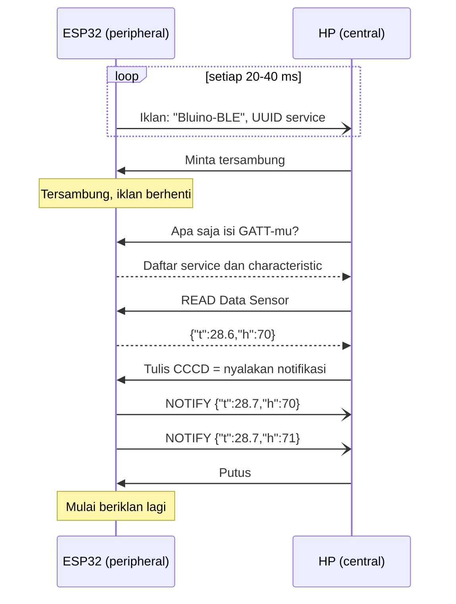
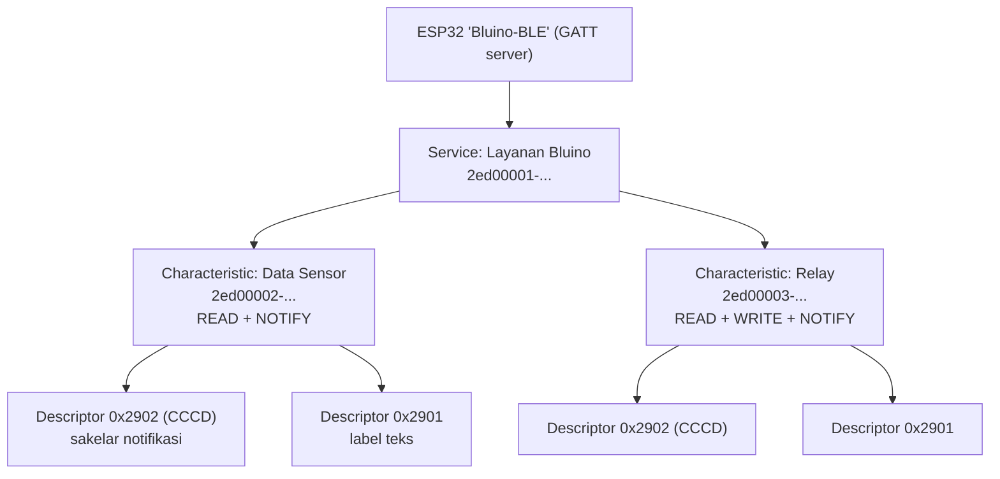
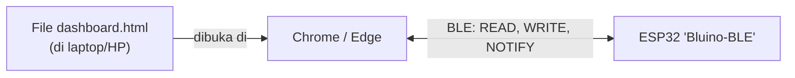

# BAB 53: BLE — Bluetooth Low Energy

> ✅ **Prasyarat:** Selesaikan **BAB 52 (Bluetooth Classic)** — kamu sudah mengenal Bluetooth di ESP32 dan terbiasa memasang aplikasi penguji di HP. Program di BAB ini juga memakai DHT11 dari **BAB 26 (DHT11 — Suhu & Kelembapan)**, *relay* dari **BAB 37 (*Relay* — Kontrol AC/DC)**, pola `struct Timer` dari **BAB 16 (Non-Blocking Programming)**, dan *callback* dari **BAB 18 (Callback & Event-Driven Programming)**. Program 3 memakai tombol dengan *debounce* dari **BAB 9 (Digital Input — Push Button)** dan halaman HTML + JavaScript seperti di **BAB 47 (WebSocket — Komunikasi Real-Time Dua Arah)**.

Di BAB 52, ESP32 dan HP mengobrol lewat Bluetooth Classic seperti dua orang yang **menelepon**: saluran dibiarkan terbuka dan data terus mengalir. Di BAB ini kamu belajar **BLE** (*Bluetooth Low Energy*), cara Bluetooth yang dipakai gelang kebugaran, sensor suhu nirkabel, dan kunci pintar. BLE lebih mirip **papan informasi** yang rapi: ESP32 menyusun datanya di "kotak-kotak" berlabel, HP boleh membaca isinya kapan saja, menulis perintah ke kotak tertentu, atau minta dikabari setiap kali isinya berubah. Bonusnya, BLE bisa dipakai dari **iPhone** dan bahkan dari *browser* Chrome di laptop — dua hal yang tidak bisa dilakukan Bluetooth Classic di BAB 52.

## 📌 Tujuan Pembelajaran

Setelah mempelajari BAB ini, kamu bisa:

- Menjelaskan perbedaan BLE dan Bluetooth Classic, serta alasan BLE disebut hemat daya.
- Menjelaskan cara kerja BLE: *advertising* (beriklan), peran *central* dan *peripheral*, serta urutan tersambung sampai bertukar data.
- Menjelaskan struktur GATT (*service* → *characteristic* → *descriptor*), sifat `READ`, `WRITE`, `NOTIFY`, dan `INDICATE`, serta batas ukuran data (MTU).
- Membuat UUID sendiri dan memakainya untuk *service* dan *characteristic*.
- Membuat *server* BLE di ESP32 dengan *library* **BLE** bawaan *board package* esp32 3.3.x: mengirim data sensor lewat notifikasi dan menerima perintah dari HP.
- Menguji perangkat BLE dengan aplikasi **nRF Connect for Mobile** (Android dan iOS): memindai, menyambung, membaca, menulis teks, dan menyalakan notifikasi.
- Membuat *dashboard* di *browser* yang tersambung langsung ke ESP32 dengan **Web Bluetooth**, beserta batasan dukungan *browser*-nya.
- Menerapkan pola aman: *relay* otomatis mati saat sambungan BLE terputus.

## 🧰 Yang Perlu Disiapkan

| Kebutuhan | Keterangan |
|---|---|
| *Hardware* | Kit Bluino ESP32 IoT Starter Shield + kabel USB **data** |
| Kabel *jumper* | Program 1: 1 kabel *female-female* (`DHT` → IO27). Program 2: 2 kabel (`DHT` → IO27, `RELAY` → IO26). Program 3: 3 kabel (`DHT` → IO27, `RELAY` → IO26, `SW1` → IO15) |
| Komponen tambahan | Tidak ada. *Relay* cukup dicoba tanpa beban — **jangan** menyambungkan listrik PLN 220 V |
| *Software* | Arduino IDE 2.x + *board package* **esp32** versi 3.3.x (lihat [BAB 5](../BAB-05/README.md)) |
| *Library* | *Library* **BLE** sudah bawaan *board package* esp32 (tidak perlu diinstal). Tambahan: **DHT sensor library** by Adafruit + **Adafruit Unified Sensor** ([BAB 26](../BAB-26/README.md)) |
| Alat uji | **Serial Monitor** (baud 115200); HP Android atau iPhone dengan aplikasi **nRF Connect for Mobile** (gratis, dari Nordic Semiconductor); Program 3: *browser* **Chrome** atau **Edge** di laptop Windows/macOS/ChromeOS, atau Chrome di HP Android (lihat [53.9](#539-web-bluetooth-mengakses-ble-dari-browser)) |
| Jaringan | Tidak perlu WiFi maupun internet — HP/laptop cukup menyalakan Bluetooth dan berada dalam jarak beberapa meter dari ESP32 |

## 📑 Daftar Isi

- [53.1 Apa Itu BLE dan Bedanya dengan Bluetooth Classic](#531-apa-itu-ble-dan-bedanya-dengan-bluetooth-classic)
- [53.2 Cara Kerja BLE: Advertising, Central, dan Peripheral](#532-cara-kerja-ble-advertising-central-dan-peripheral)
- [53.3 GATT: Service, Characteristic, dan Descriptor](#533-gatt-service-characteristic-dan-descriptor)
- [53.4 UUID: Nomor Identitas Service dan Characteristic](#534-uuid-nomor-identitas-service-dan-characteristic)
- [53.5 Library BLE Bawaan ESP32](#535-library-ble-bawaan-esp32)
- [53.6 Aplikasi Penguji: nRF Connect for Mobile](#536-aplikasi-penguji-nrf-connect-for-mobile)
- [53.7 Program 1: Sensor DHT11 lewat BLE (Read dan Notify)](#537-program-1-sensor-dht11-lewat-ble-read-dan-notify)
- [53.8 Program 2: Kontrol Relay dari HP (Write)](#538-program-2-kontrol-relay-dari-hp-write)
- [53.9 Web Bluetooth: Mengakses BLE dari Browser](#539-web-bluetooth-mengakses-ble-dari-browser)
- [53.10 Program 3: Dashboard BLE di Browser](#5310-program-3-dashboard-ble-di-browser)
- [53.11 Keamanan, Batasan, dan Pilihan Lain](#5311-keamanan-batasan-dan-pilihan-lain)
- [53.12 Troubleshooting](#5312-troubleshooting)
- [📝 Rangkuman](#-rangkuman)
- [💪 Latihan](#-latihan)
- [📚 Referensi](#-referensi)

---

## 53.1 Apa Itu BLE dan Bedanya dengan Bluetooth Classic

**BLE** (*Bluetooth Low Energy*, sering juga ditulis **Bluetooth LE**) diperkenalkan pada spesifikasi Bluetooth 4.0 tahun 2010. Walaupun namanya sama-sama "Bluetooth", BLE adalah **protokol radio yang berbeda** dari Bluetooth Classic di BAB 52. Perangkat yang hanya mengenal Bluetooth Classic tidak bisa mengobrol dengan perangkat yang hanya mengenal BLE. ESP32 di kit kita termasuk *dual mode*: menurut *datasheet*-nya, ESP32 mendukung **Bluetooth v4.2 BR/EDR** (Classic) **dan Bluetooth LE**, jadi bisa memakai keduanya.

### 53.1.1 Kenapa Disebut Hemat Daya?

Ibaratkan dua cara berkabar dengan teman:

- **Bluetooth Classic** seperti **telepon** yang dibiarkan tersambung. Radio terus aktif supaya data bisa mengalir kapan saja — cocok untuk aliran data besar seperti audio ke *speaker*.
- **BLE** seperti **pesan singkat**. Radio hanya "bangun" sebentar pada jadwal tertentu (disebut *connection interval*, bisa diatur dari 7,5 ms sampai 4 detik), mengirim paket kecil, lalu tidur lagi. Kalau tidak ada yang perlu dikirim, radio hampir selalu tidur.

Jadi BLE hemat karena **radionya jarang menyala**, bukan karena radionya ajaib. Saat radio ESP32 benar-benar aktif, arusnya tetap besar — *datasheet* ESP32 menyebut sekitar **130 mA** saat memancar (daya 0 dBm) dan **95–100 mA** saat menerima. Hemat dayanya baru terasa kalau perangkat dirancang untuk baterai: CPU ikut tidur dan *board* tidak membawa komponen boros.

> 📌 **Catatan:** Program di BAB ini **tidak** dibuat untuk hemat daya. CPU ESP32 terus bekerja, dan *board* ESP32 DEVKIT V1 membawa *chip* USB, regulator, dan LED yang ikut memakan arus. Jadi kit ini tetap menyedot puluhan mA dari USB. Teknik tidur (*deep sleep*, sekitar 10 µA menurut *datasheet*) dibahas di [BAB 27](../BAB-27/README.md).

### 53.1.2 Apa yang Berubah Dibanding BAB 52?

Perbandingan lengkap Bluetooth Classic, BLE, dan WiFi (kecepatan, daya, jangkauan, contoh pemakaian) sudah ada di [52.1.1](../BAB-52/README.md#5211-bluetooth-classic-ble-atau-wifi). Dalam praktik, inilah yang berbeda saat kamu pindah dari BAB 52 ke BAB ini:

| Hal | Bluetooth Classic ([BAB 52](../BAB-52/README.md)) | BLE (BAB ini) |
|---|---|---|
| Cara data dikirim | Aliran *byte* seperti kabel serial (SPP, *Serial Port Profile*) — cukup `SerialBT.print()` | Data disimpan di "kotak" bernama *characteristic* (GATT) yang bisa dibaca, ditulis, atau dipantau |
| Menyambung | *Pairing* dulu di menu Bluetooth HP, baru *connect* dari aplikasi | Tanpa *pairing* — langsung **CONNECT** dari aplikasi |
| Bisa dipakai dari | HP Android dan laptop Windows | HP Android, **iPhone**, dan *browser* Chrome/Edge (**Web Bluetooth**) |
| *Library* ESP32 | `BluetoothSerial` — ditandai usang (*deprecated*): tidak lagi disertakan secara bawaan mulai *board package* 4.0.0 | **BLE** (`BLEDevice.h` dan kawan-kawan) — tetap menjadi bagian *board package* dan menjadi jalan ke depan |
| Aplikasi uji | Serial Bluetooth Terminal (Android) | **nRF Connect for Mobile** (Android dan iOS) |

Beberapa hal lain yang perlu kamu tahu sejak awal:

- **Jangkauan.** Di dalam ruangan, perkirakan sekitar 10 m. Dinding, badan manusia, dan posisi HP sangat berpengaruh; di ruang terbuka jaraknya bisa lebih jauh.
- **Jumlah sambungan.** Pengaturan BLE di *board package* esp32 3.3.12 untuk ESP32 mengizinkan sampai 3 sambungan BLE sekaligus. Program di BAB ini sengaja melayani **satu HP dalam satu waktu** supaya sederhana.
- **Bluetooth Classic dan BLE tidak saling menggantikan.** Kalau perangkat lain (misalnya modul HC-05) hanya mengenal Classic, kamu tetap perlu cara di BAB 52.

---

## 53.2 Cara Kerja BLE: Advertising, Central, dan Peripheral

Bayangkan sebuah pasar. ESP32 adalah **penjual** yang terus mengangkat papan nama bertuliskan "Bluino-BLE ada di sini!". HP adalah **pembeli** yang berkeliling melihat papan-papan itu. Kalau tertarik, pembeli mendekat dan mulai bertanya-tanya. Dalam istilah BLE:

| Istilah | Artinya | Di BAB ini |
|---|---|---|
| ***Advertising*** (beriklan) | Perangkat menyiarkan paket kecil berulang-ulang supaya bisa ditemukan | ESP32 beriklan dengan nama **Bluino-BLE** |
| ***Scanning*** (memindai) | Mendengarkan iklan dari perangkat di sekitar | HP/laptop memindai |
| ***Peripheral*** | Perangkat yang beriklan dan menunggu disambung — biasanya perangkat kecil | ESP32 |
| ***Central*** | Perangkat yang memindai lalu memulai sambungan — biasanya HP/laptop | HP atau laptop |
| **GATT *server*** | Pihak yang **menyimpan** data | ESP32 |
| **GATT *client*** | Pihak yang **meminta/mengubah** data | Aplikasi di HP atau *browser* |

Urutan lengkapnya, dari ESP32 menyala sampai HP memutus sambungan:



*Gambar 53.1 — Urutan komunikasi BLE: beriklan, tersambung, menanyakan isi GATT, membaca nilai, menyalakan notifikasi, lalu menerima kiriman data tanpa harus bertanya. Sumber: dibuat untuk materi ini.*

Hal penting dari gambar di atas:

- **Iklan itu kecil.** Satu paket iklan BLE 4.x hanya memuat **31 *byte*** data, dikirim berulang di tiga kanal khusus. *Library* ESP32 mengirimnya setiap 20–40 ms. Isinya cukup untuk penanda, UUID *service* (lihat [53.4](#534-uuid-nomor-identitas-service-dan-characteristic)), dan nama perangkat. Kalau nama tidak muat, *library* memindahkannya ke ***scan response***, yaitu paket tambahan yang dikirim saat HP bertanya "kamu siapa?". Aplikasi seperti nRF Connect selalu bertanya, jadi namanya tetap muncul.
- **Saat tersambung, ESP32 berhenti beriklan.** Akibatnya HP lain tidak bisa menemukannya. Setelah HP memutus sambungan, ESP32 harus **mulai beriklan lagi** — kalau lupa, ESP32 "hilang" dan baru muncul lagi setelah di-*reset*. Di program BAB ini, urusan ini diserahkan ke *library* dengan satu baris: `server->advertiseOnDisconnect(true);`.
- **HP tidak perlu *pairing*.** Sambungan dibuat langsung dari aplikasi. Jangan memasangkan (*pair*) ESP32 lewat menu **Settings → Bluetooth** di HP; untuk program di BAB ini, langkah itu tidak perlu dan justru bisa membingungkan.

---

## 53.3 GATT: Service, Characteristic, dan Descriptor

Setelah tersambung, data BLE selalu disusun dengan aturan bernama **GATT** (*Generic Attribute Profile*). Bayangkan sebuah **lemari arsip**:

- **ESP32** adalah lemarinya.
- ***Service*** adalah **laci** berlabel, berisi data yang berhubungan. Contoh: laci "Layanan Bluino".
- ***Characteristic*** adalah **map** di dalam laci. Satu map berisi **satu jenis data** (misalnya data sensor, atau status *relay*), lengkap dengan **nilai** (*value*) dan **sifat** (*properties*) — apakah boleh dibaca, ditulis, atau dipantau.
- ***Descriptor*** adalah **catatan tempel** di sampul map: keterangan tambahan tentang map itu, misalnya labelnya, atau sakelar "kabari aku kalau isinya berubah".

Inilah struktur GATT yang dibangun di BAB ini. Program 1 hanya membuat *characteristic* **Data Sensor**; Program 2 dan 3 menambahkan *characteristic* **Relay**.



*Gambar 53.2 — Struktur GATT di BAB ini: satu service berisi dua characteristic, masing-masing dengan descriptor. Angka 2ed0000x-... adalah UUID yang dijelaskan di 53.4. Sumber: dibuat untuk materi ini.*

### 53.3.1 Sifat (Properties) Characteristic

| Sifat | Siapa memulai | Analogi | Dipakai untuk |
|---|---|---|---|
| `READ` | HP bertanya, ESP32 menjawab nilai **saat ini** | Melihat papan skor | Membaca data kapan saja |
| `WRITE` | HP menulis nilai baru, ESP32 membalas "diterima" | Menitipkan surat dan menerima tanda terima | Mengirim perintah, misalnya `ON` |
| `WRITE_NR` (*write without response*) | HP menulis tanpa menunggu balasan | Melempar surat ke kotak pos | Kiriman cepat yang boleh sesekali hilang |
| `NOTIFY` | ESP32 mengirim nilai baru **tanpa ditanya**, ke HP yang sudah berlangganan | Notifikasi grup *chat* | Data sensor berkala, perubahan status |
| `INDICATE` | Seperti `NOTIFY`, tetapi HP wajib membalas "sudah diterima" | Surat tercatat | Kabar penting yang tidak boleh hilang; lebih lambat karena menunggu balasan satu per satu |

`NOTIFY` adalah bintang di BAB ini. Mirip WebSocket di [BAB 47](../BAB-47/README.md), HP tidak perlu terus bertanya (*polling*) — ESP32 yang mengabari saat ada data baru.

### 53.3.2 Descriptor CCCD: Sakelar Langganan

ESP32 hanya boleh mengirim notifikasi kepada HP yang **memintanya**. Permintaan itu disimpan di *descriptor* khusus bernama **CCCD** (*Client Characteristic Configuration Descriptor*) dengan nomor **0x2902**. Saat kamu menekan tombol notifikasi di aplikasi, HP menulis angka 1 ke CCCD (angka 2 untuk *indicate*, angka 0 untuk berhenti).

- Di ESP32 klasik (yang kita pakai), *library* BLE memakai *stack* Bluetooth bernama **Bluedroid**. Di sini CCCD **harus ditambahkan sendiri** dengan `addDescriptor(new BLE2902())` pada setiap *characteristic* yang punya sifat `NOTIFY` atau `INDICATE`. Tanpa CCCD, HP tidak punya "sakelar" untuk berlangganan, sehingga aplikasi seperti nRF Connect atau Chrome bisa gagal menyalakan notifikasi.
- Pada *chip* lain (ESP32-S3, ESP32-C3, ESP32-C6, dan seterusnya) *library* yang sama memakai *stack* **NimBLE** yang membuat CCCD secara otomatis. Di sana `BLE2902` ditandai usang (*deprecated*) dan memunculkan peringatan saat *compile*. Untuk **ESP32 Dev Module**, tetap tambahkan `BLE2902`.

*Descriptor* lain yang kita pakai adalah **0x2901** (*Characteristic User Description*): label teks yang bisa dibaca aplikasi, misalnya "Suhu (C) dan kelembapan (%)". Sifatnya opsional, tetapi membantu saat menguji karena *characteristic* buatan sendiri hanya tampil sebagai **Unknown Characteristic** di aplikasi.

### 53.3.3 Isi Characteristic dan Batas 20 Byte

Nilai *characteristic* hanyalah deretan *byte*. Supaya mudah dibaca manusia, semua program di BAB ini mengirim **teks** (UTF-8). Kata `ON` misalnya tersimpan sebagai dua *byte*: `4F 4E` dalam heksadesimal. Aplikasi penguji bisa menampilkan nilai sebagai teks atau sebagai heksadesimal — nanti kamu akan memilihnya saat menulis perintah.

Ada satu batas penting: **MTU** (*Maximum Transmission Unit*), ukuran paket terbesar yang disepakati kedua pihak. Setiap sambungan BLE dimulai dengan MTU **23 *byte***; 3 *byte* dipakai untuk kepala paket, jadi **satu notifikasi hanya membawa 20 *byte* data**. HP boleh meminta MTU yang lebih besar setelah tersambung (iPhone biasanya melakukannya otomatis; di Android tergantung aplikasinya). Kalau notifikasi lebih panjang dari batas, *library* ESP32 **memotongnya tanpa pesan *error*** di Serial Monitor.

Karena itu, semua data yang dikirim lewat notifikasi di BAB ini dijaga **paling panjang 20 *byte***, misalnya:

```text
{"t":28.6,"h":70}      ← 17 byte: suhu 28,6 °C, kelembapan 70 %
{"t":null,"h":null}    ← 19 byte: sensor gagal dibaca
ON                     ← 2 byte: status relay
```

> 💡 **Tips:** Untuk `READ`, nilai yang lebih panjang dari 20 *byte* tetap bisa dibaca utuh karena HP otomatis membacanya sepotong demi sepotong. Batas 20 *byte* paling terasa pada **notifikasi**.

---

## 53.4 UUID: Nomor Identitas Service dan Characteristic

Setiap *service* dan *characteristic* punya **UUID** (*Universally Unique Identifier*), nomor identitas yang dipakai HP untuk mengenalinya — mirip NIK pada KTP. Ada dua jenis:

| Jenis | Contoh | Keterangan |
|---|---|---|
| UUID 16-bit **standar** | `0x180F` (*Battery Service*), `0x2A19` (*Battery Level*), `0x181A` (*Environmental Sensing*), `0x2A6E` (*Temperature*) | Ditetapkan oleh Bluetooth SIG. Aplikasi mengenalinya dan menampilkan namanya. Pakai hanya kalau datamu benar-benar mengikuti format standar itu |
| UUID 128-bit **buatan sendiri** | `2ed00001-fc4c-400d-bb3c-1953ec992b13` | Untuk data milikmu sendiri. Ditulis sebagai 32 digit heksadesimal dalam 5 kelompok (8-4-4-4-12) |

UUID buatan sendiri tidak perlu didaftarkan ke mana pun. Kalau dibuat secara **acak** (UUID versi 4), peluang dua orang mendapat UUID yang sama sangat-sangat kecil. Cara membuatnya, pilih salah satu:

| Alat | Cara |
|---|---|
| Situs web | Buka [uuidgenerator.net](https://www.uuidgenerator.net/). Halaman depannya langsung membuat UUID versi 4 (tertulis **Your Version 4 UUID**); salin UUID itu |
| Windows | Buka **PowerShell** (tombol Start → ketik `powershell` → Enter), ketik `[guid]::NewGuid()` lalu Enter |
| macOS/Linux | Buka **Terminal**, ketik `uuidgen` lalu Enter. Di macOS hasilnya huruf besar — ubah menjadi huruf kecil sebelum dipakai |
| Python | `python -c "import uuid; print(uuid.uuid4())"` di Command Prompt/Terminal |

UUID di BAB ini dibuat dengan cara yang sama: satu UUID acak, lalu bagian depannya diberi nomor urut supaya mudah dikenali di aplikasi.

| Untuk | UUID |
|---|---|
| *Service* Layanan Bluino | `2ed00001-fc4c-400d-bb3c-1953ec992b13` |
| *Characteristic* Data Sensor | `2ed00002-fc4c-400d-bb3c-1953ec992b13` |
| *Characteristic* Relay | `2ed00003-fc4c-400d-bb3c-1953ec992b13` |

> ⚠️ **Perhatian:** Tulis UUID dengan **huruf kecil**. *Library* ESP32 menerima huruf besar, tetapi Web Bluetooth di *browser* (Program 3) menolaknya. Jangan pula menyalin UUID milik layanan terkenal — misalnya `6e400001-b5a3-f393-e0a9-e50e24dcca9e` milik *Nordic UART Service* — untuk data yang formatnya berbeda, karena aplikasi akan mengira perangkatmu adalah layanan tersebut.

> 💡 **Tips:** Kalau satu kelas memakai kode yang sama, akan ada banyak "Bluino-BLE" di daftar pemindaian. Ganti nama perangkat (konstanta `NAMA_BLE`) dengan namamu, misalnya `"Bluino-Ani"`. UUID boleh tetap sama, karena HP membedakan perangkat dari alamatnya (MAC), bukan dari UUID.

---

## 53.5 Library BLE Bawaan ESP32

*Library* **BLE** sudah ikut terpasang bersama *board package* esp32, jadi tidak perlu diinstal lewat Library Manager. *Library* ini dipakai dengan menyertakan beberapa *file header*:

| *Header* | Isinya |
|---|---|
| `BLEDevice.h` | Menyalakan BLE (`BLEDevice::init()`), membuat *server*, mengatur iklan |
| `BLEServer.h` | Kelas `BLEServer`, *service*, *characteristic*, dan *callback* sambungan |
| `BLE2902.h` | *Descriptor* CCCD (sakelar notifikasi) |
| `BLE2901.h` | *Descriptor* label teks |

> ⚠️ **Perhatian:** Banyak tutorial lama di internet ditulis untuk core 2.x dan memakai `std::string nilai = karakteristik->getValue();`. Di core 3.x, `getValue()` mengembalikan **`String`** Arduino, jadi baris lama itu gagal di-*compile*. Tulis `String nilai = karakteristik->getValue();`.

> 📌 **Catatan:** Pada ESP32 klasik, *library* ini memakai *stack* Bluedroid, yang mendukung Classic dan BLE tetapi cukup besar. Dokumentasi *library* menyebut bahwa mulai core **4.0.0** Bluedroid akan diganti NimBLE. Kalau suatu saat kamu memakai core 4.x, cek lagi contoh resmi di **File → Examples → BLE**, karena sebagian kode mungkin perlu disesuaikan.

### 53.5.1 Pola Dasar Program BLE

Semua program di BAB ini mengikuti urutan yang sama (potongan kode; program lengkapnya ada di Program 1):

```cpp
#include <BLEDevice.h>
#include <BLEServer.h>
#include <BLE2902.h>

// --- di dalam setup() ---
BLEDevice::init("Bluino-BLE");                    // 1. Nyalakan BLE dan beri nama
BLEServer *server = BLEDevice::createServer();     // 2. Buat GATT server
server->setCallbacks(new PenanganServer());        // 3. Pasang callback sambung/putus
server->advertiseOnDisconnect(true);               // 4. Otomatis beriklan lagi setelah putus

BLEService *layanan = server->createService(UUID_LAYANAN);        // 5. Buat service
BLECharacteristic *kar = layanan->createCharacteristic(            // 6. Buat characteristic
    UUID_SENSOR, BLECharacteristic::PROPERTY_READ | BLECharacteristic::PROPERTY_NOTIFY);
kar->addDescriptor(new BLE2902());                 // 7. CCCD, wajib untuk NOTIFY
kar->setValue("Menunggu data");                    // 8. Nilai awal
layanan->start();                                  // 9. Jalankan service

BLEAdvertising *iklan = BLEDevice::getAdvertising();
iklan->addServiceUUID(UUID_LAYANAN);               // 10. Sebut UUID service di iklan
iklan->setScanResponse(true);                      //     nama boleh pindah ke scan response
BLEDevice::startAdvertising();                     // 11. Mulai beriklan

// --- di dalam loop(), saat ada data baru ---
kar->setValue((uint8_t *)teks, strlen(teks));      // perbarui nilai (untuk READ)
kar->notify();                                     // kirim ke HP yang berlangganan
```

Beberapa sifat *characteristic* digabung dengan operator OR bit `|`, misalnya `PROPERTY_READ | PROPERTY_NOTIFY`. Tambahkan semua *characteristic* **sebelum** `layanan->start()`, dan jalankan *service* **sebelum** mulai beriklan.

### 53.5.2 Callback BLE

*Library* memberi tahu program lewat *callback* ([BAB 18](../BAB-18/README.md)): kamu membuat kelas turunan, menimpa (*override*) fungsi yang dibutuhkan, lalu mendaftarkannya.

| Kelas | Fungsi | Kapan dipanggil |
|---|---|---|
| `BLEServerCallbacks` | `onConnect(BLEServer *server)` | HP tersambung |
| | `onDisconnect(BLEServer *server)` | HP terputus |
| | `onMtuChanged(BLEServer *server, esp_ble_gatts_cb_param_t *param)` | HP dan ESP32 menyepakati MTU baru (`param->mtu.mtu`) |
| `BLECharacteristicCallbacks` | `onWrite(BLECharacteristic *kar)` | HP menulis nilai baru ke *characteristic* |
| | `onRead(BLECharacteristic *kar)` | HP akan membaca *characteristic* (jarang dipakai) |

> ⚠️ **Perhatian:** *Callback* BLE **tidak** dijalankan oleh `loop()`, melainkan oleh *task* Bluetooth milik ESP32 — seolah ada "petugas" lain yang bekerja bersamaan dengan `loop()`. Karena itu *callback* harus singkat: jangan memakai `delay()` dan jangan mengerjakan hal lama di dalamnya. Pola yang dipakai di BAB ini: *callback* hanya mengubah variabel penanda (diberi kata kunci `volatile`, seperti variabel ISR di [BAB 10](../BAB-10/README.md)), lalu `loop()` yang mengerjakan sisanya.

### 53.5.3 Fungsi Penting

Semua fungsi berikut sudah diperiksa pada *library* BLE versi 3.3.12:

| Fungsi | Kegunaan |
|---|---|
| `BLEDevice::init(nama)` | Menyalakan BLE dengan nama perangkat; mengembalikan `false` kalau gagal |
| `BLEDevice::createServer()` | Membuat GATT *server* |
| `server->advertiseOnDisconnect(true)` | Beriklan lagi secara otomatis setiap kali HP memutus sambungan |
| `server->createService(uuid)` | Membuat *service* dengan jatah 15 *handle* (nomor urut atribut). *Service* memakai 1, setiap *characteristic* 2, dan setiap *descriptor* 1. Kalau jatahnya kurang, pakai `createService(BLEUUID(uuid), 30)` |
| `server->getConnectedCount()` | Jumlah HP yang sedang tersambung |
| `layanan->createCharacteristic(uuid, sifat)` | Membuat *characteristic* |
| `kar->addDescriptor(...)` | Menambahkan *descriptor* (`BLE2902`, `BLE2901`) |
| `kar->setValue(...)` | Mengganti nilai: dari teks (`"ON"`), `String`, atau *buffer* *byte* `(uint8_t *)data, panjang` |
| `kar->getValue()` | Membaca nilai sebagai `String` (core 3.x) |
| `kar->notify()` | Mengirim nilai sekarang sebagai notifikasi ke HP yang berlangganan |
| `cccd->getNotifications()` | `true` kalau HP sedang menyalakan notifikasi (`cccd` = objek `BLE2902`) |
| `BLEDevice::getAddress().toString()` | Alamat Bluetooth (MAC) ESP32, misalnya `24:6f:28:ab:cd:ee` |

### 53.5.4 Ukuran Program

Seperti Bluetooth Classic, seluruh "mesin" Bluetooth (*Bluetooth stack*) ikut masuk ke program, jadi program BLE berukuran besar dan *compile*-nya lebih lama. Ketiga program di BAB ini memakai sekitar **83 %** ruang program bawaan (kira-kira 1,1 juta *byte* dari 1.310.720 *byte* yang tersedia) — angka ini terlihat di baris terakhir panel **Output** setelah *compile*, dalam bentuk `Sketch uses ... bytes (83%) of program storage space`. Semuanya masih muat, jadi kamu **tidak perlu** mengubah *partition scheme*.

Kalau kelak kamu menggabungkan BLE dengan WiFi, *web server*, atau OLED dan *compile* gagal dengan pesan `Sketch too big` atau `text section exceeds available space in board`, pilih **Tools → Partition Scheme → Huge APP (3MB No OTA/1MB SPIFFS)**. Penjelasan lengkap dan efek sampingnya ada di [52.4.2](../BAB-52/README.md#5242-ukuran-program-dan-partition-scheme).

---

## 53.6 Aplikasi Penguji: nRF Connect for Mobile

Untuk menguji perangkat BLE kita butuh aplikasi yang bisa memindai, menyambung, dan "membuka lemari GATT". Pilihan paling populer adalah **nRF Connect for Mobile** dari Nordic Semiconductor, gratis untuk **Android** dan **iOS**.

### 53.6.1 Memasang dan Menyiapkan Aplikasi

1. Buka **Play Store** (Android) atau **App Store** (iPhone), cari `nRF Connect for Mobile`, pastikan pembuatnya **Nordic Semiconductor ASA**, lalu pasang.
2. Nyalakan **Bluetooth** di HP.
3. Saat aplikasi dibuka pertama kali, izinkan semua permintaan izin (di Android: **Perangkat di sekitar**/*Nearby devices* atau **Lokasi**, tergantung versi Android). Di Android 11 ke bawah, **Lokasi** (GPS) juga harus menyala, karena tanpa itu Android tidak mau memindai perangkat BLE.

### 53.6.2 Langkah Umum Pengujian

Langkah berikut dipakai di Program 1 dan 2. Tampilan di bawah mengikuti nRF Connect versi Android; versi iPhone tata letaknya sedikit berbeda, tetapi menu dan fungsinya sama (**Connect**, **Read**, **Write**, **Notify/Subscribe**).

1. Buka tab **SCANNER**, lalu tekan **SCAN**. Daftar perangkat BLE di sekitarmu muncul.
2. Cari **Bluino-BLE**. Kalau daftarnya panjang, gunakan filter nama di bagian atas, atau dekatkan HP ke ESP32 — perangkat terdekat biasanya punya angka RSSI (kekuatan sinyal, dalam dBm) yang paling besar, misalnya −45 dBm lebih kuat daripada −80 dBm.
3. Tekan **CONNECT** di samping nama itu. Aplikasi membuka halaman baru untuk perangkat tersebut.
4. Buka tab **CLIENT**. Tampil daftar *service*. Dua *service* teratas (**Generic Access** dan **Generic Attribute**) dibuat otomatis oleh *stack* Bluetooth. *Service* milik kita tampil sebagai **Unknown Service** dengan UUID `2ed00001-...` — ketuk untuk membukanya.
5. Di bawahnya muncul **Unknown Characteristic** beserta sifatnya (**READ, NOTIFY** dan seterusnya). Setiap *characteristic* punya ikon:

| Ikon | Fungsi |
|---|---|
| Satu panah ke bawah (↓) | **Read** — membaca nilai sekali |
| Satu panah ke atas (↑) | **Write** — menulis nilai baru |
| Beberapa panah ke bawah | **Notify** — menyalakan/mematikan notifikasi; ikon berubah tampilan saat aktif |

6. Nilai terakhir tampil di baris **Value**. Aplikasi biasanya menampilkan isi teks, kadang disertai bentuk heksadesimalnya, misalnya `(0x) 4F-4E` untuk `ON`.
7. Untuk memutus sambungan, tekan **DISCONNECT** di pojok kanan atas.

> ⚠️ **Perhatian:** Saat menulis perintah (ikon ↑), aplikasi menampilkan kotak dialog **Write value** yang bisa menerima beberapa jenis data. Pilih jenis **teks** (tertulis **TEXT** atau **UTF-8**, tergantung versi aplikasi), bukan **BYTE ARRAY**/heksadesimal. Kalau jenisnya heksadesimal, mengetik `ON` tidak akan menjadi huruf O dan N.

> 💡 **Tips:** Alternatif nRF Connect adalah **LightBlue** dari Punch Through (Android dan iOS). Fungsinya sama: memindai, menyambung, membaca, menulis, dan berlangganan notifikasi. Pada LightBlue, pilih format **UTF-8 String** untuk melihat dan menulis teks.

---

## 53.7 Program 1: Sensor DHT11 lewat BLE (Read dan Notify)

**Tujuan:** Membuat perangkat BLE pertama. ESP32 beriklan dengan nama **Bluino-BLE** dan menyediakan *characteristic* **Data Sensor** (`READ` + `NOTIFY`) berisi teks JSON pendek seperti `{"t":28.6,"h":70}`. Nilainya diperbarui setiap 2 detik dari DHT11. HP bisa membacanya kapan saja, atau menyalakan notifikasi supaya data baru datang sendiri. LED biru di *board* berkedip selama menunggu HP dan menyala terus saat HP tersambung.

**Rangkaian:**

| Pin **Custom** di kit | Sambungkan ke pin ESP32 |
|---|---|
| `DHT` — DHT11 (header hijau, pin ke-3 dari atas) | IO27 |

LED biru yang dipakai adalah LED bawaan *board* ESP32 di IO2, jadi tidak perlu kabel. Kalau ingin LED biru di kit ikut menyala, tambahkan kabel `LED3` (biru, header LED) → IO2.

**Cara Menjalankan:**

1. Sambungkan kabel *jumper* sesuai tabel **Rangkaian** di atas.
2. Pastikan *library* **DHT sensor library** by Adafruit dan **Adafruit Unified Sensor** sudah terpasang (**Sketch → Include Library → Manage Libraries…**, lihat [BAB 26](../BAB-26/README.md)). *Library* BLE tidak perlu dipasang.
3. Buka Arduino IDE → **File → New Sketch**, hapus isinya, lalu salin kode di bawah. Kode yang sama juga tersedia di *file* [`p1_ble_notify.ino`](p1_ble_notify/p1_ble_notify.ino).
4. Pastikan **Tools → Board** = **ESP32 Dev Module** dan **Tools → Port** = *port* ESP32 kamu (misalnya `COM5` di Windows atau `/dev/ttyUSB0` di Linux).
5. Klik **Upload** dan tunggu sampai muncul **Done uploading**. Proses *compile* program BLE lebih lama daripada biasanya (bisa lebih dari 1 menit), karena *library*-nya besar.
6. Buka **Serial Monitor** (**Tools → Serial Monitor**), pilih baud **115200**.
7. Uji dengan nRF Connect di HP:
   1. **SCANNER** → **SCAN** → tekan **CONNECT** di samping **Bluino-BLE**.
   2. Tab **CLIENT** → ketuk **Unknown Service** (`2ed00001-...`).
   3. Pada **Unknown Characteristic** (`2ed00002-...`), tekan ikon **↓** (*Read*). Baris **Value** menampilkan teks seperti `{"t":28.6,"h":70}`.
   4. Tekan ikon **beberapa panah ke bawah** (*Notify*). Sejak saat itu nilainya berganti sendiri setiap 2 detik, dan Serial Monitor menulis `notifikasi #... terkirim`.
   5. Di bawah *characteristic* itu terlihat dua *descriptor*: **Client Characteristic Configuration** (CCCD, 0x2902) dan **Characteristic User Description** (0x2901). Tekan ikon **↓** pada *descriptor* 0x2901 untuk membaca labelnya: `Suhu (C) dan kelembapan (%)`.

**Kode Program:**

<!-- sketch: p1_ble_notify -->
```cpp
/*
 * BAB 53 - Program 1: Sensor DHT11 lewat BLE (Read dan Notify)
 * ESP32 beriklan dengan nama "Bluino-BLE" dan menyediakan satu service berisi
 * characteristic "Data Sensor" (READ + NOTIFY). Isinya teks JSON pendek,
 * misalnya {"t":28.6,"h":70}, diperbarui setiap 2 detik dan dikirim sebagai
 * notifikasi ke HP yang berlangganan.
 * Uji dengan aplikasi nRF Connect for Mobile (Android/iOS).
 * Rangkaian: DHT -> IO27.
 * LED biru bawaan board (IO2): berkedip = menunggu HP, menyala = HP tersambung.
 */

#include <BLEDevice.h>
#include <BLEServer.h>
#include <BLE2902.h>  // descriptor CCCD: sakelar notifikasi
#include <BLE2901.h>  // descriptor label teks
#include <DHT.h>

const char *NAMA_BLE = "Bluino-BLE";  // nama yang muncul di HP (boleh diganti)

// UUID buatan sendiri (lihat 53.4), huruf kecil semua
#define UUID_LAYANAN "2ed00001-fc4c-400d-bb3c-1953ec992b13"
#define UUID_SENSOR "2ed00002-fc4c-400d-bb3c-1953ec992b13"

#define PIN_DHT 27
#define TIPE_DHT DHT11
#define LED_BIRU 2  // LED biru bawaan board ESP32, aktif HIGH

// struct Timer dari BAB 16
struct Timer {
  unsigned long interval;   // ms
  unsigned long waktuLalu;  // hasil millis() saat terakhir dijalankan

  // Mengembalikan true kalau sudah waktunya, lalu mencatat waktunya
  bool sudahWaktunya(unsigned long sekarang) {
    if (sekarang - waktuLalu >= interval) {
      waktuLalu = sekarang;
      return true;
    }
    return false;
  }
};

DHT dht(PIN_DHT, TIPE_DHT);
BLECharacteristic *karSensor = nullptr;  // characteristic Data Sensor
BLE2902 *cccdSensor = nullptr;           // sakelar notifikasi milik Data Sensor

Timer timerSensor = {2000, 0};  // baca DHT11 setiap 2 detik
Timer timerKedip = {500, 0};    // kedip LED selama menunggu HP

// Diubah oleh callback (task Bluetooth), dibaca oleh loop()
volatile bool hpTersambung = false;
volatile uint16_t mtuBaru = 0;  // 0 = tidak ada kabar MTU baru

bool tersambungSebelumnya = false;
bool ledNyala = false;
unsigned long jumlahNotifikasi = 0;

// Callback sambungan: cukup ubah penanda, sisanya dikerjakan loop()
class PenanganServer : public BLEServerCallbacks {
  void onConnect(BLEServer *server) override {
    hpTersambung = true;
  }
  void onDisconnect(BLEServer *server) override {
    hpTersambung = false;
  }
  void onMtuChanged(BLEServer *server, esp_ble_gatts_cb_param_t *param) override {
    mtuBaru = param->mtu.mtu;
  }
};

void siapkanBLE() {
  if (!BLEDevice::init(NAMA_BLE)) {
    Serial.println("[BLE] Gagal menyalakan BLE! ESP32 restart dalam 5 detik...");
    delay(5000);
    ESP.restart();
  }

  BLEServer *server = BLEDevice::createServer();
  server->setCallbacks(new PenanganServer());
  server->advertiseOnDisconnect(true);  // beriklan lagi setelah HP memutus

  BLEService *layanan = server->createService(UUID_LAYANAN);

  karSensor = layanan->createCharacteristic(
      UUID_SENSOR, BLECharacteristic::PROPERTY_READ | BLECharacteristic::PROPERTY_NOTIFY);

  cccdSensor = new BLE2902();  // wajib untuk NOTIFY di ESP32 (Bluedroid)
  karSensor->addDescriptor(cccdSensor);

  BLE2901 *label = new BLE2901();  // label teks (opsional)
  label->setDescription("Suhu (C) dan kelembapan (%)");
  label->setAccessPermissions(ESP_GATT_PERM_READ);  // label hanya boleh dibaca
  karSensor->addDescriptor(label);

  karSensor->setValue("Menunggu data");
  layanan->start();

  BLEAdvertising *iklan = BLEDevice::getAdvertising();
  iklan->addServiceUUID(UUID_LAYANAN);  // HP/browser bisa menyaring berdasarkan UUID ini
  iklan->setScanResponse(true);         // nama yang tidak muat dikirim di scan response
  BLEDevice::startAdvertising();
}

void bacaDanKirimSensor() {
  dht.read(true);  // paksa membaca sensor sekarang (BAB 26)
  float h = dht.readHumidity();
  float t = dht.readTemperature();

  char teks[24];  // isi maksimal 20 karakter (batas notifikasi, lihat 53.3.3)
  if (isnan(h) || isnan(t)) {
    snprintf(teks, sizeof(teks), "{\"t\":null,\"h\":null}");
    Serial.println("[DHT11] Gagal membaca. Periksa kabel DHT -> IO27.");
  } else {
    snprintf(teks, sizeof(teks), "{\"t\":%.1f,\"h\":%.0f}", t, h);
  }

  karSensor->setValue((uint8_t *)teks, strlen(teks));  // nilai terbaru untuk READ

  Serial.printf("[DHT11] %s -> ", teks);
  if (!hpTersambung) {
    Serial.println("belum ada HP tersambung");
  } else if (!cccdSensor->getNotifications()) {
    Serial.println("HP belum menyalakan notifikasi");
  } else {
    karSensor->notify();  // kirim nilai sekarang ke HP
    jumlahNotifikasi++;
    Serial.printf("notifikasi #%lu terkirim\n", jumlahNotifikasi);
  }
}

void setup() {
  Serial.begin(115200);
  delay(1000);
  Serial.println("\nBAB 53 - Program 1: Sensor DHT11 lewat BLE");

  pinMode(LED_BIRU, OUTPUT);  // pinMode dulu, baru digitalWrite (core 3.x)
  digitalWrite(LED_BIRU, LOW);
  dht.begin();

  siapkanBLE();

  Serial.printf("[BLE] Siap! Nama perangkat: %s\n", NAMA_BLE);
  Serial.printf("[BLE] Alamat BLE (MAC): %s\n", BLEDevice::getAddress().toString().c_str());
  Serial.println("[BLE] Buka nRF Connect di HP, SCAN, lalu CONNECT ke perangkat ini.");
}

void loop() {
  unsigned long sekarang = millis();

  // 1. Perubahan sambungan (penandanya diubah oleh callback)
  bool tersambung = hpTersambung;
  if (tersambung != tersambungSebelumnya) {
    tersambungSebelumnya = tersambung;
    if (tersambung) {
      Serial.println("[BLE] HP tersambung.");
    } else {
      cccdSensor->setNotifications(false);  // HP berikutnya harus berlangganan lagi
      Serial.println("[BLE] HP terputus. ESP32 beriklan lagi.");
    }
  }

  // 2. Kabar MTU baru dari callback
  uint16_t mtu = mtuBaru;
  if (mtu != 0) {
    mtuBaru = 0;
    Serial.printf("[BLE] MTU disepakati: %u byte\n", mtu);
  }

  // 3. LED biru: menyala terus saat tersambung, berkedip saat menunggu
  if (tersambung) {
    digitalWrite(LED_BIRU, HIGH);
  } else if (timerKedip.sudahWaktunya(sekarang)) {
    ledNyala = !ledNyala;
    digitalWrite(LED_BIRU, ledNyala ? HIGH : LOW);
  }

  // 4. Baca sensor dan kirim setiap 2 detik
  if (timerSensor.sudahWaktunya(sekarang)) {
    bacaDanKirimSensor();
  }
}
```

**Penjelasan Kode:**

- **`siapkanBLE()`** mengikuti pola dasar di [53.5.1](#5351-pola-dasar-program-ble). `BLEDevice::init()` memakai nama dari `NAMA_BLE`; kalau gagal, ESP32 menyala ulang. `advertiseOnDisconnect(true)` membuat ESP32 otomatis beriklan lagi setiap kali HP memutus sambungan.
- **Dua *descriptor*.** `cccdSensor` (`BLE2902`) adalah sakelar notifikasi; pointer-nya disimpan supaya `loop()` bisa memeriksa posisinya dengan `getNotifications()`. `BLE2901` memberi label teks dan diatur hanya-baca dengan `setAccessPermissions(ESP_GATT_PERM_READ)` — di Bluedroid, *descriptor* bawaannya boleh dibaca **dan** ditulis.
- **`setValue()` lalu `notify()`.** Setiap 2 detik nilai *characteristic* diganti dengan bacaan terbaru, sehingga `READ` dari HP selalu mendapat angka baru. `notify()` hanya dipanggil kalau ada HP yang tersambung **dan** sudah menyalakan notifikasi. Serial Monitor menuliskan keadaan mana yang sedang terjadi.
- **Teks dijaga pendek.** `snprintf()` menyusun JSON tanpa spasi dengan satu angka desimal untuk suhu, sehingga panjangnya paling banyak 19 karakter — di bawah batas 20 *byte* per notifikasi ([53.3.3](#5333-isi-characteristic-dan-batas-20-byte)). Kalau DHT11 gagal dibaca, nilainya `null`.
- ***Callback* hanya mengubah penanda.** `onConnect()`, `onDisconnect()`, dan `onMtuChanged()` dijalankan *task* Bluetooth, jadi isinya cuma mengubah variabel `volatile`. `loop()` yang mencetak pesan, mengatur LED, dan mengosongkan CCCD saat HP terputus. CCCD perlu dikosongkan karena di Bluedroid nilainya tidak ter-*reset* sendiri; tanpa langkah ini, HP berikutnya dianggap sudah berlangganan padahal belum.
- **LED biru** memakai `struct Timer` dari [BAB 16](../BAB-16/README.md): berkedip setiap 500 ms saat menunggu, menyala terus saat tersambung.

**Contoh Output:**

```text
BAB 53 - Program 1: Sensor DHT11 lewat BLE
[BLE] Siap! Nama perangkat: Bluino-BLE
[BLE] Alamat BLE (MAC): 24:6f:28:ab:cd:ee
[BLE] Buka nRF Connect di HP, SCAN, lalu CONNECT ke perangkat ini.
[DHT11] {"t":28.6,"h":70} -> belum ada HP tersambung
[DHT11] {"t":28.6,"h":70} -> belum ada HP tersambung
[BLE] HP tersambung.
[BLE] MTU disepakati: 517 byte
[DHT11] {"t":28.6,"h":70} -> HP belum menyalakan notifikasi
[DHT11] {"t":28.7,"h":70} -> notifikasi #1 terkirim
[DHT11] {"t":28.7,"h":71} -> notifikasi #2 terkirim
[BLE] HP terputus. ESP32 beriklan lagi.
[DHT11] {"t":28.7,"h":71} -> belum ada HP tersambung
```

Alamat MAC, suhu, dan kelembapan di tempatmu akan berbeda. Baris `MTU disepakati` hanya muncul kalau HP meminta MTU yang lebih besar, dan angkanya tergantung HP (misalnya 185, 247, atau 517). Di nRF Connect, nilai pada baris **Value** berganti setiap 2 detik selama notifikasi menyala, sementara LED biru di *board* menyala terus. Setelah kamu menekan **DISCONNECT**, LED kembali berkedip dan **Bluino-BLE** muncul lagi saat HP memindai.

**Kalau Belum Berhasil:**

- ***Compile* gagal dengan pesan `Sketch too big` atau `text section exceeds available space`** → program ini seharusnya muat (±83 %). Pastikan *board* yang dipilih **ESP32 Dev Module** dan **Tools → Partition Scheme** masih pilihan bawaan; kalau kamu sudah menambah banyak fitur, pilih **Huge APP** ([53.5.4](#5354-ukuran-program)).
- **Bluino-BLE tidak muncul saat SCAN** → pastikan Serial Monitor menampilkan `[BLE] Siap!`. Nyalakan Bluetooth dan izin lokasi/perangkat sekitar di HP. Kalau ESP32 sedang tersambung ke HP lain (LED biru menyala terus), ia tidak beriklan; putuskan dulu sambungan itu.
- **Menekan ikon notifikasi tidak mengubah apa pun, Serial Monitor tetap menulis `HP belum menyalakan notifikasi`** → pastikan yang ditekan ikon **beberapa panah**, bukan ikon **↓** (*Read*). Coba **DISCONNECT** lalu **CONNECT** lagi.
- **Nilai berisi `{"t":null,"h":null}`** → DHT11 gagal dibaca. Periksa kabel `DHT` → `27` dan *library* DHT ([BAB 26](../BAB-26/README.md)).

---

## 53.8 Program 2: Kontrol Relay dari HP (Write)

**Tujuan:** Menambahkan *characteristic* kedua, **Relay** (`READ` + `WRITE` + `NOTIFY`). HP menulis teks `ON`, `OFF`, atau `TOGGLE` (boleh juga `1` dan `0`) untuk mengendalikan *relay*, dan ESP32 membalas dengan status terbaru (`ON`/`OFF`) lewat notifikasi. *Characteristic* **Data Sensor** dari Program 1 tetap ada. Sebagai pengaman, *relay* otomatis mati begitu sambungan BLE terputus.

**Rangkaian:**

| Pin **Custom** di kit | Sambungkan ke pin ESP32 |
|---|---|
| `DHT` — DHT11 (header hijau, pin ke-3 dari atas) | IO27 |
| `RELAY` (header biru, di **kanan** `BUZZ`) | IO26 |

Kabel `DHT` dari Program 1 tetap terpasang; tambahkan satu kabel untuk *relay*. Letak pin `RELAY` dan pin `26` bisa kamu lihat di Gambar 37.4 pada [BAB 37](../BAB-37/README.md#375-rangkaian-untuk-seluruh-bab).

> 🚨 **Bahaya:** Coba *relay* **tanpa beban**. Bunyi "klik" dan LED indikator kecil di dekat *relay* sudah cukup sebagai tanda bahwa *relay* bekerja. **Jangan pernah menyambungkan listrik PLN 220 V ke *relay* kit** — kit ini papan belajar terbuka yang tidak dirancang untuk tegangan itu ([BAB 37](../BAB-37/README.md#374-keselamatan-kit-ini-bukan-untuk-listrik-pln)). Apalagi program ini bisa dikendalikan siapa saja di dekatmu yang memasang aplikasi BLE (lihat [53.11](#5311-keamanan-batasan-dan-pilihan-lain)).

**Cara Menjalankan:**

1. Sambungkan kabel *jumper* sesuai tabel **Rangkaian** di atas.
2. Buka **File → New Sketch**, hapus isinya, lalu salin kode di bawah. Kode yang sama juga tersedia di *file* [`p2_ble_relay.ino`](p2_ble_relay/p2_ble_relay.ino).
3. Pastikan **Tools → Board** = **ESP32 Dev Module** dan **Tools → Port** = *port* ESP32 kamu, lalu klik **Upload** dan tunggu sampai muncul **Done uploading**.
4. Buka **Serial Monitor** (baud **115200**).
5. Di nRF Connect: **SCAN** → **CONNECT** ke **Bluino-BLE** → tab **CLIENT** → buka **Unknown Service**. Sekarang ada dua **Unknown Characteristic**: `2ed00002-...` (Data Sensor) dan `2ed00003-...` (Relay).

   > 💡 **Tips:** Kalau HP masih menampilkan isi lama (hanya satu *characteristic*), tekan **DISCONNECT**, lalu **CONNECT** lagi.

6. Pada *characteristic* `2ed00003-...`, tekan ikon **beberapa panah ke bawah** untuk menyalakan notifikasi status *relay*.
7. Tekan ikon **↑** (*Write*) pada *characteristic* yang sama. Di kotak dialog **Write value**, pilih jenis **teks** (**TEXT**/**UTF-8**), ketik `ON`, lalu tekan **SEND**. *Relay* berbunyi "klik", LED indikatornya menyala, dan baris **Value** berubah menjadi `ON`.
8. Ulangi dengan `OFF`, lalu `TOGGLE`. Coba juga mengetik `halo` untuk melihat penanganan perintah yang salah.
9. Uji pengaman: kirim `ON`, lalu tekan **DISCONNECT**. *Relay* langsung mati.

**Kode Program:**

<!-- sketch: p2_ble_relay -->
```cpp
/*
 * BAB 53 - Program 2: Kontrol Relay dari HP (Write)
 * Service Layanan Bluino berisi dua characteristic:
 *   - Data Sensor (READ + NOTIFY)      : {"t":28.6,"h":70} setiap 2 detik
 *   - Relay (READ + WRITE + NOTIFY)    : HP menulis ON / OFF / TOGGLE (atau 1 / 0),
 *                                        ESP32 membalas status "ON" atau "OFF"
 * Pengaman: relay otomatis mati saat sambungan BLE terputus.
 * Rangkaian: DHT -> IO27, RELAY -> IO26.
 * LED biru bawaan board (IO2): berkedip = menunggu HP, menyala = HP tersambung.
 */

#include <BLEDevice.h>
#include <BLEServer.h>
#include <BLE2902.h>  // descriptor CCCD: sakelar notifikasi
#include <BLE2901.h>  // descriptor label teks
#include <DHT.h>

const char *NAMA_BLE = "Bluino-BLE";  // nama yang muncul di HP (boleh diganti)

// UUID buatan sendiri (lihat 53.4), huruf kecil semua
#define UUID_LAYANAN "2ed00001-fc4c-400d-bb3c-1953ec992b13"
#define UUID_SENSOR "2ed00002-fc4c-400d-bb3c-1953ec992b13"
#define UUID_RELAY "2ed00003-fc4c-400d-bb3c-1953ec992b13"

#define PIN_DHT 27
#define TIPE_DHT DHT11
#define PIN_RELAY 26  // RELAY, aktif HIGH (BAB 37)
#define LED_BIRU 2    // LED biru bawaan board ESP32, aktif HIGH

// Jenis perintah dari HP (tipe data ditulis di atas, sebelum fungsi pertama)
enum Perintah { TIDAK_ADA, NYALAKAN, MATIKAN, BALIK, TIDAK_DIKENAL };

// struct Timer dari BAB 16
struct Timer {
  unsigned long interval;   // ms
  unsigned long waktuLalu;  // hasil millis() saat terakhir dijalankan

  // Mengembalikan true kalau sudah waktunya, lalu mencatat waktunya
  bool sudahWaktunya(unsigned long sekarang) {
    if (sekarang - waktuLalu >= interval) {
      waktuLalu = sekarang;
      return true;
    }
    return false;
  }
};

DHT dht(PIN_DHT, TIPE_DHT);
BLECharacteristic *karSensor = nullptr;  // characteristic Data Sensor
BLECharacteristic *karRelay = nullptr;   // characteristic Relay
BLE2902 *cccdSensor = nullptr;           // sakelar notifikasi Data Sensor
BLE2902 *cccdRelay = nullptr;            // sakelar notifikasi Relay

Timer timerSensor = {2000, 0};  // baca DHT11 setiap 2 detik
Timer timerKedip = {500, 0};    // kedip LED selama menunggu HP

// Diubah oleh callback (task Bluetooth), dibaca oleh loop()
volatile bool hpTersambung = false;
volatile Perintah perintahMasuk = TIDAK_ADA;

bool tersambungSebelumnya = false;
bool ledNyala = false;
bool relayNyala = false;
unsigned long jumlahNotifikasi = 0;

// Callback sambungan: cukup ubah penanda, sisanya dikerjakan loop()
class PenanganServer : public BLEServerCallbacks {
  void onConnect(BLEServer *server) override {
    hpTersambung = true;
  }
  void onDisconnect(BLEServer *server) override {
    hpTersambung = false;
  }
};

// Dipanggil saat HP menulis ke characteristic Relay
class PenanganRelay : public BLECharacteristicCallbacks {
  void onWrite(BLECharacteristic *kar) override {
    String teks = kar->getValue();  // core 3.x: getValue() mengembalikan String
    teks.trim();                    // buang spasi/Enter di awal dan akhir
    teks.toUpperCase();             // "on", "On", dan "ON" dianggap sama
    if (teks == "ON" || teks == "1") {
      perintahMasuk = NYALAKAN;
    } else if (teks == "OFF" || teks == "0") {
      perintahMasuk = MATIKAN;
    } else if (teks == "TOGGLE") {
      perintahMasuk = BALIK;
    } else {
      perintahMasuk = TIDAK_DIKENAL;
    }
  }
};

// Membuat characteristic beserta CCCD dan labelnya
BLECharacteristic *buatCharacteristic(BLEService *layanan, const char *uuid, uint32_t sifat,
                                      BLE2902 *&cccd, const char *keterangan) {
  BLECharacteristic *kar = layanan->createCharacteristic(uuid, sifat);
  cccd = new BLE2902();  // wajib untuk NOTIFY di ESP32 (Bluedroid)
  kar->addDescriptor(cccd);
  BLE2901 *label = new BLE2901();
  label->setDescription(keterangan);
  label->setAccessPermissions(ESP_GATT_PERM_READ);  // label hanya boleh dibaca
  kar->addDescriptor(label);
  return kar;
}

void siapkanBLE() {
  if (!BLEDevice::init(NAMA_BLE)) {
    Serial.println("[BLE] Gagal menyalakan BLE! ESP32 restart dalam 5 detik...");
    delay(5000);
    ESP.restart();
  }

  BLEServer *server = BLEDevice::createServer();
  server->setCallbacks(new PenanganServer());
  server->advertiseOnDisconnect(true);  // beriklan lagi setelah HP memutus

  BLEService *layanan = server->createService(UUID_LAYANAN);

  karSensor = buatCharacteristic(layanan, UUID_SENSOR,
                                 BLECharacteristic::PROPERTY_READ | BLECharacteristic::PROPERTY_NOTIFY,
                                 cccdSensor, "Suhu (C) dan kelembapan (%)");
  karSensor->setValue("Menunggu data");

  karRelay = buatCharacteristic(layanan, UUID_RELAY,
                                BLECharacteristic::PROPERTY_READ | BLECharacteristic::PROPERTY_WRITE |
                                    BLECharacteristic::PROPERTY_NOTIFY,
                                cccdRelay, "Relay: tulis ON, OFF, atau TOGGLE");
  karRelay->setCallbacks(new PenanganRelay());
  karRelay->setValue("OFF");

  layanan->start();

  BLEAdvertising *iklan = BLEDevice::getAdvertising();
  iklan->addServiceUUID(UUID_LAYANAN);
  iklan->setScanResponse(true);
  BLEDevice::startAdvertising();
}

// Mengubah relay, menyimpan statusnya di characteristic, lalu mengabari HP
void aturRelay(bool nyala) {
  relayNyala = nyala;
  digitalWrite(PIN_RELAY, nyala ? HIGH : LOW);
  karRelay->setValue(nyala ? "ON" : "OFF");
  if (hpTersambung && cccdRelay->getNotifications()) {
    karRelay->notify();
  }
  Serial.printf("[RELAY] %s\n", nyala ? "AKTIF" : "MATI");
}

void jalankanPerintah(Perintah perintah) {
  if (perintah == NYALAKAN) {
    Serial.println("[BLE] Perintah diterima: ON");
    aturRelay(true);
  } else if (perintah == MATIKAN) {
    Serial.println("[BLE] Perintah diterima: OFF");
    aturRelay(false);
  } else if (perintah == BALIK) {
    Serial.println("[BLE] Perintah diterima: TOGGLE");
    aturRelay(!relayNyala);
  } else {
    Serial.printf("[BLE] Perintah tidak dikenal: \"%s\". Pakai ON, OFF, atau TOGGLE.\n",
                  karRelay->getValue().c_str());
    aturRelay(relayNyala);  // kembalikan isi characteristic ke status sebenarnya
  }
}

void bacaDanKirimSensor() {
  dht.read(true);  // paksa membaca sensor sekarang (BAB 26)
  float h = dht.readHumidity();
  float t = dht.readTemperature();

  char teks[24];  // isi maksimal 20 karakter (batas notifikasi, lihat 53.3.3)
  if (isnan(h) || isnan(t)) {
    snprintf(teks, sizeof(teks), "{\"t\":null,\"h\":null}");
    Serial.println("[DHT11] Gagal membaca. Periksa kabel DHT -> IO27.");
  } else {
    snprintf(teks, sizeof(teks), "{\"t\":%.1f,\"h\":%.0f}", t, h);
  }

  karSensor->setValue((uint8_t *)teks, strlen(teks));  // nilai terbaru untuk READ

  Serial.printf("[DHT11] %s -> ", teks);
  if (!hpTersambung) {
    Serial.println("belum ada HP tersambung");
  } else if (!cccdSensor->getNotifications()) {
    Serial.println("HP belum menyalakan notifikasi");
  } else {
    karSensor->notify();  // kirim nilai sekarang ke HP
    jumlahNotifikasi++;
    Serial.printf("notifikasi #%lu terkirim\n", jumlahNotifikasi);
  }
}

void setup() {
  Serial.begin(115200);
  delay(1000);
  Serial.println("\nBAB 53 - Program 2: Kontrol Relay dari HP");

  pinMode(PIN_RELAY, OUTPUT);  // pinMode dulu, baru digitalWrite (core 3.x)
  digitalWrite(PIN_RELAY, LOW);
  pinMode(LED_BIRU, OUTPUT);
  digitalWrite(LED_BIRU, LOW);
  dht.begin();

  siapkanBLE();

  Serial.printf("[BLE] Siap! Nama perangkat: %s\n", NAMA_BLE);
  Serial.printf("[BLE] Alamat BLE (MAC): %s\n", BLEDevice::getAddress().toString().c_str());
  Serial.println("[BLE] Tulis ON, OFF, atau TOGGLE ke characteristic 2ed00003-...");
}

void loop() {
  unsigned long sekarang = millis();

  // 1. Perubahan sambungan (penandanya diubah oleh callback)
  bool tersambung = hpTersambung;
  if (tersambung != tersambungSebelumnya) {
    tersambungSebelumnya = tersambung;
    if (tersambung) {
      Serial.println("[BLE] HP tersambung.");
    } else {
      cccdSensor->setNotifications(false);  // HP berikutnya harus berlangganan lagi
      cccdRelay->setNotifications(false);
      Serial.println("[BLE] HP terputus. ESP32 beriklan lagi.");
      if (relayNyala) {
        Serial.println("[PENGAMAN] Sambungan putus, relay dimatikan.");
        aturRelay(false);
      }
    }
  }

  // 2. Perintah dari HP (penandanya diubah oleh callback onWrite)
  Perintah perintah = perintahMasuk;
  if (perintah != TIDAK_ADA) {
    perintahMasuk = TIDAK_ADA;
    jalankanPerintah(perintah);
  }

  // 3. LED biru: menyala terus saat tersambung, berkedip saat menunggu
  if (tersambung) {
    digitalWrite(LED_BIRU, HIGH);
  } else if (timerKedip.sudahWaktunya(sekarang)) {
    ledNyala = !ledNyala;
    digitalWrite(LED_BIRU, ledNyala ? HIGH : LOW);
  }

  // 4. Baca sensor dan kirim setiap 2 detik
  if (timerSensor.sudahWaktunya(sekarang)) {
    bacaDanKirimSensor();
  }
}
```

**Penjelasan Kode:**

- **`buatCharacteristic()`** merangkum langkah yang berulang: membuat *characteristic*, memasang CCCD (`BLE2902`), dan memasang label (`BLE2901`). Parameter `BLE2902 *&cccd` adalah *reference* ke pointer, sehingga fungsi bisa mengisi variabel `cccdSensor`/`cccdRelay` milik pemanggil.
- ***Characteristic* Relay** punya tiga sifat: `READ` supaya HP bisa menanyakan status, `WRITE` untuk menerima perintah, dan `NOTIFY` supaya HP langsung tahu kalau status berubah — termasuk perubahan yang tidak dimintanya, misalnya karena pengaman.
- **`PenanganRelay::onWrite()`** dipanggil setelah *library* menyimpan teks dari HP. `getValue()` membaca teks itu sebagai `String`; `trim()` dan `toUpperCase()` membuat `on`, ` On `, dan `ON` dianggap sama. *Callback* hanya menerjemahkan teks menjadi nilai `enum Perintah` dan menaruhnya di `perintahMasuk`. Satu nilai `enum` kecil aman dititipkan dari *task* Bluetooth ke `loop()`.
- **`jalankanPerintah()`** di `loop()` yang benar-benar menggerakkan *relay*. Perintah yang tidak dikenal tetap dicatat, lalu `aturRelay(relayNyala)` mengembalikan isi *characteristic* ke `ON`/`OFF`, karena teks salah dari HP sempat tersimpan di sana.
- **`aturRelay()`** adalah satu-satunya tempat yang mengubah pin *relay*. Fungsi ini sekaligus memperbarui nilai *characteristic* dan mengirim notifikasi, jadi status di HP selalu sama dengan keadaan *relay* yang sebenarnya.
- **Pengaman putus sambungan.** Saat `loop()` melihat `hpTersambung` berubah menjadi `false`, *relay* dimatikan. Alasannya sama seperti di [BAB 37](../BAB-37/README.md): kalau sambungan putus, orang yang mengendalikan dari HP tidak lagi bisa melihat atau mematikan bebannya.

**Contoh Output:**

```text
BAB 53 - Program 2: Kontrol Relay dari HP
[BLE] Siap! Nama perangkat: Bluino-BLE
[BLE] Alamat BLE (MAC): 24:6f:28:ab:cd:ee
[BLE] Tulis ON, OFF, atau TOGGLE ke characteristic 2ed00003-...
[DHT11] {"t":28.6,"h":70} -> belum ada HP tersambung
[BLE] HP tersambung.
[DHT11] {"t":28.6,"h":70} -> HP belum menyalakan notifikasi
[BLE] Perintah diterima: ON
[RELAY] AKTIF
[DHT11] {"t":28.6,"h":70} -> HP belum menyalakan notifikasi
[BLE] Perintah diterima: TOGGLE
[RELAY] MATI
[BLE] Perintah tidak dikenal: "halo". Pakai ON, OFF, atau TOGGLE.
[RELAY] MATI
[BLE] Perintah diterima: ON
[RELAY] AKTIF
[BLE] HP terputus. ESP32 beriklan lagi.
[PENGAMAN] Sambungan putus, relay dimatikan.
[RELAY] MATI
```

Contoh di atas terjadi saat notifikasi hanya dinyalakan untuk *characteristic* Relay, lalu HP menulis `ON`, `TOGGLE`, `halo`, dan `ON`, kemudian menekan **DISCONNECT**. Teks yang salah dicetak persis seperti yang dikirim HP, karena `jalankanPerintah()` membacanya lagi dari *characteristic*, bukan dari salinan yang sudah diubah `toUpperCase()`. Alamat MAC dan angka sensor di tempatmu akan berbeda. Di nRF Connect, baris **Value** *characteristic* Relay langsung berganti `ON`/`OFF` setiap kali kamu menulis perintah, walaupun kamu tidak menekan **Read**.

**Kalau Belum Berhasil:**

- **Serial Monitor menulis `Perintah tidak dikenal` untuk teks yang benar, dan tampilannya berisi angka/simbol aneh** → jenis data di dialog **Write value** masih heksadesimal (**BYTE ARRAY**). Pilih jenis teks (**TEXT**/**UTF-8**).
- **`[RELAY] AKTIF` muncul tetapi tidak ada bunyi "klik"** → kabel `RELAY` → `26` belum terpasang atau tertukar dengan `BUZZ`. Kalau *buzzer* yang berbunyi, kabelnya ada di `BUZZ`.
- **Ikon ↑ (*Write*) tidak ada** → kamu membuka *characteristic* `2ed00002-...` (Data Sensor), yang memang hanya bisa dibaca. Pilih `2ed00003-...`.
- **HP hanya menampilkan satu *characteristic*** → aplikasi menyimpan isi GATT lama dari Program 1. **DISCONNECT** lalu **CONNECT** lagi; kalau masih sama, tutup aplikasinya lalu buka kembali.

---

## 53.9 Web Bluetooth: Mengakses BLE dari Browser

**Web Bluetooth** adalah fitur JavaScript di *browser* untuk memindai, menyambung, dan membaca/menulis *characteristic* BLE — persis seperti nRF Connect, tetapi dari halaman web buatan sendiri. Bedanya dengan BAB 46–47: halaman **tidak** dikirim oleh ESP32 dan tidak butuh WiFi. Halaman dibuka di laptop/HP, lalu *browser* menyambung **langsung** ke ESP32 lewat Bluetooth.



*Gambar 53.3 — Web Bluetooth: halaman dashboard dibuka dari file di laptop, lalu browser tersambung langsung ke ESP32 lewat BLE tanpa WiFi dan tanpa internet. Sumber: dibuat untuk materi ini.*

### 53.9.1 Browser yang Mendukung

Web Bluetooth belum didukung semua *browser*. Menurut catatan status implementasi dari Web Bluetooth Community Group dan dokumentasi Chrome (lihat [Referensi](#-referensi)):

| Perangkat | *Browser* | Web Bluetooth |
|---|---|---|
| Laptop Windows 10/11 | Chrome, Edge | ✅ |
| Laptop macOS | Chrome, Edge | ✅ — kalau macOS meminta izin Bluetooth untuk *browser*, pilih **Allow** |
| Chromebook | Chrome | ✅ |
| HP Android 6.0 ke atas | Chrome | ✅ |
| Linux | Chrome | ⚠️ Perlu menyalakan *flag* `about://flags/#enable-experimental-web-platform-features` |
| iPhone/iPad | Safari, Chrome, dan *browser* lain di iOS | ❌ Tidak didukung — pakai nRF Connect |
| Semua perangkat | Firefox, Safari | ❌ Tidak didukung |

> 📌 **Catatan:** Di iPhone, semua *browser* (termasuk Chrome) memakai mesin Safari, jadi tidak ada yang mendukung Web Bluetooth. Untuk iPhone, uji Program 3 dengan nRF Connect seperti Program 2 — ESP32-nya tetap sama.

### 53.9.2 Syarat Halaman: Konteks Aman dan Klik Pengguna

Karena Bluetooth menyangkut perangkat di sekitarmu, *browser* memberi dua syarat:

1. **Halaman harus berada di konteks aman** (*secure context*): dibuka lewat `https://`, lewat `http://localhost`, atau (di Chrome/Edge) dari *file* lokal. Halaman yang dibuka lewat `http://` biasa — misalnya `http://192.168.1.10:8000` dari laptop lain — **tidak** mendapat Web Bluetooth sama sekali (`navigator.bluetooth` bernilai `undefined`).
2. **Jendela pilihan perangkat hanya boleh muncul setelah pengguna menekan tombol** (klik atau sentuhan). Halaman tidak bisa diam-diam menyambung sendiri saat dibuka.

Saat tombol **Hubungkan** ditekan, *browser* menampilkan jendela kecil berisi daftar perangkat BLE yang cocok. Kamu yang memilih perangkatnya, lalu menekan **Pair**/**Sambungkan**. Walaupun tombolnya bertuliskan *pair*, langkah ini hanya memberi izin halaman untuk mengakses perangkat itu; ESP32 tidak perlu dipasangkan di menu Bluetooth.

### 53.9.3 Cara Membuka Halaman Dashboard

Halaman Program 3 adalah satu *file* bernama `dashboard.html`. Pilih salah satu cara berikut:

| Cara | Untuk | Langkah singkat |
|---|---|---|
| **A. Server lokal Python** (paling pasti) | Laptop Windows/macOS/Linux | Jalankan `python -m http.server 8000` di folder *file*, lalu buka `http://localhost:8000/dashboard.html` |
| **B. Buka *file* langsung** (paling cepat) | Laptop dengan Chrome/Edge | Klik kanan *file* → **Open with** → **Google Chrome**/**Microsoft Edge** |
| **C. Halaman HTTPS** | HP Android (atau laptop mana pun) | Taruh *file* di layanan HTTPS, misalnya GitHub Pages milikmu sendiri (lihat Pendalaman di bawah) |

**Cara A — server lokal Python (laptop):**

1. Buka **Command Prompt** (Windows: tombol Start → ketik `cmd` → Enter) atau **Terminal** (macOS/Linux), lalu ketik `python --version` (di macOS/Linux: `python3 --version`). Kalau Python belum terpasang, ikuti langkah pemasangannya di [BAB 51](../BAB-51/README.md#5151-memasang-aiocoap-client) (cukup sampai `python --version` berhasil).
2. Buka folder tempat `dashboard.html` disimpan di File Explorer, klik kolom alamat di bagian atas, ketik `cmd`, lalu tekan Enter. Command Prompt terbuka **di folder itu**. (Di macOS/Linux: ketik `cd ` lalu seret folder itu ke jendela Terminal, kemudian tekan Enter.)
3. Ketik perintah berikut lalu tekan Enter (di macOS/Linux ganti `python` dengan `python3`):

   ```bash
   python -m http.server 8000
   ```

   Muncul tulisan seperti `Serving HTTP on ... port 8000`. Biarkan jendela ini terbuka selama memakai *dashboard*.
4. Buka Chrome atau Edge di laptop yang sama, lalu ketik alamat `http://localhost:8000/dashboard.html`.
5. Setelah selesai, kembali ke Command Prompt dan tekan **Ctrl+C** untuk mematikan *server*.

`localhost` selalu berarti "komputer ini sendiri", dan *browser* menganggapnya konteks aman. Karena itu Cara A hanya berlaku di laptop yang menjalankan perintah Python; HP yang membuka alamat IP laptop **tidak** mendapat Web Bluetooth.

**Cara B — buka *file* langsung:** klik kanan `dashboard.html` → **Open with** → **Google Chrome** (atau **Microsoft Edge**). Alamatnya diawali `file:///`. Chrome dan Edge versi baru menganggap *file* lokal sebagai konteks aman, sehingga Web Bluetooth tersedia. Perilaku ini tidak diatur oleh standar, jadi kalau tombol **Hubungkan** menampilkan pesan *error* keamanan, pakai Cara A.

<details>
<summary><b>🔬 Pendalaman (opsional): Cara C — menaruh dashboard di GitHub Pages supaya bisa dibuka dari HP Android</b></summary>

Chrome di HP Android hanya mengizinkan Web Bluetooth pada halaman `https://`. Salah satu cara gratis adalah **GitHub Pages**, layanan dari GitHub yang menayangkan *file* HTML dari repositori sebagai situs `https://`.

1. Buat akun di [github.com](https://github.com) kalau belum punya, lalu buat repositori **publik** baru (tombol **New**), misalnya bernama `ble-dashboard`.
2. Di halaman repositori, pilih **Add file → Upload files**, unggah `dashboard.html`, lalu tekan **Commit changes**.
3. Buka **Settings → Pages**. Pada **Build and deployment**, pilih **Source: Deploy from a branch**, pilih *branch* **main** dan folder **/ (root)**, lalu tekan **Save**.
4. Tunggu satu sampai beberapa menit. Halamanmu tersedia di `https://NAMA-AKUN.github.io/ble-dashboard/dashboard.html` (ganti `NAMA-AKUN` dengan nama akun GitHub-mu).
5. Buka alamat itu di **Chrome** di HP Android. Nyalakan Bluetooth dan Lokasi, lalu izinkan Chrome mengakses perangkat di sekitar saat diminta.

Halaman ini hanya berisi kode tampilan; tidak ada kata sandi atau data rahasia di dalamnya. Tetap ingat bahwa siapa pun yang tahu alamatnya bisa membuka halaman itu — tetapi mereka hanya bisa tersambung ke ESP32 kalau berada dalam jangkauan Bluetooth-nya.

</details>

### 53.9.4 Fungsi JavaScript yang Dipakai

Semua kode Web Bluetooth berjalan di dalam `<script>` pada halaman, dan hampir semuanya **asinkron**: hasilnya baru datang setelah beberapa saat, jadi ditulis dengan `await` di dalam fungsi `async`.

```javascript
// 1. Tampilkan jendela pilihan perangkat (hanya boleh di dalam fungsi klik tombol)
const perangkat = await navigator.bluetooth.requestDevice({
  filters: [{ services: ["2ed00001-fc4c-400d-bb3c-1953ec992b13"] }]  // UUID service, huruf kecil
});

// 2. Sambungkan, lalu ambil service dan characteristic
const server = await perangkat.gatt.connect();
const layanan = await server.getPrimaryService("2ed00001-fc4c-400d-bb3c-1953ec992b13");
const karSensor = await layanan.getCharacteristic("2ed00002-fc4c-400d-bb3c-1953ec992b13");

// 3. READ: hasilnya DataView (deretan byte), ubah menjadi teks
const nilai = await karSensor.readValue();
console.log(new TextDecoder().decode(nilai));     // {"t":28.6,"h":70}

// 4. NOTIFY: pasang penangan, lalu nyalakan notifikasi (browser menulis CCCD)
karSensor.addEventListener("characteristicvaluechanged", (e) => {
  console.log(new TextDecoder().decode(e.target.value));
});
await karSensor.startNotifications();

// 5. WRITE: ubah teks menjadi byte, lalu tulis (menunggu tanda terima dari ESP32)
await karRelay.writeValueWithResponse(new TextEncoder().encode("ON"));

// 6. Tahu kalau sambungan putus, dan cara memutus sendiri
perangkat.addEventListener("gattserverdisconnected", () => console.log("Terputus"));
perangkat.gatt.disconnect();
```

| Fungsi | Kegunaan |
|---|---|
| `navigator.bluetooth.requestDevice({ filters })` | Menampilkan jendela pilihan perangkat. `filters: [{ services: [...] }]` hanya menampilkan perangkat yang mengiklankan UUID itu — alasan ESP32 memanggil `addServiceUUID()` |
| `perangkat.gatt.connect()` | Menyambung ke GATT *server* ESP32 |
| `getPrimaryService(uuid)`, `getCharacteristic(uuid)` | Mengambil *service* dan *characteristic*. UUID **wajib huruf kecil**; huruf besar langsung ditolak dengan `TypeError: Invalid Service name` |
| `readValue()` | `READ`; hasilnya `DataView` |
| `startNotifications()` + *event* `characteristicvaluechanged` | Menyalakan `NOTIFY`; nilai baru ada di `e.target.value` |
| `writeValueWithResponse(data)` | `WRITE` dengan tanda terima |
| `new TextDecoder().decode(...)`, `new TextEncoder().encode(...)` | Mengubah *byte* ↔ teks UTF-8 |
| *Event* `gattserverdisconnected` | Dipanggil saat sambungan putus (ESP32 di-*reset*, keluar jangkauan, atau `disconnect()`) |

> 💡 **Tips:** Chrome dan Edge punya halaman diagnosis `about://bluetooth-internals`. Ketik alamat itu di kolom alamat untuk melihat status adaptor Bluetooth laptop dan perangkat BLE di sekitar.

---

## 53.10 Program 3: Dashboard BLE di Browser

**Tujuan:** Membuat *dashboard* di *browser* yang tersambung langsung ke ESP32 lewat Web Bluetooth: menampilkan suhu dan kelembapan secara *real-time* (lewat notifikasi) dan menyalakan/mematikan *relay* dengan satu tombol. Program ESP32-nya adalah Program 2 ditambah tombol S1 di kit untuk membalik *relay*; perubahan dari tombol fisik langsung terlihat di *dashboard* berkat notifikasi. Tampilan *dashboard* sengaja dibuat mirip [BAB 47](../BAB-47/README.md#4710-program-3-dashboard-dua-arah).

**Rangkaian:**

| Pin **Custom** di kit | Sambungkan ke pin ESP32 |
|---|---|
| `DHT` — DHT11 (header hijau, pin ke-3 dari atas) | IO27 |
| `RELAY` (header biru, di **kanan** `BUZZ`) | IO26 |
| `SW1` — tombol S1 (header kuning, pin ke-3 dari kiri) | IO15 |

Kabel `DHT` dan `RELAY` dari Program 2 tetap terpasang; tambahkan satu kabel untuk tombol S1. Letak ketiga pin ini ada di Gambar 37.4 pada [BAB 37](../BAB-37/README.md#375-rangkaian-untuk-seluruh-bab).

> ⚠️ **Perhatian:** Di deretan pin ESP32, label `15` bersebelahan dengan `G` (GND). Kalau kabel S1 meleset satu pin ke `G`, menekan S1 akan menyambung 3,3 V langsung ke GND. Periksa sekali lagi sebelum menyalakan kit.

> 🚨 **Bahaya:** Sama seperti Program 2, coba *relay* **tanpa beban** dan jangan pernah menyambungkan listrik PLN 220 V ke kit ([BAB 37](../BAB-37/README.md#374-keselamatan-kit-ini-bukan-untuk-listrik-pln)).

**Cara Menjalankan:**

1. Sambungkan kabel *jumper* sesuai tabel **Rangkaian** di atas.
2. Buka **File → New Sketch**, hapus isinya, lalu salin **kode ESP32** di bawah. Kode yang sama juga tersedia di *file* [`p3_ble_dashboard.ino`](p3_ble_dashboard/p3_ble_dashboard.ino).
3. Pastikan **Tools → Board** = **ESP32 Dev Module** dan **Tools → Port** = *port* ESP32 kamu, lalu klik **Upload** dan tunggu sampai muncul **Done uploading**. Buka **Serial Monitor** (baud **115200**).
4. Siapkan *file* **`dashboard.html`** (kode kedua di bawah) di laptop. Pilih salah satu:
   - Buka [`p3_ble_dashboard/dashboard.html`](p3_ble_dashboard/dashboard.html) di GitHub, lalu tekan tombol **Download raw file** (ikon unduh di kanan atas kotak kode); atau
   - Salin kodenya ke **Notepad** (Windows) atau **TextEdit** (macOS; pilih **Format → Make Plain Text**), lalu simpan dengan nama `dashboard.html`. Di Notepad, pilih **Save as type: All files** dan **Encoding: UTF-8**, supaya *file*-nya tidak bernama `dashboard.html.txt`.
5. Pastikan HP lain tidak sedang tersambung ke **Bluino-BLE** (tekan **DISCONNECT** di nRF Connect), karena ESP32 berhenti beriklan selama tersambung.
6. Buka `dashboard.html` dengan Cara A atau B di [53.9.3](#5393-cara-membuka-halaman-dashboard) (HP Android: Cara C).
7. Tekan **Hubungkan ke ESP32**. Di jendela yang muncul, pilih **Bluino-BLE**, lalu tekan **Pair**. Label di kanan atas berubah menjadi **● Terhubung** dan angka sensor muncul.
8. Tekan **Nyalakan** pada baris **Relay**, lalu tekan tombol S1 di kit dan perhatikan *dashboard* ikut berubah.

**Kode ESP32:**

<!-- sketch: p3_ble_dashboard -->
```cpp
/*
 * BAB 53 - Program 3: Dashboard BLE di Browser
 * Sisi ESP32 untuk file dashboard.html (Web Bluetooth). Isi GATT-nya sama
 * dengan Program 2, ditambah tombol S1 di kit untuk membalik relay:
 *   - Data Sensor (READ + NOTIFY)      : {"t":28.6,"h":70} setiap 2 detik
 *   - Relay (READ + WRITE + NOTIFY)    : browser/HP menulis ON / OFF / TOGGLE,
 *                                        ESP32 membalas status "ON" atau "OFF"
 * Pengaman: relay otomatis mati saat sambungan BLE terputus.
 * Rangkaian: DHT -> IO27, RELAY -> IO26, SW1 -> IO15.
 * LED biru bawaan board (IO2): berkedip = menunggu, menyala = tersambung.
 */

#include <BLEDevice.h>
#include <BLEServer.h>
#include <BLE2902.h>  // descriptor CCCD: sakelar notifikasi
#include <BLE2901.h>  // descriptor label teks
#include <DHT.h>

const char *NAMA_BLE = "Bluino-BLE";  // nama yang muncul di HP/browser (boleh diganti)

// UUID buatan sendiri (lihat 53.4). Harus sama dengan yang di dashboard.html
#define UUID_LAYANAN "2ed00001-fc4c-400d-bb3c-1953ec992b13"
#define UUID_SENSOR "2ed00002-fc4c-400d-bb3c-1953ec992b13"
#define UUID_RELAY "2ed00003-fc4c-400d-bb3c-1953ec992b13"

#define PIN_DHT 27
#define TIPE_DHT DHT11
#define PIN_RELAY 26  // RELAY, aktif HIGH (BAB 37)
#define PIN_S1 15     // tombol S1 (SW1), ditekan = HIGH (pull-down 10 kΩ di PCB)
#define LED_BIRU 2    // LED biru bawaan board ESP32, aktif HIGH

const unsigned long WAKTU_DEBOUNCE = 50;  // ms: tombol harus stabil selama ini (BAB 9)

// Jenis perintah dari HP/browser (tipe data ditulis di atas, sebelum fungsi pertama)
enum Perintah { TIDAK_ADA, NYALAKAN, MATIKAN, BALIK, TIDAK_DIKENAL };

// struct Timer dari BAB 16
struct Timer {
  unsigned long interval;   // ms
  unsigned long waktuLalu;  // hasil millis() saat terakhir dijalankan

  // Mengembalikan true kalau sudah waktunya, lalu mencatat waktunya
  bool sudahWaktunya(unsigned long sekarang) {
    if (sekarang - waktuLalu >= interval) {
      waktuLalu = sekarang;
      return true;
    }
    return false;
  }
};

DHT dht(PIN_DHT, TIPE_DHT);
BLECharacteristic *karSensor = nullptr;  // characteristic Data Sensor
BLECharacteristic *karRelay = nullptr;   // characteristic Relay
BLE2902 *cccdSensor = nullptr;           // sakelar notifikasi Data Sensor
BLE2902 *cccdRelay = nullptr;            // sakelar notifikasi Relay

Timer timerSensor = {2000, 0};  // baca DHT11 setiap 2 detik
Timer timerKedip = {500, 0};    // kedip LED selama menunggu

// Diubah oleh callback (task Bluetooth), dibaca oleh loop()
volatile bool hpTersambung = false;
volatile Perintah perintahMasuk = TIDAK_ADA;

bool tersambungSebelumnya = false;
bool ledNyala = false;
bool relayNyala = false;
unsigned long jumlahNotifikasi = 0;

// Data debounce tombol S1 (BAB 9)
int bacaanS1Sebelumnya = LOW;
int statusS1Stabil = LOW;
unsigned long waktuS1Berubah = 0;

// Callback sambungan: cukup ubah penanda, sisanya dikerjakan loop()
class PenanganServer : public BLEServerCallbacks {
  void onConnect(BLEServer *server) override {
    hpTersambung = true;
  }
  void onDisconnect(BLEServer *server) override {
    hpTersambung = false;
  }
};

// Dipanggil saat HP/browser menulis ke characteristic Relay
class PenanganRelay : public BLECharacteristicCallbacks {
  void onWrite(BLECharacteristic *kar) override {
    String teks = kar->getValue();  // core 3.x: getValue() mengembalikan String
    teks.trim();                    // buang spasi/Enter di awal dan akhir
    teks.toUpperCase();             // "on", "On", dan "ON" dianggap sama
    if (teks == "ON" || teks == "1") {
      perintahMasuk = NYALAKAN;
    } else if (teks == "OFF" || teks == "0") {
      perintahMasuk = MATIKAN;
    } else if (teks == "TOGGLE") {
      perintahMasuk = BALIK;
    } else {
      perintahMasuk = TIDAK_DIKENAL;
    }
  }
};

// Membuat characteristic beserta CCCD dan labelnya
BLECharacteristic *buatCharacteristic(BLEService *layanan, const char *uuid, uint32_t sifat,
                                      BLE2902 *&cccd, const char *keterangan) {
  BLECharacteristic *kar = layanan->createCharacteristic(uuid, sifat);
  cccd = new BLE2902();  // wajib untuk NOTIFY di ESP32 (Bluedroid)
  kar->addDescriptor(cccd);
  BLE2901 *label = new BLE2901();
  label->setDescription(keterangan);
  label->setAccessPermissions(ESP_GATT_PERM_READ);  // label hanya boleh dibaca
  kar->addDescriptor(label);
  return kar;
}

void siapkanBLE() {
  if (!BLEDevice::init(NAMA_BLE)) {
    Serial.println("[BLE] Gagal menyalakan BLE! ESP32 restart dalam 5 detik...");
    delay(5000);
    ESP.restart();
  }

  BLEServer *server = BLEDevice::createServer();
  server->setCallbacks(new PenanganServer());
  server->advertiseOnDisconnect(true);  // beriklan lagi setelah HP/browser memutus

  BLEService *layanan = server->createService(UUID_LAYANAN);

  karSensor = buatCharacteristic(layanan, UUID_SENSOR,
                                 BLECharacteristic::PROPERTY_READ | BLECharacteristic::PROPERTY_NOTIFY,
                                 cccdSensor, "Suhu (C) dan kelembapan (%)");
  karSensor->setValue("Menunggu data");

  karRelay = buatCharacteristic(layanan, UUID_RELAY,
                                BLECharacteristic::PROPERTY_READ | BLECharacteristic::PROPERTY_WRITE |
                                    BLECharacteristic::PROPERTY_NOTIFY,
                                cccdRelay, "Relay: tulis ON, OFF, atau TOGGLE");
  karRelay->setCallbacks(new PenanganRelay());
  karRelay->setValue("OFF");

  layanan->start();

  BLEAdvertising *iklan = BLEDevice::getAdvertising();
  iklan->addServiceUUID(UUID_LAYANAN);  // dipakai filter requestDevice() di browser
  iklan->setScanResponse(true);
  BLEDevice::startAdvertising();
}

// Mengubah relay, menyimpan statusnya di characteristic, lalu mengabari HP/browser
void aturRelay(bool nyala) {
  relayNyala = nyala;
  digitalWrite(PIN_RELAY, nyala ? HIGH : LOW);
  karRelay->setValue(nyala ? "ON" : "OFF");
  if (hpTersambung && cccdRelay->getNotifications()) {
    karRelay->notify();
  }
  Serial.printf("[RELAY] %s\n", nyala ? "AKTIF" : "MATI");
}

void jalankanPerintah(Perintah perintah) {
  if (perintah == NYALAKAN) {
    Serial.println("[BLE] Perintah diterima: ON");
    aturRelay(true);
  } else if (perintah == MATIKAN) {
    Serial.println("[BLE] Perintah diterima: OFF");
    aturRelay(false);
  } else if (perintah == BALIK) {
    Serial.println("[BLE] Perintah diterima: TOGGLE");
    aturRelay(!relayNyala);
  } else {
    Serial.printf("[BLE] Perintah tidak dikenal: \"%s\". Pakai ON, OFF, atau TOGGLE.\n",
                  karRelay->getValue().c_str());
    aturRelay(relayNyala);  // kembalikan isi characteristic ke status sebenarnya
  }
}

void bacaDanKirimSensor() {
  dht.read(true);  // paksa membaca sensor sekarang (BAB 26)
  float h = dht.readHumidity();
  float t = dht.readTemperature();

  char teks[24];  // isi maksimal 20 karakter (batas notifikasi, lihat 53.3.3)
  if (isnan(h) || isnan(t)) {
    snprintf(teks, sizeof(teks), "{\"t\":null,\"h\":null}");
    Serial.println("[DHT11] Gagal membaca. Periksa kabel DHT -> IO27.");
  } else {
    snprintf(teks, sizeof(teks), "{\"t\":%.1f,\"h\":%.0f}", t, h);
  }

  karSensor->setValue((uint8_t *)teks, strlen(teks));  // nilai terbaru untuk READ

  Serial.printf("[DHT11] %s -> ", teks);
  if (!hpTersambung) {
    Serial.println("belum ada HP tersambung");
  } else if (!cccdSensor->getNotifications()) {
    Serial.println("HP belum menyalakan notifikasi");
  } else {
    karSensor->notify();  // kirim nilai sekarang ke HP/browser
    jumlahNotifikasi++;
    Serial.printf("notifikasi #%lu terkirim\n", jumlahNotifikasi);
  }
}

// Mengembalikan true SATU KALI setiap S1 baru ditekan (debounce + edge detection, BAB 9)
bool s1BaruDitekan() {
  int bacaan = digitalRead(PIN_S1);
  if (bacaan != bacaanS1Sebelumnya) {  // bacaan mentah berubah: ulangi "stopwatch"
    waktuS1Berubah = millis();
    bacaanS1Sebelumnya = bacaan;
  }
  if ((millis() - waktuS1Berubah) > WAKTU_DEBOUNCE && bacaan != statusS1Stabil) {
    statusS1Stabil = bacaan;
    return statusS1Stabil == HIGH;  // hanya saat berubah dari lepas ke ditekan
  }
  return false;
}

void setup() {
  Serial.begin(115200);
  delay(1000);
  Serial.println("\nBAB 53 - Program 3: Dashboard BLE di Browser");

  pinMode(PIN_RELAY, OUTPUT);  // pinMode dulu, baru digitalWrite (core 3.x)
  digitalWrite(PIN_RELAY, LOW);
  pinMode(LED_BIRU, OUTPUT);
  digitalWrite(LED_BIRU, LOW);
  pinMode(PIN_S1, INPUT);  // pull-down eksternal di PCB: ditekan = HIGH
  dht.begin();

  siapkanBLE();

  Serial.printf("[BLE] Siap! Nama perangkat: %s\n", NAMA_BLE);
  Serial.printf("[BLE] Alamat BLE (MAC): %s\n", BLEDevice::getAddress().toString().c_str());
  Serial.println("[BLE] Buka dashboard.html di Chrome/Edge, lalu tekan Hubungkan ke ESP32.");
}

void loop() {
  unsigned long sekarang = millis();

  // 1. Perubahan sambungan (penandanya diubah oleh callback)
  bool tersambung = hpTersambung;
  if (tersambung != tersambungSebelumnya) {
    tersambungSebelumnya = tersambung;
    if (tersambung) {
      Serial.println("[BLE] HP/browser tersambung.");
    } else {
      cccdSensor->setNotifications(false);  // klien berikutnya harus berlangganan lagi
      cccdRelay->setNotifications(false);
      Serial.println("[BLE] HP/browser terputus. ESP32 beriklan lagi.");
      if (relayNyala) {
        Serial.println("[PENGAMAN] Sambungan putus, relay dimatikan.");
        aturRelay(false);
      }
    }
  }

  // 2. Perintah dari HP/browser (penandanya diubah oleh callback onWrite)
  Perintah perintah = perintahMasuk;
  if (perintah != TIDAK_ADA) {
    perintahMasuk = TIDAK_ADA;
    jalankanPerintah(perintah);
  }

  // 3. Tombol S1 di kit membalik relay (berlaku juga saat tidak ada yang tersambung)
  if (s1BaruDitekan()) {
    Serial.println("[TOMBOL] S1 ditekan");
    aturRelay(!relayNyala);
  }

  // 4. LED biru: menyala terus saat tersambung, berkedip saat menunggu
  if (tersambung) {
    digitalWrite(LED_BIRU, HIGH);
  } else if (timerKedip.sudahWaktunya(sekarang)) {
    ledNyala = !ledNyala;
    digitalWrite(LED_BIRU, ledNyala ? HIGH : LOW);
  }

  // 5. Baca sensor dan kirim setiap 2 detik
  if (timerSensor.sudahWaktunya(sekarang)) {
    bacaDanKirimSensor();
  }
}
```

**Kode Halaman `dashboard.html`:**

```html
<!DOCTYPE html>
<html lang="id">
<head>
<meta charset="UTF-8">
<meta name="viewport" content="width=device-width, initial-scale=1">
<title>Dashboard BLE Bluino</title>
<style>
  * { box-sizing: border-box; }
  body { font-family: Arial, Helvetica, sans-serif; background: #f2f4f7;
         color: #222; margin: 0; padding: 16px; }
  .wadah { max-width: 520px; margin: 0 auto; }
  header { display: flex; justify-content: space-between; align-items: center; gap: 10px; }
  h1 { font-size: 1.3em; margin: 0; color: #1565c0; }
  h2 { font-size: 1em; color: #555; margin: 20px 0 8px; }
  .koneksi { font-size: 0.85em; padding: 4px 10px; border-radius: 999px;
             background: #e0e0e0; color: #555; white-space: nowrap; }
  .koneksi.ok { background: #e8f5e9; color: #2e7d32; }
  .koneksi.putus { background: #ffebee; color: #c62828; }
  .aksi { display: flex; gap: 10px; margin-top: 16px; flex-wrap: wrap; }
  .grid { display: grid; grid-template-columns: repeat(auto-fit, minmax(140px, 1fr));
          gap: 10px; }
  .kartu { background: #fff; border-radius: 12px; padding: 14px;
           box-shadow: 0 1px 3px rgba(0, 0, 0, 0.12); }
  .label { font-size: 0.9em; color: #666; }
  .nilai { font-size: 2em; font-weight: bold; margin-top: 4px; }
  .satuan { font-size: 0.5em; color: #666; font-weight: normal; }
  .baris { display: flex; justify-content: space-between; align-items: center;
           gap: 10px; margin-bottom: 10px; }
  .lencana { display: inline-block; margin-top: 6px; font-size: 0.85em;
             padding: 2px 10px; border-radius: 999px; background: #eceff1; color: #546e7a; }
  .lencana.nyala { background: #fff3e0; color: #e65100; }
  button { font-size: 1em; padding: 12px 16px; min-width: 120px; border: none;
           border-radius: 8px; background: #1565c0; color: #fff; cursor: pointer; }
  button.matikan { background: #455a64; }
  button:disabled { background: #90a4ae; cursor: not-allowed; }
  .peringatan { color: #c62828; font-size: 0.9em; min-height: 1.2em; margin: 8px 0 0; }
  .info { font-size: 0.85em; color: #666; line-height: 1.6; }
</style>
</head>
<body>
<div class="wadah">
  <header>
    <h1>Dashboard BLE Bluino</h1>
    <span id="koneksi" class="koneksi">Belum tersambung</span>
  </header>

  <div class="aksi">
    <button id="tombolSambung" onclick="sambungkan()">Hubungkan ke ESP32</button>
    <button id="tombolPutus" class="matikan" onclick="putuskan()" disabled>Putuskan</button>
  </div>
  <p id="dukungan" class="peringatan"></p>

  <h2>Sensor</h2>
  <div class="grid">
    <div class="kartu">
      <div class="label">Suhu</div>
      <div class="nilai"><span id="suhu">--</span> <span class="satuan">°C</span></div>
    </div>
    <div class="kartu">
      <div class="label">Kelembapan</div>
      <div class="nilai"><span id="lembap">--</span> <span class="satuan">%RH</span></div>
    </div>
  </div>
  <p id="dhtPesan" class="peringatan"></p>

  <h2>Kontrol</h2>
  <div class="kartu baris">
    <div>
      <div class="label">Relay (IO26)</div>
      <span id="relayStatus" class="lencana">--</span>
    </div>
    <button id="relayTombol" onclick="kirimRelay()" disabled>Nyalakan</button>
  </div>
  <p id="pesan" class="peringatan"></p>

  <h2>Info Perangkat</h2>
  <div class="kartu info">
    Perangkat: <span id="nama">--</span><br>
    Data sensor diperbarui pukul: <span id="jam">--</span>
  </div>
</div>

<script>
// Harus sama dengan UUID di program ESP32 (huruf kecil semua)
const UUID_LAYANAN = "2ed00001-fc4c-400d-bb3c-1953ec992b13";
const UUID_SENSOR = "2ed00002-fc4c-400d-bb3c-1953ec992b13";
const UUID_RELAY = "2ed00003-fc4c-400d-bb3c-1953ec992b13";

function el(id) { return document.getElementById(id); }
let perangkat = null;    // perangkat BLE yang dipilih pengguna
let karRelay = null;     // characteristic Relay (untuk menulis perintah)
let relayNyala = false;  // status relay terakhir menurut ESP32
const pembaca = new TextDecoder();  // byte -> teks
const penulis = new TextEncoder();  // teks -> byte

// Periksa dukungan Web Bluetooth begitu halaman dibuka
if (!navigator.bluetooth) {
  el("tombolSambung").disabled = true;
  el("dukungan").textContent = window.isSecureContext
    ? "Browser ini tidak mendukung Web Bluetooth. Pakai Chrome/Edge di laptop atau Chrome di Android."
    : "Web Bluetooth mati karena halaman dibuka lewat http:// biasa. Buka lewat http://localhost atau https://.";
}

function aturKoneksi(teks, kelas) {
  el("koneksi").textContent = teks;
  el("koneksi").className = "koneksi " + kelas;
}

// Isi characteristic Data Sensor, misalnya {"t":28.6,"h":70}
function tampilkanSensor(dataView) {
  const teks = pembaca.decode(dataView);
  let d;
  try {
    d = JSON.parse(teks);
  } catch (err) {
    return;  // misalnya "Menunggu data" sebelum bacaan pertama
  }
  el("suhu").textContent = d.t === null ? "--" : d.t.toFixed(1).replace(".", ",");
  el("lembap").textContent = d.h === null ? "--" : d.h.toFixed(0);
  el("dhtPesan").textContent = d.t === null ? "DHT11 belum terbaca. Periksa kabel DHT ke IO27." : "";
  el("jam").textContent = new Date().toLocaleTimeString("id-ID");
}

// Isi characteristic Relay: "ON" atau "OFF"
// Status = keadaan SEKARANG; tulisan tombol = AKSI yang terjadi kalau ditekan
function tampilkanRelay(dataView) {
  relayNyala = pembaca.decode(dataView) === "ON";
  el("relayStatus").textContent = relayNyala ? "Aktif" : "Mati";
  el("relayStatus").className = "lencana" + (relayNyala ? " nyala" : "");
  el("relayTombol").textContent = relayNyala ? "Matikan" : "Nyalakan";
  el("relayTombol").className = relayNyala ? "matikan" : "";
  el("relayTombol").disabled = false;
}

// Dipanggil tombol "Hubungkan" (Web Bluetooth wajib dipicu klik pengguna)
async function sambungkan() {
  el("pesan").textContent = "";
  try {
    if (!perangkat) {
      // Jendela pilihan: hanya perangkat yang mengiklankan UUID layanan kita
      perangkat = await navigator.bluetooth.requestDevice({
        filters: [{ services: [UUID_LAYANAN] }]
      });
      perangkat.addEventListener("gattserverdisconnected", saatTerputus);
    }
    el("tombolSambung").disabled = true;
    aturKoneksi("Menyambung...", "");

    const server = await perangkat.gatt.connect();
    const layanan = await server.getPrimaryService(UUID_LAYANAN);
    const karSensor = await layanan.getCharacteristic(UUID_SENSOR);
    karRelay = await layanan.getCharacteristic(UUID_RELAY);

    // Nilai baru dari notifikasi ESP32
    karSensor.addEventListener("characteristicvaluechanged", (e) => tampilkanSensor(e.target.value));
    karRelay.addEventListener("characteristicvaluechanged", (e) => tampilkanRelay(e.target.value));

    tampilkanSensor(await karSensor.readValue());  // nilai awal (READ)
    tampilkanRelay(await karRelay.readValue());
    await karSensor.startNotifications();          // browser menulis CCCD = 1
    await karRelay.startNotifications();

    el("nama").textContent = perangkat.name || "(tanpa nama)";
    aturKoneksi("● Terhubung", "ok");
    el("tombolPutus").disabled = false;
  } catch (err) {
    el("pesan").textContent = "Gagal menyambung: " + err.message;
    el("tombolSambung").disabled = false;
    if (perangkat && perangkat.gatt.connected) {
      perangkat.gatt.disconnect();  // bersihkan sambungan yang setengah jadi
    } else {
      aturKoneksi(perangkat ? "● Terputus" : "Belum tersambung", perangkat ? "putus" : "");
    }
  }
}

// Dipanggil browser saat sambungan putus (ESP32 reset, keluar jangkauan, atau Putuskan)
function saatTerputus() {
  karRelay = null;
  aturKoneksi("● Terputus", "putus");
  el("relayTombol").disabled = true;
  el("tombolPutus").disabled = true;
  el("tombolSambung").disabled = false;
  el("tombolSambung").textContent = "Hubungkan lagi";
}

function putuskan() {
  if (perangkat && perangkat.gatt.connected) {
    perangkat.gatt.disconnect();  // memicu saatTerputus()
  }
}

// Tombol relay: kirim keadaan TUJUAN, lalu tunggu notifikasi status dari ESP32
async function kirimRelay() {
  if (!karRelay) return;
  el("relayTombol").disabled = true;  // cegah klik ganda selama menulis
  el("pesan").textContent = "";
  try {
    await karRelay.writeValueWithResponse(penulis.encode(relayNyala ? "OFF" : "ON"));
  } catch (err) {
    el("pesan").textContent = "Gagal mengirim perintah: " + err.message;
  }
  if (karRelay) el("relayTombol").disabled = false;
}
</script>
</body>
</html>
```

**Penjelasan Kode:**

*Bagian ESP32 (C++):*

- **Isi GATT sama persis dengan Program 2** — UUID, sifat, dan format teksnya tidak berubah. Karena itu `dashboard.html` juga bisa dipakai dengan Program 2, dan Program 3 tetap bisa diuji dengan nRF Connect (misalnya dari iPhone).
- **`s1BaruDitekan()`** adalah *debounce* dan *edge detection* dari [BAB 9](../BAB-09/README.md), sama seperti di [BAB 47](../BAB-47/README.md#4710-program-3-dashboard-dua-arah). Tombol S1 cukup memanggil `aturRelay(!relayNyala)`; fungsi itu yang mengirim notifikasi, sehingga *dashboard* langsung menampilkan status baru tanpa perlu bertanya.
- **Tombol S1 tetap bekerja walaupun tidak ada yang tersambung.** Pengaman hanya mematikan *relay* saat sambungan **putus**, karena saat itulah pengendali jarak jauh kehilangan kendali. Orang yang menekan S1 berada di dekat kit dan bisa melihat *relay*-nya sendiri.

*Bagian halaman (HTML dan JavaScript):*

- **Tidak ada CDN atau *file* lain.** Semua CSS dan JavaScript ada di satu *file*, jadi halaman tetap berjalan tanpa internet.
- **Pemeriksaan dukungan.** Begitu halaman dibuka, `if (!navigator.bluetooth)` memeriksa apakah Web Bluetooth tersedia. Kalau tidak, tombol **Hubungkan** dimatikan dan muncul pesan merah yang menjelaskan sebabnya: *browser* tidak mendukung, atau halaman dibuka lewat `http://` biasa (`window.isSecureContext` bernilai `false`).
- **`sambungkan()`** mengikuti urutan di [53.9.4](#5394-fungsi-javascript-yang-dipakai): `requestDevice()` dengan filter UUID *service*, `gatt.connect()`, mengambil kedua *characteristic*, membaca nilai awal dengan `readValue()`, lalu `startNotifications()`. Perangkat yang sudah dipilih disimpan di `perangkat`, jadi tombol **Hubungkan lagi** langsung menyambung tanpa menampilkan jendela pilihan. Untuk memilih perangkat lain, muat ulang halaman (**F5**).
- **`tampilkanSensor()`** mengubah *byte* menjadi teks dengan `TextDecoder`, lalu membacanya dengan `JSON.parse()`. Suhu ditampilkan dengan koma desimal (`28,6`). Nilai `null` berarti DHT11 gagal dibaca dan memunculkan pesan peringatan.
- **`kirimRelay()`** mengirim **keadaan tujuan** (`ON` kalau sekarang mati, `OFF` kalau sekarang aktif) dengan `writeValueWithResponse()`. Fungsi ini **tidak** mengubah tampilan; tampilan baru berubah saat notifikasi status dari ESP32 datang di `tampilkanRelay()`. Jadi *dashboard* selalu menunjukkan keadaan *relay* yang sebenarnya — sama seperti prinsip di BAB 47.
- **`saatTerputus()`** dipanggil *browser* lewat *event* `gattserverdisconnected`: label berubah menjadi **● Terputus**, tombol *relay* dimatikan, dan tombol sambung berganti menjadi **Hubungkan lagi**.

**Contoh Output:**

```text
BAB 53 - Program 3: Dashboard BLE di Browser
[BLE] Siap! Nama perangkat: Bluino-BLE
[BLE] Alamat BLE (MAC): 24:6f:28:ab:cd:ee
[BLE] Buka dashboard.html di Chrome/Edge, lalu tekan Hubungkan ke ESP32.
[DHT11] {"t":28.6,"h":70} -> belum ada HP tersambung
[BLE] HP/browser tersambung.
[DHT11] {"t":28.6,"h":70} -> notifikasi #1 terkirim
[BLE] Perintah diterima: ON
[RELAY] AKTIF
[DHT11] {"t":28.6,"h":70} -> notifikasi #2 terkirim
[TOMBOL] S1 ditekan
[RELAY] MATI
[DHT11] {"t":28.7,"h":70} -> notifikasi #3 terkirim
[BLE] Perintah diterima: ON
[RELAY] AKTIF
[BLE] HP/browser terputus. ESP32 beriklan lagi.
[PENGAMAN] Sambungan putus, relay dimatikan.
[RELAY] MATI
```

Contoh di atas terjadi saat *dashboard* tersambung, tombol **Nyalakan** ditekan, tombol S1 di kit ditekan, **Nyalakan** ditekan lagi, lalu tombol **Putuskan** ditekan. Alamat MAC dan angka sensor di tempatmu akan berbeda. Karena *browser* langsung menyalakan notifikasi, baris `HP belum menyalakan notifikasi` biasanya tidak muncul.

Di *browser* muncul *dashboard* berjudul **Dashboard BLE Bluino** dengan label koneksi di kanan atas, kartu **Suhu** dan **Kelembapan** yang diperbarui setiap 2 detik, serta baris **Relay (IO26)**:


*Gambar 53.4 — Contoh tampilan dashboard Program 3 selebar layar HP (390 piksel) setelah relay dinyalakan. Angka-angkanya hanya contoh. Sumber: tangkapan layar halaman Program 3, dibuat untuk materi ini.*

- Menekan **Nyalakan** membuat *relay* berbunyi "klik", lalu status berubah menjadi **Aktif** (latar jingga) dan tombol menjadi **Matikan**.
- Menekan tombol S1 di kit membuat status di *dashboard* ikut berubah dalam sekejap, tanpa menekan apa pun di *browser*.
- Kalau ESP32 di-*reset* atau dibawa menjauh, label berubah menjadi **● Terputus**. Tekan **Hubungkan lagi** setelah ESP32 siap.

> 🧪 **Coba Sendiri:** Buka DevTools (**F12**) → tab **Console** saat *dashboard* tersambung, lalu ketik `karRelay.writeValueWithResponse(new TextEncoder().encode("TOGGLE"))` dan tekan Enter. *Relay* berganti keadaan dan tombol di halaman ikut berubah, karena tampilan selalu mengikuti notifikasi dari ESP32. Coba juga mengirim `"halo"` dan lihat Serial Monitor.

**Kalau Belum Berhasil:**

- **Tombol Hubungkan abu-abu dan muncul pesan merah** → baca pesannya. *Browser* tidak mendukung Web Bluetooth (pakai Chrome/Edge, bukan Firefox/Safari, dan bukan iPhone), atau halaman dibuka lewat `http://` biasa (pakai Cara A atau B di [53.9.3](#5393-cara-membuka-halaman-dashboard)).
- **Jendela pilihan muncul tetapi Bluino-BLE tidak ada di daftar** → ESP32 sedang tersambung ke HP lain (LED biru menyala terus) atau belum menjalankan Program 2/3. Pastikan juga Bluetooth laptop menyala. Di Windows, periksa **Settings → Bluetooth & devices**.
- **Muncul `Gagal menyambung: No Services matching UUID ...` atau `No Characteristics matching UUID ...`** → UUID di `dashboard.html` berbeda dengan di program ESP32, atau ESP32 masih menjalankan Program 1 (yang belum punya *characteristic* Relay). Samakan UUID-nya (huruf kecil semua) dan *upload* Program 3.
- **Muncul `Gagal menyambung: User cancelled the requestDevice() chooser.`** → jendela pilihan ditutup tanpa memilih perangkat. Tekan **Hubungkan ke ESP32** lagi, pilih **Bluino-BLE**, lalu tekan **Pair**.

---

## 53.11 Keamanan, Batasan, dan Pilihan Lain

### 53.11.1 Siapa Saja di Dekatmu Bisa Tersambung

Semua program di BAB ini **tidak memakai *pairing* maupun kata sandi**. Artinya, siapa pun dalam jangkauan Bluetooth yang memasang nRF Connect bisa menemukan **Bluino-BLE**, membaca suhunya, dan menulis `ON` ke *relay*. Tanpa *pairing*, isi paket BLE juga **tidak terenkripsi**, sehingga bisa disadap dengan alat khusus.

Kebiasaan aman untuk latihan:

- Jangan menyambungkan beban berbahaya ke *relay* kit, apalagi listrik PLN 220 V.
- Pertahankan pengaman "putus = mati" seperti di Program 2 dan 3.
- Ganti nama perangkat supaya mudah dikenali, dan perhatikan Serial Monitor: setiap sambungan dan perintah tercatat di sana.

Untuk proyek sungguhan, BLE menyediakan *pairing* dengan kode PIN 6 digit (*passkey*) dan enkripsi. *Library* BLE punya contohnya di **File → Examples → BLE → Server_secure_static_passkey** (pilih *board* **ESP32 Dev Module** dulu supaya menu contoh BLE muncul). Topik ini di luar cakupan BAB ini, tetapi bisa kamu coba di bagian [Latihan](#-latihan).

### 53.11.2 Batasan BLE di ESP32

| Batasan | Penjelasan |
|---|---|
| Satu sambungan dalam satu waktu | Program di BAB ini berhenti beriklan selama ada yang tersambung. Pengaturan *board package* mengizinkan sampai 3 sambungan BLE, tetapi untuk itu ESP32 harus beriklan lagi di `onConnect()` — lihat contoh **File → Examples → BLE → Server_multiconnect** |
| Data kecil | Satu notifikasi membawa 20 *byte* selama MTU masih 23 ([53.3.3](#5333-isi-characteristic-dan-batas-20-byte)). Untuk data yang lebih banyak, pecah ke beberapa *characteristic* |
| Jangkauan pendek | Sekitar 10 m di dalam ruangan. Untuk jarak jauh atau akses dari internet, pakai WiFi ([BAB 42](../BAB-42/README.md)–[BAB 50](../BAB-50/README.md)) |
| Ukuran program dan RAM | Sekitar 83 % ruang program bawaan ([53.5.4](#5354-ukuran-program)). *Stack* Bluedroid juga memakai banyak RAM, jadi gabungan WiFi + BLE + fitur lain bisa kehabisan memori ([BAB 20](../BAB-20/README.md)) |
| WiFi dan BLE berbagi satu radio | ESP32 hanya punya satu radio 2,4 GHz. Saat WiFi dan Bluetooth dipakai bersamaan, radio dibagi bergiliran (*coexistence*) — keduanya tetap jalan, tetapi masing-masing mendapat waktu siaran lebih sedikit |

### 53.11.3 Kapan Memakai BLE?

Perbandingan lengkap Bluetooth Classic, BLE, dan WiFi ada di [52.1.1](../BAB-52/README.md#5211-bluetooth-classic-ble-atau-wifi). Ringkasnya:

- **BLE (BAB ini)** — untuk mengobrol dengan HP atau laptop di dekatmu tanpa *router*: alat ukur, kendali jarak dekat, perangkat bertenaga baterai. Bisa dari Android, iPhone, dan *browser*.
- **Bluetooth Classic ([BAB 52](../BAB-52/README.md))** — untuk aliran teks serial ala modul HC-05, terutama dengan Android atau laptop Windows. Ingat bahwa `BluetoothSerial` sudah ditandai usang untuk *board package* 4.0.0.
- **WiFi + HTTP/WebSocket/MQTT ([BAB 46](../BAB-46/README.md)–[BAB 50](../BAB-50/README.md))** — kalau data harus dilihat dari jauh atau dikirim ke internet.
- **ESP-NOW ([BAB 54](../BAB-54/README.md))** — kalau yang berkomunikasi sesama ESP32, tanpa HP dan tanpa *router*.

---

## 53.12 Troubleshooting

| Masalah | Kemungkinan Penyebab | Solusi |
|---|---|---|
| *Compile* gagal: `conversion from 'String' to non-scalar type 'std::string' requested` | Kode dari tutorial core 2.x memakai `std::string nilai = kar->getValue();` | Ganti menjadi `String nilai = kar->getValue();` ([53.5](#535-library-ble-bawaan-esp32)) |
| *Compile* memunculkan peringatan `'BLE2902' is deprecated` | *Board* yang dipilih bukan ESP32 klasik (misalnya ESP32-S3/C3), yang memakai NimBLE | Untuk kit ini pilih **Tools → Board → ESP32 Dev Module**. Di *board* NimBLE, CCCD dibuat otomatis sehingga `BLE2902` boleh dihapus |
| *Compile* gagal: `Sketch too big` / `text section exceeds available space in board` | Program BLE + banyak fitur lain melebihi 1280 KB | **Tools → Partition Scheme → Huge APP (3MB No OTA/1MB SPIFFS)** ([53.5.4](#5354-ukuran-program)) |
| Perangkat tidak muncul saat SCAN | Bluetooth/izin HP mati; ESP32 sedang tersambung ke HP/*browser* lain; `startAdvertising()` belum dipanggil | Nyalakan Bluetooth dan izin **Perangkat di sekitar**/**Lokasi** (Android 11 ke bawah: Lokasi harus menyala). Putuskan sambungan lain. Pastikan Serial Monitor menampilkan `[BLE] Siap!` |
| Setelah HP memutus sambungan, ESP32 tidak muncul lagi | Program buatanmu lupa beriklan lagi | Tambahkan `server->advertiseOnDisconnect(true);` di `setup()`, atau panggil `BLEDevice::startAdvertising()` setelah terputus |
| Sudah tersambung, tetapi notifikasi tidak pernah datang | CCCD (`BLE2902`) tidak ditambahkan; notifikasi belum dinyalakan di aplikasi | Tambahkan `addDescriptor(new BLE2902())` sebelum `layanan->start()`. Di nRF Connect, tekan ikon **beberapa panah ke bawah** |
| Data notifikasi terpotong (JSON tidak lengkap) | Data lebih dari 20 *byte* sementara MTU masih 23 | Perpendek data atau pecah ke beberapa *characteristic* ([53.3.3](#5333-isi-characteristic-dan-batas-20-byte)) |
| `onWrite()` tidak pernah dipanggil | `setCallbacks()` belum dipasang; *characteristic* tidak punya `PROPERTY_WRITE`; menulis ke *characteristic* yang salah | Pasang `kar->setCallbacks(new PenanganRelay())` sebelum `layanan->start()` dan periksa UUID yang ditulis |
| Teks perintah tiba sebagai simbol aneh | Aplikasi mengirim dalam mode heksadesimal | Pilih jenis **TEXT**/**UTF-8** di dialog **Write value** |
| Nama baru (setelah mengganti `NAMA_BLE`) tidak muncul, yang tampil masih nama lama | HP menyimpan nama lama perangkat (sering terjadi di iPhone) | Matikan lalu nyalakan Bluetooth HP, tutup aplikasi, lalu SCAN lagi. Kenali perangkat dari alamat MAC di Serial Monitor |
| HP masih menampilkan isi GATT lama | Aplikasi menyimpan daftar *service* dari program sebelumnya | **DISCONNECT** lalu **CONNECT** lagi; kalau perlu tutup dan buka lagi aplikasinya |
| ESP32 *restart* sendiri saat BLE digabung dengan WiFi dan fitur lain | RAM habis | Kurangi fitur, hindari `String` besar, pantau `ESP.getFreeHeap()` ([BAB 20](../BAB-20/README.md)) |
| Web Bluetooth tidak tersedia atau tidak menemukan perangkat | *Browser*/cara membuka halaman tidak didukung | Lihat [53.9](#539-web-bluetooth-mengakses-ble-dari-browser) dan bagian **Kalau Belum Berhasil** di Program 3 |

---

## 📝 Rangkuman

- **BLE** adalah protokol Bluetooth yang berbeda dari Bluetooth Classic. Ia hemat daya karena radionya hanya aktif sebentar pada jadwal tertentu, dan bisa dipakai dari Android, iPhone, serta *browser* Chrome/Edge.
- ESP32 berperan sebagai ***peripheral*** dan **GATT *server*** yang **beriklan**; HP/laptop sebagai ***central*** dan **GATT *client*** yang memindai lalu menyambung. Saat tersambung, ESP32 berhenti beriklan, jadi pasang `advertiseOnDisconnect(true)`.
- **GATT** = *service* (laci) → *characteristic* (map berisi satu data) → *descriptor* (catatan tempel). Sifat *characteristic*: `READ`, `WRITE`, `WRITE_NR`, `NOTIFY`, `INDICATE`.
- **CCCD (0x2902)** adalah sakelar notifikasi. Di ESP32 klasik (Bluedroid) wajib ditambahkan sendiri dengan `BLE2902`; nilainya dikosongkan saat HP terputus.
- **UUID** 16-bit untuk layanan standar; UUID 128-bit acak (versi 4) untuk data sendiri. Tulis dengan huruf kecil.
- MTU awal 23 *byte* → **20 *byte* per notifikasi**. Jaga data tetap pendek.
- Di core 3.x, `getValue()` mengembalikan `String`. *Callback* BLE berjalan di *task* Bluetooth, jadi cukup ubah penanda `volatile` dan kerjakan sisanya di `loop()`.
- Uji dengan **nRF Connect for Mobile**: **SCAN** → **CONNECT** → **CLIENT** → ikon ↓ (*Read*), ↑ (*Write*, pilih teks), beberapa panah (*Notify*).
- **Web Bluetooth** butuh Chrome/Edge (bukan Firefox, Safari, atau iPhone), konteks aman (`https://`, `http://localhost`, atau *file* lokal di Chrome/Edge), dan klik pengguna untuk memilih perangkat.
- Program BLE memakai ±83 % ruang program bawaan; kalau ditambah banyak fitur, pakai **Huge APP**. Tanpa *pairing*, siapa pun di dekatmu bisa tersambung — pertahankan pengaman *relay*.

---

## 💪 Latihan

### Latihan Dasar

1. Ganti `NAMA_BLE` di Program 1 dengan namamu sendiri, lalu temukan perangkatmu di nRF Connect. Cocokkan alamat MAC di aplikasi dengan yang tercetak di Serial Monitor.
   *Petunjuk:* nama boleh sampai belasan karakter; nama yang tidak muat di paket iklan dikirim lewat *scan response* ([53.2](#532-cara-kerja-ble-advertising-central-dan-peripheral)).
2. Ubah Program 1 supaya data sensor dikirim setiap 5 detik. Hitung berapa notifikasi yang masuk dalam 1 menit.
   *Petunjuk:* cukup ubah `Timer timerSensor = {2000, 0};`. DHT11 sebaiknya tidak dibaca lebih cepat dari sekali per detik ([BAB 26](../BAB-26/README.md)).
3. Di Program 2, kirim `on`, ` ON `, `1`, dan `0`. Jelaskan kenapa semuanya diterima, lalu kirim `nyala` dan amati Serial Monitor.
   *Petunjuk:* perhatikan `trim()` dan `toUpperCase()` di `onWrite()`.

### Latihan Menengah

4. Tambahkan *characteristic* **Potensiometer** (`READ` + `NOTIFY`, UUID `2ed00004-...`) ke Program 2 yang mengirim nilai potensiometer dalam persen, misalnya `63`. Kirim hanya kalau nilainya berubah minimal 2 %, dan paling sering 10 kali per detik.
   *Petunjuk:* sambungkan `VR10K` → IO34. Pakai `buatCharacteristic()`, lalu pola ambang dan pembatas laju dari [BAB 47](../BAB-47/README.md#4773-jangan-membanjiri-batasi-laju-kiriman).
5. Tambahkan pengatur waktu ke Program 2: *relay* yang dinyalakan dari HP otomatis mati setelah 30 detik, dan HP langsung mendapat notifikasi `OFF`.
   *Petunjuk:* catat `millis()` saat *relay* menyala di `aturRelay(true)`, lalu periksa di `loop()`. Notifikasi sudah otomatis terkirim oleh `aturRelay(false)`.
6. Tampilkan status BLE (**Menunggu**/**Terhubung**), suhu, dan status *relay* di OLED ([BAB 35](../BAB-35/README.md)).
   *Petunjuk:* periksa dulu apakah OLED menjawab di alamat `0x3C` seperti di BAB 35, dan perbarui layar hanya saat ada perubahan supaya `loop()` tetap lancar. Perhatikan ukuran program setelah menambah *library* OLED.
7. Tambahkan tombol untuk LED merah (`LED1` → IO4) di *dashboard* Program 3, lengkap dengan *characteristic* baru di ESP32.
   *Petunjuk:* tiru *characteristic* Relay (UUID `2ed00005-...`), lalu di JavaScript tiru `tampilkanRelay()` dan `kirimRelay()`. Jangan lupa menambah UUID baru di kedua sisi.

### Tantangan Lanjutan

8. Ubah Program 1 supaya memakai layanan **standar** *Environmental Sensing* (`0x181A`) dengan *characteristic* *Temperature* (`0x2A6E`) dan *Humidity* (`0x2A6F`). nRF Connect akan menampilkan nama dan nilainya secara otomatis.
   *Petunjuk:* pakai `BLEUUID((uint16_t)0x181A)`. Suhu disimpan sebagai bilangan bulat bertanda 16-bit dalam satuan 0,01 °C (28,6 °C → 2860), kelembapan sebagai bilangan bulat tak bertanda 16-bit dalam satuan 0,01 %. Kirim dengan `setValue((uint8_t *)&nilai, 2)`.
9. Buat ESP32 menjadi ***beacon***: suhu ikut disiarkan di dalam paket iklan sehingga bisa dibaca tanpa tersambung.
   *Petunjuk:* lihat contoh **File → Examples → BLE → iBeacon** dan **EddystoneTLM_Beacon**. Ingat batas 31 *byte* per paket iklan. Di nRF Connect, data iklan terlihat di tab **SCANNER** saat baris perangkat diketuk.
10. Lindungi *characteristic* Relay dengan *pairing* PIN 6 digit, supaya hanya HP yang tahu PIN-nya yang bisa menyalakan *relay*.
    *Petunjuk:* pelajari contoh **File → Examples → BLE → Server_secure_static_passkey** dan bagian *Security* di dokumentasi *library* BLE (lihat [Referensi](#-referensi)).
11. Gabungkan WiFi dan BLE: kirim data sensor ke *broker* MQTT ([BAB 50](../BAB-50/README.md)) sambil tetap mengirim notifikasi BLE ke HP.
    *Petunjuk:* kemungkinan besar perlu **Huge APP**. Pantau `ESP.getFreeHeap()` di Serial Monitor, dan ingat bahwa WiFi dan BLE berbagi satu radio ([53.11.2](#53112-batasan-ble-di-esp32)).

---

## 📚 Referensi

- [BLE library — espressif/arduino-esp32 (GitHub)](https://github.com/espressif/arduino-esp32/tree/master/libraries/BLE) — kode sumber dan contoh resmi *library* BLE (`Notify`, `Write`, `Server_multiconnect`, `Server_secure_static_passkey`, `iBeacon`)
- [BLE for ESP32 Arduino Core — README library BLE](https://github.com/espressif/arduino-esp32/blob/master/libraries/BLE/README.md) — Bluedroid di ESP32 vs NimBLE di *chip* lain, rencana core 4.0.0, keamanan dan *pairing*
- [ESP32 Series Datasheet — Espressif](https://documentation.espressif.com/esp32_datasheet_en.pdf) — Bluetooth v4.2 BR/EDR dan Bluetooth LE, arus radio (Tabel 5-4), mode daya
- [Bluetooth LE Introduction — ESP-IDF Programming Guide](https://docs.espressif.com/projects/esp-idf/en/stable/esp32/api-guides/ble/get-started/ble-introduction.html) — dasar BLE: lapisan protokol, GAP, dan GATT
- [Data Exchange — ESP-IDF Programming Guide](https://docs.espressif.com/projects/esp-idf/en/stable/esp32/api-guides/ble/get-started/ble-data-exchange.html) — ATT, GATT, *service*, *characteristic*, dan *descriptor*
- [RF Coexistence — ESP-IDF Programming Guide](https://docs.espressif.com/projects/esp-idf/en/stable/esp32/api-guides/coexist.html) — WiFi dan Bluetooth berbagi satu radio secara bergiliran
- [Assigned Numbers — Bluetooth SIG](https://www.bluetooth.com/specifications/assigned-numbers/) — daftar UUID 16-bit standar (misalnya *Environmental Sensing* 0x181A)
- [nRF Connect for Mobile — Nordic Semiconductor](https://www.nordicsemi.com/Products/Development-tools/nRF-Connect-for-Mobile) — aplikasi penguji BLE untuk Android dan iOS
- [LightBlue — Punch Through](https://punchthrough.com/lightblue/) — aplikasi penguji BLE alternatif
- [Online UUID Generator](https://www.uuidgenerator.net/) — membuat UUID versi 4 secara acak
- [Communicating with Bluetooth devices over JavaScript — Chrome for Developers](https://developer.chrome.com/docs/capabilities/bluetooth) — panduan Web Bluetooth: `requestDevice()`, notifikasi, menulis nilai, syarat HTTPS dan klik pengguna, `about://bluetooth-internals`
- [Web Bluetooth implementation status — Web Bluetooth Community Group](https://github.com/WebBluetoothCG/web-bluetooth/blob/main/implementation-status.md) — dukungan per *browser* dan sistem operasi
- [Web Bluetooth (draf spesifikasi) — W3C Web Bluetooth Community Group](https://webbluetoothcg.github.io/web-bluetooth/) — aturan UUID huruf kecil dan izin perangkat
- [Web Bluetooth API — MDN Web Docs](https://developer.mozilla.org/en-US/docs/Web/API/Web_Bluetooth_API) — referensi `BluetoothDevice`, `BluetoothRemoteGATTCharacteristic`
- [Secure contexts — MDN Web Docs](https://developer.mozilla.org/en-US/docs/Web/Security/Secure_Contexts) — kenapa `https://` dan `http://localhost` dianggap aman
- [Creating a GitHub Pages site — GitHub Docs](https://docs.github.com/en/pages/getting-started-with-github-pages/creating-a-github-pages-site) — menayangkan `dashboard.html` lewat `https://`

---

[⬅️ BAB 52: Bluetooth Classic](../BAB-52/README.md) · [🏠 Daftar Isi](../README.md) · [BAB 54: ESP-NOW ➡️](../BAB-54/README.md)

---

## ☕ Dukung Proyek Ini

Bab ini disusun dengan dedikasi waktu dan keahlian yang tidak sedikit. Kalau materi ini bermanfaat untuk proses belajar, riset, atau proyekmu, bentuk apresiasi terbaik yang bisa kamu berikan adalah mentraktir penulis secangkir kopi:

[](https://trakteer.id/limitless7/tip)

**💬 Konsultasi & Kolaborasi:**
Punya kritik, saran, atau butuh pendampingan khusus ESP32 & IoT? Silakan hubungi:
- ✉️ **Email:** [antonprafanto@unmul.ac.id](mailto:antonprafanto@unmul.ac.id)
- 📞 **WhatsApp:** [0811-553-393](https://wa.me/62811553393) / [0852-5069-0673](https://wa.me/6285250690673)
