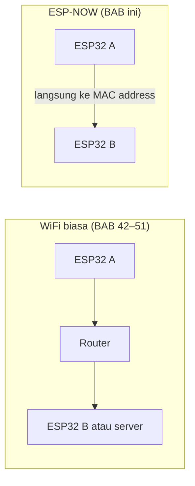
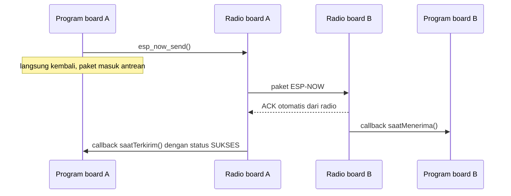
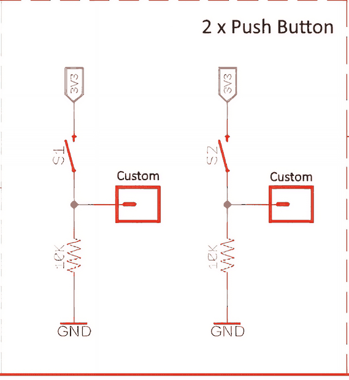
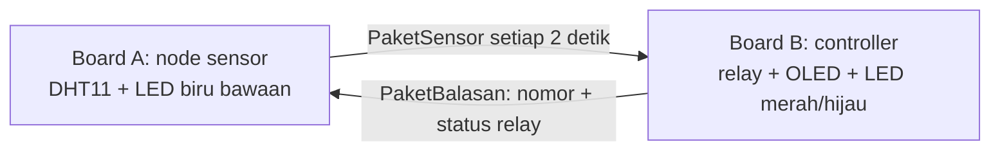
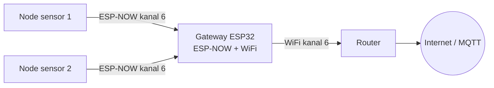

# BAB 54: ESP-NOW

> ✅ **Prasyarat:** Selesaikan **BAB 42 (WiFi Station Mode — Koneksi Internet ESP32)** — kamu sudah mengenal MAC *address*, kanal WiFi, dan `WiFi.mode(WIFI_STA)`. Kamu juga perlu terbiasa dengan `millis()` tanpa `delay()` dari **BAB 16 (Non-Blocking Programming)** dan *callback* dari **BAB 18 (Callback & Event-Driven Programming)**. Program di BAB ini juga memakai tombol dari [BAB 9 (Digital Input — Push Button)](../BAB-09/README.md), bagian kritis `portMUX_TYPE` dari [BAB 10 (Interrupt & ISR)](../BAB-10/README.md), DHT11 dari [BAB 26 (DHT11 — Suhu & Kelembapan)](../BAB-26/README.md), OLED dari [BAB 35 (OLED Display 128×64)](../BAB-35/README.md), dan *relay* dari [BAB 37 (Relay — Kontrol AC/DC)](../BAB-37/README.md).

Di BAB 42–51, setiap pesan dari ESP32 harus lewat *router* WiFi. Di BAB 52–53, ESP32 berbicara dengan HP lewat Bluetooth. Bagaimana kalau dua ESP32 ingin saling berkirim pesan **langsung**, misalnya tombol di teras menyalakan lampu di garasi, atau sensor suhu di gudang melapor ke layar di ruang kerja, tanpa *router* sama sekali? Itulah tugas **ESP-NOW**, protokol buatan Espressif yang mirip *walkie-talkie* digital: sebuah ESP32 bisa langsung "memanggil" ESP32 lain lewat MAC *address*-nya. BAB ini membutuhkan **dua *board* ESP32**, jadi siapkan *board* kedua atau ajak teman yang juga punya kit untuk berpasangan.

## 📌 Tujuan Pembelajaran

Setelah mempelajari BAB ini, kamu bisa:

- Menjelaskan cara kerja ESP-NOW dan bedanya dengan WiFi lewat *router*, Bluetooth, dan ESP-MESH.
- Membaca MAC *address* setiap *board* dengan benar di core 3.3.x dan menuliskannya sebagai *array* di kode.
- Menyiapkan dua *board* sekaligus: memberi label, memilih *port* yang benar saat mengunggah, dan membuka dua Serial Monitor.
- Memakai fungsi `esp_now_init()`, `esp_now_add_peer()`, dan `esp_now_send()`, serta *callback* kirim dan terima dengan bentuk (tanda tangan) yang benar untuk core 3.3.x.
- Mengirim beberapa nilai sekaligus dengan `struct` yang identik di pengirim dan penerima, sambil memahami batas ukuran paket.
- Memahami arti konfirmasi (ACK) ESP-NOW dan membuat balasan sendiri kalau perlu kepastian.
- Membuat tiga pola komunikasi: *unicast* (tombol → LED), *broadcast* (satu sensor → banyak layar), dan dua arah (node sensor ↔ *controller relay*).
- Menjalankan ESP-NOW bersama koneksi WiFi *router* dan mengenal dasar enkripsinya.

## 🧰 Yang Perlu Disiapkan

| Kebutuhan | Keterangan |
|---|---|
| *Hardware* | **Dua *board* ESP32**, masing-masing dengan kabel USB **data**. *Board* A: kit Bluino ESP32 IoT Starter Shield (memakai S1 dan DHT11). *Board* B: sebaiknya kit Bluino kedua (memakai LED, OLED, dan *relay*); ESP32 DEVKIT V1 polos juga bisa, tetapi hasilnya sebagian besar hanya terlihat di Serial Monitor (lihat [54.3](#543-menyiapkan-dua-board-esp32)) |
| Kabel *jumper* | *Board* A: `SW1` → IO15 dan `DHT` → IO27. *Board* B: `LED1` (merah) → IO4, `LED2` (hijau) → IO17, dan `RELAY` → IO26. Semuanya kabel *female-female* yang ada di kit. OLED tersambung lewat *jumper cap* **JP** |
| Komponen tambahan | ***Board* ESP32 kedua — tidak termasuk kit.** Pinjam kit teman, atau beli ESP32 DEVKIT V1 (30 pin, chip ESP32 klasik). Opsional: *charger* HP atau *power bank* untuk menyalakan salah satu *board* tanpa laptop |
| *Software* | Arduino IDE 2.x + *board package* **esp32** versi 3.3.x (lihat [BAB 5](../BAB-05/README.md)) |
| *Library* | Program 1 tidak perlu *library* tambahan (`WiFi`, `esp_wifi`, dan `esp_now` sudah termasuk di *board package* esp32). Program 2 dan 3 butuh **DHT sensor library** + **Adafruit Unified Sensor** by Adafruit untuk *board* A ([cara memasang di BAB 26](../BAB-26/README.md#265-memasang-library-dht)) serta **Adafruit SSD1306** + **Adafruit GFX Library** by Adafruit untuk *board* B ([cara memasang di BAB 35](../BAB-35/README.md#352-memasang-library-adafruit-ssd1306-dan-gfx)) |
| Alat uji | **Serial Monitor** Arduino IDE (baud 115200) — idealnya dua sekaligus, satu untuk setiap *board*, dengan dua jendela Arduino IDE (caranya di [54.3](#543-menyiapkan-dua-board-esp32)) |
| Jaringan | **Tidak perlu WiFi atau *router*.** Hanya bagian opsional [54.9](#549-esp-now-bersamaan-dengan-wifi-router) yang memakai WiFi 2,4 GHz |

> 📌 **Catatan:** *Board* ESP32 kedua memang tidak ada di dalam kit. Cara paling mudah adalah berpasangan dengan teman: satu kit menjadi *board* A, kit lainnya menjadi *board* B. Kalau kamu hanya punya satu laptop, satu *board* cukup dinyalakan dari *charger* HP setelah programnya diunggah.

## 📑 Daftar Isi

- [54.1 Apa Itu ESP-NOW?](#541-apa-itu-esp-now)
- [54.2 MAC Address, Kanal, dan Peer](#542-mac-address-kanal-dan-peer)
- [54.3 Menyiapkan Dua Board ESP32](#543-menyiapkan-dua-board-esp32)
- [54.4 Fungsi-Fungsi ESP-NOW di Core 3.3.x](#544-fungsi-fungsi-esp-now-di-core-33x)
- [54.5 Paket Data dengan struct](#545-paket-data-dengan-struct)
- [54.6 Program 1: Tombol di Board A, LED di Board B](#546-program-1-tombol-di-board-a-led-di-board-b)
- [54.7 Program 2: Broadcast Suhu ke Semua Board](#547-program-2-broadcast-suhu-ke-semua-board)
- [54.8 Program 3: Node Sensor dan Controller Relay Dua Arah](#548-program-3-node-sensor-dan-controller-relay-dua-arah)
- [54.9 ESP-NOW Bersamaan dengan WiFi Router](#549-esp-now-bersamaan-dengan-wifi-router)
- [54.10 Enkripsi ESP-NOW](#5410-enkripsi-esp-now)
- [54.11 Troubleshooting](#5411-troubleshooting)
- [📝 Rangkuman](#-rangkuman)
- [💪 Latihan](#-latihan)
- [📚 Referensi](#-referensi)

---

## 54.1 Apa Itu ESP-NOW?

Bayangkan dua cara mengirim pesan ke tetangga sebelah rumah:

- **Lewat kantor pos.** Suratmu dibawa ke kantor pos, disortir, lalu diantar. Rapi dan bisa sampai ke mana saja, tetapi butuh kantor pos yang buka. Begitulah WiFi biasa: setiap pesan lewat *router* (BAB 42–51).
- **Lewat *walkie-talkie*.** Kamu langsung bicara, tetanggamu langsung mendengar. Tidak perlu kantor pos, asalkan kalian memakai **kanal** yang sama dan jaraknya masih terjangkau. Begitulah ESP-NOW.

**ESP-NOW** adalah protokol komunikasi buatan Espressif yang memakai radio WiFi 2,4 GHz di dalam ESP32, tetapi **tanpa** *router*, tanpa alamat IP, dan tanpa proses "menyambung" seperti WiFi biasa. Data dititipkan di dalam jenis bingkai WiFi khusus (*vendor-specific action frame*), lalu dikirim langsung ke MAC *address* ESP32 tujuan.



*Gambar 54.1 — WiFi biasa selalu lewat router, sedangkan ESP-NOW mengirim langsung dari ESP32 ke ESP32. Sumber: dibuat untuk materi ini.*

Sifat-sifat penting ESP-NOW:

| Sifat | ESP-NOW | Keterangan |
|---|---|---|
| Butuh *router*/internet | Tidak | Cukup dua ESP32 atau lebih yang memakai kanal sama |
| Alamat tujuan | MAC *address* (6 *byte*) | Atau alamat *broadcast* `FF:FF:FF:FF:FF:FF` untuk semua |
| Ukuran data per paket | Maks. **250 *byte*** (ESP-NOW v1.0) | ESP-NOW v2.0 bisa sampai 1470 *byte*, tetapi BAB ini tetap memakai paket kecil (lihat [54.5](#545-paket-data-dengan-struct)) |
| Jumlah *peer* (tujuan terdaftar) | Maks. 20 | Yang terenkripsi dibatasi lebih sedikit (bawaan 7) |
| Kecepatan radio bawaan | 1 Mbps | Lambat untuk *file*, tetapi lebih dari cukup untuk data sensor dan perintah |
| Jeda kirim | Biasanya beberapa milidetik | Tidak ada proses menyambung ke *router* atau server |
| Jangkauan | Puluhan meter di dalam ruangan; sekitar 200 m di area terbuka | Sangat bergantung pada antena, tembok, dan gangguan. Anggap angka ini perkiraan, bukan janji |
| Konfirmasi | ACK di tingkat radio untuk *unicast* | Artinya dibahas di [54.4](#544-fungsi-fungsi-esp-now-di-core-33x) |
| Enkripsi | Opsional | Kunci 16 *byte* (lihat [54.10](#5410-enkripsi-esp-now)) |

Di mana posisi ESP-NOW dibanding protokol nirkabel lain di kurikulum ini?

| Protokol | BAB | Siapa bicara dengan siapa | Butuh *router* | Cocok untuk |
|---|---|---|---|---|
| WiFi + HTTP/MQTT/CoAP | 42–51 | ESP32 ↔ *router* ↔ server/HP | Ya | Data ke internet, *dashboard*, *cloud* |
| Bluetooth Classic / BLE | 52–53 | ESP32 ↔ HP/laptop | Tidak | Kontrol dan pemantauan dari HP |
| **ESP-NOW** | **54** | **ESP32 ↔ ESP32** | **Tidak** | *Remote control*, sensor nirkabel ke layar/panel, robot |
| ESP-MESH | [55](../BAB-55/README.md) | Banyak ESP32 saling meneruskan pesan | Tidak (opsional untuk internet) | Jaringan besar yang melebihi jangkauan satu radio |

> 📌 **Catatan:** HP dan laptop **tidak bisa** berbicara ESP-NOW, karena ESP-NOW hanya dipahami chip WiFi buatan Espressif (ESP32, ESP32-S2/S3/C3/C6, ESP8266). Kalau data ESP-NOW perlu sampai ke HP atau internet, satu ESP32 dijadikan **gateway** yang juga tersambung ke WiFi ([54.9](#549-esp-now-bersamaan-dengan-wifi-router)).

---

## 54.2 MAC Address, Kanal, dan Peer

Ada tiga hal yang harus disepakati dua *board* sebelum bisa ber-ESP-NOW: **alamat** (MAC *address*), **kanal**, dan **daftar kontak** (*peer*).

### 54.2.1 MAC Address: Alamat Setiap Board

Kamu sudah mengenal MAC *address* di [BAB 42](../BAB-42/README.md): nomor unik 6 *byte* yang ditanam di chip saat produksi, ditulis dalam heksadesimal seperti `24:6F:28:AB:CD:EF`. ESP-NOW memakai nomor ini sebagai alamat tujuan, persis seperti nomor HP di buku kontak.

Satu chip ESP32 sebenarnya punya beberapa MAC *address* yang berbeda di angka terakhirnya: satu untuk mode Station, satu untuk mode *Access Point*, dan satu untuk Bluetooth. Karena semua program di BAB ini memakai `WiFi.mode(WIFI_STA)`, yang dipakai adalah **MAC Station**. Cara membacanya di core 3.3.x:

```cpp
#include <WiFi.h>
#include <esp_wifi.h>   // untuk esp_wifi_get_mac()

// ... di dalam setup(), setelah Serial.begin(115200):
WiFi.mode(WIFI_STA);    // nyalakan radio WiFi sebagai Station
WiFi.STA.begin();       // tunggu radio benar-benar menyala (maks. 1 detik)

uint8_t mac[6];
esp_wifi_get_mac(WIFI_IF_STA, mac);   // tanya langsung ke driver WiFi
Serial.printf("%02X:%02X:%02X:%02X:%02X:%02X\n",
              mac[0], mac[1], mac[2], mac[3], mac[4], mac[5]);
```

> 📌 **Catatan:** `WiFi.macAddress()` dari BAB 42 juga bisa dipakai, tetapi di core 3.x nilainya baru terisi setelah radio Station selesai menyala. Kalau dipanggil terlalu cepat, hasilnya bisa `00:00:00:00:00:00`. `esp_wifi_get_mac()` langsung bertanya ke *driver* WiFi, jadi hasilnya benar setelah `WiFi.mode(WIFI_STA)`. Semua program di BAB ini memakai cara ini dan mencetak MAC *board*-nya sendiri saat mulai, jadi kamu tidak perlu mengunggah potongan kode di atas secara terpisah.

Di dalam kode C++, MAC *address* ditulis sebagai *array* 6 *byte*. Setiap pasangan huruf di antara titik dua menjadi satu angka berawalan `0x` (tanda angka heksadesimal):

| Bentuk | Contoh |
|---|---|
| Teks di Serial Monitor | `24:6F:28:AB:CD:EF` |
| *Array* di kode | `{0x24, 0x6F, 0x28, 0xAB, 0xCD, 0xEF}` |

Supaya tidak salah ketik, setiap program di BAB ini mencetak MAC-nya dalam **dua bentuk sekaligus**. Baris `Format kode` tinggal kamu salin lalu tempel ke program *board* lain.

Ada satu alamat istimewa: **`FF:FF:FF:FF:FF:FF`**, alamat *broadcast*. Paket yang dikirim ke alamat ini diterima oleh semua ESP32 ber-ESP-NOW di kanal yang sama, seperti pengumuman lewat pengeras suara.

### 54.2.2 Kanal: Harus Sama di Semua Board

Pita 2,4 GHz dibagi menjadi beberapa **kanal** (*channel*), di Indonesia kanal 1–13. Radio ESP32 hanya mendengar satu kanal pada satu waktu, dan ESP-NOW mengirim di kanal yang sedang dipakai radio itu. Akibatnya, sama seperti *walkie-talkie*: **pengirim dan penerima harus berada di kanal yang sama**, kalau tidak, pesannya tidak akan pernah terdengar.

Semua program di BAB ini memakai konstanta yang sama:

```cpp
const uint8_t KANAL_ESPNOW = 1;   // harus sama di semua board
...
WiFi.setChannel(KANAL_ESPNOW);    // pindahkan radio ke kanal ini
```

Pakailah kanal **1 sampai 11**: kanal-kanal ini diizinkan di semua pengaturan negara, sedangkan kanal 12–13 bisa ditolak tergantung pengaturan negara di *driver* WiFi. Situasinya berbeda kalau salah satu *board* juga tersambung ke *router*: radionya harus mengikuti kanal *router*, sehingga *board* lain harus ikut pindah ke kanal itu ([54.9](#549-esp-now-bersamaan-dengan-wifi-router)).

### 54.2.3 Peer: Daftar Kontak

Sebelum mengirim ke sebuah MAC *address*, alamat itu harus didaftarkan dulu sebagai ***peer*** (rekan), mirip menyimpan nomor ke buku kontak sebelum bisa mengirim pesan. Aturannya:

- **Mengirim** ke sebuah alamat → alamat itu wajib terdaftar sebagai *peer*. Untuk *broadcast*, daftarkan `FF:FF:FF:FF:FF:FF`.
- **Menerima** tidak perlu mendaftarkan pengirim (kecuali memakai enkripsi). Penerima menerima paket dari siapa pun di kanal yang sama, jadi programmu sendiri yang harus memeriksa apakah paketnya benar.
- Maksimal **20 *peer***. Dari jumlah itu, *peer* terenkripsi dibatasi lebih sedikit (bawaan *board package* 3.3.x: 7).

Dua cara mengirim yang akan kamu coba:

| | *Unicast* (satu tujuan) | *Broadcast* (semua) |
|---|---|---|
| Alamat tujuan | MAC *board* tertentu | `FF:FF:FF:FF:FF:FF` |
| Penerima | Hanya *board* itu | Semua *board* ESP-NOW di kanal yang sama |
| Konfirmasi ACK dari radio penerima | Ada; radio pengirim otomatis mencoba ulang beberapa kali kalau ACK tidak datang | Tidak ada; pengirim tidak tahu siapa yang menerima |
| Bisa dienkripsi | Ya | Tidak |
| Contoh di BAB ini | Program 1 dan 3 | Program 2 |

---

## 54.3 Menyiapkan Dua Board ESP32

Bekerja dengan dua *board* sekaligus punya tantangan sendiri: program mana masuk ke *board* mana, *port* mana milik siapa, dan Serial Monitor mana yang sedang kamu lihat. Siapkan dulu langkah-langkah berikut sekali saja.

### 54.3.1 Pilihan Board Kedua

| Pilihan | Kelebihan | Yang perlu diperhatikan |
|---|---|---|
| Kit Bluino kedua (pinjam teman) | Semua program berjalan lengkap: LED, OLED, dan *relay* di *board* B | Sepakati siapa *board* A dan siapa *board* B |
| ESP32 DEVKIT V1 polos | Murah; semua program tetap bisa diunggah | Tidak ada tombol, OLED, DHT11, atau *relay*. Jadikan *board* B dan pantau hasilnya di Serial Monitor. Di Program 1, ganti pin LED menjadi `2` (LED biru bawaan *board*) |
| *Board* ESP32 jenis lain (ESP32-S3, ESP32-C3, dan sebagainya) | ESP-NOW juga didukung | Pilih *board* yang sesuai di **Tools → Board**, dan nomor pinnya bisa berbeda. ESP32-H2 **tidak** bisa karena tidak punya WiFi |

### 54.3.2 Beri Label A dan B

1. Tempel selotip kertas (*masking tape*) di setiap *board* dan tulis **A** dan **B**.
2. Setelah Program 1 berjalan, tulis juga 3 *byte* terakhir MAC *address*-nya di label (misalnya `B: …AB:CD:EF`). Catatan ini memudahkan Program 3 nanti.

Rencana kabel untuk seluruh BAB (pasang sekali, boleh dibiarkan terpasang):

| *Board* | Pin **Custom** di kit | Sambungkan ke pin ESP32 | Dipakai di |
|---|---|---|---|
| A | `SW1` — header kuning, pin ke-3 dari kiri | IO15 (label `15`, deretan bawah) | Program 1 |
| A | `DHT` — header hijau, pin ke-3 dari atas | IO27 (label `27`, deretan atas) | Program 2 dan 3 |
| B | `LED1` (merah) — header LED | IO4 (label `4`, deretan bawah) | Program 1 dan 3 |
| B | `LED2` (hijau) — header LED | IO17 (label `17`, deretan bawah) | Program 3 |
| B | `RELAY` — header biru, di **kanan** `BUZZ` | IO26 (label `26`, deretan atas) | Program 3 |
| B | OLED | Sudah tersambung lewat *jumper cap* **JP** (SDA IO21, SCL IO22) | Program 2 dan 3 |

> ⚠️ **Perhatian:** Label `15` di deretan bawah bersebelahan dengan `G` (GND). Kabel S1 yang tergeser satu pin akan menyambung 3,3 V ke GND saat S1 ditekan. Pin `RELAY` juga bersebelahan dengan `BUZZ`; kalau tertukar, *buzzer* yang berbunyi.

### 54.3.3 Mengenali Port Setiap Board

1. Colokkan **hanya *board* A** ke laptop. Buka **Tools → Port** dan catat *port* yang muncul, misalnya `COM5` (Windows), `/dev/ttyUSB0` (Linux), atau `/dev/cu.usbserial-…` (macOS).
2. Colokkan *board* B. Buka lagi **Tools → Port**: *port* yang **baru** muncul adalah milik *board* B, misalnya `COM7`.
3. Ragu? Cabut salah satu *board*, lalu lihat *port* mana yang hilang dari daftar.

Nomor *port* bisa berubah kalau *board* dicolokkan ke lubang USB lain, jadi periksa lagi setiap kali kamu memindah kabel.

### 54.3.4 Dua Jendela Arduino IDE, Dua Serial Monitor

Di Arduino IDE 2.x, setiap jendela punya pilihan *board*, *port*, dan Serial Monitor sendiri. Manfaatkan itu:

1. Buka program untuk *board* A (**File → Open**, atau **File → New Sketch** lalu tempel kodenya). Di jendela ini pilih **Tools → Board → ESP32 Dev Module** dan **Tools → Port** = *port* *board* A.
2. Buka program untuk *board* B dengan cara yang sama. Program itu terbuka di **jendela baru**. Di jendela kedua ini, pilih *port* *board* B.
3. Klik **Upload** di masing-masing jendela. Setiap jendela mengunggah ke *port*-nya sendiri.
4. Buka **Tools → Serial Monitor** di **kedua** jendela, pilih baud **115200**, lalu atur kedua jendela berdampingan. Sekarang kamu bisa melihat pesan *board* A dan *board* B bersamaan.

> 💡 **Tips:** Kalau unggahan gagal dengan pesan bahwa *port* sedang dipakai atau tidak bisa dibuka, kemungkinan *port* itu sedang dibuka Serial Monitor di jendela lain. Tutup Serial Monitor itu dulu, unggah, lalu buka lagi.

**Hanya punya satu laptop dengan satu lubang USB?** Tidak masalah:

1. Unggah program *board* B, lihat MAC-nya di Serial Monitor, lalu cabut kabelnya dari laptop.
2. Nyalakan *board* B dari *charger* HP atau *power bank*. Program tetap berjalan; ESP-NOW tidak butuh laptop.
3. Colokkan *board* A ke laptop, unggah programnya, dan pantau lewat Serial Monitor.

---

## 54.4 Fungsi-Fungsi ESP-NOW di Core 3.3.x

ESP-NOW sudah termasuk di *board package* esp32, jadi tidak ada *library* yang perlu dipasang. Cukup tiga baris `#include`:

```cpp
#include <WiFi.h>      // menyalakan radio dan memilih kanal
#include <esp_wifi.h>  // esp_wifi_get_mac()
#include <esp_now.h>   // fungsi-fungsi ESP-NOW
```

### 54.4.1 Urutan Memulai ESP-NOW

Semua program di BAB ini memulai ESP-NOW dengan urutan yang sama:

```cpp
WiFi.mode(WIFI_STA);                      // 1. nyalakan radio WiFi sebagai Station
WiFi.STA.begin();                         // 2. tunggu radio benar-benar menyala
WiFi.setChannel(KANAL_ESPNOW);            // 3. pindah ke kanal yang disepakati
esp_now_init();                           // 4. nyalakan ESP-NOW
esp_now_register_send_cb(saatTerkirim);   // 5. (opsional) callback setelah mengirim
esp_now_register_recv_cb(saatMenerima);   // 6. (opsional) callback saat paket masuk
// 7. daftarkan peer tujuan dengan esp_now_add_peer()
// 8. kirim dengan esp_now_send()
```

| Langkah | Kenapa perlu |
|---|---|
| `WiFi.mode(WIFI_STA)` | ESP-NOW memakai radio WiFi, jadi radio harus menyala. Mode Station dipilih karena tidak ikut memancarkan jaringan WiFi sendiri. ESP32 **tidak** menyambung ke *router* mana pun, karena `WiFi.begin()` tidak dipanggil |
| `WiFi.STA.begin()` | Tanpa nama WiFi, fungsi ini hanya menunggu (paling lama 1 detik) sampai radio Station selesai menyala, sehingga MAC dan kanal bisa diatur dengan aman |
| `WiFi.setChannel()` | Menyamakan kanal semua *board* ([54.2.2](#5422-kanal-harus-sama-di-semua-board)) |
| `esp_now_init()` | Menyalakan ESP-NOW. Hasilnya `ESP_OK` kalau berhasil |
| `register_..._cb()` | Memberi tahu ESP-NOW fungsi mana yang dipanggil saat ada kejadian (pola *callback* dari [BAB 18](../BAB-18/README.md)) |

> 📌 **Catatan:** Banyak contoh lama di internet memanggil `WiFi.disconnect()` setelah `WiFi.mode(WIFI_STA)`. Di core 3.3.x baris itu tidak diperlukan, karena ESP32 memang tidak menyambung ke *router* sebelum `WiFi.begin()` dipanggil.

### 54.4.2 Mendaftarkan Peer dan Mengirim

```cpp
esp_now_peer_info_t peer = {};          // semua kolom diisi 0 dulu
memcpy(peer.peer_addr, MAC_TUJUAN, 6);  // alamat tujuan (6 byte)
peer.channel = 0;                       // 0 = ikut kanal radio saat ini
peer.ifidx = WIFI_IF_STA;               // kirim lewat antarmuka Station
peer.encrypt = false;                   // tanpa enkripsi
esp_now_add_peer(&peer);

esp_err_t hasil = esp_now_send(MAC_TUJUAN, (uint8_t *)&paket, sizeof(paket));
```

- `memcpy(tujuan, sumber, jumlah)` menyalin sejumlah *byte* dari satu tempat ke tempat lain. Di sini, 6 *byte* MAC disalin ke kolom `peer_addr`.
- `esp_now_send()` menerima tiga hal: alamat tujuan, alamat data yang dikirim (diubah menjadi "deretan *byte*" dengan `(uint8_t *)&paket`), dan jumlah *byte*-nya (`sizeof(paket)`).
- Hasil `ESP_OK` **belum** berarti paket sampai. Artinya hanya "paket sudah masuk antrean radio". Hasil pengiriman yang sebenarnya dilaporkan belakangan lewat *callback* kirim.

Kalau hasilnya bukan `ESP_OK`, paket ditolak sebelum dikirim. Pesan yang paling sering muncul (cetak dengan `esp_err_to_name(hasil)`):

| Kode | Arti | Penyebab umum |
|---|---|---|
| `ESP_ERR_ESPNOW_NOT_INIT` | ESP-NOW belum dinyalakan | `esp_now_init()` belum dipanggil atau gagal |
| `ESP_ERR_ESPNOW_NOT_FOUND` | Tujuan belum terdaftar sebagai *peer* | Lupa `esp_now_add_peer()` |
| `ESP_ERR_ESPNOW_ARG` | Argumen tidak valid | Data terlalu panjang atau alamat data kosong |
| `ESP_ERR_ESPNOW_NO_MEM` | Antrean penuh | Mengirim terlalu cepat; beri jeda sampai *callback* kirim sebelumnya datang |
| `ESP_ERR_ESPNOW_CHAN` | Kanal *peer* tidak cocok dengan kanal radio | `peer.channel` diisi kanal lain; pakai `0` |
| `ESP_ERR_ESPNOW_EXIST` | (dari `esp_now_add_peer()`) *peer* sudah terdaftar | Mendaftarkan alamat yang sama dua kali; periksa dulu dengan `esp_now_is_peer_exist()` |
| `ESP_ERR_ESPNOW_FULL` | (dari `esp_now_add_peer()`) daftar *peer* penuh | Sudah ada 20 *peer* |

### 54.4.3 Callback Kirim dan Terima (Bentuk Core 3.3.x)

Bentuk (tanda tangan) kedua *callback* sudah berubah beberapa kali. Contoh lama di internet sering memakai bentuk core 2.x dan akan gagal di-*compile* di core 3.3.x. Ini bentuk yang benar:

```cpp
// Dipanggil setelah sebuah paket selesai dikirim
void saatTerkirim(const wifi_tx_info_t *info, esp_now_send_status_t status) {
  // status == ESP_NOW_SEND_SUCCESS → radio penerima mengirim ACK
  // info->des_addr                 → alamat tujuan paket
}

// Dipanggil setiap ada paket ESP-NOW masuk
void saatMenerima(const esp_now_recv_info_t *info, const uint8_t *data, int len) {
  // info->src_addr      → MAC pengirim (6 byte)
  // info->rx_ctrl->rssi → kekuatan sinyal paket ini (dBm)
  // data, len           → isi paket dan panjangnya (byte)
}
```

| *Callback* | Core 2.x (jangan dipakai) | Core 3.0–3.2 | Core 3.3.x (BAB ini) |
|---|---|---|---|
| Terima | `(const uint8_t *mac, const uint8_t *data, int len)` | `(const esp_now_recv_info_t *info, const uint8_t *data, int len)` | Sama dengan core 3.0–3.2 |
| Kirim | `(const uint8_t *mac, esp_now_send_status_t status)` | Sama dengan core 2.x | `(const wifi_tx_info_t *info, esp_now_send_status_t status)` |

### 54.4.4 Arti ACK: Sampai di Radio, Belum Tentu Diproses

Untuk *unicast*, radio penerima otomatis membalas dengan **ACK** (*acknowledgement*, tanda terima) begitu paket sampai dengan utuh. Kalau ACK tidak datang, radio pengirim mencoba mengirim ulang beberapa kali, lalu melaporkan hasilnya lewat *callback* kirim.



*Gambar 54.2 — Perjalanan satu paket unicast. ACK dikirim oleh radio penerima, bukan oleh program di board B. Sumber: dibuat untuk materi ini.*

Hal yang sering disalahpahami:

- **`ESP_NOW_SEND_SUCCESS` hanya berarti radio *board* B sudah menerima paketnya.** Dokumentasi Espressif menegaskan bahwa ini tidak menjamin program di *board* B ikut menerimanya. Misalnya, *board* B sedang menjalankan program lain yang tidak memakai paket itu, tetapi radionya tetap mengirim ACK.
- **`ESP_NOW_SEND_FAIL`** berarti setelah beberapa kali percobaan, ACK tidak pernah datang: *board* B mati, MAC salah, kanal berbeda, atau terlalu jauh.
- **Untuk *broadcast* tidak ada ACK.** Hasil *callback* kirimnya tidak bisa dipakai untuk mengetahui apakah ada yang menerima.
- Kalau kamu butuh kepastian bahwa **program** penerima sudah memproses datanya, buat balasan sendiri: penerima mengirim paket balik berisi nomor paket yang diterimanya. Itulah yang dilakukan Program 3.

### 54.4.5 Callback Berjalan di Task WiFi: Cukup Salin dan Angkat Bendera

Kedua *callback* ESP-NOW **tidak** dijalankan oleh `loop()`, melainkan oleh *task* WiFi yang berprioritas tinggi di inti (*core*) 0, sementara `loop()` berjalan di inti 1. Akibatnya:

- Isi *callback* harus **singkat**. Jangan memanggil `delay()`, menggambar OLED, membaca DHT11, atau mencetak banyak teks di dalamnya, karena semua itu menahan *task* WiFi sehingga paket berikutnya bisa terlewat.
- Data yang ditulis *callback* dan dibaca `loop()` adalah **data bersama** antara dua inti. Kalau `loop()` sedang membaca sebuah paket tepat saat paket baru masuk, isinya bisa tercampur separuh lama, separuh baru.

Polanya sama seperti ISR di [BAB 10](../BAB-10/README.md): *callback* hanya menyalin data dan mengangkat bendera, lalu `loop()` yang mengerjakan sisanya. Salinannya dijaga dengan bagian kritis `portMUX_TYPE`. Karena *callback* ESP-NOW berjalan di *task* (bukan ISR), versi yang dipakai adalah `portENTER_CRITICAL()`/`portEXIT_CRITICAL()` biasa:

```cpp
portMUX_TYPE kunci = portMUX_INITIALIZER_UNLOCKED;
volatile bool adaPaketBaru = false;
PaketLed paketMasuk;

void saatMenerima(const esp_now_recv_info_t *info, const uint8_t *data, int len) {
  if (len != sizeof(PaketLed)) return;          // ukuran tidak cocok: abaikan
  portENTER_CRITICAL(&kunci);
  memcpy(&paketMasuk, data, sizeof(PaketLed));  // 1. salin
  adaPaketBaru = true;                          // 2. angkat bendera
  portEXIT_CRITICAL(&kunci);
}

void loop() {
  if (adaPaketBaru) {
    PaketLed paket;
    portENTER_CRITICAL(&kunci);
    paket = paketMasuk;       // ambil salinan secepatnya
    adaPaketBaru = false;
    portEXIT_CRITICAL(&kunci);
    // ... proses paket dengan santai di sini (Serial, OLED, LED, relay)
  }
}
```

Untuk hasil *callback* kirim, cukup satu variabel `volatile uint8_t` berukuran 1 *byte*. Variabel sekecil itu selalu ditulis dan dibaca dalam satu langkah, jadi tidak perlu dikunci.

<details>
<summary><b>🔬 Pendalaman (opsional): library C++ ESP32_NOW bawaan core</b></summary>

Selain fungsi C `esp_now_*` yang dipakai di BAB ini, *board package* esp32 3.x juga menyertakan *library* C++ bernama **ESP32_NOW** (`#include "ESP32_NOW.h"`). Contohnya bisa dibuka lewat **File → Examples → ESP_NOW** setelah memilih *board* ESP32 Dev Module, misalnya `ESP_NOW_Broadcast_Master` dan `ESP_NOW_Broadcast_Slave`.

*Library* itu membungkus fungsi yang sama dalam kelas: `ESP_NOW.begin()` menggantikan `esp_now_init()`, dan setiap *peer* dibuat sebagai kelas turunan `ESP_NOW_Peer` yang punya fungsi `onReceive()` dan `onSent()`. *Library* ini juga punya `ESP_NOW.getVersion()` dan `ESP_NOW.getMaxDataLen()` untuk mengetahui versi ESP-NOW dan ukuran paket maksimal.

BAB ini sengaja memakai fungsi C `esp_now_*` karena lapisannya lebih sedikit, sama persis dengan dokumentasi ESP-IDF, dan paling banyak dipakai di contoh-contoh internet. Setelah memahami BAB ini, kamu akan mudah membaca kedua gaya tersebut. Pilih **salah satu** gaya untuk satu program; jangan mencampurnya, karena keduanya sama-sama mendaftarkan *callback*.

</details>

---

## 54.5 Paket Data dengan struct

ESP-NOW hanya mengirim **deretan *byte***. Ia tidak tahu bahwa 4 *byte* pertama adalah nomor paket dan *byte* berikutnya status LED. Supaya beberapa nilai bisa dikirim sekaligus dan dibaca dengan benar, kita membungkusnya dalam sebuah `struct` — bayangkan **formulir** dengan kolom-kolom yang urutannya sudah disepakati.

```cpp
// Isi paket Program 1: HARUS sama persis di pengirim dan penerima
struct PaketLed {
  uint32_t nomor;     // nomor urut paket: 1, 2, 3, ...
  uint8_t  ledNyala;  // 1 = nyalakan LED merah, 0 = matikan
};
```

Pengirim mengisi formulir lalu mengirim seluruh isinya: `esp_now_send(mac, (uint8_t *)&paket, sizeof(paket))`. Penerima menyalin *byte*-*byte* itu kembali ke `struct` yang **sama persis**: `memcpy(&paketMasuk, data, sizeof(PaketLed))`.

### 54.5.1 Aturan Emas: Struct Harus Identik

Penerima tidak menerima nama kolom, hanya *byte*. Kalau definisi `struct` di kedua program berbeda, *byte*-nya dibaca di tempat yang salah:

| Di pengirim | Di penerima | Akibat |
|---|---|---|
| `uint32_t nomor; uint8_t ledNyala;` | `uint32_t nomor; uint8_t ledNyala;` | ✅ Benar |
| `uint32_t nomor; uint8_t ledNyala;` | `uint8_t ledNyala; uint32_t nomor;` (urutan tertukar) | ❌ Nilai kacau |
| `float suhu;` | `int suhu;` (tipe berbeda) | ❌ Angka aneh, misalnya `1105199104` |
| Ada kolom tambahan | Tidak ada | ❌ Ukuran berbeda, paket ditolak oleh pemeriksaan `len` |

Cara paling aman: **salin-tempel** definisi `struct` yang sama ke kedua program, dan setiap kali mengubahnya, unggah ulang **kedua** *board*.

### 54.5.2 Ukuran Paket dan Padding

Coba tebak: berapa *byte* `PaketLed`? `uint32_t` = 4 *byte* dan `uint8_t` = 1 *byte*, jadi 5? Ternyata `sizeof(PaketLed)` bernilai **8**. *Compiler* menambahkan 3 *byte* kosong (***padding***, pengganjal) di akhir supaya ukuran `struct` kelipatan 4. Prosesor ESP32 membaca angka 4 *byte* paling cepat kalau letaknya di alamat kelipatan 4.

| *Byte* ke- | 0–3 | 4 | 5–7 |
|---|---|---|---|
| Isi | `nomor` | `ledNyala` | *padding* (tidak dipakai) |

Selama kedua *board* sama-sama ESP32 yang di-*compile* dengan Arduino IDE, *padding*-nya sama persis, jadi tidak masalah. Beberapa kebiasaan baik:

- Pakai **tipe berukuran pasti**: `uint8_t`, `int16_t`, `uint32_t`, `float`. Hindari `int` dan `long` kalau suatu saat paketnya akan diterima *board* jenis lain.
- **Jangan** memasukkan `String`, *pointer*, atau *array* yang ukurannya berubah. Yang terkirim hanya alamat memorinya, bukan isinya. Untuk teks, pakai *array* `char` berukuran tetap, misalnya `char nama[12];`.
- Penerima selalu memeriksa `len == sizeof(...)` sebelum menyalin. Paket dari program lain yang ukurannya berbeda otomatis diabaikan.
- Tulis definisi `struct` **di bagian atas** program, sebelum fungsi mana pun, supaya Arduino IDE tidak memunculkan *error* "'...' has not been declared".

> 💡 **Tips:** Kalau isi paket nantinya dibaca perangkat atau program lain yang aturan *padding*-nya bisa berbeda (misalnya program Python di komputer yang menerima *byte* mentah dari *gateway*), tambahkan `__attribute__((packed))` supaya tidak ada *padding* sama sekali: `struct __attribute__((packed)) PaketLed { ... };`. Ukurannya menjadi 5 *byte*. Pakai cara yang sama di **semua** sisi.

### 54.5.3 Batas 250 Byte

Satu paket ESP-NOW v1.0 berisi paling banyak **250 *byte*** (konstanta `ESP_NOW_MAX_DATA_LEN`). *Board package* 3.3.x memakai ESP-IDF 5.5 yang sudah mendukung **ESP-NOW v2.0** dengan paket sampai 1470 *byte*. Namun penerima v1.0 — misalnya ESP32 dengan *board package* lama atau ESP8266 — hanya bisa menerima paket sampai 250 *byte*; paket yang lebih panjang dipotong atau dibuang. Jadi, kebiasaan yang aman: **jaga paket tetap ≤ 250 *byte***. Paket terbesar di BAB ini hanya 24 *byte*.

Kamu bisa meminta *compiler* memeriksa ukurannya. Baris ini cukup ditulis sekali di bawah definisi `struct`; kalau paketnya kebesaran, *compile* langsung gagal dengan pesan yang kamu tulis:

```cpp
static_assert(sizeof(PaketLed) <= ESP_NOW_MAX_DATA_LEN, "Paket ESP-NOW lebih dari 250 byte!");
```

---

## 54.6 Program 1: Tombol di Board A, LED di Board B

**Tujuan:** Setiap kali tombol S1 di *board* A ditekan, LED merah di *board* B menyala atau mati. Perintahnya dikirim lewat ESP-NOW *unicast*, tanpa *router*. *Board* A juga menunjukkan apakah perintahnya sampai: LED biru bawaan *board* A berkedip singkat setiap kali radio *board* B mengirim ACK.

Program 1 terdiri dari **dua *sketch***:

| *Sketch* | Diunggah ke | Tugas |
|---|---|---|
| [`p1_receiver`](p1_receiver/p1_receiver.ino) | *Board* B | Menerima perintah, menyalakan/mematikan LED merah, dan mencetak MAC *board* B |
| [`p1_sender`](p1_sender/p1_sender.ino) | *Board* A | Membaca S1 dan mengirim perintah ke MAC *board* B |

**Rangkaian:**

| *Board* | Pin **Custom** di kit | Sambungkan ke pin ESP32 |
|---|---|---|
| A | `SW1` (header kuning, pin ke-3 dari kiri) | IO15 |
| B | `LED1` (merah, header LED) | IO4 |

LED biru di *board* A adalah LED bawaan *board* ESP32 di IO2, jadi tidak perlu kabel.



*Gambar 54.3 — Tombol S1 di kit memakai resistor pull-down 10 kΩ, jadi terbaca HIGH saat ditekan dan cukup memakai `pinMode(15, INPUT)`. Sumber: skematik ESP32 Starter Shield 3.2, [Bluino](http://www.bluino.com).*

**Cara Menjalankan:**

Unggah *board* B **lebih dulu**, karena *board* A perlu tahu MAC *board* B.

1. Pasang kabel sesuai tabel **Rangkaian** di atas, lalu colokkan kedua *board* dan kenali *port*-nya ([54.3.3](#5433-mengenali-port-setiap-board)).
2. **Board B:** buka Arduino IDE → **File → New Sketch**, hapus isinya, lalu salin kode **p1_receiver** di bawah (atau buka *file* [`p1_receiver.ino`](p1_receiver/p1_receiver.ino)). Pilih **Tools → Board** = **ESP32 Dev Module** dan **Tools → Port** = *port* *board* B, lalu klik **Upload** dan tunggu tulisan **Done uploading**.
3. Buka **Serial Monitor** di jendela itu (baud **115200**). Kalau tulisannya terlewat, tekan tombol **EN** di *board* B. Salin seluruh baris `Format kode`, misalnya `{0x24, 0x6F, 0x28, 0xAB, 0xCD, 0xEF}`.
4. **Board A:** buka **jendela kedua** (**File → New Sketch**), salin kode **p1_sender** (atau buka [`p1_sender.ino`](p1_sender/p1_sender.ino)). Ganti isi `MAC_PENERIMA` dengan baris yang kamu salin di langkah 3.
5. Di jendela kedua, pilih **Tools → Port** = *port* *board* A, lalu klik **Upload**.
6. Buka Serial Monitor di jendela kedua (baud **115200**), lalu tekan S1 di *board* A beberapa kali. Perhatikan LED merah di *board* B dan pesan di kedua Serial Monitor.

> 📌 **Catatan:** Selama kabel S1 terpasang di IO15, log *boot* bawaan ESP32 (baris seperti `rst:0x1 (POWERON_RESET),boot:0x13 ...`) tidak muncul di Serial Monitor *board* A. Itu normal dan aman (penjelasannya di [BAB 9](../BAB-09/README.md)).

**Kode Program — *board* B (penerima):**

<!-- sketch: p1_receiver -->
```cpp
/*
 * BAB 54 - Program 1 (board B): Penerima LED Merah
 *
 * Menerima perintah dari board A (p1_sender) lewat ESP-NOW, lalu
 * menyalakan/mematikan LED merah. MAC board ini dicetak di Serial
 * Monitor supaya bisa disalin ke MAC_PENERIMA di p1_sender.
 *
 * Rangkaian board B: LED1 (merah, header LED) -> IO4
 * Alat uji: Serial Monitor, baud 115200.
 */

#include <WiFi.h>
#include <esp_wifi.h>  // esp_wifi_get_mac()
#include <esp_now.h>   // fungsi-fungsi ESP-NOW

#define LED_MERAH 4  // LED1 (merah). Board ESP32 polos tanpa kit: ganti menjadi 2

const uint8_t KANAL_ESPNOW = 1;  // harus sama dengan board A

// Isi paket: HARUS sama persis dengan struct di p1_sender
struct PaketLed {
  uint32_t nomor;     // nomor urut paket: 1, 2, 3, ...
  uint8_t  ledNyala;  // 1 = nyalakan LED merah, 0 = matikan
};

// Data bersama antara callback (task WiFi) dan loop(), dijaga kunci (BAB 10)
portMUX_TYPE kunci = portMUX_INITIALIZER_UNLOCKED;
volatile bool adaPaketBaru = false;
PaketLed paketMasuk;
uint8_t macPengirim[6];
int rssiPaket = 0;

bool espNowSiap = false;

void cetakMac(const uint8_t *mac) {
  Serial.printf("%02X:%02X:%02X:%02X:%02X:%02X",
                mac[0], mac[1], mac[2], mac[3], mac[4], mac[5]);
}

// Mencetak MAC board ini dalam dua bentuk: teks biasa dan siap ditempel ke kode
void cetakMacBoardIni() {
  uint8_t mac[6];
  esp_wifi_get_mac(WIFI_IF_STA, mac);
  Serial.print("MAC board ini : ");
  cetakMac(mac);
  Serial.println();
  Serial.printf("Format kode   : {0x%02X, 0x%02X, 0x%02X, 0x%02X, 0x%02X, 0x%02X}\n",
                mac[0], mac[1], mac[2], mac[3], mac[4], mac[5]);
}

// Callback: dipanggil ESP-NOW setiap ada paket masuk (bentuk core 3.x)
void saatMenerima(const esp_now_recv_info_t *info, const uint8_t *data, int len) {
  if (len != sizeof(PaketLed)) return;  // ukuran tidak cocok: bukan paket kita
  portENTER_CRITICAL(&kunci);
  memcpy(&paketMasuk, data, sizeof(PaketLed));
  memcpy(macPengirim, info->src_addr, 6);
  rssiPaket = info->rx_ctrl->rssi;
  adaPaketBaru = true;
  portEXIT_CRITICAL(&kunci);
}

bool mulaiEspNow() {
  WiFi.mode(WIFI_STA);            // 1. nyalakan radio WiFi sebagai Station
  WiFi.STA.begin();               // 2. tunggu radio benar-benar menyala (maks. 1 detik)
  WiFi.setChannel(KANAL_ESPNOW);  // 3. pindah ke kanal yang disepakati
  cetakMacBoardIni();
  Serial.printf("Kanal         : %ld\n", (long)WiFi.channel());

  if (esp_now_init() != ESP_OK) {  // 4. nyalakan ESP-NOW
    Serial.println("ESP-NOW gagal dimulai. Tekan tombol EN untuk mencoba lagi.");
    return false;
  }
  esp_now_register_recv_cb(saatMenerima);  // 5. daftarkan callback terima
  return true;
}

void setup() {
  Serial.begin(115200);
  delay(1000);  // beri waktu Serial Monitor tersambung
  pinMode(LED_MERAH, OUTPUT);
  digitalWrite(LED_MERAH, LOW);

  Serial.println();
  Serial.println("BAB 54 - Program 1: Penerima LED Merah (board B)");

  espNowSiap = mulaiEspNow();
  if (!espNowSiap) return;

  Serial.println("Salin baris \"Format kode\" ke MAC_PENERIMA di p1_sender.");
  Serial.println("Menunggu perintah dari board A...");
}

void loop() {
  if (!espNowSiap || !adaPaketBaru) return;

  // Ambil salinan data dari callback, lalu lepaskan kunci secepatnya
  PaketLed paket;
  uint8_t mac[6];
  int rssi;
  portENTER_CRITICAL(&kunci);
  paket = paketMasuk;
  memcpy(mac, macPengirim, 6);
  rssi = rssiPaket;
  adaPaketBaru = false;
  portEXIT_CRITICAL(&kunci);

  digitalWrite(LED_MERAH, paket.ledNyala ? HIGH : LOW);

  Serial.printf("Paket #%lu dari ", (unsigned long)paket.nomor);
  cetakMac(mac);
  Serial.printf(" (RSSI %d dBm): LED %s\n", rssi, paket.ledNyala ? "NYALA" : "MATI");
}
```

**Kode Program — *board* A (pengirim):**

<!-- sketch: p1_sender -->
```cpp
/*
 * BAB 54 - Program 1 (board A): Pengirim Tombol S1
 *
 * Setiap kali S1 ditekan, board A mengirim perintah "LED merah nyala/mati"
 * langsung ke board B lewat ESP-NOW (unicast, tanpa router).
 * LED biru bawaan board A berkedip singkat setiap kali radio board B
 * mengonfirmasi bahwa paketnya sampai (ACK).
 *
 * Rangkaian board A: SW1 (header kuning, pin ke-3 dari kiri) -> IO15
 * Board B menjalankan p1_receiver. Isi MAC_PENERIMA dengan MAC board B.
 * Alat uji: Serial Monitor, baud 115200.
 */

#include <WiFi.h>
#include <esp_wifi.h>  // esp_wifi_get_mac()
#include <esp_now.h>   // fungsi-fungsi ESP-NOW

#define TOMBOL_S1 15  // S1: ditekan = HIGH (pull-down 10 kΩ di kit)
#define LED_BIRU  2   // LED biru bawaan board ESP32 (tidak perlu kabel)

const uint8_t KANAL_ESPNOW = 1;  // harus sama dengan board B

// ← ganti dengan MAC board B (baris "Format kode" di Serial Monitor board B)
uint8_t MAC_PENERIMA[6] = {0x00, 0x00, 0x00, 0x00, 0x00, 0x00};

// Isi paket: HARUS sama persis dengan struct di p1_receiver
struct PaketLed {
  uint32_t nomor;     // nomor urut paket: 1, 2, 3, ...
  uint8_t  ledNyala;  // 1 = nyalakan LED merah, 0 = matikan
};

const unsigned long WAKTU_DEBOUNCE = 50;   // ms, seperti BAB 9
const unsigned long LAMA_KEDIP     = 150;  // ms, lama LED biru menyala saat ACK datang

// Hasil pengiriman: ditulis callback (task WiFi), dibaca loop()
const uint8_t HASIL_BELUM_ADA = 0;
const uint8_t HASIL_SUKSES    = 1;
const uint8_t HASIL_GAGAL     = 2;
volatile uint8_t hasilKirim = HASIL_BELUM_ADA;

bool espNowSiap = false;
bool peerSiap = false;
PaketLed paket = {0, 0};
bool ledBTerkonfirmasi = false;  // keadaan LED board B yang terakhir dikonfirmasi ACK

int bacaanSebelumnya = LOW;      // variabel debounce (BAB 9)
int statusStabil = LOW;
unsigned long waktuBerubah = 0;

bool ledBiruNyala = false;
unsigned long waktuKedip = 0;

void cetakMac(const uint8_t *mac) {
  Serial.printf("%02X:%02X:%02X:%02X:%02X:%02X",
                mac[0], mac[1], mac[2], mac[3], mac[4], mac[5]);
}

// Mencetak MAC board ini dalam dua bentuk: teks biasa dan siap ditempel ke kode
void cetakMacBoardIni() {
  uint8_t mac[6];
  esp_wifi_get_mac(WIFI_IF_STA, mac);
  Serial.print("MAC board ini : ");
  cetakMac(mac);
  Serial.println();
  Serial.printf("Format kode   : {0x%02X, 0x%02X, 0x%02X, 0x%02X, 0x%02X, 0x%02X}\n",
                mac[0], mac[1], mac[2], mac[3], mac[4], mac[5]);
}

bool macMasihKosong(const uint8_t *mac) {
  for (int i = 0; i < 6; i++) {
    if (mac[i] != 0) return false;
  }
  return true;
}

// Callback: dipanggil ESP-NOW setelah paket selesai dikirim (bentuk core 3.3.x)
void saatTerkirim(const wifi_tx_info_t *info, esp_now_send_status_t status) {
  hasilKirim = (status == ESP_NOW_SEND_SUCCESS) ? HASIL_SUKSES : HASIL_GAGAL;
}

bool mulaiEspNow() {
  WiFi.mode(WIFI_STA);            // 1. nyalakan radio WiFi sebagai Station
  WiFi.STA.begin();               // 2. tunggu radio benar-benar menyala (maks. 1 detik)
  WiFi.setChannel(KANAL_ESPNOW);  // 3. pindah ke kanal yang disepakati
  cetakMacBoardIni();
  Serial.printf("Kanal         : %ld\n", (long)WiFi.channel());

  if (esp_now_init() != ESP_OK) {  // 4. nyalakan ESP-NOW
    Serial.println("ESP-NOW gagal dimulai. Tekan tombol EN untuk mencoba lagi.");
    return false;
  }
  esp_now_register_send_cb(saatTerkirim);  // 5. daftarkan callback kirim
  return true;
}

bool tambahPeer(const uint8_t *mac) {
  esp_now_peer_info_t peer = {};  // semua kolom diisi 0 dulu
  memcpy(peer.peer_addr, mac, 6);
  peer.channel = 0;               // 0 = ikut kanal radio saat ini
  peer.ifidx = WIFI_IF_STA;       // kirim lewat antarmuka Station
  peer.encrypt = false;           // tanpa enkripsi
  esp_err_t hasil = esp_now_add_peer(&peer);
  if (hasil != ESP_OK) {
    Serial.printf("Gagal mendaftarkan peer: %s\n", esp_err_to_name(hasil));
    return false;
  }
  return true;
}

void kirimPerintah(bool nyala) {
  if (!peerSiap) {
    Serial.println("MAC_PENERIMA belum diisi, tekanan S1 diabaikan.");
    return;
  }
  paket.nomor = paket.nomor + 1;
  paket.ledNyala = nyala ? 1 : 0;
  Serial.printf("Kirim #%lu: LED %s", (unsigned long)paket.nomor, nyala ? "NYALA" : "MATI");

  esp_err_t hasil = esp_now_send(MAC_PENERIMA, (uint8_t *)&paket, sizeof(paket));
  if (hasil != ESP_OK) {
    // Ditolak sebelum dikirim, jadi callback kirim tidak akan dipanggil
    Serial.printf(" -> ditolak: %s\n", esp_err_to_name(hasil));
  }
}

void setup() {
  Serial.begin(115200);
  delay(1000);  // beri waktu Serial Monitor tersambung
  pinMode(TOMBOL_S1, INPUT);
  pinMode(LED_BIRU, OUTPUT);
  digitalWrite(LED_BIRU, LOW);

  Serial.println();
  Serial.println("BAB 54 - Program 1: Pengirim Tombol S1 (board A)");

  espNowSiap = mulaiEspNow();
  if (!espNowSiap) return;

  if (macMasihKosong(MAC_PENERIMA)) {
    Serial.println("MAC_PENERIMA masih 00:00:00:00:00:00.");
    Serial.println("Isi dengan MAC board B, lalu upload ulang program ini.");
  } else {
    peerSiap = tambahPeer(MAC_PENERIMA);
    if (peerSiap) {
      Serial.print("Peer (board B): ");
      cetakMac(MAC_PENERIMA);
      Serial.println();
    }
  }
  Serial.println("Tekan S1 untuk menyalakan/mematikan LED merah di board B.");
}

void loop() {
  if (!espNowSiap) return;
  unsigned long sekarang = millis();

  // 1. Baca S1 dengan debounce, bereaksi saat baru ditekan (pola BAB 9)
  int bacaan = digitalRead(TOMBOL_S1);
  if (bacaan != bacaanSebelumnya) {
    waktuBerubah = sekarang;
    bacaanSebelumnya = bacaan;
  }
  if (sekarang - waktuBerubah > WAKTU_DEBOUNCE && bacaan != statusStabil) {
    statusStabil = bacaan;
    if (statusStabil == HIGH) {
      kirimPerintah(!ledBTerkonfirmasi);  // minta LED board B berganti keadaan
    }
  }

  // 2. Proses hasil pengiriman yang dilaporkan callback
  uint8_t hasil = hasilKirim;
  if (hasil != HASIL_BELUM_ADA) {
    hasilKirim = HASIL_BELUM_ADA;
    if (hasil == HASIL_SUKSES) {
      ledBTerkonfirmasi = (paket.ledNyala == 1);
      Serial.println(" -> sampai di board B (ACK)");
      digitalWrite(LED_BIRU, HIGH);
      ledBiruNyala = true;
      waktuKedip = sekarang;
    } else {
      Serial.println(" -> GAGAL: board B tidak menjawab");
    }
  }

  // 3. Matikan LED biru setelah LAMA_KEDIP
  if (ledBiruNyala && sekarang - waktuKedip >= LAMA_KEDIP) {
    digitalWrite(LED_BIRU, LOW);
    ledBiruNyala = false;
  }
}
```

**Penjelasan Kode:**

- **`mulaiEspNow()`** di kedua *sketch* menjalankan urutan dari [54.4.1](#5441-urutan-memulai-esp-now): radio Station menyala, kanal disetel ke `KANAL_ESPNOW`, MAC dicetak, lalu `esp_now_init()`. Penerima hanya mendaftarkan *callback* terima, pengirim hanya *callback* kirim — masing-masing hanya mendaftarkan yang dibutuhkan.
- **`cetakMacBoardIni()`** membaca MAC dengan `esp_wifi_get_mac()` dan mencetaknya dua kali. `%02X` berarti "cetak sebagai heksadesimal huruf besar, minimal 2 digit", sehingga `0x0A` tercetak `0A`, bukan `A`.
- **`struct PaketLed`** ditulis sama persis di kedua *sketch*. Ukurannya 8 *byte* ([54.5.2](#5452-ukuran-paket-dan-padding)).
- **Penerima — `saatMenerima()`** menolak paket yang ukurannya bukan `sizeof(PaketLed)`, lalu di dalam bagian kritis menyalin isi paket, MAC pengirim (`info->src_addr`), dan kekuatan sinyalnya (`info->rx_ctrl->rssi`). Tidak ada `Serial` atau `digitalWrite()` di sini; semuanya dikerjakan `loop()` setelah melihat bendera `adaPaketBaru`.
- **Pengirim — tombol.** Bagian 1 di `loop()` adalah *debounce* dari [BAB 9](../BAB-09/README.md). Setiap tekanan memanggil `kirimPerintah(!ledBTerkonfirmasi)`: minta LED *board* B berganti ke kebalikan keadaan terakhir yang **sudah dikonfirmasi**.
- **Pengirim — paket berisi keadaan, bukan perintah "balik".** Paket membawa `ledNyala = 1` atau `0`, bukan "balikkan LED". Kalau satu paket hilang, paket berikutnya tetap membuat LED *board* B benar. Kalau paket memakai perintah "balik", satu paket hilang saja sudah membuat kedua *board* tidak sepakat selamanya.
- **Pengirim — `saatTerkirim()`** hanya menyimpan hasilnya di `hasilKirim`. Di bagian 2 `loop()`, hasil `SUKSES` membuat `ledBTerkonfirmasi` diperbarui dan LED biru menyala 150 ms. Hasil `GAGAL` tidak mengubah `ledBTerkonfirmasi`, jadi tekanan S1 berikutnya mengirim ulang permintaan yang sama.
- **`peerSiap`** mencegah pengiriman selama `MAC_PENERIMA` masih berisi nol. Tanpa pemeriksaan ini, setiap tekanan S1 akan ditolak dengan kode *error* yang membingungkan.
- Nomor `paket.nomor` naik setiap pengiriman. Di Serial Monitor *board* B, loncatan nomor (misalnya dari #2 langsung ke #4) berarti ada paket yang tidak sampai.

**Contoh Output:**

Serial Monitor *board* B (MAC dan RSSI-mu pasti berbeda):

```text
BAB 54 - Program 1: Penerima LED Merah (board B)
MAC board ini : 24:6F:28:AB:CD:EF
Format kode   : {0x24, 0x6F, 0x28, 0xAB, 0xCD, 0xEF}
Kanal         : 1
Salin baris "Format kode" ke MAC_PENERIMA di p1_sender.
Menunggu perintah dari board A...
Paket #1 dari 24:6F:28:11:22:33 (RSSI -41 dBm): LED NYALA
Paket #2 dari 24:6F:28:11:22:33 (RSSI -40 dBm): LED MATI
Paket #4 dari 24:6F:28:11:22:33 (RSSI -42 dBm): LED NYALA
```

Serial Monitor *board* A. Paket #3 dikirim saat *board* B sedang dibawa terlalu jauh, jadi gagal (dan tidak muncul di Serial Monitor *board* B); tekanan berikutnya (#4) mengirim ulang permintaan `NYALA`:

```text
BAB 54 - Program 1: Pengirim Tombol S1 (board A)
MAC board ini : 24:6F:28:11:22:33
Format kode   : {0x24, 0x6F, 0x28, 0x11, 0x22, 0x33}
Kanal         : 1
Peer (board B): 24:6F:28:AB:CD:EF
Tekan S1 untuk menyalakan/mematikan LED merah di board B.
Kirim #1: LED NYALA -> sampai di board B (ACK)
Kirim #2: LED MATI -> sampai di board B (ACK)
Kirim #3: LED NYALA -> GAGAL: board B tidak menjawab
Kirim #4: LED NYALA -> sampai di board B (ACK)
```

Di kit: setiap tekanan S1 di *board* A membuat LED merah di *board* B berganti keadaan, dan LED biru bawaan *board* A berkedip singkat. Kalau *board* B dicabut, LED biru *board* A tidak berkedip dan Serial Monitor menulis `GAGAL`.

> 🧪 **Coba Sendiri:** Unggah `p1_sender` (tanpa mengubah apa pun) ke *board* B, sehingga radio *board* B tetap menyala di kanal 1 tetapi programnya tidak lagi mengurus LED. Tekan S1 di *board* A. Kemungkinan besar pengirimannya tetap tertulis `sampai di board B (ACK)`, padahal LED merah tidak berubah. Inilah bukti bahwa ACK berasal dari radio, bukan dari program ([54.4.4](#5444-arti-ack-sampai-di-radio-belum-tentu-diproses)). Setelah selesai, unggah lagi `p1_receiver` ke *board* B.

**Kalau Belum Berhasil:**

- **Board A selalu `GAGAL: board B tidak menjawab`** → MAC yang ditempel salah (periksa setiap angkanya), *board* B mati atau belum menjalankan `p1_receiver`, atau `KANAL_ESPNOW` di kedua *sketch* berbeda.
- **Board A menulis `MAC_PENERIMA belum diisi`** → kamu lupa mengganti `{0x00, ...}` dengan baris `Format kode` dari *board* B, atau lupa mengunggah ulang setelah menggantinya.
- **ACK sukses, tetapi LED merah di *board* B diam** → kabel `LED1` belum terpasang ke IO4, *board* B tidak menjalankan `p1_receiver`, atau `struct PaketLed` di kedua *sketch* berbeda. Lihat apakah Serial Monitor *board* B menampilkan baris `Paket #...`.
- **Tidak ada reaksi sama sekali saat S1 ditekan** → periksa kabel `SW1` → IO15 dan pastikan kamu membuka Serial Monitor *board* A, bukan *board* B (lihat **Tools → Port** di jendela itu).

---

## 54.7 Program 2: Broadcast Suhu ke Semua Board

**Tujuan:** *Board* A membaca DHT11 setiap 3 detik, lalu **menyiarkan** (*broadcast*) suhu dan kelembapannya ke semua *board* ESP-NOW di kanal yang sama. *Board* penerima menampilkan data itu di OLED dan Serial Monitor, lengkap dengan nama pengirim, kekuatan sinyal, dan jumlah paket yang tidak sampai. Di program ini **tidak ada MAC yang perlu disalin**.

| *Sketch* | Diunggah ke | Tugas |
|---|---|---|
| [`p2_broadcast_sender`](p2_broadcast_sender/p2_broadcast_sender.ino) | *Board* A | Membaca DHT11 dan menyiarkan datanya ke `FF:FF:FF:FF:FF:FF` |
| [`p2_broadcast_receiver`](p2_broadcast_receiver/p2_broadcast_receiver.ino) | *Board* B (dan C, D, … kalau ada) | Menerima siaran dari siapa pun, menampilkannya di OLED dan Serial Monitor |

**Rangkaian:**

| *Board* | Pin **Custom** di kit | Sambungkan ke pin ESP32 |
|---|---|---|
| A | `DHT` (header hijau, pin ke-3 dari atas) | IO27 |
| B | OLED | *Tidak perlu kabel — sudah tersambung lewat jumper cap* **JP** (SDA IO21, SCL IO22) |

Kabel S1 dari Program 1 boleh tetap terpasang. *Board* penerima tanpa OLED (misalnya ESP32 polos) tetap bisa dipakai; datanya cukup dilihat di Serial Monitor.

**Cara Menjalankan:**

1. Pasang kabel `DHT` → IO27 di *board* A.
2. Pasang *library* yang dibutuhkan lewat **Sketch → Include Library → Manage Libraries…**: cari dan **Install** **DHT sensor library** by Adafruit (pilih **Install All** supaya **Adafruit Unified Sensor** ikut terpasang), lalu **Adafruit SSD1306** by Adafruit (juga **Install All** supaya **Adafruit GFX Library** ikut terpasang). Langkah bergambarnya ada di [BAB 26](../BAB-26/README.md#265-memasang-library-dht) dan [BAB 35](../BAB-35/README.md#352-memasang-library-adafruit-ssd1306-dan-gfx).
3. **Board B:** di satu jendela Arduino IDE, salin kode **p2_broadcast_receiver** (atau buka [`p2_broadcast_receiver.ino`](p2_broadcast_receiver/p2_broadcast_receiver.ino)), pilih **ESP32 Dev Module** dan *port* *board* B, lalu **Upload**. Buka Serial Monitor (baud **115200**).
4. **Board A:** di jendela kedua, salin kode **p2_broadcast_sender** (atau buka [`p2_broadcast_sender.ino`](p2_broadcast_sender/p2_broadcast_sender.ino)). Kalau mau, ganti `NAMA_BOARD` dengan nama sendiri (maksimal 11 huruf). Pilih *port* *board* A, lalu **Upload**, dan buka Serial Monitor-nya.
5. Punya *board* ketiga? Unggah **p2_broadcast_receiver** yang sama tanpa perubahan apa pun. Semua penerima akan menampilkan data yang sama.

**Kode Program — *board* A (penyiar):**

<!-- sketch: p2_broadcast_sender -->
```cpp
/*
 * BAB 54 - Program 2 (board A): Broadcast Suhu DHT11
 *
 * Setiap 3 detik board A membaca DHT11, lalu menyiarkan (broadcast) suhu
 * dan kelembapan ke SEMUA board ESP-NOW di kanal yang sama.
 * Tidak perlu tahu MAC penerima.
 *
 * Rangkaian board A: DHT (header hijau, pin ke-3 dari atas) -> IO27
 * Library: DHT sensor library by Adafruit (+ Adafruit Unified Sensor)
 * Alat uji: Serial Monitor, baud 115200.
 */

#include <WiFi.h>
#include <esp_wifi.h>  // esp_wifi_get_mac()
#include <esp_now.h>   // fungsi-fungsi ESP-NOW
#include <DHT.h>

#define DHT_PIN  27
#define DHT_TYPE DHT11

const uint8_t KANAL_ESPNOW = 1;       // harus sama di semua board
const char NAMA_BOARD[] = "Kamar-A";  // ← boleh diganti, maksimal 11 huruf

uint8_t MAC_BROADCAST[6] = {0xFF, 0xFF, 0xFF, 0xFF, 0xFF, 0xFF};

// Isi paket: HARUS sama persis dengan struct di p2_broadcast_receiver
struct PaketCuaca {
  uint32_t nomor;       // nomor urut paket
  float    suhu;        // °C
  float    kelembapan;  // %
  char     nama[12];    // nama board pengirim (teks diakhiri '\0')
};

// Pola timer dari BAB 16
struct Timer {
  unsigned long interval;
  unsigned long waktuLalu;
  bool sudahWaktunya(unsigned long sekarang) {
    if (sekarang - waktuLalu >= interval) {
      waktuLalu = sekarang;
      return true;
    }
    return false;
  }
};

DHT dht(DHT_PIN, DHT_TYPE);
Timer timerKirim = {3000, 0};  // 3 detik; DHT11 paling cepat dibaca tiap 2 detik
PaketCuaca paket = {};          // semua kolom diisi 0 dulu
bool espNowSiap = false;

void cetakMac(const uint8_t *mac) {
  Serial.printf("%02X:%02X:%02X:%02X:%02X:%02X",
                mac[0], mac[1], mac[2], mac[3], mac[4], mac[5]);
}

void cetakMacBoardIni() {
  uint8_t mac[6];
  esp_wifi_get_mac(WIFI_IF_STA, mac);
  Serial.print("MAC board ini : ");
  cetakMac(mac);
  Serial.println();
  Serial.printf("Format kode   : {0x%02X, 0x%02X, 0x%02X, 0x%02X, 0x%02X, 0x%02X}\n",
                mac[0], mac[1], mac[2], mac[3], mac[4], mac[5]);
}

bool mulaiEspNow() {
  WiFi.mode(WIFI_STA);
  WiFi.STA.begin();
  WiFi.setChannel(KANAL_ESPNOW);
  cetakMacBoardIni();
  Serial.printf("Kanal         : %ld\n", (long)WiFi.channel());

  if (esp_now_init() != ESP_OK) {
    Serial.println("ESP-NOW gagal dimulai. Tekan tombol EN untuk mencoba lagi.");
    return false;
  }
  return true;  // broadcast tidak punya ACK, jadi callback kirim tidak dipakai
}

bool tambahPeer(const uint8_t *mac) {
  esp_now_peer_info_t peer = {};
  memcpy(peer.peer_addr, mac, 6);
  peer.channel = 0;          // 0 = ikut kanal radio saat ini
  peer.ifidx = WIFI_IF_STA;
  peer.encrypt = false;      // broadcast tidak bisa dienkripsi
  esp_err_t hasil = esp_now_add_peer(&peer);
  if (hasil != ESP_OK) {
    Serial.printf("Gagal mendaftarkan peer: %s\n", esp_err_to_name(hasil));
    return false;
  }
  return true;
}

void kirimData() {
  float suhu = dht.readTemperature();
  float kelembapan = dht.readHumidity();
  if (isnan(suhu) || isnan(kelembapan)) {
    Serial.println("Gagal membaca DHT11, paket tidak dikirim. Periksa kabel DHT -> IO27.");
    return;
  }

  paket.nomor = paket.nomor + 1;
  paket.suhu = suhu;
  paket.kelembapan = kelembapan;

  esp_err_t hasil = esp_now_send(MAC_BROADCAST, (uint8_t *)&paket, sizeof(paket));
  if (hasil == ESP_OK) {
    Serial.printf("Broadcast #%lu: %.1f °C | %.0f %%\n",
                  (unsigned long)paket.nomor, suhu, kelembapan);
  } else {
    Serial.printf("Broadcast #%lu ditolak: %s\n",
                  (unsigned long)paket.nomor, esp_err_to_name(hasil));
  }
}

void setup() {
  Serial.begin(115200);
  delay(1000);
  dht.begin();

  Serial.println();
  Serial.println("BAB 54 - Program 2: Broadcast Suhu DHT11 (board A)");

  espNowSiap = mulaiEspNow();
  if (!espNowSiap) return;

  if (tambahPeer(MAC_BROADCAST)) {
    Serial.println("Peer broadcast FF:FF:FF:FF:FF:FF terdaftar.");
  }
  strncpy(paket.nama, NAMA_BOARD, sizeof(paket.nama) - 1);  // sisakan 1 byte untuk '\0'
  Serial.printf("Nama board    : %s\n", paket.nama);
  Serial.println("Menyiarkan data setiap 3 detik...");
}

void loop() {
  if (!espNowSiap) return;
  if (timerKirim.sudahWaktunya(millis())) {
    kirimData();
  }
}
```

**Kode Program — *board* B (penerima):**

<!-- sketch: p2_broadcast_receiver -->
```cpp
/*
 * BAB 54 - Program 2 (board B, C, ...): Penerima Broadcast + OLED
 *
 * Menerima siaran suhu dari board mana pun di kanal yang sama, lalu
 * menampilkannya di OLED (kalau ada) dan Serial Monitor.
 * Program yang sama boleh diunggah ke beberapa board sekaligus.
 *
 * Rangkaian: OLED sudah tersambung lewat jumper cap JP (SDA IO21, SCL IO22).
 *            Board tanpa OLED tetap bisa dipakai (cukup Serial Monitor).
 * Library: Adafruit SSD1306 + Adafruit GFX Library by Adafruit
 * Alat uji: Serial Monitor, baud 115200.
 */

#include <WiFi.h>
#include <esp_wifi.h>
#include <esp_now.h>
#include <Wire.h>
#include <Adafruit_GFX.h>
#include <Adafruit_SSD1306.h>

const uint8_t KANAL_ESPNOW = 1;               // harus sama dengan board A
const unsigned long BATAS_DATA_LAMA = 10000;  // ms: lebih lama dari ini = siaran terputus

// Isi paket: HARUS sama persis dengan struct di p2_broadcast_sender
struct PaketCuaca {
  uint32_t nomor;       // nomor urut paket
  float    suhu;        // °C
  float    kelembapan;  // %
  char     nama[12];    // nama board pengirim (teks diakhiri '\0')
};

struct Timer {
  unsigned long interval;
  unsigned long waktuLalu;
  bool sudahWaktunya(unsigned long sekarang) {
    if (sekarang - waktuLalu >= interval) {
      waktuLalu = sekarang;
      return true;
    }
    return false;
  }
};

Adafruit_SSD1306 oled(128, 64, &Wire, -1);
bool oledAda = false;
Timer timerLayar = {500, 0};  // gambar ulang OLED setiap 0,5 detik

// Data bersama antara callback (task WiFi) dan loop(), dijaga kunci
portMUX_TYPE kunci = portMUX_INITIALIZER_UNLOCKED;
volatile bool adaPaketBaru = false;
PaketCuaca paketMasuk;
uint8_t macPengirim[6];
int rssiPaket = 0;

// Data terakhir yang sudah diproses loop()
PaketCuaca dataTerakhir;
int rssiTerakhir = 0;
bool pernahMenerima = false;
bool sudahLaporTerputus = false;
unsigned long waktuTerima = 0;
uint32_t nomorSebelumnya = 0;
uint32_t jumlahHilang = 0;
bool espNowSiap = false;

void cetakMac(const uint8_t *mac) {
  Serial.printf("%02X:%02X:%02X:%02X:%02X:%02X",
                mac[0], mac[1], mac[2], mac[3], mac[4], mac[5]);
}

void cetakMacBoardIni() {
  uint8_t mac[6];
  esp_wifi_get_mac(WIFI_IF_STA, mac);
  Serial.print("MAC board ini : ");
  cetakMac(mac);
  Serial.println();
  Serial.printf("Format kode   : {0x%02X, 0x%02X, 0x%02X, 0x%02X, 0x%02X, 0x%02X}\n",
                mac[0], mac[1], mac[2], mac[3], mac[4], mac[5]);
}

// Callback terima: hanya salin dan angkat bendera
void saatMenerima(const esp_now_recv_info_t *info, const uint8_t *data, int len) {
  if (len != sizeof(PaketCuaca)) return;
  portENTER_CRITICAL(&kunci);
  memcpy(&paketMasuk, data, sizeof(PaketCuaca));
  memcpy(macPengirim, info->src_addr, 6);
  rssiPaket = info->rx_ctrl->rssi;
  adaPaketBaru = true;
  portEXIT_CRITICAL(&kunci);
}

bool mulaiEspNow() {
  WiFi.mode(WIFI_STA);
  WiFi.STA.begin();
  WiFi.setChannel(KANAL_ESPNOW);
  cetakMacBoardIni();
  Serial.printf("Kanal         : %ld\n", (long)WiFi.channel());

  if (esp_now_init() != ESP_OK) {
    Serial.println("ESP-NOW gagal dimulai. Tekan tombol EN untuk mencoba lagi.");
    return false;
  }
  esp_now_register_recv_cb(saatMenerima);
  return true;
}

void mulaiOled() {
  Wire.begin(21, 22);
  Wire.beginTransmission(0x3C);  // apakah OLED menjawab? (BAB 35)
  if (Wire.endTransmission() != 0) {
    Serial.println("OLED tidak menjawab di 0x3C, data hanya tampil di Serial Monitor.");
    return;
  }
  if (!oled.begin(SSD1306_SWITCHCAPVCC, 0x3C)) {
    Serial.println("RAM tidak cukup untuk buffer OLED.");
    return;
  }
  oledAda = true;
  oled.cp437(true);  // supaya simbol derajat (kode 248) tampil benar
  oled.setTextColor(SSD1306_WHITE);
  Serial.println("OLED siap di alamat 0x3C.");
}

void prosesPaketBaru() {
  PaketCuaca paket;
  uint8_t mac[6];
  int rssi;
  portENTER_CRITICAL(&kunci);
  paket = paketMasuk;
  memcpy(mac, macPengirim, 6);
  rssi = rssiPaket;
  adaPaketBaru = false;
  portEXIT_CRITICAL(&kunci);

  paket.nama[sizeof(paket.nama) - 1] = '\0';  // jaga-jaga: pastikan teks berakhir

  // Loncatan nomor urut = ada paket yang tidak sampai (broadcast tidak dikirim ulang)
  if (pernahMenerima && paket.nomor > nomorSebelumnya + 1) {
    uint32_t hilang = paket.nomor - nomorSebelumnya - 1;
    jumlahHilang = jumlahHilang + hilang;
    Serial.printf("(%lu paket sebelumnya tidak sampai)\n", (unsigned long)hilang);
  }
  nomorSebelumnya = paket.nomor;

  dataTerakhir = paket;
  rssiTerakhir = rssi;
  pernahMenerima = true;
  sudahLaporTerputus = false;
  waktuTerima = millis();

  Serial.printf("#%lu dari %s (", (unsigned long)paket.nomor, paket.nama);
  cetakMac(mac);
  Serial.printf(", RSSI %d dBm): %.1f °C | %.0f %%\n", rssi, paket.suhu, paket.kelembapan);
}

void tampilkanLayar() {
  if (!oledAda) return;
  oled.clearDisplay();
  oled.setTextSize(1);
  oled.setCursor(0, 0);
  oled.print("ESP-NOW Broadcast");

  if (!pernahMenerima) {
    oled.setCursor(0, 24);
    oled.print("Menunggu siaran...");
    oled.display();
    return;
  }

  oled.setCursor(0, 12);
  oled.print("Dari: ");
  oled.print(dataTerakhir.nama);

  oled.setTextSize(2);
  oled.setCursor(0, 24);
  oled.print(dataTerakhir.suhu, 1);
  oled.write(248);  // simbol derajat
  oled.print("C");

  oled.setTextSize(1);
  oled.setCursor(0, 44);
  oled.printf("Lembap %.0f %%  %d dBm", dataTerakhir.kelembapan, rssiTerakhir);
  oled.setCursor(0, 56);
  unsigned long umur = millis() - waktuTerima;
  if (umur > BATAS_DATA_LAMA) {
    oled.print("Siaran terputus!");
  } else {
    oled.printf("%lu s lalu, hilang %lu", umur / 1000, (unsigned long)jumlahHilang);
  }
  oled.display();
}

void setup() {
  Serial.begin(115200);
  delay(1000);

  Serial.println();
  Serial.println("BAB 54 - Program 2: Penerima Broadcast + OLED");

  mulaiOled();
  espNowSiap = mulaiEspNow();
  if (!espNowSiap) return;

  Serial.println("Menunggu siaran dari board mana pun di kanal ini...");
  tampilkanLayar();
}

void loop() {
  if (!espNowSiap) return;

  if (adaPaketBaru) {
    prosesPaketBaru();
  }

  if (pernahMenerima && !sudahLaporTerputus && millis() - waktuTerima > BATAS_DATA_LAMA) {
    Serial.println("Tidak ada siaran selama 10 detik. Board A mati atau di luar jangkauan?");
    sudahLaporTerputus = true;
  }

  if (timerLayar.sudahWaktunya(millis())) {
    tampilkanLayar();
  }
}
```

**Penjelasan Kode:**

- **Penyiar — peer *broadcast*.** Satu-satunya *peer* yang didaftarkan adalah `FF:FF:FF:FF:FF:FF`, dan paket dikirim ke alamat itu. Karena *broadcast* tidak punya ACK ([54.2.3](#5423-peer-daftar-kontak)), penyiar tidak mendaftarkan *callback* kirim sama sekali; hasil `esp_now_send()` cukup diperiksa untuk mengetahui apakah paket diterima antrean.
- **Penyiar — DHT11 gagal = tidak mengirim.** Kalau `readTemperature()` atau `readHumidity()` menghasilkan `NaN` ([BAB 26](../BAB-26/README.md)), paket tidak dikirim, supaya penerima tidak menampilkan angka yang salah.
- **`struct PaketCuaca`** berukuran 4 + 4 + 4 + 12 = 24 *byte*, tanpa *padding* karena semua kolomnya sudah rapi di kelipatan 4. `strncpy(..., sizeof(paket.nama) - 1)` menyalin paling banyak 11 huruf, jadi *byte* terakhir tetap `'\0'` (penanda akhir teks) dari `paket = {}`.
- **Penerima — siapa pun boleh mengirim.** Penerima tidak mendaftarkan *peer* sama sekali, karena menerima tidak memerlukannya. MAC pengirim tetap diketahui dari `info->src_addr`, dan nama dari kolom `nama`.
- **Penerima — menghitung paket hilang.** *Broadcast* tidak dikirim ulang kalau gagal, jadi sebagian paket bisa hilang, terutama saat jauh. Penerima membandingkan nomor paket dengan nomor sebelumnya; loncatan nomor dijumlahkan ke `jumlahHilang`. Kalau penyiar di-*reset*, nomornya mulai dari 1 lagi dan tidak dihitung sebagai hilang. Penghitung ini menganggap hanya ada **satu** penyiar; untuk banyak penyiar, lihat Latihan 5.
- **Penerima — OLED tidak digambar di *callback*.** `tampilkanLayar()` dipanggil `loop()` setiap 0,5 detik, sehingga angka "detik lalu" terus bertambah walaupun tidak ada paket baru. Kalau lebih dari 10 detik tanpa paket, layar menulis `Siaran terputus!` dan Serial Monitor memberi peringatan satu kali.
- `oled.cp437(true)` dan `oled.write(248)` menampilkan simbol derajat, seperti di [BAB 35](../BAB-35/README.md).

**Contoh Output:**

Serial Monitor *board* A (angka suhu, kelembapan, dan MAC-mu pasti berbeda):

```text
BAB 54 - Program 2: Broadcast Suhu DHT11 (board A)
MAC board ini : 24:6F:28:11:22:33
Format kode   : {0x24, 0x6F, 0x28, 0x11, 0x22, 0x33}
Kanal         : 1
Peer broadcast FF:FF:FF:FF:FF:FF terdaftar.
Nama board    : Kamar-A
Menyiarkan data setiap 3 detik...
Broadcast #1: 28.0 °C | 65 %
Broadcast #2: 28.0 °C | 65 %
Broadcast #3: 28.1 °C | 64 %
Broadcast #4: 28.1 °C | 64 %
```

Serial Monitor *board* B. Paket #3 tidak sampai karena *board* A sedang dibawa menjauh (lihat RSSI paket #4 yang melemah), dan baris terakhir muncul setelah *board* A dimatikan:

```text
BAB 54 - Program 2: Penerima Broadcast + OLED
OLED siap di alamat 0x3C.
MAC board ini : 24:6F:28:AB:CD:EF
Format kode   : {0x24, 0x6F, 0x28, 0xAB, 0xCD, 0xEF}
Kanal         : 1
Menunggu siaran dari board mana pun di kanal ini...
#1 dari Kamar-A (24:6F:28:11:22:33, RSSI -45 dBm): 28.0 °C | 65 %
#2 dari Kamar-A (24:6F:28:11:22:33, RSSI -47 dBm): 28.0 °C | 65 %
(1 paket sebelumnya tidak sampai)
#4 dari Kamar-A (24:6F:28:11:22:33, RSSI -83 dBm): 28.1 °C | 64 %
Tidak ada siaran selama 10 detik. Board A mati atau di luar jangkauan?
```

Tampilan OLED *board* B (baris suhu tampil dengan huruf dua kali lebih besar):

```text
ESP-NOW Broadcast
Dari: Kamar-A
28.0°C
Lembap 65 %  -45 dBm
2 s lalu, hilang 0
```

**Kalau Belum Berhasil:**

- ***Board* B tidak menerima apa pun** → periksa dulu Serial Monitor *board* A: kalau tertulis `Gagal membaca DHT11`, tidak ada yang dikirim (periksa kabel `DHT` → IO27). Kalau *board* A sudah menulis `Broadcast #...`, pastikan `KANAL_ESPNOW` di kedua *sketch* sama.
- **OLED gelap, Serial Monitor menulis `OLED tidak menjawab di 0x3C`** → periksa *jumper cap* OLED di header **JP**. Program tetap berjalan tanpa OLED.
- ***Compile error* `DHT.h: No such file or directory` atau `Adafruit_SSD1306.h: No such file or directory`** → *library* belum terpasang (langkah 2).
- **Banyak paket hilang dan RSSI di bawah sekitar −80 dBm** → *board* terlalu jauh atau terhalang tembok/logam. Dekatkan, lalu bandingkan RSSI-nya.

---

## 54.8 Program 3: Node Sensor dan Controller Relay Dua Arah

**Tujuan:** Dua *board* saling berkirim pesan. *Board* A menjadi **node sensor** yang mengirim suhu dan kelembapan DHT11 setiap 2 detik. *Board* B menjadi **controller** yang mengatur *relay* seperti termostat di [BAB 37](../BAB-37/README.md), menampilkan data di OLED, lalu **membalas** setiap paket dengan status *relay*. Balasan ini adalah konfirmasi tingkat program — lebih pasti daripada ACK radio. *Controller* juga punya pengaman: *relay* dimatikan kalau sensor gagal dibaca atau data berhenti datang selama 10 detik.



*Gambar 54.4 — Alur dua arah Program 3. Sumber: dibuat untuk materi ini.*

| *Sketch* | Diunggah ke | Tugas |
|---|---|---|
| [`p3_node_controller`](p3_node_controller/p3_node_controller.ino) | *Board* B | Menerima data, mengatur *relay* dengan histeresis, menampilkan OLED dan LED, membalas ke node |
| [`p3_node_sensor`](p3_node_sensor/p3_node_sensor.ino) | *Board* A | Membaca DHT11, mengirim ke MAC *controller*, menerima balasan |

Hanya node sensor yang perlu diisi MAC (milik *controller*). *Controller* mengetahui MAC node dari paket yang masuk (`info->src_addr`), lalu mendaftarkannya sebagai *peer* secara otomatis supaya bisa membalas.

**Rangkaian:**

| *Board* | Pin **Custom** di kit | Sambungkan ke pin ESP32 | Fungsi |
|---|---|---|---|
| A | `DHT` (header hijau, pin ke-3 dari atas) | IO27 | Sensor suhu dan kelembapan |
| B | `RELAY` (header biru, di **kanan** `BUZZ`) | IO26 | *Relay* "kipas" |
| B | `LED1` (merah, header LED) | IO4 | Menyala kalau data hilang atau sensor gagal |
| B | `LED2` (hijau, header LED) | IO17 | Menyala selama data lancar |
| B | OLED | *Jumper cap* **JP** (sudah terpasang) | Tampilan data |

LED biru di *board* A adalah LED bawaan *board* (IO2), menyala selama balasan dari *controller* lancar.

> 🚨 **Bahaya:** Jangan menyambung listrik PLN 220 V ke *relay* kit dalam bentuk apa pun. Program ini cukup diuji **tanpa beban** — dengarkan bunyi "klik" dan lihat LED indikator *relay*. Alasan dan beban yang aman dibahas di [BAB 37](../BAB-37/README.md#374-keselamatan-kit-ini-bukan-untuk-listrik-pln).

**Cara Menjalankan:**

1. Pasang kabel sesuai tabel **Rangkaian**. *Library* sama dengan Program 2.
2. **Board B:** salin kode **p3_node_controller** (atau buka [`p3_node_controller.ino`](p3_node_controller/p3_node_controller.ino)). Lihat suhu ruanganmu di Program 2, lalu atur `SUHU_NYALA` sekitar 2 °C di atas suhu ruangan dan `SUHU_MATI` kira-kira sama dengan suhu ruangan (misalnya ruangan 28 °C → `SUHU_NYALA = 30.0`, `SUHU_MATI = 28.0`). Unggah ke *port* *board* B, buka Serial Monitor-nya, lalu salin baris `Format kode`.
3. **Board A:** di jendela kedua, salin kode **p3_node_sensor** (atau buka [`p3_node_sensor.ino`](p3_node_sensor/p3_node_sensor.ino)). Ganti isi `MAC_CONTROLLER` dengan baris yang kamu salin, lalu unggah ke *port* *board* A dan buka Serial Monitor-nya.
4. Tunggu sampai data mengalir, lalu hangatkan DHT11 dengan menggenggamnya atau mengembuskan napas ke arahnya. Begitu suhu mencapai `SUHU_NYALA`, *relay* *board* B berbunyi "klik" dan aktif. Biarkan dingin: *relay* baru mati setelah suhu turun sampai `SUHU_MATI`.
5. Uji pengaman: cabut kabel USB *board* A. Setelah 10 detik, *relay* *board* B mati, LED merah menyala, dan OLED menulis `DATA HILANG!`. Colokkan lagi; data kembali mengalir dan LED hijau menyala.

**Kode Program — *board* B (*controller*):**

<!-- sketch: p3_node_controller -->
```cpp
/*
 * BAB 54 - Program 3 (board B): Controller Relay + OLED
 *
 * Menerima suhu dari node sensor (board A, p3_node_sensor), mengatur relay
 * dengan histeresis seperti termostat BAB 37, lalu membalas status relay.
 * Pengaman: relay dimatikan kalau sensor gagal atau data hilang 10 detik.
 *
 * Rangkaian board B:
 *   RELAY (header biru, kanan BUZZ) -> IO26
 *   LED1 (merah)                    -> IO4   (data hilang / sensor gagal)
 *   LED2 (hijau)                    -> IO17  (data lancar)
 *   OLED: lewat jumper cap JP (SDA IO21, SCL IO22)
 * Library: Adafruit SSD1306 + Adafruit GFX Library by Adafruit
 * Alat uji: Serial Monitor, baud 115200. JANGAN sambungkan 220 V ke relay.
 */

#include <WiFi.h>
#include <esp_wifi.h>
#include <esp_now.h>
#include <Wire.h>
#include <Adafruit_GFX.h>
#include <Adafruit_SSD1306.h>

#define RELAY_PIN 26
#define LED_MERAH 4
#define LED_HIJAU 17

const uint8_t KANAL_ESPNOW = 1;  // harus sama dengan board A

// ← Sesuaikan kedua batas ini dengan suhu ruanganmu (lihat langkah 2)
const float SUHU_NYALA = 31.0;  // °C: relay aktif kalau suhu >= angka ini
const float SUHU_MATI  = 29.0;  // °C: relay mati kalau suhu <= angka ini
const unsigned long BATAS_DATA_HILANG = 10000;  // ms tanpa paket sebelum relay dimatikan

// Dua jenis paket: HARUS sama persis di p3_node_sensor dan p3_node_controller
struct PaketSensor {     // node sensor -> controller
  uint32_t nomor;        // nomor urut paket
  float    suhu;         // °C
  float    kelembapan;   // %
  uint8_t  sensorOk;     // 1 = bacaan DHT11 valid, 0 = gagal
};

struct PaketBalasan {    // controller -> node sensor
  uint32_t nomorDibalas; // nomor PaketSensor yang dibalas
  uint8_t  relayAktif;   // 1 = relay aktif, 0 = mati
};

struct Timer {
  unsigned long interval;
  unsigned long waktuLalu;
  bool sudahWaktunya(unsigned long sekarang) {
    if (sekarang - waktuLalu >= interval) {
      waktuLalu = sekarang;
      return true;
    }
    return false;
  }
};

Adafruit_SSD1306 oled(128, 64, &Wire, -1);
bool oledAda = false;
Timer timerLayar = {500, 0};

// Data bersama antara callback (task WiFi) dan loop(), dijaga kunci
portMUX_TYPE kunci = portMUX_INITIALIZER_UNLOCKED;
volatile bool adaPaketBaru = false;
PaketSensor paketMasuk;
uint8_t macPengirim[6];

PaketSensor dataTerakhir = {};
bool pernahMenerima = false;
bool dataHilang = false;
unsigned long waktuTerima = 0;
bool relayAktif = false;
bool espNowSiap = false;

void cetakMac(const uint8_t *mac) {
  Serial.printf("%02X:%02X:%02X:%02X:%02X:%02X",
                mac[0], mac[1], mac[2], mac[3], mac[4], mac[5]);
}

void cetakMacBoardIni() {
  uint8_t mac[6];
  esp_wifi_get_mac(WIFI_IF_STA, mac);
  Serial.print("MAC board ini : ");
  cetakMac(mac);
  Serial.println();
  Serial.printf("Format kode   : {0x%02X, 0x%02X, 0x%02X, 0x%02X, 0x%02X, 0x%02X}\n",
                mac[0], mac[1], mac[2], mac[3], mac[4], mac[5]);
}

void saatMenerima(const esp_now_recv_info_t *info, const uint8_t *data, int len) {
  if (len != sizeof(PaketSensor)) return;
  portENTER_CRITICAL(&kunci);
  memcpy(&paketMasuk, data, sizeof(PaketSensor));
  memcpy(macPengirim, info->src_addr, 6);
  adaPaketBaru = true;
  portEXIT_CRITICAL(&kunci);
}

bool mulaiEspNow() {
  WiFi.mode(WIFI_STA);
  WiFi.STA.begin();
  WiFi.setChannel(KANAL_ESPNOW);
  cetakMacBoardIni();
  Serial.printf("Kanal         : %ld\n", (long)WiFi.channel());

  if (esp_now_init() != ESP_OK) {
    Serial.println("ESP-NOW gagal dimulai. Tekan tombol EN untuk mencoba lagi.");
    return false;
  }
  esp_now_register_recv_cb(saatMenerima);
  return true;
}

bool tambahPeer(const uint8_t *mac) {
  esp_now_peer_info_t peer = {};
  memcpy(peer.peer_addr, mac, 6);
  peer.channel = 0;
  peer.ifidx = WIFI_IF_STA;
  peer.encrypt = false;
  esp_err_t hasil = esp_now_add_peer(&peer);
  if (hasil != ESP_OK) {
    Serial.printf("Gagal mendaftarkan peer: %s\n", esp_err_to_name(hasil));
    return false;
  }
  return true;
}

void mulaiOled() {
  Wire.begin(21, 22);
  Wire.beginTransmission(0x3C);
  if (Wire.endTransmission() != 0) {
    Serial.println("OLED tidak menjawab di 0x3C, data hanya tampil di Serial Monitor.");
    return;
  }
  if (!oled.begin(SSD1306_SWITCHCAPVCC, 0x3C)) {
    Serial.println("RAM tidak cukup untuk buffer OLED.");
    return;
  }
  oledAda = true;
  oled.cp437(true);
  oled.setTextColor(SSD1306_WHITE);
  Serial.println("OLED siap di alamat 0x3C.");
}

void aturRelay(bool aktif, const char *alasan) {
  if (aktif == relayAktif) return;  // tidak berubah: jangan klik-klik
  relayAktif = aktif;
  digitalWrite(RELAY_PIN, aktif ? HIGH : LOW);
  Serial.printf("Relay -> %s (%s)\n", aktif ? "AKTIF" : "MATI", alasan);
}

void prosesPaketBaru() {
  PaketSensor paket;
  uint8_t mac[6];
  portENTER_CRITICAL(&kunci);
  paket = paketMasuk;
  memcpy(mac, macPengirim, 6);
  adaPaketBaru = false;
  portEXIT_CRITICAL(&kunci);

  // 1. Pengirim baru? Daftarkan sebagai peer supaya bisa dibalas
  bool bisaMembalas = esp_now_is_peer_exist(mac);
  if (!bisaMembalas) {
    bisaMembalas = tambahPeer(mac);
    if (bisaMembalas) {
      Serial.print("Node baru terdaftar sebagai peer: ");
      cetakMac(mac);
      Serial.println();
    }
  }

  dataTerakhir = paket;
  pernahMenerima = true;
  waktuTerima = millis();
  if (dataHilang) {
    dataHilang = false;
    Serial.println("Data dari node sensor kembali lancar.");
  }

  // 2. Putuskan keadaan relay
  if (paket.sensorOk == 0) {
    Serial.printf("Paket #%lu: DHT11 di node GAGAL dibaca\n", (unsigned long)paket.nomor);
    aturRelay(false, "sensor gagal, demi keamanan");
  } else {
    Serial.printf("Paket #%lu: %.1f °C | %.0f %%\n",
                  (unsigned long)paket.nomor, paket.suhu, paket.kelembapan);
    if (paket.suhu >= SUHU_NYALA) {
      aturRelay(true, "suhu mencapai batas atas");
    } else if (paket.suhu <= SUHU_MATI) {
      aturRelay(false, "suhu turun ke batas bawah");
    }
    // di antara kedua batas: relay mempertahankan keadaannya (histeresis)
  }

  // 3. Balas ke node sensor: "paket nomor sekian sudah diproses, relay begini"
  if (!bisaMembalas) return;
  PaketBalasan balasan = {};
  balasan.nomorDibalas = paket.nomor;
  balasan.relayAktif = relayAktif ? 1 : 0;
  esp_err_t hasil = esp_now_send(mac, (uint8_t *)&balasan, sizeof(balasan));
  if (hasil != ESP_OK) {
    Serial.printf("Balasan ditolak: %s\n", esp_err_to_name(hasil));
  }
}

void periksaDataHilang() {
  if (!pernahMenerima || dataHilang) return;
  if (millis() - waktuTerima > BATAS_DATA_HILANG) {
    dataHilang = true;
    Serial.println("DATA HILANG: tidak ada paket selama 10 detik.");
    aturRelay(false, "data hilang, demi keamanan");
  }
}

void perbaruiLed() {
  bool sensorGagal = pernahMenerima && dataTerakhir.sensorOk == 0;
  bool lancar = pernahMenerima && !dataHilang && !sensorGagal;
  digitalWrite(LED_HIJAU, lancar ? HIGH : LOW);
  digitalWrite(LED_MERAH, (dataHilang || sensorGagal) ? HIGH : LOW);
}

void tampilkanLayar() {
  if (!oledAda) return;
  oled.clearDisplay();
  oled.setTextSize(1);
  oled.setCursor(0, 0);
  oled.print("Controller ESP-NOW");

  if (!pernahMenerima) {
    oled.setCursor(0, 24);
    oled.print("Menunggu node...");
    oled.display();
    return;
  }

  oled.setTextSize(2);
  oled.setCursor(0, 14);
  if (dataTerakhir.sensorOk) {
    oled.print(dataTerakhir.suhu, 1);
    oled.write(248);  // simbol derajat
    oled.print("C");
  } else {
    oled.print("DHT ERR");
  }

  oled.setTextSize(1);
  oled.setCursor(0, 36);
  if (dataTerakhir.sensorOk) {
    oled.printf("Lembap: %.0f %%", dataTerakhir.kelembapan);
  } else {
    oled.print("Lembap: -");
  }
  oled.setCursor(0, 46);
  oled.print("Relay : ");
  oled.print(relayAktif ? "AKTIF" : "MATI");
  oled.setCursor(0, 56);
  if (dataHilang) {
    oled.print("DATA HILANG!");
  } else {
    oled.printf("Data  : %lu s lalu", (millis() - waktuTerima) / 1000);
  }
  oled.display();
}

void setup() {
  Serial.begin(115200);
  delay(1000);
  pinMode(RELAY_PIN, OUTPUT);
  digitalWrite(RELAY_PIN, LOW);  // relay mati sejak awal
  pinMode(LED_MERAH, OUTPUT);
  digitalWrite(LED_MERAH, LOW);
  pinMode(LED_HIJAU, OUTPUT);
  digitalWrite(LED_HIJAU, LOW);

  Serial.println();
  Serial.println("BAB 54 - Program 3: Controller Relay + OLED (board B)");

  mulaiOled();
  espNowSiap = mulaiEspNow();
  if (!espNowSiap) return;

  Serial.println("Salin baris \"Format kode\" ke MAC_CONTROLLER di p3_node_sensor.");
  Serial.printf("Relay AKTIF jika suhu >= %.1f °C, MATI jika suhu <= %.1f °C\n",
                SUHU_NYALA, SUHU_MATI);
  Serial.println("Menunggu data dari node sensor...");
  tampilkanLayar();
}

void loop() {
  if (!espNowSiap) return;

  if (adaPaketBaru) {
    prosesPaketBaru();
  }
  periksaDataHilang();
  perbaruiLed();

  if (timerLayar.sudahWaktunya(millis())) {
    tampilkanLayar();
  }
}
```

**Kode Program — *board* A (node sensor):**

<!-- sketch: p3_node_sensor -->
```cpp
/*
 * BAB 54 - Program 3 (board A): Node Sensor DHT11
 *
 * Setiap 2 detik mengirim suhu dan kelembapan ke controller (board B,
 * p3_node_controller) lewat ESP-NOW unicast, lalu menerima balasan berisi
 * status relay. LED biru bawaan board menyala selama balasan lancar.
 *
 * Rangkaian board A: DHT (header hijau, pin ke-3 dari atas) -> IO27
 * Isi MAC_CONTROLLER dengan MAC board B.
 * Library: DHT sensor library by Adafruit (+ Adafruit Unified Sensor)
 * Alat uji: Serial Monitor, baud 115200.
 */

#include <WiFi.h>
#include <esp_wifi.h>
#include <esp_now.h>
#include <DHT.h>

#define DHT_PIN  27
#define DHT_TYPE DHT11
#define LED_BIRU 2  // LED biru bawaan board ESP32

const uint8_t KANAL_ESPNOW = 1;            // harus sama dengan board B
const unsigned long BATAS_BALASAN = 5000;  // ms tanpa balasan = dianggap putus

// ← ganti dengan MAC board B (baris "Format kode" di Serial Monitor board B)
uint8_t MAC_CONTROLLER[6] = {0x00, 0x00, 0x00, 0x00, 0x00, 0x00};

// Dua jenis paket: HARUS sama persis di p3_node_sensor dan p3_node_controller
struct PaketSensor {     // node sensor -> controller
  uint32_t nomor;        // nomor urut paket
  float    suhu;         // °C
  float    kelembapan;   // %
  uint8_t  sensorOk;     // 1 = bacaan DHT11 valid, 0 = gagal
};

struct PaketBalasan {    // controller -> node sensor
  uint32_t nomorDibalas; // nomor PaketSensor yang dibalas
  uint8_t  relayAktif;   // 1 = relay aktif, 0 = mati
};

struct Timer {
  unsigned long interval;
  unsigned long waktuLalu;
  bool sudahWaktunya(unsigned long sekarang) {
    if (sekarang - waktuLalu >= interval) {
      waktuLalu = sekarang;
      return true;
    }
    return false;
  }
};

DHT dht(DHT_PIN, DHT_TYPE);
Timer timerKirim = {2000, 0};  // DHT11 paling cepat dibaca tiap 2 detik

// Hasil ACK radio dari callback kirim
const uint8_t HASIL_BELUM_ADA = 0;
const uint8_t HASIL_SUKSES    = 1;
const uint8_t HASIL_GAGAL     = 2;
volatile uint8_t hasilKirim = HASIL_BELUM_ADA;

// Balasan dari callback terima, dijaga kunci
portMUX_TYPE kunci = portMUX_INITIALIZER_UNLOCKED;
volatile bool adaBalasanBaru = false;
PaketBalasan balasanMasuk;

PaketSensor paket = {};
bool espNowSiap = false;
bool peerSiap = false;
bool pernahDibalas = false;
bool sudahLaporPutus = false;
unsigned long waktuBalasan = 0;

void cetakMac(const uint8_t *mac) {
  Serial.printf("%02X:%02X:%02X:%02X:%02X:%02X",
                mac[0], mac[1], mac[2], mac[3], mac[4], mac[5]);
}

void cetakMacBoardIni() {
  uint8_t mac[6];
  esp_wifi_get_mac(WIFI_IF_STA, mac);
  Serial.print("MAC board ini : ");
  cetakMac(mac);
  Serial.println();
  Serial.printf("Format kode   : {0x%02X, 0x%02X, 0x%02X, 0x%02X, 0x%02X, 0x%02X}\n",
                mac[0], mac[1], mac[2], mac[3], mac[4], mac[5]);
}

bool macMasihKosong(const uint8_t *mac) {
  for (int i = 0; i < 6; i++) {
    if (mac[i] != 0) return false;
  }
  return true;
}

void saatTerkirim(const wifi_tx_info_t *info, esp_now_send_status_t status) {
  hasilKirim = (status == ESP_NOW_SEND_SUCCESS) ? HASIL_SUKSES : HASIL_GAGAL;
}

void saatMenerima(const esp_now_recv_info_t *info, const uint8_t *data, int len) {
  if (len != sizeof(PaketBalasan)) return;
  if (memcmp(info->src_addr, MAC_CONTROLLER, 6) != 0) return;  // hanya dari controller
  portENTER_CRITICAL(&kunci);
  memcpy(&balasanMasuk, data, sizeof(PaketBalasan));
  adaBalasanBaru = true;
  portEXIT_CRITICAL(&kunci);
}

bool mulaiEspNow() {
  WiFi.mode(WIFI_STA);
  WiFi.STA.begin();
  WiFi.setChannel(KANAL_ESPNOW);
  cetakMacBoardIni();
  Serial.printf("Kanal         : %ld\n", (long)WiFi.channel());

  if (esp_now_init() != ESP_OK) {
    Serial.println("ESP-NOW gagal dimulai. Tekan tombol EN untuk mencoba lagi.");
    return false;
  }
  esp_now_register_send_cb(saatTerkirim);
  esp_now_register_recv_cb(saatMenerima);
  return true;
}

bool tambahPeer(const uint8_t *mac) {
  esp_now_peer_info_t peer = {};
  memcpy(peer.peer_addr, mac, 6);
  peer.channel = 0;
  peer.ifidx = WIFI_IF_STA;
  peer.encrypt = false;
  esp_err_t hasil = esp_now_add_peer(&peer);
  if (hasil != ESP_OK) {
    Serial.printf("Gagal mendaftarkan peer: %s\n", esp_err_to_name(hasil));
    return false;
  }
  return true;
}

void kirimData() {
  if (!peerSiap) {
    Serial.println("MAC_CONTROLLER belum diisi, tidak ada yang dikirim.");
    return;
  }

  float suhu = dht.readTemperature();
  float kelembapan = dht.readHumidity();
  paket.nomor = paket.nomor + 1;

  if (isnan(suhu) || isnan(kelembapan)) {
    paket.suhu = 0;
    paket.kelembapan = 0;
    paket.sensorOk = 0;  // beri tahu controller bahwa sensor bermasalah
    Serial.printf("Kirim #%lu: DHT11 GAGAL dibaca\n", (unsigned long)paket.nomor);
  } else {
    paket.suhu = suhu;
    paket.kelembapan = kelembapan;
    paket.sensorOk = 1;
    Serial.printf("Kirim #%lu: %.1f °C | %.0f %%\n",
                  (unsigned long)paket.nomor, suhu, kelembapan);
  }

  esp_err_t hasil = esp_now_send(MAC_CONTROLLER, (uint8_t *)&paket, sizeof(paket));
  if (hasil != ESP_OK) {
    Serial.printf("  Ditolak sebelum dikirim: %s\n", esp_err_to_name(hasil));
  }
}

void setup() {
  Serial.begin(115200);
  delay(1000);
  pinMode(LED_BIRU, OUTPUT);
  digitalWrite(LED_BIRU, LOW);
  dht.begin();

  Serial.println();
  Serial.println("BAB 54 - Program 3: Node Sensor DHT11 (board A)");

  espNowSiap = mulaiEspNow();
  if (!espNowSiap) return;

  if (macMasihKosong(MAC_CONTROLLER)) {
    Serial.println("MAC_CONTROLLER masih 00:00:00:00:00:00.");
    Serial.println("Isi dengan MAC board B, lalu upload ulang program ini.");
  } else {
    peerSiap = tambahPeer(MAC_CONTROLLER);
    if (peerSiap) {
      Serial.print("Peer (controller): ");
      cetakMac(MAC_CONTROLLER);
      Serial.println();
    }
  }
  Serial.println("Mengirim data setiap 2 detik...");
}

void loop() {
  if (!espNowSiap) return;
  unsigned long sekarang = millis();

  if (timerKirim.sudahWaktunya(sekarang)) {
    kirimData();
  }

  // 1. ACK radio (lapisan MAC): hanya kegagalan yang dicetak
  uint8_t hasil = hasilKirim;
  if (hasil != HASIL_BELUM_ADA) {
    hasilKirim = HASIL_BELUM_ADA;
    if (hasil == HASIL_GAGAL) {
      Serial.println("  ACK radio GAGAL: controller tidak terjangkau");
    }
  }

  // 2. Balasan dari program controller (lapisan aplikasi)
  if (adaBalasanBaru) {
    PaketBalasan balasan;
    portENTER_CRITICAL(&kunci);
    balasan = balasanMasuk;
    adaBalasanBaru = false;
    portEXIT_CRITICAL(&kunci);

    pernahDibalas = true;
    sudahLaporPutus = false;
    waktuBalasan = sekarang;
    Serial.printf("  Balasan #%lu: relay %s\n", (unsigned long)balasan.nomorDibalas,
                  balasan.relayAktif ? "AKTIF" : "MATI");
  }

  // 3. LED biru menyala selama balasan masih lancar
  bool tersambung = pernahDibalas && (sekarang - waktuBalasan < BATAS_BALASAN);
  digitalWrite(LED_BIRU, tersambung ? HIGH : LOW);
  if (pernahDibalas && !tersambung && !sudahLaporPutus) {
    Serial.println("Tidak ada balasan selama 5 detik: controller mati atau di luar jangkauan?");
    sudahLaporPutus = true;
  }
}
```

**Penjelasan Kode:**

- **Dua `struct`, keduanya ditulis di kedua *sketch*.** `PaketSensor` (16 *byte*: 13 *byte* data + 3 *byte* *padding*) mengalir dari node ke *controller*; `PaketBalasan` (8 *byte*) mengalir balik. Setiap sisi hanya menerima ukuran yang ia harapkan: *controller* menolak paket selain 16 *byte*, node menolak paket selain 8 *byte*. Siaran Program 2 (24 *byte*) yang mungkin masih berjalan di dekatmu otomatis diabaikan.
- **Node — `sensorOk`.** Kalau DHT11 gagal dibaca, node **tetap mengirim** paket dengan `sensorOk = 0`. *Controller* jadi bisa membedakan "sensor rusak" dari "node mati/hilang sinyal".
- **Node — menyaring pengirim.** `memcmp(info->src_addr, MAC_CONTROLLER, 6)` membandingkan 6 *byte* MAC pengirim dengan MAC *controller*. Balasan dari *board* lain diabaikan.
- **Node — dua jenis konfirmasi.** *Callback* kirim memberi ACK radio; hanya kegagalannya yang dicetak. Paket `Balasan #...` adalah konfirmasi dari **program** *controller* bahwa paket itu benar-benar sudah diproses. LED biru hanya bergantung pada balasan ini.
- ***Controller* — *peer* otomatis.** Di `prosesPaketBaru()`, `esp_now_is_peer_exist()` memeriksa apakah MAC pengirim sudah terdaftar. Kalau belum, `tambahPeer()` mendaftarkannya. Pendaftaran dilakukan di `loop()`, bukan di *callback*, supaya *callback* tetap singkat.
- ***Controller* — histeresis.** Sama seperti termostat [BAB 37](../BAB-37/README.md#3711-termostat-histeresis-dan-waktu-minimum): *relay* aktif saat suhu ≥ `SUHU_NYALA`, mati saat suhu ≤ `SUHU_MATI`, dan di antara keduanya mempertahankan keadaannya. `aturRelay()` hanya mengubah pin dan mencetak pesan kalau keadaannya benar-benar berubah.
- ***Controller* — pengaman (*failsafe*).** Ada dua keadaan aman: `sensorOk = 0` langsung mematikan *relay*, dan `periksaDataHilang()` mematikan *relay* kalau 10 detik tidak ada paket. Tanpa pengaman ini, *relay* bisa tertahan aktif selamanya kalau node mati tepat saat *relay* sedang aktif. Untuk **pemanas**, "mati" memang keadaan paling aman; untuk alat lain, tentukan keadaan amannya dengan sengaja.
- ***Controller* — balasan.** Setelah memutuskan keadaan *relay*, *controller* mengirim `PaketBalasan` berisi nomor paket yang dibalas dan status *relay* ke MAC pengirim.
- **LED dan OLED** diperbarui di `loop()`: LED hijau = data lancar, LED merah = data hilang atau sensor gagal. OLED digambar ulang setiap 0,5 detik dengan pola `struct Timer` dari [BAB 16](../BAB-16/README.md).

**Contoh Output:**

Serial Monitor *board* B (*controller*), dengan `SUHU_NYALA = 31.0` dan `SUHU_MATI = 29.0`. Angkamu pasti berbeda, dan baris `...` menandai bagian yang dipotong supaya ringkas:

```text
BAB 54 - Program 3: Controller Relay + OLED (board B)
OLED siap di alamat 0x3C.
MAC board ini : 24:6F:28:AB:CD:EF
Format kode   : {0x24, 0x6F, 0x28, 0xAB, 0xCD, 0xEF}
Kanal         : 1
Salin baris "Format kode" ke MAC_CONTROLLER di p3_node_sensor.
Relay AKTIF jika suhu >= 31.0 °C, MATI jika suhu <= 29.0 °C
Menunggu data dari node sensor...
Node baru terdaftar sebagai peer: 24:6F:28:11:22:33
Paket #1: 28.0 °C | 65 %
Paket #2: 28.0 °C | 66 %
...
Paket #9: 31.0 °C | 78 %
Relay -> AKTIF (suhu mencapai batas atas)
Paket #10: 31.0 °C | 79 %
...
Paket #25: 29.0 °C | 70 %
Relay -> MATI (suhu turun ke batas bawah)
...
DATA HILANG: tidak ada paket selama 10 detik.
Data dari node sensor kembali lancar.
Paket #1: 28.0 °C | 65 %
```

Baris `DATA HILANG` muncul setelah *board* A dicabut. Setelah *board* A dicolokkan lagi, nomornya mulai dari #1 karena program node berjalan ulang dari awal. Kalau *relay* sedang aktif saat data hilang, Serial Monitor juga menulis `Relay -> MATI (data hilang, demi keamanan)`.

Serial Monitor *board* A (node sensor):

```text
BAB 54 - Program 3: Node Sensor DHT11 (board A)
MAC board ini : 24:6F:28:11:22:33
Format kode   : {0x24, 0x6F, 0x28, 0x11, 0x22, 0x33}
Kanal         : 1
Peer (controller): 24:6F:28:AB:CD:EF
Mengirim data setiap 2 detik...
Kirim #1: 28.0 °C | 65 %
  Balasan #1: relay MATI
Kirim #2: 28.0 °C | 66 %
  Balasan #2: relay MATI
...
Kirim #9: 31.0 °C | 78 %
  Balasan #9: relay AKTIF
```

Kalau *board* B dicabut, node menulis:

```text
Kirim #30: 28.4 °C | 66 %
  ACK radio GAGAL: controller tidak terjangkau
Kirim #31: 28.4 °C | 66 %
  ACK radio GAGAL: controller tidak terjangkau
Tidak ada balasan selama 5 detik: controller mati atau di luar jangkauan?
```

Tampilan OLED *board* B (baris suhu tampil dengan huruf dua kali lebih besar):

```text
Controller ESP-NOW
31.0°C
Lembap: 78 %
Relay : AKTIF
Data  : 1 s lalu
```

Di kit: *relay* *board* B berbunyi "klik" dan LED indikatornya menyala saat aktif, LED hijau menyala selama data lancar, dan LED biru bawaan *board* A menyala selama balasan diterima.

**Kalau Belum Berhasil:**

- **Node menulis `ACK radio GAGAL` terus** → `MAC_CONTROLLER` salah, *board* B tidak menjalankan `p3_node_controller`, atau `KANAL_ESPNOW` berbeda.
- **ACK sukses (tidak ada pesan `GAGAL`), tetapi tidak pernah ada `Balasan`** → *board* B menjalankan program lain, atau `struct` di kedua *sketch* berbeda (ukuran tidak cocok sehingga *controller* mengabaikan paket). Salin ulang kedua `struct` dari README ini.
- ***Relay* tidak pernah aktif** → suhu ruangan belum mencapai `SUHU_NYALA`. Turunkan batasnya (langkah 2) atau hangatkan DHT11. Pastikan kabel `RELAY` di IO26, bukan di `BUZZ`.
- ***Relay* langsung mati dan LED merah menyala** → Serial Monitor *controller* menulis `DHT11 di node GAGAL dibaca`: periksa kabel `DHT` → IO27 di *board* A.

---

## 54.9 ESP-NOW Bersamaan dengan WiFi Router

Bagaimana kalau data dari node ESP-NOW harus sampai ke internet, misalnya ke MQTT ([BAB 50](../BAB-50/README.md))? HP dan laptop tidak bisa menerima ESP-NOW, jadi satu ESP32 dijadikan **gateway**: ia menerima ESP-NOW dari node-node di sekitarnya **dan** tersambung ke *router* WiFi.



*Gambar 54.5 — Pola gateway: semua node harus memakai kanal yang sama dengan router. Sumber: dibuat untuk materi ini.*

Kuncinya ada pada kanal. ESP32 hanya punya **satu radio**. Begitu *gateway* tersambung ke *router*, radionya harus tetap di **kanal *router*** (misalnya kanal 6) supaya koneksi WiFi tidak putus. Akibatnya:

- Di *gateway*, **jangan** memanggil `WiFi.setChannel()`. Kanal diatur oleh *router*.
- Semua node harus memakai kanal yang sama dengan *router*: isi `KANAL_ESPNOW` di node dengan angka kanal yang dicetak *gateway*.
- Matikan mode hemat daya WiFi di *gateway* dengan `WiFi.setSleep(false)`. Dalam mode hemat daya bawaan (*modem sleep*, [BAB 42](../BAB-42/README.md)), radio sesekali "tidur" di antara sinyal *router*, sehingga paket ESP-NOW yang datang saat itu bisa terlewat.

Potongan kode *gateway* (bagian WiFi mengikuti pola BAB 42):

```cpp
WiFi.mode(WIFI_STA);
WiFi.setSleep(false);                              // radio selalu mendengar
WiFi.begin("NamaWiFiKamu", "PasswordWiFiKamu");    // ← ganti dengan WiFi kamu

// ... tunggu sampai WiFi.status() == WL_CONNECTED (dengan batas waktu, seperti BAB 42) ...

Serial.printf("Kanal router: %ld\n", (long)WiFi.channel());  // salin ke KANAL_ESPNOW di node
esp_now_init();
esp_now_register_recv_cb(saatMenerima);
// Tidak ada WiFi.setChannel() di sini!
```

Pengingat untuk bagian WiFi: ESP32 **hanya mendukung WiFi 2,4 GHz**, dan nama serta *password* WiFi peka huruf besar-kecil. Cara menyiapkan jaringan dan *hotspot* HP dibahas di [BAB 42](../BAB-42/README.md#423-menyiapkan-jaringan-wifi-24-ghz).

> ⚠️ **Perhatian:** Banyak *router* memilih kanal secara otomatis dan bisa berpindah kanal setelah dinyalakan ulang. Kalau tiba-tiba semua node berhenti terdengar, cek kanal yang dicetak *gateway*. Solusinya: atur *router* ke kanal tetap di halaman pengaturannya, atau buat node mencari sendiri kanal *router* (lihat Latihan 9).

---

## 54.10 Enkripsi ESP-NOW

Tanpa enkripsi, siapa pun yang punya ESP32 di kanal yang sama bisa "menguping" paketmu, bahkan mengirim paket palsu dengan memalsukan MAC pengirim. Untuk proyek belajar hal ini tidak masalah, tetapi untuk pintu garasi atau alarm sungguhan, enkripsi wajib dipakai.

ESP-NOW mengenkripsi paket *unicast* dengan metode CCMP (berbasis AES, standar yang sama dengan keamanan WiFi WPA2) memakai dua kunci 16 *byte*:

| Kunci | Kepanjangan | Dipasang dengan | Keterangan |
|---|---|---|---|
| PMK | *Primary Master Key* | `esp_now_set_pmk()` setelah `esp_now_init()` | Satu untuk seluruh *board*, dipakai untuk mengenkripsi LMK. Kalau tidak diatur, dipakai PMK bawaan |
| LMK | *Local Master Key* | Kolom `lmk` saat mendaftarkan *peer* | Satu untuk setiap pasangan *board*. *Peer* tanpa LMK tidak dienkripsi |

Contoh mengubah Program 1 menjadi terenkripsi. Kedua *board* memakai potongan yang **sama**, masing-masing dengan MAC *board* di seberangnya:

```cpp
// Tepat 16 karakter, sama persis di kedua board (ini contoh, buat sendiri)
const char KUNCI_PMK[] = "PMK-Bluino-0001!";
const char KUNCI_LMK[] = "LMK-A-ke-B-2026!";

// Setelah esp_now_init():
esp_now_set_pmk((const uint8_t *)KUNCI_PMK);

esp_now_peer_info_t peer = {};
memcpy(peer.peer_addr, MAC_LAWAN, 6);   // MAC board di seberang
peer.channel = 0;
peer.ifidx = WIFI_IF_STA;
peer.encrypt = true;                     // aktifkan enkripsi untuk peer ini
memcpy(peer.lmk, KUNCI_LMK, 16);         // kunci khusus pasangan ini
esp_now_add_peer(&peer);
```

Aturan yang perlu diingat:

- **Penerima juga wajib mendaftarkan pengirim** sebagai *peer* terenkripsi dengan LMK yang sama. Jadi di Program 1 versi terenkripsi, *board* B juga perlu MAC *board* A.
- Kalau PMK atau LMK di kedua sisi berbeda, paket tidak bisa dibuka dan tidak pernah sampai ke *callback* penerima.
- ***Broadcast* tidak bisa dienkripsi.**
- Jumlah *peer* terenkripsi lebih terbatas daripada *peer* biasa: bawaan *board package* 3.3.x adalah 7 dari total 20.
- Kunci yang tertulis di kode ikut terbaca siapa pun yang melihat kodenya. Jangan mengunggah kode berisi kunci asli ke GitHub atau grup obrolan.

---

## 54.11 Troubleshooting

| Masalah | Kemungkinan Penyebab | Solusi |
|---|---|---|
| Pengirim selalu `GAGAL`/`ACK radio GAGAL` | MAC tujuan salah, *board* tujuan mati atau menjalankan program lain, kanal berbeda, atau terlalu jauh | Salin ulang baris `Format kode` dari Serial Monitor *board* tujuan, samakan `KANAL_ESPNOW`, dekatkan kedua *board* |
| ACK sukses, tetapi penerima tidak bereaksi | ACK hanya berasal dari radio; program penerima tidak memproses paketnya (program lain, ukuran `struct` berbeda) | Pastikan program yang benar terunggah ke *board* yang benar dan definisi `struct` identik ([54.5.1](#5451-aturan-emas-struct-harus-identik)) |
| Nilai yang diterima aneh, misalnya suhu `1105199104` | `struct` di kedua sisi berbeda urutan atau tipe | Salin-tempel definisi `struct` yang sama ke kedua *sketch*, lalu unggah ulang keduanya |
| Pesan `ditolak: ESP_ERR_ESPNOW_NOT_FOUND` | Tujuan belum didaftarkan sebagai *peer* | Panggil `esp_now_add_peer()` sebelum `esp_now_send()`; periksa pesan `Gagal mendaftarkan peer` |
| `Gagal mendaftarkan peer: ESP_ERR_ESPNOW_EXIST` | Alamat yang sama didaftarkan dua kali | Periksa dulu dengan `esp_now_is_peer_exist()` seperti di Program 3 |
| `Gagal mendaftarkan peer: ESP_ERR_ESPNOW_FULL` | Sudah ada 20 *peer* (atau 7 *peer* terenkripsi) | Hapus *peer* yang tidak dipakai dengan `esp_now_del_peer()`, atau pakai *broadcast* |
| Pesan `ESP_ERR_ESPNOW_NO_MEM` | Mengirim terlalu cepat, antrean penuh | Kirim paket berikutnya setelah *callback* kirim sebelumnya datang, atau beri jeda |
| MAC tercetak `00:00:00:00:00:00` | Kode lain membaca `WiFi.macAddress()` sebelum radio Station selesai menyala | Pakai `esp_wifi_get_mac()` setelah `WiFi.mode(WIFI_STA)` dan `WiFi.STA.begin()` ([54.2.1](#5421-mac-address-alamat-setiap-board)) |
| *Compile error* `invalid conversion from 'void (*)(const uint8_t*, ...)'` saat `esp_now_register_..._cb()` | *Callback* memakai bentuk core 2.x dari contoh lama | Pakai bentuk core 3.3.x ([54.4.3](#5443-callback-kirim-dan-terima-bentuk-core-33x)) |
| *Compile error* `esp_now.h: No such file or directory` | *Board* yang dipilih bukan ESP32 | Pilih **Tools → Board → esp32 → ESP32 Dev Module** |
| Unggahan gagal: *port* sibuk/tidak bisa dibuka, atau program masuk ke *board* yang salah | *Port* sedang dibuka Serial Monitor di jendela lain, atau *port* tertukar | Tutup Serial Monitor *port* itu dulu; kenali ulang *port* setiap *board* ([54.3.3](#5433-mengenali-port-setiap-board)) |
| Serial Monitor menampilkan pesan *board* lain | *Port* di jendela itu milik *board* lain | Periksa **Tools → Port** di setiap jendela Arduino IDE |
| ESP-NOW berhenti setelah *board* tersambung ke *router* | Radio pindah ke kanal *router*, node masih di kanal lama | Samakan `KANAL_ESPNOW` node dengan kanal *router* ([54.9](#549-esp-now-bersamaan-dengan-wifi-router)) |
| Baris `Kanal` di Serial Monitor tidak sama dengan `KANAL_ESPNOW` | Kanal yang diminta di luar rentang yang diizinkan sehingga `WiFi.setChannel()` menolaknya | Pakai kanal 1–11 |
| Banyak paket hilang, RSSI di bawah sekitar −80 dBm | Terlalu jauh, terhalang tembok/logam, atau antena tertutup tangan | Dekatkan *board*, jauhkan antena (ujung modul ESP32 yang bergaris zig-zag) dari logam |
| OLED gelap | *Jumper cap* OLED lepas | Periksa header **JP**; pesan `OLED tidak menjawab di 0x3C` membantu memastikannya |

---

## 📝 Rangkuman

- **ESP-NOW** mengirim paket kecil langsung dari ESP32 ke ESP32 lewat radio WiFi 2,4 GHz, tanpa *router*, alamat IP, atau proses menyambung. Cocok untuk *remote control* dan sensor nirkabel; HP dan laptop tidak bisa ikut, jadi pakai *gateway* kalau data harus ke internet.
- Alamat tujuan adalah **MAC Station** 6 *byte*. Di core 3.3.x, baca dengan `esp_wifi_get_mac(WIFI_IF_STA, mac)` setelah `WiFi.mode(WIFI_STA)` dan `WiFi.STA.begin()`. `FF:FF:FF:FF:FF:FF` adalah alamat *broadcast*.
- Semua *board* harus berada di **kanal yang sama** (`WiFi.setChannel()`, pakai kanal 1–11). *Board* yang tersambung ke *router* mengikuti kanal *router*.
- Urutan memulai: `WiFi.mode(WIFI_STA)` → `WiFi.STA.begin()` → `WiFi.setChannel()` → `esp_now_init()` → daftarkan *callback* → `esp_now_add_peer()` → `esp_now_send()`.
- Mengirim butuh *peer* terdaftar (maks. 20, terenkripsi bawaan 7); menerima tidak. Penerima harus memeriksa sendiri ukuran dan asal paket.
- Bentuk *callback* core 3.3.x: kirim `(const wifi_tx_info_t *info, esp_now_send_status_t status)`, terima `(const esp_now_recv_info_t *info, const uint8_t *data, int len)`. Keduanya berjalan di *task* WiFi: cukup salin data dan angkat bendera (dengan `portMUX_TYPE`), lalu proses di `loop()`.
- `esp_now_send()` = `ESP_OK` hanya berarti masuk antrean. **ACK** (`ESP_NOW_SEND_SUCCESS`) berarti radio penerima sudah menerima, **bukan** programnya. *Broadcast* tidak punya ACK. Untuk kepastian, buat balasan sendiri (Program 3).
- Data dikirim sebagai `struct` yang **identik** di kedua sisi, dengan tipe berukuran pasti dan tanpa `String`/*pointer*. Perhatikan *padding* (`sizeof`) dan jaga paket ≤ 250 *byte* supaya kompatibel dengan ESP-NOW v1.0.
- Kirim **keadaan** (misalnya "LED nyala"), bukan perintah "balik", supaya satu paket hilang tidak membuat kedua *board* berbeda pendapat. Pakai nomor urut untuk mendeteksi paket hilang.
- Untuk aktuator seperti *relay*, siapkan **keadaan aman** saat data hilang atau sensor gagal, dan jangan pernah menyambungkan 220 V ke *relay* kit.
- Enkripsi memakai PMK + LMK 16 *byte*; kedua sisi wajib saling mendaftarkan *peer* terenkripsi dengan kunci yang sama, dan *broadcast* tidak bisa dienkripsi.

---

## 💪 Latihan

### Latihan Dasar

1. **Tukar peran.** Unggah `p1_receiver` ke *board* A dan `p1_sender` ke *board* B, lalu kendalikan LED merah *board* A dari tombol S1 *board* B.
   *Petunjuk:* Pindahkan kabelnya: `SW1` → IO15 sekarang di *board* B, `LED1` → IO4 di *board* A. Jangan lupa mengisi `MAC_PENERIMA` dengan MAC *board* A.
2. **Beri nama penyiar.** Di Program 2, ganti `NAMA_BOARD` dengan namamu, lalu pastikan nama itu muncul di OLED dan Serial Monitor *board* B.
   *Petunjuk:* Maksimal 11 huruf, karena *byte* ke-12 dipakai untuk `'\0'`. Coba juga nama 15 huruf: apa yang terlihat di penerima, dan kenapa?
3. **Ukur jangkauan.** Nyalakan *board* A (Program 2) dari *power bank*, lalu bawa menjauh dari *board* B sambil memantau Serial Monitor *board* B. Catat RSSI saat paket mulai hilang, di dalam ruangan dan di luar ruangan.
   *Petunjuk:* Perhatikan baris `(... paket sebelumnya tidak sampai)` dan angka `hilang` di OLED. Bandingkan juga hasilnya saat antena *board* tertutup tangan.

### Latihan Menengah

4. **Dua tombol, dua LED.** Kembangkan Program 1: S1 *board* A mengatur LED merah *board* B, dan S2 *board* A mengatur LED hijau *board* B.
   *Petunjuk:* Tambahkan kolom `uint8_t ledHijau` ke `PaketLed` di **kedua** *sketch*. S2 ada di IO25 (`pinMode(25, INPUT)`, ditekan = HIGH) — baca dengan *polling* dan *debounce* seperti S1. LED2 (hijau) → IO17 di *board* B.
5. **Banyak penyiar.** Ubah penerima Program 2 supaya mengingat sampai 3 penyiar berbeda (berdasarkan MAC) dan menampilkan suhu masing-masing di Serial Monitor.
   *Petunjuk:* Buat *array* `uint8_t daftarMac[3][6]` dan `PaketCuaca dataPenyiar[3]`. Cari MAC yang cocok dengan `memcmp()`; kalau belum ada, isi slot kosong berikutnya. Hitung paket hilang per penyiar.
6. **Waktu minimum *relay*.** Tambahkan waktu nyala dan mati minimum 10 detik ke *controller* Program 3, seperti termostat [BAB 37](../BAB-37/README.md#3711-termostat-histeresis-dan-waktu-minimum).
   *Petunjuk:* Simpan `millis()` setiap kali *relay* berganti keadaan. Keputusan karena suhu menunggu waktu minimum, tetapi keputusan pengaman (sensor gagal, data hilang) boleh langsung mematikan *relay*.
7. **Program 1 terenkripsi.** Ubah Program 1 supaya memakai PMK dan LMK seperti [54.10](#5410-enkripsi-esp-now).
   *Petunjuk:* *Board* B sekarang juga perlu MAC *board* A dan harus mendaftarkannya sebagai *peer* terenkripsi. Uji dengan sengaja mengganti satu huruf LMK di salah satu *board*: apakah LED masih bereaksi?

### Tantangan Lanjutan

8. ***Gateway* ESP-NOW ke MQTT.** Jadikan *board* B *gateway*: menerima `PaketSensor` dari node Program 3 lewat ESP-NOW, lalu meneruskan suhunya ke *broker* MQTT ([BAB 50](../BAB-50/README.md)).
   *Petunjuk:* Ikuti [54.9](#549-esp-now-bersamaan-dengan-wifi-router): `WiFi.setSleep(false)`, tidak ada `WiFi.setChannel()` di *gateway*, dan `KANAL_ESPNOW` node = kanal yang dicetak *gateway*. Kirim MQTT dari `loop()`, jangan dari *callback*.
9. **Node yang mencari kanal sendiri.** Buat node Program 3 yang tidak perlu diisi kanal: node mencoba kanal 1 sampai 11 satu per satu sampai mendapat `Balasan` dari *controller*, lalu bertahan di kanal itu.
   *Petunjuk:* Pakai *state machine* dari [BAB 17](../BAB-17/README.md): keadaan `MENCARI` (ganti kanal dengan `WiFi.setChannel(k)`, kirim satu paket, tunggu balasan ±300 ms) dan `TERSAMBUNG` (kembali ke `MENCARI` kalau 5 detik tanpa balasan).
10. ***Pairing* otomatis.** Buat node yang tidak perlu diisi MAC *controller*: node mengirim *broadcast* "cari controller", *controller* membalas *unicast*, lalu node menyimpan MAC *controller* di NVS ([BAB 39](../BAB-39/README.md)) supaya tidak perlu mencari lagi setelah dinyalakan ulang.
    *Petunjuk:* Bedakan jenis paket dengan kolom pertama `uint8_t jenis` (misalnya 1 = cari, 2 = jawaban, 3 = data). Simpan 6 *byte* MAC dengan fungsi `putBytes()` dari *library* `Preferences`, lalu baca lagi dengan `getBytes()` saat *board* menyala.

---

## 📚 Referensi

- [ESP-NOW — ESP-IDF Programming Guide v5.5 (Espressif)](https://docs.espressif.com/projects/esp-idf/en/v5.5/esp32/api-reference/network/esp_now.html) — acuan utama BAB ini: format bingkai, versi v1.0/v2.0 dan batas 250/1470 *byte*, PMK/LMK, batas 20 *peer*, aturan kanal, arti `ESP_NOW_SEND_SUCCESS` di lapisan MAC, *callback* yang berjalan di *task* WiFi, dan kecepatan bawaan 1 Mbps.
- [ESP-NOW — Arduino-ESP32 Documentation (Espressif)](https://docs.espressif.com/projects/arduino-esp32/en/latest/api/espnow.html) — dokumentasi *library* C++ `ESP32_NOW` bawaan *board package* 3.x.
- [*Library* dan contoh ESP_NOW — espressif/arduino-esp32 (GitHub)](https://github.com/espressif/arduino-esp32/tree/master/libraries/ESP_NOW) — kode sumber `ESP32_NOW.cpp` (perubahan bentuk *callback* kirim mulai ESP-IDF 5.5) dan contoh `ESP_NOW_Broadcast_Master/Slave`.
- [Kode sumber *library* WiFi — espressif/arduino-esp32 (GitHub)](https://github.com/espressif/arduino-esp32/tree/master/libraries/WiFi/src) — `STA.cpp` (`WiFi.STA.begin()` menunggu radio Station menyala) dan `WiFiGeneric.cpp` (`WiFi.setChannel()` memeriksa rentang kanal yang diizinkan).
- [Wi-Fi Driver — ESP-IDF Programming Guide v5.5 (Espressif)](https://docs.espressif.com/projects/esp-idf/en/v5.5/esp32/api-guides/wifi.html) — kanal, pengaturan negara, dan mode hemat daya yang memengaruhi penerimaan ESP-NOW.
- [ESP-NOW Wireless Communication Protocol (Espressif)](https://www.espressif.com/en/solutions/low-power-solutions/esp-now) — gambaran umum ESP-NOW, termasuk perkiraan jangkauan sekitar 200 m di area terbuka.
- [ESP-NOW communication protocol with ESP32 — R. Pasic, I. Kuzmanov, K. Atanasovski, *Challenges of the Future* Vol. 6 No. 1 (2021)](https://ojs.fos-unm.si/index.php/ip/article/view/15) — pengukuran jangkauan ESP-NOW sekitar 190 m di lapangan terbuka.

---

[⬅️ BAB 53: BLE — Bluetooth Low Energy](../BAB-53/README.md) · [🏠 Daftar Isi](../README.md) · [BAB 55: ESP-MESH ➡️](../BAB-55/README.md)

---

## ☕ Dukung Proyek Ini

Bab ini disusun dengan dedikasi waktu dan keahlian yang tidak sedikit. Kalau materi ini bermanfaat untuk proses belajar, riset, atau proyekmu, bentuk apresiasi terbaik yang bisa kamu berikan adalah mentraktir penulis secangkir kopi:

[](https://trakteer.id/limitless7/tip)

**💬 Konsultasi & Kolaborasi:**
Punya kritik, saran, atau butuh pendampingan khusus ESP32 & IoT? Silakan hubungi:
- ✉️ **Email:** [antonprafanto@unmul.ac.id](mailto:antonprafanto@unmul.ac.id)
- 📞 **WhatsApp:** [0811-553-393](https://wa.me/62811553393) / [0852-5069-0673](https://wa.me/6285250690673)
