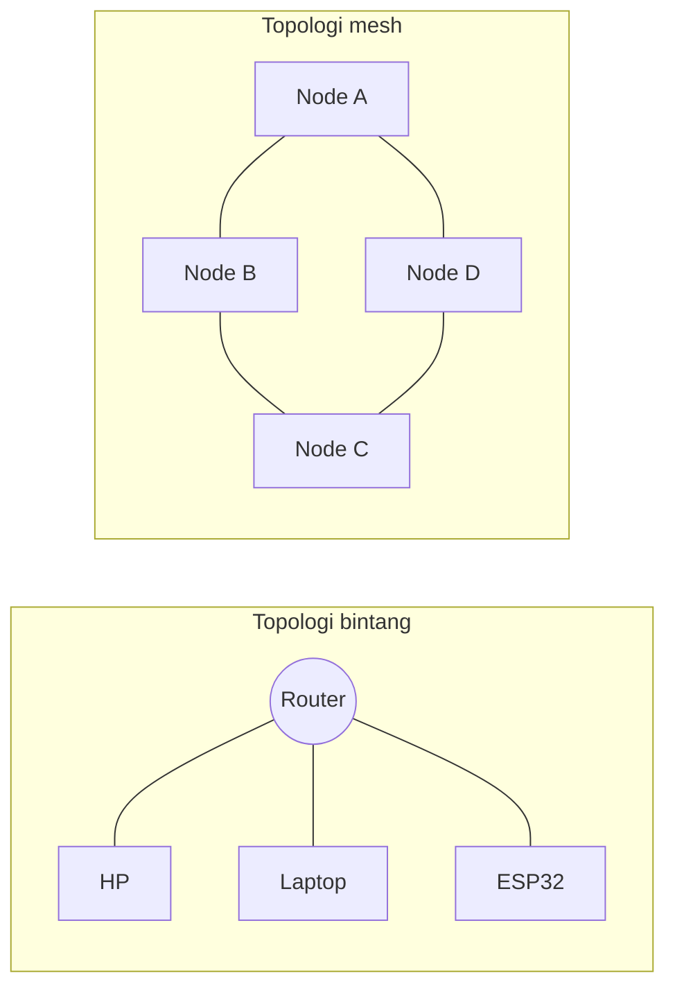
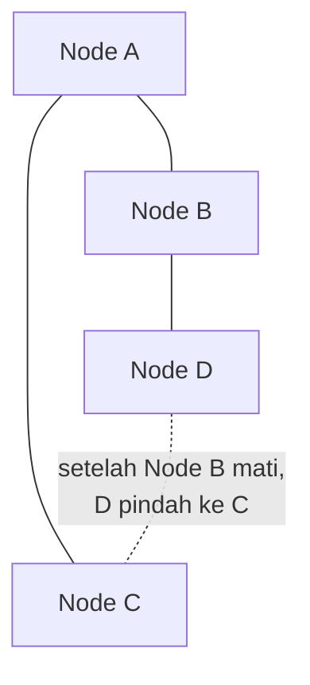
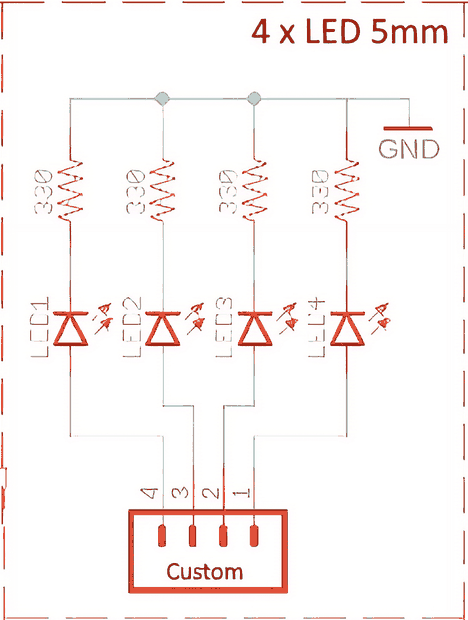
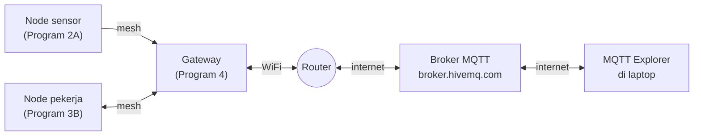

# BAB 55: ESP-MESH

> ✅ **Prasyarat:** Selesaikan **BAB 54 (ESP-NOW)** — kamu sudah pernah membuat dua ESP32 saling berkirim pesan tanpa *router*. BAB ini juga memakai pola `millis()` dengan `struct Timer` dari **BAB 16 (Non-Blocking Programming)**, JSON dengan ArduinoJson dari **BAB 46 (Web Server)** bagian 46.6, DHT11 dari **BAB 26 (DHT11 — Suhu & Kelembapan)**, dan OLED dari **BAB 35 (OLED Display 128×64)**. Program 4 memakai MQTT dari **BAB 50 (MQTT)**.

Di BAB 54, pesan ESP-NOW harus langsung sampai dari pengirim ke penerima. Kalau jaraknya terlalu jauh atau terhalang tembok tebal, pesannya hilang. Di BAB ini kamu membuat beberapa ESP32 yang saling **meneruskan** pesan seperti lari estafet: kalau ESP32 A tidak bisa menjangkau ESP32 C, pesannya dititipkan dulu ke ESP32 B yang ada di tengah. Jaringan seperti ini disebut **jaringan *mesh***. Dengan *library* **Painless Mesh**, cukup beberapa baris kode: ESP32 saling menemukan sendiri, membentuk jaringan, dan menyusun ulang jalurnya kalau ada yang mati. Contoh pemakaiannya: sensor suhu di setiap ruangan sebuah gedung yang datanya "diestafetkan" ke satu ESP32 *gateway*, lalu diteruskan ke internet.

## 📌 Tujuan Pembelajaran

Setelah mempelajari BAB ini, kamu bisa:

- Menjelaskan beda topologi bintang (*star*) dan topologi *mesh*, serta arti *multi-hop* dan *self-healing*.
- Membedakan *library* komunitas **Painless Mesh** dengan **ESP-WIFI-MESH** resmi buatan Espressif (ESP-IDF).
- Menjelaskan cara kerja Painless Mesh: jaringan WiFi milik *mesh* (nama, kata sandi, *port*, kanal), Node ID, dan alasan `mesh.update()` harus sering dipanggil sementara `delay()` dilarang.
- Memasang *library* Painless Mesh beserta **Async TCP**, yang **tidak** ikut terpasang otomatis.
- Meng-*upload* program ke beberapa *board* dan memantau beberapa Serial Monitor sekaligus.
- Mengirim pesan *broadcast* ke semua node dan pesan *unicast* ke satu node tertentu.
- Membangun jaringan sensor DHT11 dengan *gateway* yang menampilkan data di OLED dan meneruskannya ke *broker* MQTT.
- Memilih antara ESP-NOW, *mesh*, dan WiFi biasa sesuai kebutuhan proyek, termasuk memahami keterbatasan *mesh*.

## 🧰 Yang Perlu Disiapkan

| Kebutuhan | Keterangan |
|---|---|
| *Hardware* | Kit Bluino ESP32 IoT Starter Shield + kabel USB **data** |
| Kabel *jumper* | 1–2 kabel *female-female* (sudah ada di kit): `DHT` → IO27 untuk node sensor (Program 2 dan 4) dan, kalau mau, `LED3` (biru) → IO2 untuk node pekerja (Program 3) |
| Komponen tambahan | **1–2 ESP32 tambahan** (misalnya ESP32 DEVKIT V1) — **tidak termasuk kit**. Jaringan *mesh* minimal butuh **2 *board***; 3 *board* membuat percobaan *self-healing* lebih menarik. Siapkan juga kabel USB data untuk setiap *board*, atau *charger* HP/*power bank* untuk *board* yang tidak sedang dipantau |
| *Software* | Arduino IDE 2.x + *board package* **esp32** versi 3.3.x (lihat [BAB 5](../BAB-05/README.md)); aplikasi **MQTT Explorer** untuk Program 4 (cara memasangnya di [BAB 50](../BAB-50/README.md) bagian 50.5.1) |
| *Library* | **Painless Mesh** (diuji dengan versi 1.5.7) + pendukungnya **TaskScheduler** dan **ArduinoJson** (versi 7) yang ikut terpasang lewat **Install All**; **Async TCP** by ESP32Async (diuji dengan versi 3.4.10) yang **harus dipasang sendiri**; **DHT sensor library** + **Adafruit Unified Sensor** (Program 2 dan 4); **Adafruit SSD1306** + **Adafruit GFX Library** (Program 2); **PubSubClient** by Nick O'Leary (Program 4). Langkahnya di [55.5.1](#5551-memasang-library) |
| Alat uji | **Serial Monitor** Arduino IDE (baud 115200), satu jendela Arduino IDE untuk setiap *board* yang dipantau ([55.5.3](#5553-memantau-beberapa-board-sekaligus)); **MQTT Explorer** di laptop (Program 4) |
| Jaringan | Program 1–3 **tidak perlu** WiFi *router* — *mesh* membuat jaringan WiFi sendiri. Program 4 butuh WiFi **2,4 GHz** (ESP32 tidak mendukung 5 GHz) yang tersambung ke internet, dan kamu perlu tahu **kanal** WiFi-nya |

## 📑 Daftar Isi

- [55.1 Topologi Bintang dan Topologi Mesh](#551-topologi-bintang-dan-topologi-mesh)
- [55.2 ESP-MESH, ESP-WIFI-MESH, dan Painless Mesh](#552-esp-mesh-esp-wifi-mesh-dan-painless-mesh)
- [55.3 Cara Kerja Painless Mesh](#553-cara-kerja-painless-mesh)
- [55.4 Kapan Memakai Mesh?](#554-kapan-memakai-mesh)
- [55.5 Persiapan: Library dan Beberapa Board](#555-persiapan-library-dan-beberapa-board)
- [55.6 Pola Dasar Program Painless Mesh](#556-pola-dasar-program-painless-mesh)
- [55.7 Program 1: Mesh Broadcast — Semua Node Saling Menyapa](#557-program-1-mesh-broadcast--semua-node-saling-menyapa)
- [55.8 Program 2: Jaringan Sensor — Node Sensor dan Gateway OLED](#558-program-2-jaringan-sensor--node-sensor-dan-gateway-oled)
- [55.9 Program 3: Unicast — Kendalikan LED Node Tertentu](#559-program-3-unicast--kendalikan-led-node-tertentu)
- [55.10 Program 4: Gateway Mesh ke MQTT](#5510-program-4-gateway-mesh-ke-mqtt)
- [55.11 Troubleshooting](#5511-troubleshooting)
- [📝 Rangkuman](#-rangkuman)
- [💪 Latihan](#-latihan)
- [📚 Referensi](#-referensi)

---

## 55.1 Topologi Bintang dan Topologi Mesh

**Topologi** adalah "peta sambungan" sebuah jaringan: siapa tersambung ke siapa.

### 55.1.1 Topologi Bintang: Semua Lewat Router

WiFi di rumah memakai **topologi bintang** (*star*). Semua perangkat — HP, laptop, ESP32 — tersambung ke satu pusat, yaitu *router*. Kalau HP ingin mengirim data ke ESP32, datanya lewat *router* dulu. Mirip semua surat di sebuah kota yang harus lewat satu kantor pos pusat.

Topologi bintang sederhana dan cepat, tetapi punya dua kelemahan:

- **Jangkauan terbatas.** Perangkat yang terlalu jauh dari *router* (misalnya di gudang belakang atau di lantai tiga) tidak bisa tersambung sama sekali.
- **Satu titik lemah.** Kalau *router* mati, semua perangkat ikut terputus.

### 55.1.2 Topologi Mesh: Saling Meneruskan

Pada **topologi *mesh*** (*mesh* = jala/jaring), setiap perangkat bisa tersambung ke beberapa perangkat lain di dekatnya dan ikut **meneruskan** pesan milik perangkat lain. Bayangkan kabar yang disampaikan dari rumah ke rumah di satu kampung: kamu tidak perlu berteriak sampai ujung kampung, cukup titip ke tetangga, lalu tetangga menitipkannya lagi ke tetangga berikutnya.

Beberapa istilah yang akan sering muncul:

| Istilah | Arti |
|---|---|
| **Node** | Satu perangkat di dalam jaringan. Di BAB ini, satu node = satu ESP32 |
| ***Hop*** (lompatan) | Satu kali perpindahan pesan dari satu node ke node tetangganya |
| ***Multi-hop*** | Pesan melewati beberapa node perantara sebelum sampai ke tujuan |
| ***Self-healing*** (memulihkan diri) | Kalau satu node mati, node lain otomatis mencari jalur baru tanpa perlu diatur ulang manual |
| ***Gateway*** | Node yang menjadi "pintu keluar" *mesh* ke jaringan lain, misalnya ke internet |



*Gambar 55.1 — Kiri: semua perangkat lewat satu router. Kanan: pesan dari Node A ke Node C bisa lewat B atau lewat D. Sumber: dibuat untuk materi ini.*

Keuntungan *mesh*: jangkauan bisa diperluas cukup dengan menambah node di tengah, dan jaringan tetap hidup walaupun ada node yang mati. Harganya: setiap node ikut sibuk meneruskan pesan orang lain, dan pesan yang melewati banyak *hop* sampai lebih lambat.

---

## 55.2 ESP-MESH, ESP-WIFI-MESH, dan Painless Mesh

Nama-nama di bawah ini sering tertukar di internet, jadi kita luruskan dulu:

| Nama | Apa itu? | Dipakai di BAB ini? |
|---|---|---|
| **ESP-MESH** | Sebutan umum untuk jaringan *mesh* antar-ESP32. Judul BAB ini memakai sebutan umum ini | — |
| **ESP-WIFI-MESH** | Protokol *mesh* **resmi Espressif** (dulu bernama ESP-MESH) di dalam ESP-IDF, kerangka pemrograman resmi ESP32. Ada satu ***root node*** yang tersambung ke *router*, dan node lain tersusun bertingkat di bawahnya | Tidak. Dipakai dari ESP-IDF, tidak tersedia sebagai *library* Arduino yang sederhana |
| **Painless Mesh** (painlessMesh) | ***Library* komunitas** untuk Arduino (ESP32 dan ESP8266), dibuat oleh Coopdis dan kontributor lain. **Bukan** buatan Espressif dan **tidak** kompatibel dengan ESP-WIFI-MESH | **Ya** — semua program di BAB ini |

Jadi, kalau kamu membaca dokumentasi ESP-WIFI-MESH di situs Espressif, ingat bahwa fungsi dan aturannya berbeda dengan Painless Mesh. Keduanya hanya mirip secara ide.

> 📌 **Catatan:** Painless Mesh juga bukan jaringan IP biasa. Node-node di dalamnya tidak saling mengenal lewat alamat IP seperti `192.168.1.10`, melainkan lewat **Node ID** (dibahas di [55.3.3](#5533-node-id-nomor-identitas-setiap-node)). Pesannya berupa teks — biasanya JSON — yang dititipkan dari node ke node.

---

## 55.3 Cara Kerja Painless Mesh

### 55.3.1 Setiap Node Menjadi Access Point dan Station Sekaligus

Di [BAB 42](../BAB-42/README.md) dan [BAB 43](../BAB-43/README.md), ESP32 menjadi *station* (tersambung ke *router*) **atau** *access point* (membuat WiFi sendiri). Pada Painless Mesh, setiap ESP32 menjalankan **keduanya sekaligus** (mode `WIFI_AP_STA`):

- Sebagai ***access point*** (AP), node membuat jaringan WiFi bernama sama, misalnya `BluinoMesh-andi`. Node lain boleh tersambung ke sini.
- Sebagai ***station*** (STA), node memindai jaringan bernama `BluinoMesh-andi` milik node lain, lalu tersambung ke salah satunya — biasanya yang sinyalnya paling kuat dan belum menjadi bagian dari jaringannya.

Setelah tersambung secara WiFi, kedua node membuka sambungan TCP di ***port*** *mesh* (misalnya 5555). Lewat sambungan TCP inilah pesan dan informasi susunan jaringan dikirim. Karena setiap node juga membuat WiFi sendiri, jaringan `BluinoMesh-andi` akan muncul di daftar WiFi HP-mu — **jangan** sambungkan HP ke sana, karena jaringan itu khusus untuk ESP32.

### 55.3.2 Bentuknya Sebenarnya Pohon

Walaupun namanya *mesh*, Painless Mesh tidak menyimpan beberapa jalur sekaligus seperti bagian kanan Gambar 55.1. Node-nodenya disusun seperti **pohon** (*tree*): setiap node tersambung ke **satu** "induk" lewat *station*-nya, dan boleh menerima beberapa "anak" di *access point*-nya. Painless Mesh menolak sambungan yang membuat putaran (misalnya A → B → C → A), sehingga di antara dua node selalu ada tepat satu jalur.



*Gambar 55.2 — Pesan dari D ke C mula-mula lewat B lalu A (multi-hop). Kalau B mati, D memindai ulang dan tersambung ke node lain, misalnya C. Sumber: dibuat untuk materi ini.*

Kalau ada node yang mati, anak-anaknya kehilangan induk. Mereka lalu mencari induk baru — dari hasil pindaian terakhir atau dengan memindai ulang — dan tersambung ke node lain yang masih hidup. Inilah ***self-healing***. Prosesnya tidak instan: node harus menyadari dulu bahwa tetangganya hilang, dan pindaian ulang dijadwalkan setiap 15–120 detik tergantung keadaan jaringan. Jadi, pemulihan biasanya butuh **beberapa detik sampai sekitar dua menit**.

### 55.3.3 Node ID: Nomor Identitas Setiap Node

Setiap node otomatis punya **Node ID**, bilangan 32-bit yang diambil dari 4 *byte* terakhir **alamat MAC** *access point* ESP32 tersebut. Contohnya, alamat MAC `24:6F:28:AB:12:C5` menghasilkan Node ID `0x28AB12C5` = `682300101`. Karena alamat MAC setiap ESP32 berbeda, Node ID juga berbeda — kamu tidak perlu mengaturnya dan tidak perlu mencatat alamat MAC seperti di ESP-NOW. Node ID ESP32-mu selalu sama setiap kali menyala, dan bisa dibaca dengan `mesh.getNodeId()`.

### 55.3.4 Empat Pengaturan yang Harus Sama di Semua Node

Supaya bisa bergabung, semua node harus memakai empat pengaturan yang **persis sama**:

| Pengaturan | Contoh di BAB ini | Aturan |
|---|---|---|
| `MESH_PREFIX` (nama jaringan *mesh*) | `"BluinoMesh-andi"` | Maksimal 32 karakter, peka huruf besar-kecil. Buat unik ([55.5.4](#5554-menentukan-nama-mesh-milikmu)) supaya tidak bercampur dengan *mesh* orang lain |
| `MESH_PASSWORD` (kata sandi *mesh*) | `"rahasia123"` | **Minimal 8 karakter** (aturan WPA2). Kurang dari itu, *access point* gagal dibuat dan node tidak bisa bergabung |
| `MESH_PORT` (*port* TCP) | `5555` | Bebas, asalkan sama. 5555 adalah nilai bawaan *library* |
| `MESH_CHANNEL` (kanal WiFi) | `1` | Paling aman kanal 1–11, karena pengaturan negara bawaan ESP32 (*world safe mode*) hanya mencakup kanal 1–11. Bawaan *library* = 1. **Semua node harus di kanal yang sama** — Painless Mesh hanya memindai satu kanal itu |

**Kanal** (*channel*) adalah "jalur frekuensi" di pita 2,4 GHz, mirip saluran radio. ESP32 hanya punya satu radio, jadi *access point* dan *station*-nya selalu berada di kanal yang sama. Akibatnya, *gateway* yang juga tersambung ke *router* (Program 4) **terpaksa** mengikuti kanal *router*, dan semua node lain harus ikut pindah ke kanal itu juga. Cara mengetahui kanal *router* dibahas di Program 4.

### 55.3.5 Pesan: Broadcast dan Unicast

Pesan Painless Mesh berupa teks (`String`). Isinya bebas, tetapi JSON paling praktis karena penerima bisa membaca setiap bagiannya dengan ArduinoJson. Ada dua cara mengirim:

| Cara | Fungsi | Siapa yang menerima |
|---|---|---|
| ***Broadcast*** | `mesh.sendBroadcast(pesan)` | **Semua** node lain di *mesh* (pengirim sendiri tidak) |
| ***Unicast*** (*single*) | `mesh.sendSingle(nodeId, pesan)` | **Satu** node dengan Node ID tersebut, walaupun letaknya beberapa *hop* jauhnya |

Hal penting yang perlu diingat:

- **Pengiriman tidak dijamin.** Pesan bisa hilang kalau jaringan sedang sibuk atau sedang menyusun ulang jalur. Kalau pesan penting, minta penerima mengirim balasan (Program 3 melakukannya).
- **Jangan membanjiri jaringan.** Setiap *broadcast* diteruskan ke semua node. Kirim seperlunya — misalnya setiap beberapa detik, bukan puluhan kali per detik.
- Nilai kembalian `true` hanya berarti pesan berhasil **dimasukkan ke antrean** sambungan; `false` berarti tidak ada sambungan atau tidak ada jalur ke tujuan.

### 55.3.6 Jam Bersama

Painless Mesh juga menyamakan "jam" semua node. `mesh.getNodeTime()` memberikan waktu *mesh* dalam mikrodetik yang hampir sama di semua node (selisihnya biasanya hanya beberapa milidetik). Ini berguna untuk membuat beberapa node melakukan sesuatu secara serempak, misalnya berkedip bersamaan. Karena disimpan dalam 32 *bit*, angka ini kembali ke nol setiap ±71 menit.

### 55.3.7 Kenapa `delay()` Dilarang

Semua pekerjaan *mesh* — memindai node lain, menyambung, meneruskan pesan, menyamakan jam, memeriksa node yang mati — dikerjakan sedikit demi sedikit setiap kali kamu memanggil **`mesh.update()`**. Fungsi ini harus dipanggil **sesering mungkin** di `loop()`.

Kalau `loop()` tertahan oleh `delay(2000)`, selama 2 detik itu node tidak meneruskan pesan orang lain dan tidak menjawab tetangganya. Node lain bisa mengira node itu mati lalu memutus sambungannya. Karena itu, semua program di BAB ini memakai pola **non-blocking** `struct Timer` dari [BAB 16](../BAB-16/README.md), dan tidak ada satu pun `delay()` di `loop()`.

---

## 55.4 Kapan Memakai Mesh?

| Aspek | ESP-NOW ([BAB 54](../BAB-54/README.md)) | Painless Mesh (BAB ini) | WiFi biasa lewat *router* ([BAB 42](../BAB-42/README.md)) |
|---|---|---|---|
| Butuh *router*? | Tidak | Tidak (kecuali *gateway* ke internet) | Ya |
| Jalur pesan | Langsung, 1 *hop* | Diteruskan antarnode (*multi-hop*) | Selalu lewat *router* |
| Kalau satu perangkat mati | Pesan untuk perangkat itu hilang | Jalur disusun ulang otomatis (*self-healing*) | *Router* mati = semua putus |
| Alamat tujuan | Alamat MAC (dicatat manual) | Node ID (otomatis) | Alamat IP |
| Kecepatan sampai (*latency*) | Sangat cepat (beberapa milidetik) | Lebih lambat; bertambah di setiap *hop* | Cepat di jaringan lokal |
| Koneksi internet | Tidak langsung | Lewat satu node *gateway* | Langsung |
| Pemakaian memori dan *flash* | Kecil, bawaan *core* | Besar (program dasar ±73 % *flash*) | Sedang |
| Cocok untuk | Remote, sensor sederhana, data cepat 1 lawan 1 atau 1 ke banyak | Banyak node tersebar di area luas, gedung bertingkat, kebun | Perangkat di dalam jangkauan *router* |

**Keterbatasan Painless Mesh yang perlu kamu tahu:**

- **Semua node di satu kanal WiFi.** *Gateway* yang tersambung ke *router* memaksa seluruh *mesh* memakai kanal *router*. Kalau *router* berpindah kanal sendiri (fitur *auto channel*), *mesh* bisa putus sampai pengaturannya disamakan lagi.
- **Jumlah node terbatas memori.** Setiap node menyimpan peta jaringan dan antrean pesan di RAM. Satu *access point* ESP32 di Painless Mesh menerima paling banyak 10 node anak. Untuk belajar, 2–10 node sudah lebih dari cukup; jaringan berisi puluhan node butuh pengujian sendiri.
- ***Latency* bertambah.** Setiap *hop* menambah waktu tempuh, dan saat jaringan sedang menyusun ulang jalur, pesan bisa tertunda atau hilang. Painless Mesh tidak cocok untuk kendali yang harus seketika (misalnya rem motor).
- **Pembentukan jaringan butuh waktu.** Setelah dinyalakan, node butuh beberapa detik sampai sekitar satu menit untuk saling menemukan, dan beberapa detik sampai sekitar dua menit untuk pulih setelah ada node yang mati.
- **Program besar.** Painless Mesh beserta pendukungnya memakan banyak *flash* dan RAM, dan tidak boleh dicampur dengan `delay()` atau kode yang menahan `loop()` lama.

> 💡 **Tips:** Kalau semua perangkatmu berada dalam jangkauan satu sama lain dan hanya butuh mengirim data kecil dengan cepat, ESP-NOW biasanya lebih sederhana. Pilih *mesh* kalau jaraknya terlalu jauh untuk satu *hop* atau kamu butuh jaringan yang tetap hidup walaupun ada node yang mati.

> 📌 **Catatan:** Di [BAB 56](../BAB-56/README.md) kamu akan bertemu **Thread**, jaringan *mesh* lain yang menjadi standar terbuka untuk rumah pintar (Matter). Thread tidak memakai WiFi, melainkan radio IEEE 802.15.4 yang hanya ada di chip seperti ESP32-C6 dan ESP32-H2 — ESP32 di kit tidak bisa menjalankannya.

---

## 55.5 Persiapan: Library dan Beberapa Board

### 55.5.1 Memasang Library

Buka **Sketch → Include Library → Manage Libraries…** (atau klik ikon buku di sisi kiri Arduino IDE), lalu pasang satu per satu (lewati yang sudah terpasang):

1. Ketik `Painless Mesh`. Pilih **Painless Mesh** yang pembuatnya diawali **Coopdis, Scotty Franzyshen, Edwin van Leeuwen, …** (diuji dengan versi **1.5.7**), lalu klik **INSTALL**. Saat muncul pertanyaan soal *library* pendukung (**ArduinoJson** dan **TaskScheduler**), klik **INSTALL ALL**.
2. Ketik `Async TCP`. Pilih **Async TCP** yang pembuatnya **ESP32Async** (diuji dengan versi **3.4.10**), lalu klik **INSTALL**.
3. Untuk Program 2 dan 4: ketik `DHT sensor library`, pilih buatan **Adafruit**, klik **INSTALL**, lalu **INSTALL ALL** (ikut memasang **Adafruit Unified Sensor**).
4. Untuk Program 2: ketik `Adafruit SSD1306`, pilih buatan **Adafruit**, klik **INSTALL**, lalu **INSTALL ALL** (ikut memasang **Adafruit GFX Library** dan **Adafruit BusIO**).
5. Untuk Program 4: ketik `PubSubClient`, pilih buatan **Nick O'Leary**, lalu klik **INSTALL**.

> ⚠️ **Perhatian:** Langkah 2 **wajib** dan paling sering terlewat. Painless Mesh di ESP32 membutuhkan Async TCP, tetapi *library* itu **tidak** tercantum sebagai pendukung di Library Manager, sehingga **tidak** ikut terpasang lewat **INSTALL ALL**. Tanpa Async TCP, *compile* gagal dengan pesan `AsyncTCP.h: No such file or directory`. Di hasil pencarian ada beberapa *library* bernama mirip — pastikan pembuatnya **ESP32Async**.

> 📌 **Catatan:** Painless Mesh 1.5.7 membutuhkan **ArduinoJson versi 7**. Kalau kamu masih punya ArduinoJson versi 6, klik **UPDATE** pada ArduinoJson di Library Manager.

**Cek apakah semuanya sudah lengkap:** buka **File → Examples**, gulir ke bagian *library* tambahan, lalu pilih **Painless Mesh → basic**. Klik tombol **Verify** (ikon centang ✓). *Compile* pertama butuh 1–2 menit. Kalau muncul **Done compiling**, *library*-nya sudah lengkap.

### 55.5.2 Program Mana di Board Mana?

BAB ini butuh **minimal 2 ESP32**: satu di kit, sisanya *board* tambahan. Karena DHT11 dan OLED hanya ada di kit, susunan berikut paling praktis:

| Program | *Board* kit (A) | *Board* tambahan B | *Board* tambahan C (opsional) |
|---|---|---|---|
| 1 | `p1_mesh_broadcast` | `p1_mesh_broadcast` | `p1_mesh_broadcast` |
| 2 | `p2_mesh_sensor_node` (DHT11 asli) | `p2_mesh_gateway` (data tampil di Serial Monitor) | `p2_mesh_sensor_node` dengan mode simulasi |
| 3 | `p3_mesh_worker` (LED biru) | `p3_mesh_controller` (kamu mengetik perintah di sini) | `p3_mesh_worker` |
| 4 | `p2_mesh_sensor_node` (DHT11 asli) | `p4_mesh_mqtt_gateway` (tersambung ke *router*) | `p3_mesh_worker` |

Susunan lain juga boleh, misalnya *gateway* Program 2 di kit supaya bisa memakai OLED. Penjelasannya ada di setiap program.

> 💡 **Tips:** Tempelkan potongan selotip kertas bertuliskan **A**, **B**, **C** di setiap *board*. Saat semua *board* terlihat sama, label ini mencegahmu meng-*upload* program ke *board* yang salah.

### 55.5.3 Memantau Beberapa Board Sekaligus

Setiap *board* yang dicolok ke laptop mendapat *port* sendiri, misalnya `COM5` dan `COM7` di Windows, `/dev/ttyUSB0` dan `/dev/ttyUSB1` di Linux, atau `/dev/cu.usbserial-…` di macOS.

**Mengenali *port* setiap *board*:**

1. Colok *board* A saja. Buka **Tools → Port** dan catat *port* yang muncul, misalnya `COM5`.
2. Colok *board* B. Buka lagi **Tools → Port** — *port* yang baru muncul (misalnya `COM7`) adalah milik *board* B.

**Meng-*upload*:** pilih *port* *board* yang dituju di **Tools → Port**, buka *sketch*-nya, lalu klik **Upload**. Ulangi untuk *board* berikutnya dengan *port* dan *sketch*-nya sendiri. **Tools → Board** tetap **ESP32 Dev Module** untuk semua *board*.

**Membuka beberapa Serial Monitor:** di Arduino IDE 2, setiap jendela punya pilihan *port* dan Serial Monitor sendiri.

1. Di jendela pertama, pilih *port* *board* A, lalu buka **Tools → Serial Monitor** (baud **115200**).
2. Buka jendela kedua lewat **File → New Sketch**. Di jendela baru itu, pilih **Tools → Board → ESP32 Dev Module** dan **Tools → Port** = *port* *board* B, lalu buka **Tools → Serial Monitor** (baud **115200**).
3. Atur kedua jendela berdampingan. Di Windows, klik sebuah jendela lalu tekan **tombol Windows + ←**, klik jendela lain lalu tekan **tombol Windows + →**.

> ⚠️ **Perhatian:** Satu *port* hanya bisa dibuka oleh satu jendela. Kalau *upload* gagal dengan pesan seperti `could not open port` atau `Access is denied`, tutup dulu Serial Monitor *board* itu di jendela lain.

*Board* yang tidak sedang dipantau tidak harus tersambung ke laptop. Colok saja ke *charger* HP atau *power bank* — ESP32 langsung menjalankan program terakhir yang di-*upload* ke dalamnya. Ini juga cara yang baik untuk menguji jarak: bawa *board* itu ke ruangan lain.

> 💡 **Tips:** Pesan awal di Serial Monitor sering terlewat karena ESP32 sudah berjalan sebelum Serial Monitor dibuka. Tekan tombol **EN** di *board* ESP32 untuk mengulang program dari awal.

Cara bekerja dengan beberapa *board* ini juga dipakai di [BAB 54](../BAB-54/README.md).

### 55.5.4 Menentukan Nama Mesh Milikmu

Sama seperti awalan topik MQTT di [BAB 50](../BAB-50/README.md), nama *mesh* sebaiknya unik. Kalau di satu kelas semua orang memakai `BluinoMesh`, *board* semua orang akan bergabung menjadi satu *mesh* besar dan kamu akan menerima pesan dari *board* temanmu.

1. Nama *mesh*: `BluinoMesh-` + nama panggilanmu, misalnya `BluinoMesh-andi`.
2. Kata sandi *mesh*: minimal 8 karakter, misalnya `rahasia123`. Jangan memakai kata sandi WiFi rumahmu.
3. Pakai nama dan kata sandi yang **sama** di semua *sketch* dan semua *board* milikmu. Di semua contoh BAB ini, ganti `andi` dengan milikmu.

---

## 55.6 Pola Dasar Program Painless Mesh

Potongan-potongan berikut memperlihatkan urutan pemakaian Painless Mesh. Program lengkapnya dimulai di [55.7](#557-program-1-mesh-broadcast--semua-node-saling-menyapa).

Di bagian atas program (di luar fungsi):

```cpp
#include <painlessMesh.h>

// Empat pengaturan yang harus SAMA di semua node
#define MESH_PREFIX   "BluinoMesh-andi"  // nama jaringan mesh
#define MESH_PASSWORD "rahasia123"       // minimal 8 karakter
#define MESH_PORT     5555               // port TCP mesh
#define MESH_CHANNEL  1                  // kanal WiFi (1-13)

painlessMesh mesh;  // objek mesh

// Dipanggil setiap ada pesan untuk node ini (broadcast maupun unicast)
void pesanMasuk(uint32_t dari, String &pesan) {
  Serial.printf("Dari %lu: %s\n", (unsigned long)dari, pesan.c_str());
}
```

Di dalam `setup()`, setelah `Serial.begin(115200);`:

```cpp
mesh.setDebugMsgTypes(ERROR | STARTUP);  // 1. jenis pesan log library yang ditampilkan
mesh.init(MESH_PREFIX, MESH_PASSWORD, MESH_PORT, WIFI_AP_STA, MESH_CHANNEL);  // 2. nyalakan mesh
mesh.onReceive(&pesanMasuk);             // 3. daftarkan fungsi penerima pesan
```

Di dalam `loop()`:

```cpp
mesh.update();  // 4. WAJIB dan sesering mungkin: semua pekerjaan mesh ada di sini
// tugas lain memakai struct Timer (BAB 16), tanpa delay()
```

Fungsi-fungsi yang dipakai di BAB ini (semuanya sudah dicek pada Painless Mesh 1.5.7):

| Fungsi | Kegunaan |
|---|---|
| `mesh.setDebugMsgTypes(ERROR \| STARTUP)` | Memilih jenis pesan log *library* yang dicetak ke Serial Monitor. Panggil **sebelum** `init()`. Untuk mencari masalah sambungan, tambahkan `\| CONNECTION` |
| `mesh.init(prefix, password, port, WIFI_AP_STA, kanal)` | Menyalakan *mesh*: membuat *access point*, mulai memindai node lain, membuka *port* TCP |
| `mesh.update()` | Mengerjakan semua tugas *mesh*. Panggil di setiap putaran `loop()` |
| `mesh.onReceive(fungsi)` | Mendaftarkan fungsi `void fungsi(uint32_t dari, String &pesan)` yang dipanggil setiap ada pesan masuk |
| `mesh.onNewConnection(fungsi)` | `void fungsi(uint32_t nodeId)` — dipanggil saat sebuah node tersambung **langsung** ke node ini |
| `mesh.onDroppedConnection(fungsi)` | `void fungsi(uint32_t nodeId)` — dipanggil saat sambungan langsung ke sebuah node putus |
| `mesh.onChangedConnections(fungsi)` | `void fungsi()` — dipanggil setiap susunan *mesh* berubah, di bagian mana pun |
| `mesh.onNodeTimeAdjusted(fungsi)` | `void fungsi(int32_t selisih)` — dipanggil saat jam node ini disesuaikan dengan jam *mesh* (selisih dalam mikrodetik) |
| `mesh.sendBroadcast(pesan)` | Mengirim ke semua node lain. Hasilnya `false` kalau belum ada sambungan |
| `mesh.sendSingle(nodeId, pesan)` | Mengirim ke satu node. Hasilnya `false` kalau tidak ada jalur ke node itu |
| `mesh.getNodeId()` | Node ID milik node ini |
| `mesh.getNodeList()` | Daftar Node ID **lain** yang dikenal (tersambung langsung maupun lewat node lain). `getNodeList(true)` ikut menyertakan node ini |
| `mesh.isConnected(nodeId)` | `true` kalau ada jalur ke node itu |
| `mesh.subConnectionJson()` | Susunan *mesh* dalam bentuk teks JSON |
| `mesh.getNodeTime()` | Jam *mesh* dalam mikrodetik ([55.3.6](#5536-jam-bersama)) |
| `mesh.stationManual(ssid, password)`, `mesh.setRoot(true)`, `mesh.setContainsRoot(true)` | Untuk *gateway* yang juga tersambung ke *router* (Program 4) |

Beberapa hal yang perlu diperhatikan:

- **`std::list<uint32_t>`.** `getNodeList()` menghasilkan daftar berjenis `std::list` dari *library* standar C++. Kamu cukup tahu dua cara memakainya: `daftar.size()` untuk jumlah isinya, dan `for (uint32_t id : daftar) { ... }` untuk membaca isinya satu per satu.
- **Fungsi *callback* dipanggil dari dalam `mesh.update()`**, jadi aman memakai `Serial` di dalamnya ([BAB 18](../BAB-18/README.md) tentang *callback*). Tetap buat isinya singkat dan jangan pernah memakai `delay()` di sana.
- **Mencetak Node ID.** Di *board package* 3.x, `uint32_t` sama dengan `unsigned long`, jadi program di BAB ini mencetaknya dengan `%lu` dan `(unsigned long)`.

<details>
<summary><b>🔬 Pendalaman (opsional): Task dan Scheduler di contoh bawaan library</b></summary>

Contoh bawaan Painless Mesh (**File → Examples → Painless Mesh**) tidak memakai `struct Timer`, melainkan ***Task*** dari *library* **TaskScheduler**. Hasilnya sama: tugas dijalankan berkala tanpa `delay()`. Supaya kamu bisa membaca contoh-contoh itu, berikut padanannya:

```cpp
Scheduler penjadwal;  // pengatur tugas dari library TaskScheduler

void kirimSapaan() {
  mesh.sendBroadcast("Halo");
}
Task tugasKirim(5000, TASK_FOREVER, &kirimSapaan);  // setiap 5000 ms, selamanya

// --- di dalam setup() ---
mesh.init(MESH_PREFIX, MESH_PASSWORD, &penjadwal, MESH_PORT);  // penjadwal ikut diserahkan
penjadwal.addTask(tugasKirim);  // daftarkan tugas
tugasKirim.enable();            // aktifkan tugas

// --- di dalam loop() ---
mesh.update();  // juga menjalankan semua tugas di penjadwal
```

`mesh.update()` sudah menjalankan penjadwal yang diserahkan lewat `init()`, jadi **tidak perlu** memanggil `penjadwal.execute()` lagi di `loop()`. Kalau `init()` dipanggil tanpa penjadwal (seperti di BAB ini), Painless Mesh membuat penjadwal internalnya sendiri.

</details>

---

## 55.7 Program 1: Mesh Broadcast — Semua Node Saling Menyapa

**Tujuan:** *Sketch* yang **sama** di-*upload* ke 2–3 ESP32. Setiap 5 detik, setiap node mengirim sapaan ke semua node lain (*broadcast*) dan mencetak sapaan yang diterimanya. Program juga melaporkan saat ada node yang tersambung atau terputus, menampilkan susunan *mesh*, dan memperlihatkan *self-healing* saat salah satu *board* dimatikan.

**Rangkaian:**

*Tidak perlu merangkai — program ini hanya memakai ESP32 dan Serial Monitor.*

**Cara Menjalankan:**

1. Pastikan *library* **Painless Mesh** dan **Async TCP** sudah terpasang ([55.5.1](#5551-memasang-library)).
2. Buka Arduino IDE → **File → New Sketch**, hapus isinya, lalu salin kode di bawah. Kode yang sama juga tersedia di *file* [`p1_mesh_broadcast.ino`](p1_mesh_broadcast/p1_mesh_broadcast.ino).
3. Ganti `andi` di `MESH_PREFIX` dengan nama panggilanmu ([55.5.4](#5554-menentukan-nama-mesh-milikmu)).
4. Colok *board* A. Pastikan **Tools → Board** = **ESP32 Dev Module** dan **Tools → Port** = *port* *board* A (misalnya `COM5` di Windows atau `/dev/ttyUSB0` di Linux).
5. Klik tombol **Upload** (ikon panah →) dan tunggu sampai muncul tulisan **Done uploading**. *Compile*-nya lebih lama dari biasanya karena programnya besar.
6. Colok *board* B, pilih *port*-nya, lalu **Upload** *sketch* yang **sama**. Ulangi untuk *board* C kalau ada.
7. Buka Serial Monitor untuk *board* A dan *board* B di dua jendela Arduino IDE ([55.5.3](#5553-memantau-beberapa-board-sekaligus)), baud **115200**. Tekan tombol **EN** di setiap *board* supaya pesan awalnya terlihat.
8. Tunggu sampai muncul `[MESH] Tersambung langsung dengan node ...` (biasanya beberapa detik sampai satu menit).

**Kode Program:**

<!-- sketch: p1_mesh_broadcast -->
```cpp
/*
 * BAB 55 - Program 1: Mesh Broadcast
 * Sketch yang SAMA di-upload ke semua board (minimal 2 ESP32).
 * Setiap 5 detik, setiap node mengirim sapaan ke semua node lain (broadcast)
 * dan mencetak sapaan yang diterimanya. Perubahan susunan mesh juga dicetak.
 *
 * Rangkaian: tidak perlu
 * Library  : Painless Mesh (+ TaskScheduler, ArduinoJson 7, Async TCP)
 */

#include <painlessMesh.h>

// Pengaturan mesh: harus SAMA PERSIS di semua node
#define MESH_PREFIX   "BluinoMesh-andi"  // ← ganti "andi" dengan nama panggilanmu
#define MESH_PASSWORD "rahasia123"       // minimal 8 karakter
#define MESH_PORT     5555
#define MESH_CHANNEL  1

// struct Timer dari BAB 16
struct Timer {
  unsigned long interval;   // ms
  unsigned long waktuLalu;  // hasil millis() saat terakhir dijalankan

  // Mengembalikan true kalau sudah waktunya, lalu mencatat waktunya
  bool sudahWaktunya(unsigned long sekarang) {
    if (sekarang - waktuLalu >= interval) {
      waktuLalu = sekarang;
      return true;
    }
    return false;
  }
};

painlessMesh mesh;

Timer timerSapa = {5000, 0};      // kirim sapaan setiap 5 detik
Timer timerLaporan = {30000, 0};  // ringkasan setiap 30 detik
unsigned long nomorSapaan = 0;
unsigned long jumlahDiterima = 0;

// ---------- Fungsi callback (dipanggil dari dalam mesh.update()) ----------

void pesanMasuk(uint32_t dari, String &pesan) {
  jumlahDiterima = jumlahDiterima + 1;
  Serial.printf("[TERIMA] dari %lu: %s\n", (unsigned long)dari, pesan.c_str());
}

void nodeBaru(uint32_t nodeId) {
  Serial.printf("[MESH] Tersambung langsung dengan node %lu\n", (unsigned long)nodeId);
}

void nodePutus(uint32_t nodeId) {
  Serial.printf("[MESH] Sambungan langsung ke node %lu putus\n", (unsigned long)nodeId);
}

void susunanBerubah() {
  // getNodeList(true) = semua node yang dikenal, termasuk node ini
  Serial.printf("[MESH] Susunan mesh berubah. Jumlah node: %u\n",
                (unsigned)mesh.getNodeList(true).size());
  Serial.printf("[MESH] Susunan: %s\n", mesh.subConnectionJson().c_str());
}

void jamDisesuaikan(int32_t selisih) {
  Serial.printf("[JAM] Jam mesh disesuaikan %ld mikrodetik\n", (long)selisih);
}

// ---------- Tugas berkala ----------

void kirimSapaan() {
  nomorSapaan = nomorSapaan + 1;
  String pesan = "Halo dari " + String(mesh.getNodeId()) + ", sapaan ke-" + String(nomorSapaan);

  if (mesh.sendBroadcast(pesan)) {
    Serial.printf("[KIRIM] %s\n", pesan.c_str());
  } else {
    Serial.println("[KIRIM] Belum ada node lain, sapaan tidak terkirim");
  }
}

void cetakLaporan() {
  std::list<uint32_t> daftar = mesh.getNodeList();  // node lain (tanpa node ini)
  Serial.printf("[LAPORAN] Node ini: %lu | node lain: %u | terkirim: %lu | diterima: %lu\n",
                (unsigned long)mesh.getNodeId(), (unsigned)daftar.size(),
                nomorSapaan, jumlahDiterima);
  for (uint32_t id : daftar) {
    Serial.printf("          - %lu\n", (unsigned long)id);
  }
}

void setup() {
  Serial.begin(115200);
  Serial.println("\nBAB 55 - Program 1: Mesh Broadcast");

  mesh.setDebugMsgTypes(ERROR | STARTUP);  // panggil sebelum init()
  mesh.init(MESH_PREFIX, MESH_PASSWORD, MESH_PORT, WIFI_AP_STA, MESH_CHANNEL);

  mesh.onReceive(&pesanMasuk);
  mesh.onNewConnection(&nodeBaru);
  mesh.onDroppedConnection(&nodePutus);
  mesh.onChangedConnections(&susunanBerubah);
  mesh.onNodeTimeAdjusted(&jamDisesuaikan);

  Serial.printf("Node ID saya: %lu\n", (unsigned long)mesh.getNodeId());
  Serial.printf("Nama mesh   : %s (kanal %d)\n", MESH_PREFIX, MESH_CHANNEL);
  Serial.println("Mencari node lain...");
}

void loop() {
  mesh.update();  // wajib, sesering mungkin

  unsigned long sekarang = millis();
  if (timerSapa.sudahWaktunya(sekarang)) {
    kirimSapaan();
  }
  if (timerLaporan.sudahWaktunya(sekarang)) {
    cetakLaporan();
  }
}
```

**Penjelasan Kode:**

- **Empat `#define` di atas** adalah pengaturan *mesh* dari [55.3.4](#5534-empat-pengaturan-yang-harus-sama-di-semua-node). Karena semua *board* memakai *sketch* yang sama, otomatis semuanya cocok.
- **`mesh.setDebugMsgTypes(ERROR | STARTUP)`** menampilkan pesan *error* dan pesan saat *mesh* dinyalakan. Baris `setLogLevel:`, `STARTUP: init(): 1`, dan `STARTUP: AP tcp server established on port 5555` di Contoh Output berasal dari *library*, bukan dari program kita.
- **`mesh.init(...)`** menyalakan *access point* `BluinoMesh-andi` di kanal 1, membuka *port* 5555, dan mulai memindai node lain. Setelah `init()`, Node ID sudah bisa dibaca dengan `mesh.getNodeId()`.
- **Lima *callback*** didaftarkan dengan `mesh.on...()`. `nodeBaru()` dan `nodePutus()` hanya dipanggil untuk tetangga **langsung**, sedangkan `susunanBerubah()` dipanggil setiap ada perubahan di mana pun — termasuk saat node yang jauh bergabung lewat node lain.
- **`susunanBerubah()`** mencetak jumlah node dan `mesh.subConnectionJson()`. Teks JSON ini adalah "peta" *mesh* dari sudut pandang node ini: `nodeId` adalah node ini, dan `subs` berisi tetangganya beserta tetangga-tetangga mereka. Dari sini kamu bisa melihat node mana yang menjadi perantara.
- **`jamDisesuaikan()`** dipanggil saat node ini menyamakan jamnya dengan node lain. Pesan `[JAM]` biasanya hanya muncul di sebagian node — node yang "mengalah" mengikuti jam node lain.
- **`kirimSapaan()`** menyusun teks seperti `Halo dari 682300101, sapaan ke-3` lalu mengirimnya dengan `mesh.sendBroadcast()`. Hasil `false` berarti node ini belum tersambung ke siapa pun.
- **`cetakLaporan()`** setiap 30 detik mencetak daftar node lain dari `mesh.getNodeList()`.
- **`loop()`** hanya memanggil `mesh.update()` lalu memeriksa dua *timer*. Tidak ada `delay()`, jadi `mesh.update()` dipanggil ribuan kali per detik.

**Contoh Output:**

Serial Monitor *board* A, saat *board* B dan C menyala:

```text
BAB 55 - Program 1: Mesh Broadcast

setLogLevel: ERROR | STARTUP |
STARTUP: init(): 1
STARTUP: AP tcp server established on port 5555
Node ID saya: 682300101
Nama mesh   : BluinoMesh-andi (kanal 1)
Mencari node lain...
[KIRIM] Belum ada node lain, sapaan tidak terkirim
[MESH] Tersambung langsung dengan node 2757550731
[MESH] Susunan mesh berubah. Jumlah node: 2
[MESH] Susunan: {"nodeId":682300101,"subs":[{"nodeId":2757550731}]}
[KIRIM] Halo dari 682300101, sapaan ke-2
[TERIMA] dari 2757550731: Halo dari 2757550731, sapaan ke-2
[MESH] Susunan mesh berubah. Jumlah node: 3
[MESH] Susunan: {"nodeId":682300101,"subs":[{"nodeId":2757550731,"subs":[{"nodeId":2760968178}]}]}
[KIRIM] Halo dari 682300101, sapaan ke-3
[TERIMA] dari 2757550731: Halo dari 2757550731, sapaan ke-3
[TERIMA] dari 2760968178: Halo dari 2760968178, sapaan ke-1
[JAM] Jam mesh disesuaikan -1834 mikrodetik
[LAPORAN] Node ini: 682300101 | node lain: 2 | terkirim: 6 | diterima: 9
          - 2757550731
          - 2760968178
```

Node ID, angka sapaan, dan selisih jam hanyalah contoh — angkamu pasti berbeda. Pada contoh ini, *board* C (`2760968178`) tersambung ke *board* B, bukan langsung ke A. Sapaan C tetap sampai di A karena diteruskan oleh B — itulah *multi-hop*. Urutan dan susunannya bisa berbeda setiap kali, tergantung node mana yang lebih dulu menyala dan sinyal mana yang paling kuat.

**Percobaan *self-healing*:**

1. Lihat baris `[MESH] Susunan:` terakhir dan cari node yang menjadi perantara (node yang punya `subs`). Pada contoh di atas, perantaranya *board* B.
2. Cabut kabel USB *board* B (atau tekan dan tahan tombol **EN**-nya).
3. Amati Serial Monitor *board* A. Setelah beberapa detik sampai sekitar satu menit (waktu yang dibutuhkan A untuk menyadari B hilang), jumlah node berkurang dan muncul `[MESH] Sambungan langsung ke node 2757550731 putus`.
4. Tunggu lagi sampai sekitar dua menit. *Board* C akan tersambung langsung ke A, dan sapaan C muncul lagi di A:

```text
[MESH] Susunan mesh berubah. Jumlah node: 1
[MESH] Susunan: {"nodeId":682300101}
[MESH] Sambungan langsung ke node 2757550731 putus
[KIRIM] Belum ada node lain, sapaan tidak terkirim
[MESH] Tersambung langsung dengan node 2760968178
[MESH] Susunan mesh berubah. Jumlah node: 2
[MESH] Susunan: {"nodeId":682300101,"subs":[{"nodeId":2760968178}]}
[TERIMA] dari 2760968178: Halo dari 2760968178, sapaan ke-19
```

> 🧪 **Coba Sendiri:** Colok *board* B ke *power bank* dan bawa ke ruangan lain, sementara A dan C saling berjauhan. Perhatikan apakah C bisa menjangkau A hanya lewat B.

**Kalau Belum Berhasil:**

- ***Compile* gagal: `AsyncTCP.h: No such file or directory`** → *library* **Async TCP** by ESP32Async belum terpasang ([55.5.1](#5551-memasang-library)).
- **Terus muncul `Belum ada node lain` di semua *board*** → `MESH_PREFIX`, `MESH_PASSWORD`, `MESH_PORT`, atau `MESH_CHANNEL` berbeda antar-*board* (perhatikan huruf besar-kecil), atau kata sandi kurang dari 8 karakter. *Upload* ulang *sketch* yang sama persis ke semua *board*, lalu tunggu sampai satu menit.
- **Muncul Node ID yang tidak kamu kenal** → ada *board* orang lain dengan nama *mesh* yang sama di dekatmu. Ganti `MESH_PREFIX` dengan nama yang lebih unik di semua *board*-mu.
- **Serial Monitor menampilkan huruf acak** → baud Serial Monitor belum **115200**.

---

## 55.8 Program 2: Jaringan Sensor — Node Sensor dan Gateway OLED

**Tujuan:** Membuat jaringan sensor sungguhan dengan dua jenis node. **Node sensor** (Program 2A) membaca DHT11 setiap 10 detik dan menyiarkan hasilnya dalam format JSON. **Gateway** (Program 2B) mengumpulkan data terakhir dari setiap node sensor, lalu menampilkannya di Serial Monitor dan — kalau dijalankan di kit — di OLED, lengkap dengan suhu tertinggi.

**Siapa menjalankan apa?** Program ini terdiri dari **dua *sketch***. Karena DHT11 dan OLED hanya ada di kit, pilih salah satu susunan:

| Susunan | *Board* kit | *Board* tambahan | Hasilnya |
|---|---|---|---|
| **1 (disarankan)** | `p2_mesh_sensor_node` — DHT11 asli | `p2_mesh_gateway` | Data suhu asli, tampil di Serial Monitor *gateway* |
| **2** | `p2_mesh_gateway` — dengan OLED | `p2_mesh_sensor_node` dengan `MODE_SIMULASI` = `true` | Tampil di OLED, tetapi angkanya buatan |

Kalau punya 3 *board*, gabungkan keduanya: kit sebagai node sensor asli, *board* B sebagai *gateway*, *board* C sebagai node sensor simulasi.

> 📌 **Catatan:** **Mode simulasi** ada supaya *board* tambahan tanpa DHT11 tetap bisa ikut mengirim data. Angka suhunya dibuat acak (25,0–30,0 °C) dan diberi tanda `"simulasi":true` — **bukan** hasil pengukuran.

**Rangkaian (*board* kit sebagai node sensor):**

| Pin **Custom** di kit | Sambungkan ke pin ESP32 |
|---|---|
| `DHT` — DHT11 (header hijau, pin ke-3 dari atas) | IO27 |


*Gambar 55.3 — Rangkaian DHT11 pada kit. Pin data tersambung ke header `DHT` dengan resistor pull-up 4,7 kΩ; sambungkan header itu ke IO27 dengan kabel jumper. Sumber: skematik ESP32 Starter Shield 3.2, [Bluino](http://www.bluino.com).*

Di header hijau, `DHT` diapit `Tr` dan `DS`; di deretan pin ESP32 atas, `27` diapit `14` dan `26` (lihat [BAB 26](../BAB-26/README.md)). Kalau kit menjadi *gateway* (susunan 2), OLED sudah tersambung lewat *jumper cap* JP (SDA IO21, SCL IO22) — tidak perlu kabel.

**Cara Menjalankan:**

1. Pasang *library* **DHT sensor library**, **Adafruit Unified Sensor**, **Adafruit SSD1306**, dan **Adafruit GFX Library** kalau belum ([55.5.1](#5551-memasang-library)).
2. Sambungkan kabel `DHT` → IO27 di *board* yang menjadi node sensor asli.
3. Buka Arduino IDE → **File → New Sketch**, hapus isinya, lalu salin kode **Program 2A** di bawah. Kode yang sama tersedia di *file* [`p2_mesh_sensor_node.ino`](p2_mesh_sensor_node/p2_mesh_sensor_node.ino). Samakan `MESH_PREFIX` dengan milikmu.
4. Pilih **Tools → Board** = **ESP32 Dev Module** dan **Tools → Port** = *port* *board* node sensor, lalu klik **Upload** dan tunggu **Done uploading**. Untuk node sensor tanpa DHT11, ubah dulu `#define MODE_SIMULASI false` menjadi `true` sebelum meng-*upload*.
5. Buka jendela baru (**File → New Sketch**), salin kode **Program 2B** ([`p2_mesh_gateway.ino`](p2_mesh_gateway/p2_mesh_gateway.ino)), samakan `MESH_PREFIX`, pilih *port* *board* *gateway*, lalu **Upload**.
6. Buka Serial Monitor (baud **115200**) di jendela *gateway* dan, kalau mau, di jendela node sensor ([55.5.3](#5553-memantau-beberapa-board-sekaligus)). Tekan **EN** di setiap *board*.
7. Tunggu sampai node saling tersambung. Data pertama muncul di *gateway* paling lambat 10 detik setelahnya.

**Kode Program 2A — Node Sensor:**

<!-- sketch: p2_mesh_sensor_node -->
```cpp
/*
 * BAB 55 - Program 2A: Node Sensor (DHT11)
 * Setiap 10 detik membaca DHT11 lalu menyiarkan hasilnya (JSON) ke semua
 * node di mesh. Gateway (Program 2B atau 4) yang mengolah datanya.
 *
 * Rangkaian: DHT (header hijau) -> IO27 (board kit)
 * Board tanpa DHT11: ubah MODE_SIMULASI menjadi true (angka buatan)
 * Library  : Painless Mesh (+ TaskScheduler, ArduinoJson 7, Async TCP),
 *            DHT sensor library + Adafruit Unified Sensor
 */

#include <painlessMesh.h>
#include <DHT.h>

// Pengaturan mesh: harus SAMA PERSIS di semua node
#define MESH_PREFIX   "BluinoMesh-andi"  // ← ganti "andi" dengan nama panggilanmu
#define MESH_PASSWORD "rahasia123"       // minimal 8 karakter
#define MESH_PORT     5555
#define MESH_CHANNEL  1                  // Program 4: samakan dengan kanal router

#define PIN_DHT  27
#define TIPE_DHT DHT11
#define MODE_SIMULASI false  // true = kirim angka buatan (untuk board tanpa DHT11)

// struct Timer dari BAB 16
struct Timer {
  unsigned long interval;   // ms
  unsigned long waktuLalu;  // hasil millis() saat terakhir dijalankan

  bool sudahWaktunya(unsigned long sekarang) {
    if (sekarang - waktuLalu >= interval) {
      waktuLalu = sekarang;
      return true;
    }
    return false;
  }
};

painlessMesh mesh;
DHT dht(PIN_DHT, TIPE_DHT);

Timer timerKirim = {10000, 0};  // kirim data setiap 10 detik
unsigned long nomorKirim = 0;

void kirimDataSensor() {
  float suhu;
  float kelembapan;
  if (MODE_SIMULASI) {
    suhu = 25.0 + random(0, 51) / 10.0;  // angka buatan 25,0 - 30,0
    kelembapan = random(60, 81);         // angka buatan 60 - 80
  } else {
    kelembapan = dht.readHumidity();
    suhu = dht.readTemperature();
  }
  bool dhtOk = !isnan(suhu) && !isnan(kelembapan);
  nomorKirim = nomorKirim + 1;

  // Susun pesan JSON dengan ArduinoJson 7
  JsonDocument doc;
  doc["jenis"] = "sensor";
  if (dhtOk) {
    doc["suhu"] = suhu;              // °C
    doc["kelembapan"] = kelembapan;  // %RH
  } else {
    doc["suhu"] = nullptr;  // null = tidak ada data valid
    doc["kelembapan"] = nullptr;
    Serial.println("[DHT11] Gagal membaca. Periksa kabel DHT -> IO27.");
  }
  doc["dht_ok"] = dhtOk;
  doc["simulasi"] = MODE_SIMULASI;
  doc["urutan"] = nomorKirim;

  String pesan;
  serializeJson(doc, pesan);

  if (mesh.sendBroadcast(pesan)) {
    Serial.printf("[KIRIM] %s\n", pesan.c_str());
  } else {
    Serial.printf("[KIRIM] Belum ada node lain, tidak terkirim: %s\n", pesan.c_str());
  }
}

// Node sensor ikut menerima siaran node lain; cukup dicetak
void pesanMasuk(uint32_t dari, String &pesan) {
  Serial.printf("[TERIMA] dari %lu: %s\n", (unsigned long)dari, pesan.c_str());
}

void susunanBerubah() {
  Serial.printf("[MESH] Susunan berubah. Jumlah node: %u\n",
                (unsigned)mesh.getNodeList(true).size());
}

void setup() {
  Serial.begin(115200);
  Serial.println("\nBAB 55 - Program 2A: Node Sensor");
  dht.begin();

  mesh.setDebugMsgTypes(ERROR);  // hanya pesan error dari library
  mesh.init(MESH_PREFIX, MESH_PASSWORD, MESH_PORT, WIFI_AP_STA, MESH_CHANNEL);
  mesh.onReceive(&pesanMasuk);
  mesh.onChangedConnections(&susunanBerubah);

  Serial.printf("Node ID saya: %lu\n", (unsigned long)mesh.getNodeId());
  Serial.printf("Mode simulasi: %s\n", MODE_SIMULASI ? "YA (angka buatan)" : "tidak (DHT11 asli)");
}

void loop() {
  mesh.update();  // wajib, sesering mungkin

  if (timerKirim.sudahWaktunya(millis())) {
    kirimDataSensor();
  }
}
```

**Kode Program 2B — Gateway OLED:**

<!-- sketch: p2_mesh_gateway -->
```cpp
/*
 * BAB 55 - Program 2B: Gateway OLED
 * Menerima data JSON dari semua node sensor (Program 2A), menyimpan data
 * terakhir setiap node, lalu menampilkannya di Serial Monitor dan OLED.
 * OLED opsional: tanpa OLED, data tetap tampil di Serial Monitor.
 *
 * Rangkaian: OLED lewat jumper cap JP (SDA IO21, SCL IO22) - hanya di kit
 * Library  : Painless Mesh (+ TaskScheduler, ArduinoJson 7, Async TCP),
 *            Adafruit SSD1306 + Adafruit GFX Library
 */

#include <painlessMesh.h>
#include <Wire.h>
#include <Adafruit_GFX.h>
#include <Adafruit_SSD1306.h>

// Pengaturan mesh: harus SAMA PERSIS di semua node
#define MESH_PREFIX   "BluinoMesh-andi"  // ← ganti "andi" dengan nama panggilanmu
#define MESH_PASSWORD "rahasia123"       // minimal 8 karakter
#define MESH_PORT     5555
#define MESH_CHANNEL  1

#define ALAMAT_OLED     0x3C
#define MAKS_NODE       4         // jumlah node sensor yang dicatat
#define BATAS_DATA_LAMA 30000UL   // data lebih tua dari 30 detik = "hilang"

// struct Timer dari BAB 16
struct Timer {
  unsigned long interval;   // ms
  unsigned long waktuLalu;  // hasil millis() saat terakhir dijalankan

  bool sudahWaktunya(unsigned long sekarang) {
    if (sekarang - waktuLalu >= interval) {
      waktuLalu = sekarang;
      return true;
    }
    return false;
  }
};

// Data terakhir dari satu node sensor
struct DataNode {
  uint32_t nodeId;
  float suhu;
  float kelembapan;
  bool dhtOk;
  bool simulasi;
  unsigned long waktuTerima;  // millis() saat data terakhir diterima
};

painlessMesh mesh;
Adafruit_SSD1306 oled(128, 64, &Wire, -1);
bool adaOled = false;

DataNode daftarNode[MAKS_NODE];
int jumlahNode = 0;
unsigned long jumlahData = 0;

Timer timerLayar = {2000, 0};       // perbarui OLED setiap 2 detik
Timer timerRingkasan = {30000, 0};  // ringkasan Serial setiap 30 detik

// Cari posisi node di daftar; tambahkan kalau belum ada. Hasil -1 kalau penuh.
int cariAtauTambahNode(uint32_t nodeId) {
  for (int i = 0; i < jumlahNode; i++) {
    if (daftarNode[i].nodeId == nodeId) {
      return i;
    }
  }
  if (jumlahNode >= MAKS_NODE) {
    return -1;
  }
  daftarNode[jumlahNode].nodeId = nodeId;
  jumlahNode = jumlahNode + 1;
  Serial.printf("[GATEWAY] Node sensor baru: %lu (total %d)\n", (unsigned long)nodeId, jumlahNode);
  return jumlahNode - 1;
}

bool dataMasihBaru(const DataNode &d) {
  return millis() - d.waktuTerima < BATAS_DATA_LAMA;
}

// Dipanggil setiap ada pesan dari node lain
void pesanMasuk(uint32_t dari, String &pesan) {
  JsonDocument doc;
  DeserializationError galat = deserializeJson(doc, pesan);
  if (galat) {
    Serial.printf("[GATEWAY] Bukan JSON dari %lu: %s\n", (unsigned long)dari, pesan.c_str());
    return;
  }
  if (doc["jenis"] != "sensor") {
    return;  // bukan data sensor, abaikan
  }

  int i = cariAtauTambahNode(dari);
  if (i < 0) {
    Serial.printf("[GATEWAY] Daftar penuh, data node %lu diabaikan\n", (unsigned long)dari);
    return;
  }

  DataNode &d = daftarNode[i];
  d.suhu = doc["suhu"] | NAN;  // null -> NAN
  d.kelembapan = doc["kelembapan"] | NAN;
  d.dhtOk = (doc["dht_ok"] | false) && !isnan(d.suhu) && !isnan(d.kelembapan);
  d.simulasi = doc["simulasi"] | false;
  d.waktuTerima = millis();
  jumlahData = jumlahData + 1;

  if (d.dhtOk) {
    Serial.printf("[DATA] Node %lu: suhu %.1f °C, kelembapan %.0f %%%s\n",
                  (unsigned long)dari, d.suhu, d.kelembapan, d.simulasi ? " (simulasi)" : "");
  } else {
    Serial.printf("[DATA] Node %lu: DHT11 gagal dibaca\n", (unsigned long)dari);
  }
}

void susunanBerubah() {
  Serial.printf("[MESH] Susunan berubah. Jumlah node: %u\n",
                (unsigned)mesh.getNodeList(true).size());
}

void perbaruiLayar() {
  if (!adaOled) {
    return;
  }
  oled.clearDisplay();
  oled.setCursor(0, 0);
  oled.printf("Gateway Mesh  node:%u", (unsigned)mesh.getNodeList(true).size());
  oled.drawLine(0, 10, 127, 10, SSD1306_WHITE);

  float suhuMaks = NAN;
  for (int i = 0; i < jumlahNode; i++) {
    DataNode &d = daftarNode[i];
    oled.setCursor(0, 14 + i * 10);
    oled.printf("%04lu ", (unsigned long)(d.nodeId % 10000));  // 4 angka terakhir Node ID
    if (!dataMasihBaru(d)) {
      oled.print("hilang");
    } else if (!d.dhtOk) {
      oled.print("DHT gagal");
    } else {
      oled.printf("%.1f", d.suhu);
      oled.write(248);  // simbol derajat (cp437)
      oled.printf("C %.0f%%", d.kelembapan);
      if (d.simulasi) {
        oled.print(" S");
      }
      if (isnan(suhuMaks) || d.suhu > suhuMaks) {
        suhuMaks = d.suhu;
      }
    }
  }
  if (jumlahNode == 0) {
    oled.setCursor(0, 14);
    oled.print("Menunggu data...");
  }

  oled.setCursor(0, 56);
  if (isnan(suhuMaks)) {
    oled.print("Maks: -");
  } else {
    oled.printf("Maks: %.1f", suhuMaks);
    oled.write(248);
    oled.print("C");
  }
  oled.display();
}

void cetakRingkasan() {
  Serial.printf("[RINGKASAN] Node di mesh: %u | node sensor tercatat: %d | data diterima: %lu\n",
                (unsigned)mesh.getNodeList(true).size(), jumlahNode, jumlahData);
  for (int i = 0; i < jumlahNode; i++) {
    DataNode &d = daftarNode[i];
    if (!dataMasihBaru(d)) {
      Serial.printf("  %lu: tidak ada data 30 detik terakhir\n", (unsigned long)d.nodeId);
    } else if (!d.dhtOk) {
      Serial.printf("  %lu: DHT11 gagal dibaca\n", (unsigned long)d.nodeId);
    } else {
      Serial.printf("  %lu: %.1f °C, %.0f %%\n", (unsigned long)d.nodeId, d.suhu, d.kelembapan);
    }
  }
}

void setup() {
  Serial.begin(115200);
  Serial.println("\nBAB 55 - Program 2B: Gateway OLED");

  // OLED opsional: periksa dulu apakah ada yang menjawab di 0x3C
  Wire.begin(21, 22);
  Wire.beginTransmission(ALAMAT_OLED);
  if (Wire.endTransmission() == 0 && oled.begin(SSD1306_SWITCHCAPVCC, ALAMAT_OLED)) {
    adaOled = true;
    oled.cp437(true);  // supaya write(248) = simbol derajat
    oled.setTextSize(1);
    oled.setTextColor(SSD1306_WHITE);
    Serial.println("OLED ditemukan di 0x3C.");
  } else {
    Serial.println("OLED tidak ditemukan, data hanya tampil di Serial Monitor.");
  }

  mesh.setDebugMsgTypes(ERROR);  // hanya pesan error dari library
  mesh.init(MESH_PREFIX, MESH_PASSWORD, MESH_PORT, WIFI_AP_STA, MESH_CHANNEL);
  mesh.onReceive(&pesanMasuk);
  mesh.onChangedConnections(&susunanBerubah);

  Serial.printf("Node ID gateway: %lu\n", (unsigned long)mesh.getNodeId());
  Serial.println("Menunggu data dari node sensor...");
  perbaruiLayar();
}

void loop() {
  mesh.update();  // wajib, sesering mungkin

  unsigned long sekarang = millis();
  if (timerLayar.sudahWaktunya(sekarang)) {
    perbaruiLayar();
  }
  if (timerRingkasan.sudahWaktunya(sekarang)) {
    cetakRingkasan();
  }
}
```

**Penjelasan Kode:**

- **Satu pesan JSON per pengukuran.** Node sensor menyusun pesan seperti `{"jenis":"sensor","suhu":28.6,"kelembapan":70,"dht_ok":true,"simulasi":false,"urutan":3}` dengan `JsonDocument` dan `serializeJson()` (ArduinoJson 7, lihat [BAB 46](../BAB-46/README.md) bagian 46.6). Kunci `"jenis"` membuat penerima bisa membedakan data sensor dari pesan jenis lain — Program 3 dan 4 memakai jenis `"perintah"` dan `"balasan"` di *mesh* yang sama.
- **Data gagal tetap dikirim.** Kalau DHT11 gagal dibaca, `suhu` dan `kelembapan` diisi `null` dan `dht_ok` bernilai `false`. *Gateway* jadi tahu node itu masih hidup, hanya sensornya yang bermasalah.
- **`MODE_SIMULASI`** memilih sumber angka. `random(0, 51) / 10.0` menghasilkan 0,0–5,0, jadi suhunya 25,0–30,0 °C. Pembacaan DHT11 hanya butuh beberapa milidetik, sehingga tidak mengganggu `mesh.update()`. Jeda 10 detik juga jauh di atas jeda minimal DHT11 (2 detik, lihat [BAB 26](../BAB-26/README.md)).
- **`mesh.setDebugMsgTypes(ERROR)`** — di Program 2 dan seterusnya kita hanya menampilkan pesan *error* dari *library*, supaya Serial Monitor tidak ramai.
- **`deserializeJson()`** di *gateway* mengubah teks kembali menjadi data. Hasilnya diperiksa: kalau bukan JSON, pesan dicetak apa adanya lalu diabaikan. `doc["suhu"] | NAN` berarti "ambil nilai suhu; kalau `null` atau tidak ada, pakai `NAN`".
- **`struct DataNode` dan `daftarNode[]`** menyimpan data terakhir dari paling banyak 4 node sensor. `cariAtauTambahNode()` mencari Node ID di daftar dan menambahkannya kalau belum ada. Jenis `struct` ini ditulis di bagian atas program supaya Arduino IDE tidak bingung saat membuat deklarasi fungsi otomatis.
- **`dataMasihBaru()`** menandai node yang tidak mengirim apa pun selama 30 detik sebagai **hilang** — di OLED tampil tulisan `hilang`. Ini cara sederhana mendeteksi node yang mati tanpa menunggu Painless Mesh.
- **OLED opsional.** Alamat `0x3C` diperiksa dulu dengan `Wire.beginTransmission()` + `Wire.endTransmission()`, karena `oled.begin()` tidak memeriksa apakah layar benar-benar ada ([BAB 35](../BAB-35/README.md)). Tanpa OLED, `perbaruiLayar()` langsung selesai. `oled.cp437(true)` + `oled.write(248)` menghasilkan simbol derajat.
- **Layar diperbarui setiap 2 detik**, bukan di setiap pesan masuk. Mengirim isi layar ke OLED butuh puluhan milidetik, jadi jangan dilakukan terlalu sering.

**Contoh Output:**

Serial Monitor *gateway* (susunan 1 dengan 3 *board*: kit sebagai node sensor asli, *board* C sebagai node sensor simulasi):

```text
BAB 55 - Program 2B: Gateway OLED
OLED tidak ditemukan, data hanya tampil di Serial Monitor.

setLogLevel: ERROR |
Node ID gateway: 2757550731
Menunggu data dari node sensor...
[MESH] Susunan berubah. Jumlah node: 2
[MESH] Susunan berubah. Jumlah node: 3
[GATEWAY] Node sensor baru: 682300101 (total 1)
[DATA] Node 682300101: suhu 28.6 °C, kelembapan 70 %
[GATEWAY] Node sensor baru: 2760968178 (total 2)
[DATA] Node 2760968178: suhu 27.3 °C, kelembapan 72 % (simulasi)
[DATA] Node 682300101: suhu 28.7 °C, kelembapan 70 %
[RINGKASAN] Node di mesh: 3 | node sensor tercatat: 2 | data diterima: 3
  682300101: 28.7 °C, 70 %
  2760968178: 27.3 °C, 72 %
```

Serial Monitor node sensor di kit:

```text
BAB 55 - Program 2A: Node Sensor

setLogLevel: ERROR |
Node ID saya: 682300101
Mode simulasi: tidak (DHT11 asli)
[MESH] Susunan berubah. Jumlah node: 2
[KIRIM] {"jenis":"sensor","suhu":28.6,"kelembapan":70,"dht_ok":true,"simulasi":false,"urutan":1}
[MESH] Susunan berubah. Jumlah node: 3
[TERIMA] dari 2760968178: {"jenis":"sensor","suhu":27.3,"kelembapan":72,"dht_ok":true,"simulasi":true,"urutan":1}
[KIRIM] {"jenis":"sensor","suhu":28.7,"kelembapan":70,"dht_ok":true,"simulasi":false,"urutan":2}
```

Node ID dan angka sensor hanyalah contoh — angkamu pasti berbeda. Kelembapan tampil tanpa desimal karena DHT11 mengukur kelembapan dalam bilangan bulat.

Kalau *gateway* dijalankan di kit (susunan 2) dengan dua node sensor simulasi, OLED menampilkan kira-kira seperti ini. Angka di depan adalah 4 angka terakhir Node ID, garis putus-putus adalah garis pemisah, dan huruf `S` menandai data simulasi:

```text
Gateway Mesh  node:3
---------------------
0731 27.9°C 66% S
8178 27.3°C 72% S
Maks: 27.9°C
```

Coba cabut salah satu node sensor. Sekitar 30 detik kemudian, barisnya di OLED berubah menjadi `hilang` dan ringkasan Serial menulis `tidak ada data 30 detik terakhir`. Data dari node lain tetap masuk seperti biasa.

**Kalau Belum Berhasil:**

- **Node sensor mencetak `[DHT11] Gagal membaca`** → kabel `DHT` → `27` belum terpasang atau bergeser satu pin. Di *board* tambahan tanpa DHT11, pakai `MODE_SIMULASI` = `true`.
- **Node sensor menulis `[KIRIM] ...` tetapi *gateway* tidak menerima apa-apa** → `MESH_PREFIX`/`MESH_PASSWORD`/`MESH_CHANNEL` kedua *sketch* berbeda. Cocokkan keempat `#define` di kedua *sketch*, lalu *upload* ulang.
- **OLED gelap padahal *gateway* di kit** → *jumper cap* SCL/SDA OLED di blok JP lepas. Lihat [BAB 35](../BAB-35/README.md).
- ***Compile* gagal: `DHT.h: No such file or directory`** → pasang **DHT sensor library** by Adafruit beserta **Adafruit Unified Sensor**.

---

## 55.9 Program 3: Unicast — Kendalikan LED Node Tertentu

**Tujuan:** Mengirim perintah ke **satu** node tertentu dengan `mesh.sendSingle()`, lalu menerima balasannya. **Controller** (Program 3A) menerima ketikan dari Serial Monitor: `daftar` menampilkan semua node beserta nomornya, angka seperti `1` membalik LED node bernomor itu (*unicast*), sedangkan `on` dan `off` menyalakan/mematikan LED **semua** node (*broadcast*). **Node pekerja** (Program 3B) menjalankan perintah pada LED biru di IO2, lalu membalas ke pengirimnya.

**Siapa menjalankan apa?** Pasang `p3_mesh_controller` di *board* yang Serial Monitor-nya akan kamu ketik, dan `p3_mesh_worker` di *board* lain. Susunan yang disarankan: kit = pekerja (LED biru di kit ikut menyala), *board* B = *controller*, *board* C (opsional) = pekerja kedua.

**Rangkaian (*board* kit sebagai pekerja):**

| Pin **Custom** di kit | Sambungkan ke pin ESP32 |
|---|---|
| `LED3` — LED biru (header LED) | IO2 |



*Gambar 55.4 — Rangkaian LED pada kit: setiap LED menyala saat pin-nya HIGH. Untuk program ini cukup LED3 (biru) ke IO2. Sumber: skematik ESP32 Starter Shield 3.2, [Bluino](http://www.bluino.com).*

Kabel ini sebenarnya opsional: IO2 juga tersambung ke LED biru kecil bawaan *board* ESP32 DEVKIT V1, jadi LED bawaan itu ikut menyala. *Board* tambahan juga memakai LED bawaannya di IO2. Kalau *board* tambahanmu tidak punya LED di IO2, cukup amati Serial Monitor-nya.

**Cara Menjalankan:**

1. (Opsional) Sambungkan kabel `LED3` → IO2 di kit.
2. Buka Arduino IDE → **File → New Sketch**, salin kode **Program 3B** ([`p3_mesh_worker.ino`](p3_mesh_worker/p3_mesh_worker.ino)), samakan `MESH_PREFIX`, pilih **Tools → Board** = **ESP32 Dev Module** dan *port* *board* pekerja, lalu klik **Upload** sampai **Done uploading**. Ulangi untuk pekerja kedua kalau ada.
3. Di jendela lain, salin kode **Program 3A** ([`p3_mesh_controller.ino`](p3_mesh_controller/p3_mesh_controller.ino)), samakan `MESH_PREFIX`, pilih *port* *board* *controller*, lalu **Upload**.
4. Buka Serial Monitor *controller* (baud **115200**) dan pilih ***line ending* New Line** di menu tarik-turun di sebelah pilihan baud. Tanpa *line ending*, perintahmu tidak akan pernah diproses.
5. Tunggu sampai muncul `[MESH] Susunan berubah`, lalu ketik `daftar` di kolom pesan Serial Monitor dan tekan **Enter**.
6. Ketik `1` lalu **Enter** — LED pekerja nomor 1 menyala. Ketik `1` lagi — LED-nya mati. Coba juga `on` dan `off`.

> 📌 **Catatan:** *Board* yang masih menjalankan program lain dengan nama *mesh* yang sama (misalnya node sensor Program 2) tetap muncul di `daftar`, tetapi tidak membalas perintah LED karena tidak mengenal pesan berjenis `"perintah"`.

**Kode Program 3A — Controller:**

<!-- sketch: p3_mesh_controller -->
```cpp
/*
 * BAB 55 - Program 3A: Controller (Unicast)
 * Mengirim perintah LED ke node pekerja (Program 3B) lewat Serial Monitor:
 *   daftar   -> tampilkan node lain di mesh beserta nomornya
 *   1, 2, .. -> balik (TOGGLE) LED node bernomor itu dengan sendSingle()
 *   on / off -> nyalakan/matikan LED semua node dengan sendBroadcast()
 * Serial Monitor: baud 115200, line ending "New Line"
 *
 * Rangkaian: tidak perlu
 * Library  : Painless Mesh (+ TaskScheduler, ArduinoJson 7, Async TCP)
 */

#include <painlessMesh.h>

// Pengaturan mesh: harus SAMA PERSIS di semua node
#define MESH_PREFIX   "BluinoMesh-andi"  // ← ganti "andi" dengan nama panggilanmu
#define MESH_PASSWORD "rahasia123"       // minimal 8 karakter
#define MESH_PORT     5555
#define MESH_CHANNEL  1

#define MAKS_DAFTAR 10

painlessMesh mesh;

uint32_t nodeTerdaftar[MAKS_DAFTAR];  // hasil perintah "daftar" terakhir
int jumlahTerdaftar = 0;

char baris[32];           // tempat menampung ketikan dari Serial Monitor
size_t panjangBaris = 0;

// Menyusun pesan perintah, misalnya {"jenis":"perintah","led":"TOGGLE"}
String buatPerintah(const char *isiLed) {
  JsonDocument doc;
  doc["jenis"] = "perintah";
  doc["led"] = isiLed;
  String teks;
  serializeJson(doc, teks);
  return teks;
}

void tampilkanDaftar() {
  std::list<uint32_t> daftar = mesh.getNodeList();  // node lain (tanpa node ini)
  daftar.sort();  // urutkan supaya nomornya tidak berubah-ubah

  jumlahTerdaftar = 0;
  for (uint32_t id : daftar) {
    if (jumlahTerdaftar >= MAKS_DAFTAR) {
      break;
    }
    nodeTerdaftar[jumlahTerdaftar] = id;
    jumlahTerdaftar = jumlahTerdaftar + 1;
  }

  if (jumlahTerdaftar == 0) {
    Serial.println("[DAFTAR] Belum ada node lain di mesh.");
    return;
  }
  Serial.printf("[DAFTAR] %d node lain di mesh:\n", jumlahTerdaftar);
  for (int i = 0; i < jumlahTerdaftar; i++) {
    Serial.printf("  %d. %lu\n", i + 1, (unsigned long)nodeTerdaftar[i]);
  }
  Serial.println("Ketik nomornya untuk membalik LED node itu, atau on / off untuk semua.");
}

void prosesPerintah(const char *teks) {
  if (strlen(teks) == 0) {
    return;  // baris kosong
  }
  if (strcasecmp(teks, "daftar") == 0) {
    tampilkanDaftar();
    return;
  }
  if (strcasecmp(teks, "on") == 0 || strcasecmp(teks, "off") == 0) {
    String pesan = buatPerintah(strcasecmp(teks, "on") == 0 ? "ON" : "OFF");
    if (mesh.sendBroadcast(pesan)) {
      Serial.printf("[BROADCAST] %s\n", pesan.c_str());
    } else {
      Serial.println("[BROADCAST] Gagal: belum ada node lain.");
    }
    return;
  }

  int nomor = atoi(teks);  // "2" -> 2; teks yang bukan angka -> 0
  if (nomor >= 1 && nomor <= jumlahTerdaftar) {
    uint32_t tujuan = nodeTerdaftar[nomor - 1];
    if (!mesh.isConnected(tujuan)) {
      Serial.printf("[UNICAST] Node %lu sudah tidak ada di mesh. Ketik daftar lagi.\n",
                    (unsigned long)tujuan);
      return;
    }
    String pesan = buatPerintah("TOGGLE");
    if (mesh.sendSingle(tujuan, pesan)) {
      Serial.printf("[UNICAST] ke %lu: %s\n", (unsigned long)tujuan, pesan.c_str());
    } else {
      Serial.printf("[UNICAST] Gagal mengirim ke %lu\n", (unsigned long)tujuan);
    }
    return;
  }

  Serial.printf("Perintah \"%s\" tidak dikenal. Ketik: daftar, nomor node, on, atau off\n", teks);
}

// Membaca ketikan Serial Monitor tanpa menunggu (non-blocking)
void bacaSerial() {
  while (Serial.available() > 0) {
    char c = Serial.read();
    if (c == '\r') {
      continue;  // abaikan CR kalau line ending "Both NL & CR"
    }
    if (c == '\n') {
      baris[panjangBaris] = '\0';  // akhiri teks
      prosesPerintah(baris);
      panjangBaris = 0;
    } else if (panjangBaris < sizeof(baris) - 1) {
      baris[panjangBaris] = c;
      panjangBaris = panjangBaris + 1;
    }
  }
}

// Balasan dari node pekerja
void pesanMasuk(uint32_t dari, String &pesan) {
  JsonDocument doc;
  if (deserializeJson(doc, pesan)) {
    return;  // bukan JSON, abaikan
  }
  if (doc["jenis"] == "balasan") {
    const char *led = doc["led"] | "?";
    Serial.printf("[BALASAN] Node %lu: LED %s\n", (unsigned long)dari, led);
  }
}

void susunanBerubah() {
  Serial.printf("[MESH] Susunan berubah. Jumlah node: %u (ketik daftar untuk nomor terbaru)\n",
                (unsigned)mesh.getNodeList(true).size());
}

void setup() {
  Serial.begin(115200);
  Serial.println("\nBAB 55 - Program 3A: Controller");

  mesh.setDebugMsgTypes(ERROR);  // hanya pesan error dari library
  mesh.init(MESH_PREFIX, MESH_PASSWORD, MESH_PORT, WIFI_AP_STA, MESH_CHANNEL);
  mesh.onReceive(&pesanMasuk);
  mesh.onChangedConnections(&susunanBerubah);

  Serial.printf("Node ID controller: %lu\n", (unsigned long)mesh.getNodeId());
  Serial.println("Perintah (line ending New Line):");
  Serial.println("  daftar   -> tampilkan node lain beserta nomornya");
  Serial.println("  1, 2, .. -> balik LED node bernomor itu (unicast)");
  Serial.println("  on / off -> nyalakan/matikan LED semua node (broadcast)");
}

void loop() {
  mesh.update();  // wajib, sesering mungkin
  bacaSerial();   // tidak pernah menunggu
}
```

**Kode Program 3B — Node Pekerja:**

<!-- sketch: p3_mesh_worker -->
```cpp
/*
 * BAB 55 - Program 3B: Node Pekerja
 * Menunggu perintah LED dari controller (Program 3A) atau gateway MQTT
 * (Program 4), menjalankannya, lalu membalas ke pengirim perintah.
 * Perintah: {"jenis":"perintah","led":"ON" / "OFF" / "TOGGLE"}
 *
 * Rangkaian: LED3 (biru) -> IO2 (opsional; LED biru bawaan board juga di IO2)
 * Library  : Painless Mesh (+ TaskScheduler, ArduinoJson 7, Async TCP)
 */

#include <painlessMesh.h>

// Pengaturan mesh: harus SAMA PERSIS di semua node
#define MESH_PREFIX   "BluinoMesh-andi"  // ← ganti "andi" dengan nama panggilanmu
#define MESH_PASSWORD "rahasia123"       // minimal 8 karakter
#define MESH_PORT     5555
#define MESH_CHANNEL  1                  // Program 4: samakan dengan kanal router

#define LED_BIRU 2  // LED3 (biru) di kit dan LED bawaan board

painlessMesh mesh;
bool ledNyala = false;
unsigned long jumlahPerintah = 0;

void kirimBalasan(uint32_t tujuan) {
  JsonDocument balasan;
  balasan["jenis"] = "balasan";
  balasan["led"] = ledNyala ? "ON" : "OFF";
  balasan["perintah_ke"] = jumlahPerintah;
  String teks;
  serializeJson(balasan, teks);

  if (mesh.sendSingle(tujuan, teks)) {
    Serial.printf("[BALAS] ke %lu: %s\n", (unsigned long)tujuan, teks.c_str());
  } else {
    Serial.printf("[BALAS] Gagal, tidak ada jalur ke %lu\n", (unsigned long)tujuan);
  }
}

void pesanMasuk(uint32_t dari, String &pesan) {
  JsonDocument doc;
  if (deserializeJson(doc, pesan)) {
    return;  // bukan JSON, abaikan
  }
  if (doc["jenis"] != "perintah") {
    return;  // bukan perintah (misalnya data sensor), abaikan
  }

  const char *isi = doc["led"] | "";
  if (strcasecmp(isi, "ON") == 0) {
    ledNyala = true;
  } else if (strcasecmp(isi, "OFF") == 0) {
    ledNyala = false;
  } else if (strcasecmp(isi, "TOGGLE") == 0) {
    ledNyala = !ledNyala;
  } else {
    Serial.printf("[PERINTAH] Tidak dikenal dari %lu: %s\n", (unsigned long)dari, pesan.c_str());
    return;
  }

  digitalWrite(LED_BIRU, ledNyala ? HIGH : LOW);
  jumlahPerintah = jumlahPerintah + 1;
  Serial.printf("[PERINTAH] dari %lu: %s -> LED %s\n",
                (unsigned long)dari, isi, ledNyala ? "ON" : "OFF");
  kirimBalasan(dari);  // balas ke pengirim perintah
}

void susunanBerubah() {
  Serial.printf("[MESH] Susunan berubah. Jumlah node: %u\n",
                (unsigned)mesh.getNodeList(true).size());
}

void setup() {
  Serial.begin(115200);
  pinMode(LED_BIRU, OUTPUT);  // pinMode dulu, baru digitalWrite
  digitalWrite(LED_BIRU, LOW);
  Serial.println("\nBAB 55 - Program 3B: Node Pekerja");

  mesh.setDebugMsgTypes(ERROR);  // hanya pesan error dari library
  mesh.init(MESH_PREFIX, MESH_PASSWORD, MESH_PORT, WIFI_AP_STA, MESH_CHANNEL);
  mesh.onReceive(&pesanMasuk);
  mesh.onChangedConnections(&susunanBerubah);

  Serial.printf("Node ID pekerja: %lu\n", (unsigned long)mesh.getNodeId());
  Serial.println("Menunggu perintah...");
}

void loop() {
  mesh.update();  // wajib, sesering mungkin
}
```

**Penjelasan Kode:**

- **Format perintah dan balasan.** *Controller* mengirim `{"jenis":"perintah","led":"TOGGLE"}`; pekerja membalas `{"jenis":"balasan","led":"ON","perintah_ke":1}`. Pekerja mengabaikan pesan yang jenisnya bukan `"perintah"`, jadi aman berada satu *mesh* dengan node sensor Program 2.
- **`sendSingle()` vs `sendBroadcast()`.** Angka seperti `1` mengirim ke satu node saja dengan `mesh.sendSingle(tujuan, pesan)` — node lain tidak menerimanya sama sekali. `on`/`off` memakai `mesh.sendBroadcast()`, sehingga semua pekerja menjalankannya dan semuanya membalas.
- **`tampilkanDaftar()`** mengambil `mesh.getNodeList()`, mengurutkannya dengan `sort()`, lalu menyimpannya di larik `nodeTerdaftar[]` supaya nomor yang kamu ketik tetap menunjuk ke node yang sama. Sebelum mengirim, `mesh.isConnected()` memeriksa apakah node itu masih ada di *mesh*.
- **`bacaSerial()`** mengumpulkan huruf satu per satu ke larik `baris` sampai bertemu `'\n'` (Enter), lalu memanggil `prosesPerintah()`. Fungsi ini tidak pernah menunggu, sehingga `mesh.update()` tetap dipanggil terus. `strcasecmp()` membandingkan teks tanpa membedakan huruf besar-kecil, jadi `DAFTAR`, `Daftar`, dan `daftar` sama saja. `atoi()` mengubah teks angka menjadi bilangan.
- **Balasan memakai `from`.** Pekerja tidak perlu tahu Node ID *controller* sebelumnya: parameter `dari` di `pesanMasuk()` sudah berisi Node ID pengirim, jadi balasan dikirim dengan `mesh.sendSingle(dari, ...)`. Karena itu pekerja yang sama juga bisa menerima perintah dari *gateway* MQTT di Program 4.
- **`pinMode()` sebelum `digitalWrite()`.** Di *board package* 3.3.x, `digitalWrite()` ke pin yang belum di-`pinMode()` diabaikan.

**Contoh Output:**

Serial Monitor *controller* setelah kamu mengetik `daftar`, `1`, lalu `off` (yang kamu ketik tidak ikut tampil):

```text
BAB 55 - Program 3A: Controller

setLogLevel: ERROR |
Node ID controller: 2757550731
Perintah (line ending New Line):
  daftar   -> tampilkan node lain beserta nomornya
  1, 2, .. -> balik LED node bernomor itu (unicast)
  on / off -> nyalakan/matikan LED semua node (broadcast)
[MESH] Susunan berubah. Jumlah node: 2 (ketik daftar untuk nomor terbaru)
[MESH] Susunan berubah. Jumlah node: 3 (ketik daftar untuk nomor terbaru)
[DAFTAR] 2 node lain di mesh:
  1. 682300101
  2. 2760968178
Ketik nomornya untuk membalik LED node itu, atau on / off untuk semua.
[UNICAST] ke 682300101: {"jenis":"perintah","led":"TOGGLE"}
[BALASAN] Node 682300101: LED ON
[BROADCAST] {"jenis":"perintah","led":"OFF"}
[BALASAN] Node 682300101: LED OFF
[BALASAN] Node 2760968178: LED OFF
```

Serial Monitor pekerja di kit:

```text
BAB 55 - Program 3B: Node Pekerja

setLogLevel: ERROR |
Node ID pekerja: 682300101
Menunggu perintah...
[MESH] Susunan berubah. Jumlah node: 2
[MESH] Susunan berubah. Jumlah node: 3
[PERINTAH] dari 2757550731: TOGGLE -> LED ON
[BALAS] ke 2757550731: {"jenis":"balasan","led":"ON","perintah_ke":1}
[PERINTAH] dari 2757550731: OFF -> LED OFF
[BALAS] ke 2757550731: {"jenis":"balasan","led":"OFF","perintah_ke":2}
```

Node ID hanyalah contoh. Di kit, LED biru (LED3) dan LED biru kecil di *board* ESP32 menyala saat `LED ON` dan padam saat `LED OFF`. Perhatikan bahwa saat kamu mengetik `1`, hanya pekerja nomor 1 yang bereaksi — pekerja nomor 2 tidak menerima apa-apa.

**Kalau Belum Berhasil:**

- **Mengetik `daftar` tetapi tidak ada tanggapan** → *line ending* Serial Monitor masih **No Line Ending**. Ganti ke **New Line** (atau **Both NL & CR**).
- **`[DAFTAR] Belum ada node lain di mesh.`** → node belum saling tersambung. Tunggu sampai muncul `[MESH] Susunan berubah`, lalu ketik `daftar` lagi. Cocokkan juga `MESH_PREFIX` di kedua *sketch*.
- **Perintah terkirim tetapi tidak ada `[BALASAN]`** → node itu tidak menjalankan Program 3B (misalnya masih menjalankan Program 2). *Upload* `p3_mesh_worker` ke node tersebut.
- **Pekerja menerima perintah tetapi LED kit tidak menyala** → kabel `LED3` belum terpasang ke IO2 atau tertukar dengan LED lain. LED bawaan *board* di IO2 tetap bisa dipakai sebagai tanda.

---

## 55.10 Program 4: Gateway Mesh ke MQTT

**Tujuan:** Membuat satu node menjadi ***gateway*** yang tersambung ke *mesh* **dan** ke WiFi *router* sekaligus. Setiap pesan dari *mesh* (data sensor Program 2A, balasan pekerja Program 3B) diteruskan ke *broker* MQTT publik, sehingga bisa kamu pantau dari MQTT Explorer di mana saja. Sebaliknya, pesan `ON`, `OFF`, atau `TOGGLE` yang kamu kirim dari MQTT Explorer disiarkan ke *mesh* dan menggerakkan LED semua node pekerja.



*Gambar 55.5 — Alur data Program 4. Hanya gateway yang tersambung ke router; node lain cukup tersambung ke mesh. Sumber: dibuat untuk materi ini.*

**Siapa menjalankan apa?**

| *Board* | *Sketch* | Catatan |
|---|---|---|
| Kit (A) | `p2_mesh_sensor_node` | DHT11 asli, kabel `DHT` → IO27 |
| B | `p4_mesh_mqtt_gateway` | Harus dalam jangkauan WiFi *router* |
| C (opsional) | `p3_mesh_worker` | LED biru bawaan di IO2 |

Dengan hanya 2 *board*, cukup kit (node sensor) dan B (*gateway*).

**Aturan penting: semua node di kanal *router*.** ESP32 hanya punya satu radio, jadi *access point* *gateway* selalu ikut pindah ke kanal *router* tempat *station*-nya tersambung ([55.3.4](#5534-empat-pengaturan-yang-harus-sama-di-semua-node)). Selain itu, Painless Mesh hanya mencari *router* di kanal `MESH_CHANNEL`. Jadi, `MESH_CHANNEL` di **semua** *sketch* — *gateway*, node sensor, dan node pekerja — harus diganti menjadi kanal *router*-mu. Program ini memeriksa kanal *router* saat menyala dan memberi tahu angka yang benar.

> 💡 **Tips:** Banyak *router* memakai fitur *auto channel*, sehingga kanalnya bisa berubah setelah *router* dinyalakan ulang. Kalau bisa, kunci kanalnya di halaman pengaturan *router* (misalnya kanal 1, 6, atau 11) — hindari kanal 12 dan 13. *Hotspot* HP juga boleh dipakai — pastikan memakai pita 2,4 GHz, lalu baca kanalnya dari Serial Monitor *gateway*.

**Rangkaian:**

*Tidak perlu merangkai untuk gateway.* Node sensor memakai rangkaian Program 2 (`DHT` → IO27), dan node pekerja memakai LED bawaan di IO2.

**Cara Menjalankan:**

1. Pasang *library* **PubSubClient** by Nick O'Leary ([55.5.1](#5551-memasang-library)). Siapkan juga **MQTT Explorer** yang tersambung ke `broker.hivemq.com` dan berlangganan topik awalanmu, misalnya `bluino/andi-4821/#` ([BAB 50](../BAB-50/README.md) bagian 50.5.1 dan 50.4.2).
2. Buka Arduino IDE → **File → New Sketch**, hapus isinya, lalu salin kode di bawah. Kode yang sama juga tersedia di *file* [`p4_mesh_mqtt_gateway.ino`](p4_mesh_mqtt_gateway/p4_mesh_mqtt_gateway.ino).
3. Ganti `NamaWiFiKamu` dan `PasswordWiFiKamu` dengan nama dan kata sandi WiFi-mu. Keduanya peka huruf besar-kecil, dan WiFi-nya harus 2,4 GHz serta tersambung ke internet.
4. Ganti `andi-4821` di `#define ID_TOPIK` dengan awalan topik milikmu, dan `andi` di `MESH_PREFIX` dengan nama *mesh*-mu.
5. Pilih **Tools → Board** = **ESP32 Dev Module** dan *port* *board* *gateway*, klik **Upload**, lalu buka Serial Monitor (baud **115200**) dan tekan **EN**.
6. Baca baris `[WiFi]` sesudah `Mencari ...`. Kalau tertulis `router ada di kanal 6, tetapi MESH_CHANNEL = 1`, ubah `#define MESH_CHANNEL 1` menjadi `6` (angka dari Serial Monitor-mu), lalu *upload* ulang *gateway*.
7. Ubah `MESH_CHANNEL` di *sketch* `p2_mesh_sensor_node` (dan `p3_mesh_worker` kalau dipakai) menjadi angka yang sama, lalu *upload* ulang ke *board*-nya masing-masing.
8. Tunggu sampai Serial Monitor *gateway* menampilkan `[MQTT] ... berhasil!` dan `[MESH] dari ...`. Di MQTT Explorer muncul pohon `bluino` → `andi-4821` → `mesh`.
9. Untuk mengirim perintah: di bagian **Publish** MQTT Explorer, isi topik `bluino/andi-4821/mesh/perintah` (dengan awalanmu), pilih format **raw**, ketik `TOGGLE`, lalu klik **PUBLISH**.

**Kode Program:**

<!-- sketch: p4_mesh_mqtt_gateway -->
```cpp
/*
 * BAB 55 - Program 4: Gateway Mesh ke MQTT
 * Node ini tersambung ke mesh DAN ke WiFi router sekaligus:
 *  - setiap pesan dari mesh diteruskan ke bluino/<ID_TOPIK>/mesh/node/<NodeID>
 *  - ON / OFF / TOGGLE di bluino/<ID_TOPIK>/mesh/perintah disiarkan ke mesh
 *    sebagai {"jenis":"perintah","led":...} untuk node pekerja (Program 3B)
 *  - ringkasan mesh dikirim ke bluino/<ID_TOPIK>/mesh/info setiap 30 detik
 *  - status online/offline (retained + Last Will) di bluino/<ID_TOPIK>/mesh/status
 * Penting: MESH_CHANNEL di semua node harus sama dengan kanal router.
 *
 * Rangkaian: tidak perlu
 * Library  : Painless Mesh (+ TaskScheduler, ArduinoJson 7, Async TCP),
 *            PubSubClient (Nick O'Leary)
 */

#include <painlessMesh.h>
#include <PubSubClient.h>
#include "esp_mac.h"  // esp_read_mac(): membaca alamat MAC untuk Client ID

// Pengaturan mesh: harus SAMA PERSIS di semua node
#define MESH_PREFIX   "BluinoMesh-andi"  // ← ganti "andi" dengan nama panggilanmu
#define MESH_PASSWORD "rahasia123"       // minimal 8 karakter
#define MESH_PORT     5555
#define MESH_CHANNEL  1                  // ← ganti dengan kanal router (lihat Serial Monitor)

const char *NAMA_WIFI = "NamaWiFiKamu";          // ← ganti dengan WiFi kamu
const char *PASSWORD_WIFI = "PasswordWiFiKamu";  // ← ganti dengan WiFi kamu

// Broker publik gratis tanpa akun (sama dengan BAB 50). Cadangan: "broker.emqx.io"
const char *MQTT_BROKER = "broker.hivemq.com";
const uint16_t MQTT_PORT = 1883;

// Awalan topik unik: nama panggilan + 4 angka acak (huruf kecil, tanpa spasi)
#define ID_TOPIK "andi-4821"  // ← ganti dengan awalan milikmu
const char *TOPIK_STATUS = "bluino/" ID_TOPIK "/mesh/status";
const char *TOPIK_INFO = "bluino/" ID_TOPIK "/mesh/info";
const char *TOPIK_PERINTAH = "bluino/" ID_TOPIK "/mesh/perintah";
const char *AWALAN_TOPIK_NODE = "bluino/" ID_TOPIK "/mesh/node/";

// struct Timer dari BAB 16
struct Timer {
  unsigned long interval;   // ms
  unsigned long waktuLalu;  // hasil millis() saat terakhir dijalankan

  bool sudahWaktunya(unsigned long sekarang) {
    if (sekarang - waktuLalu >= interval) {
      waktuLalu = sekarang;
      return true;
    }
    return false;
  }
};

painlessMesh mesh;
WiFiClient wifiClient;          // jalur TCP yang dipakai MQTT
PubSubClient mqtt(wifiClient);  // client MQTT

Timer timerInfo = {30000, 0};  // ringkasan mesh setiap 30 detik
char idKlien[24];              // Client ID, misalnya "bluino-mesh-A1B2C3"
unsigned long jumlahDiteruskan = 0;

// Variabel sambung ulang MQTT dengan backoff (sama dengan BAB 50)
unsigned long jedaSambung = 0;  // jeda sebelum percobaan berikutnya (0 = boleh langsung)
unsigned long waktuCoba = 0;    // millis() saat percobaan terakhir
bool mqttTadiTersambung = false;
bool wifiTadiTersambung = false;

// Client ID dari 3 byte terakhir alamat MAC, supaya setiap board berbeda
void buatIdKlien() {
  uint8_t mac[6];
  esp_read_mac(mac, ESP_MAC_WIFI_STA);
  snprintf(idKlien, sizeof(idKlien), "bluino-mesh-%02X%02X%02X", mac[3], mac[4], mac[5]);
}

// Sekali di setup(), SEBELUM mesh.init(): cari kanal router dan bandingkan
void periksaKanalRouter() {
  Serial.printf("[WiFi] Mencari \"%s\" untuk mengetahui kanalnya...\n", NAMA_WIFI);
  WiFi.mode(WIFI_STA);
  int jumlah = WiFi.scanNetworks();  // menunggu 2-4 detik; aman karena mesh belum berjalan
  int kanalRouter = 0;
  for (int i = 0; i < jumlah; i++) {
    if (WiFi.SSID(i) == NAMA_WIFI) {
      kanalRouter = WiFi.channel(i);
      break;
    }
  }
  WiFi.scanDelete();  // bebaskan memori hasil pindai

  if (kanalRouter == 0) {
    Serial.println("[WiFi] Router tidak ditemukan. Periksa nama WiFi dan pastikan 2,4 GHz.");
  } else if (kanalRouter > 11) {
    Serial.printf("[WiFi] Router ada di kanal %d. Ubah kanal router ke 1-11 (misalnya 1, 6, 11).\n",
                  kanalRouter);
  } else if (kanalRouter != MESH_CHANNEL) {
    Serial.printf("[WiFi] Perhatian: router ada di kanal %d, tetapi MESH_CHANNEL = %d.\n",
                  kanalRouter, MESH_CHANNEL);
    Serial.printf("[WiFi] Ubah MESH_CHANNEL menjadi %d di semua sketch, lalu upload ulang.\n",
                  kanalRouter);
  } else {
    Serial.printf("[WiFi] Router ada di kanal %d, sama dengan MESH_CHANNEL. Bagus!\n", kanalRouter);
  }
}

// Satu kali percobaan menyambung ke broker. Hasilnya true kalau berhasil.
bool sambungMqtt() {
  Serial.printf("[MQTT] Menyambung ke %s:%u sebagai %s ... ", MQTT_BROKER, MQTT_PORT, idKlien);
  // Last Will: kalau gateway putus mendadak, broker mengumumkan "offline" (retained)
  if (mqtt.connect(idKlien, TOPIK_STATUS, 1, true, "offline")) {
    Serial.println("berhasil!");
    mqtt.publish(TOPIK_STATUS, "online", true);
    mqtt.subscribe(TOPIK_PERINTAH);
    return true;
  }
  Serial.printf("gagal, state=%d\n", mqtt.state());
  return false;
}

// Dipanggil setiap putaran loop(). Tidak pernah menunggu di dalam perulangan.
void jagaKoneksi() {
  // 1. Laporkan perubahan status WiFi (sambung ulang ke router dikerjakan Painless Mesh)
  bool wifiTersambung = (WiFi.status() == WL_CONNECTED);
  if (wifiTersambung != wifiTadiTersambung) {
    wifiTadiTersambung = wifiTersambung;
    if (wifiTersambung) {
      Serial.printf("[WiFi] Tersambung ke router, IP: %s\n", mesh.getStationIP().toString().c_str());
    } else {
      Serial.println("[WiFi] Terputus dari router, Painless Mesh mencoba menyambung lagi...");
    }
  }

  // 2. Laporkan kalau koneksi MQTT baru saja putus
  bool mqttTersambung = mqtt.connected();
  if (mqttTadiTersambung && !mqttTersambung) {
    Serial.printf("[MQTT] Koneksi terputus, state=%d\n", mqtt.state());
  }
  mqttTadiTersambung = mqttTersambung;
  if (mqttTersambung || !wifiTersambung) {
    return;  // sudah tersambung, atau WiFi belum siap
  }

  // 3. Belum waktunya mencoba lagi? Langsung keluar.
  unsigned long sekarang = millis();
  if (sekarang - waktuCoba < jedaSambung) {
    return;
  }
  waktuCoba = sekarang;

  if (sambungMqtt()) {
    mqttTadiTersambung = true;
    jedaSambung = 0;  // berhasil: kalau nanti putus, langsung coba lagi
  } else {
    // gagal: jeda 2, 4, 8, 16, 32, lalu paling lama 60 detik
    jedaSambung = (jedaSambung == 0) ? 2000 : min(jedaSambung * 2, 60000UL);
    Serial.printf("[MQTT] Coba lagi dalam %lu detik\n", jedaSambung / 1000);
  }
}

// Pesan dari mesh -> MQTT (topik per node)
void pesanDariMesh(uint32_t dari, String &pesan) {
  Serial.printf("[MESH] dari %lu: %s\n", (unsigned long)dari, pesan.c_str());
  if (!mqtt.connected()) {
    Serial.println("[PUB] MQTT belum tersambung, pesan tidak diteruskan");
    return;
  }
  char topik[80];
  snprintf(topik, sizeof(topik), "%s%lu", AWALAN_TOPIK_NODE, (unsigned long)dari);
  if (mqtt.publish(topik, pesan.c_str())) {
    jumlahDiteruskan = jumlahDiteruskan + 1;
    Serial.printf("[PUB] %s\n", topik);
  } else {
    Serial.println("[PUB] Gagal! Koneksi putus atau pesan lebih besar dari buffer.");
  }
}

// Pesan dari MQTT (topik perintah) -> disiarkan ke mesh
void pesanDariMqtt(char *topik, byte *payload, unsigned int panjang) {
  char isi[16];  // payload TIDAK diakhiri '\0', jadi salin dulu
  unsigned int n = min(panjang, (unsigned int)(sizeof(isi) - 1));
  memcpy(isi, payload, n);
  isi[n] = '\0';
  Serial.printf("[MQTT] Perintah masuk di %s: %s\n", topik, isi);

  const char *led;
  if (strcasecmp(isi, "ON") == 0) {
    led = "ON";
  } else if (strcasecmp(isi, "OFF") == 0) {
    led = "OFF";
  } else if (strcasecmp(isi, "TOGGLE") == 0) {
    led = "TOGGLE";
  } else {
    Serial.println("[MQTT] Perintah tidak dikenal. Pakai ON, OFF, atau TOGGLE.");
    return;
  }

  JsonDocument doc;
  doc["jenis"] = "perintah";
  doc["led"] = led;
  String pesan;
  serializeJson(doc, pesan);
  if (mesh.sendBroadcast(pesan)) {
    Serial.printf("[MESH] Disiarkan ke mesh: %s\n", pesan.c_str());
  } else {
    Serial.println("[MESH] Gagal: belum ada node lain di mesh.");
  }
}

void susunanBerubah() {
  Serial.printf("[MESH] Susunan berubah. Jumlah node: %u\n",
                (unsigned)mesh.getNodeList(true).size());
}

// Ringkasan mesh -> topik info
void kirimInfo() {
  if (!mqtt.connected()) {
    return;
  }
  std::list<uint32_t> daftar = mesh.getNodeList();  // node lain (tanpa gateway)

  JsonDocument doc;
  doc["gateway"] = mesh.getNodeId();
  doc["jumlah_node"] = daftar.size() + 1;  // termasuk gateway
  JsonArray nodeLain = doc["node_lain"].to<JsonArray>();
  for (uint32_t id : daftar) {
    nodeLain.add(id);
  }
  doc["diteruskan"] = jumlahDiteruskan;
  doc["waktu_nyala"] = millis() / 1000;  // detik

  String teks;
  serializeJson(doc, teks);
  if (mqtt.publish(TOPIK_INFO, teks.c_str())) {
    Serial.printf("[PUB] %s -> %s\n", TOPIK_INFO, teks.c_str());
  }
}

void setup() {
  Serial.begin(115200);
  Serial.println("\nBAB 55 - Program 4: Gateway Mesh ke MQTT");

  buatIdKlien();
  periksaKanalRouter();

  mesh.setDebugMsgTypes(ERROR);  // hanya pesan error dari library
  mesh.init(MESH_PREFIX, MESH_PASSWORD, MESH_PORT, WIFI_AP_STA, MESH_CHANNEL);
  mesh.onReceive(&pesanDariMesh);
  mesh.onChangedConnections(&susunanBerubah);
  mesh.stationManual(NAMA_WIFI, PASSWORD_WIFI);  // station ke router, bukan ke node lain
  mesh.setRoot(true);                            // gateway menjadi root mesh
  mesh.setContainsRoot(true);                    // mesh ini punya root

  mqtt.setServer(MQTT_BROKER, MQTT_PORT);
  mqtt.setCallback(pesanDariMqtt);
  mqtt.setBufferSize(512);                // ringkasan dengan banyak node bisa > 256 byte
  mqtt.setSocketTimeout(3);               // tunggu jawaban broker paling lama 3 detik
  wifiClient.setConnectionTimeout(2000);  // buka koneksi TCP paling lama 2 detik

  Serial.printf("Node ID gateway: %lu\n", (unsigned long)mesh.getNodeId());
  Serial.printf("Client ID MQTT : %s\n", idKlien);
  Serial.printf("Topik data     : %s<NodeID>\n", AWALAN_TOPIK_NODE);
  Serial.printf("Topik perintah : %s\n", TOPIK_PERINTAH);
}

void loop() {
  mesh.update();  // wajib, sesering mungkin
  jagaKoneksi();  // jaga koneksi MQTT (tanpa menunggu)
  mqtt.loop();    // keep-alive dan pesan masuk dari broker

  if (timerInfo.sudahWaktunya(millis())) {
    kirimInfo();
  }
}
```

**Penjelasan Kode:**

- **`periksaKanalRouter()`** memindai WiFi di sekitar **sekali** di `setup()`, sebelum `mesh.init()`. Menunggu 2–4 detik di sini aman karena *mesh* belum berjalan. Fungsi ini mencari nama WiFi-mu dan membandingkan kanalnya dengan `MESH_CHANNEL`. Cara lain mengetahui kanal *router*: Program 3 (pemindai WiFi) di [BAB 42](../BAB-42/README.md).
- **`mesh.stationManual(NAMA_WIFI, PASSWORD_WIFI)`** membuat *station* *gateway* tersambung ke *router*, bukan ke node lain. *Access point*-nya tetap menerima node *mesh*, jadi *gateway* menjadi "induk" bagi node di sekitarnya. Kalau WiFi putus, Painless Mesh sendiri yang menyambung ulang ke *router* — program cukup memantau `WiFi.status()`.
- **`mesh.setRoot(true)` dan `mesh.setContainsRoot(true)`** menandai *gateway* sebagai ***root*** (pangkal pohon), sesuai saran pembuat *library* untuk node yang tersambung ke jaringan lain. Dalam satu *mesh* paling banyak boleh ada satu *root*.
- **Bagian MQTT sama dengan [BAB 50](../BAB-50/README.md):** Client ID dari alamat MAC, *broker* publik `broker.hivemq.com`, awalan topik unik `ID_TOPIK`, status `online` sebagai *retained message* dengan *Last Will* `offline`, dan sambung ulang dengan jeda yang makin lama (*backoff*) di `jagaKoneksi()`.
- **Waktu tunggu diperpendek.** `mqtt.connect()` menahan `loop()` selama mencoba, dan selama itu `mesh.update()` tidak dipanggil. Karena itu `wifiClient.setConnectionTimeout(2000)` dan `mqtt.setSocketTimeout(3)` membatasi satu percobaan menjadi beberapa detik saja, dan *backoff* membuat percobaan yang gagal makin jarang. Saat *broker* normal, `connect()` hanya terjadi sekali.
- **`pesanDariMesh()`** meneruskan pesan apa adanya (sudah berupa JSON) ke topik `bluino/andi-4821/mesh/node/<NodeID>`, sehingga di MQTT Explorer setiap node punya cabang sendiri.
- **`pesanDariMqtt()`** menyalin *payload* ke larik `isi` dan menambahkan `'\0'`, karena *payload* PubSubClient tidak diakhiri `'\0'`. Perintah yang dikenali disiarkan ke *mesh* dengan format yang sama dengan Program 3, sehingga node pekerja langsung mengerti. Balasan pekerja kembali ke *gateway* (karena *gateway* pengirimnya) lalu ikut diteruskan ke MQTT.
- **`kirimInfo()`** mengirim ringkasan setiap 30 detik: Node ID *gateway*, jumlah node, daftar node lain, dan jumlah pesan yang sudah diteruskan. `mqtt.setBufferSize(512)` menyiapkan ruang kalau daftar nodenya panjang ([BAB 50](../BAB-50/README.md) bagian 50.6.4).

**Contoh Output:**

Serial Monitor *gateway* (kit menjalankan node sensor, *board* C menjalankan node pekerja, `TOGGLE` dikirim dari MQTT Explorer):

```text
BAB 55 - Program 4: Gateway Mesh ke MQTT
[WiFi] Mencari "NamaWiFiKamu" untuk mengetahui kanalnya...
[WiFi] Router ada di kanal 6, sama dengan MESH_CHANNEL. Bagus!

setLogLevel: ERROR |
Node ID gateway: 679297049
Client ID MQTT : bluino-mesh-7D4018
Topik data     : bluino/andi-4821/mesh/node/<NodeID>
Topik perintah : bluino/andi-4821/mesh/perintah
[WiFi] Tersambung ke router, IP: 192.168.1.107
[MQTT] Menyambung ke broker.hivemq.com:1883 sebagai bluino-mesh-7D4018 ... berhasil!
[MESH] Susunan berubah. Jumlah node: 2
[MESH] Susunan berubah. Jumlah node: 3
[MESH] dari 682300101: {"jenis":"sensor","suhu":28.6,"kelembapan":70,"dht_ok":true,"simulasi":false,"urutan":3}
[PUB] bluino/andi-4821/mesh/node/682300101
[PUB] bluino/andi-4821/mesh/info -> {"gateway":679297049,"jumlah_node":3,"node_lain":[682300101,2760968178],"diteruskan":1,"waktu_nyala":30}
[MQTT] Perintah masuk di bluino/andi-4821/mesh/perintah: TOGGLE
[MESH] Disiarkan ke mesh: {"jenis":"perintah","led":"TOGGLE"}
[MESH] dari 2760968178: {"jenis":"balasan","led":"ON","perintah_ke":1}
[PUB] bluino/andi-4821/mesh/node/2760968178
```

Node ID, Client ID, alamat IP, kanal, dan angka sensor hanyalah contoh — milikmu pasti berbeda. Di MQTT Explorer, pohon topiknya kira-kira seperti ini:

```text
bluino
└── andi-4821
    └── mesh
        ├── status = online
        ├── info = {"gateway":679297049,"jumlah_node":3,...}
        ├── perintah = TOGGLE
        └── node
            ├── 682300101 = {"jenis":"sensor","suhu":28.6,...}
            └── 2760968178 = {"jenis":"balasan","led":"ON","perintah_ke":1}
```

Cabut kabel USB *gateway*: sekitar 20–30 detik kemudian, `status` berubah menjadi `offline` — itu pesan *Last Will* yang dikirim *broker* ([BAB 50](../BAB-50/README.md) bagian 50.3.4).

> ⚠️ **Perhatian:** *Broker* publik bisa dibaca siapa saja yang tahu topikmu. Jangan meneruskan data pribadi dari *mesh*, dan ingat bahwa siapa pun yang tahu topik `.../mesh/perintah` bisa menggerakkan LED-mu. Aturan lengkapnya ada di [BAB 50](../BAB-50/README.md) bagian 50.4.1.

**Kalau Belum Berhasil:**

- **`[WiFi] Router tidak ditemukan`** → nama WiFi salah ketik (peka huruf besar-kecil), WiFi-nya 5 GHz, atau *board* terlalu jauh dari *router*.
- **`[WiFi] Perhatian: router ada di kanal ...`** dan tidak pernah muncul `Tersambung ke router` → ubah `MESH_CHANNEL` sesuai angka yang disarankan di **semua** *sketch*, lalu *upload* ulang semuanya.
- ***Gateway* tersambung ke MQTT, tetapi tidak ada `[MESH] dari ...`** → node sensor/pekerja masih memakai `MESH_CHANNEL` lama. *Upload* ulang dengan kanal *router*.
- **Kanal sudah sama, tetapi `Tersambung ke router` tidak pernah muncul** → kata sandi WiFi salah. Painless Mesh terus mencoba tanpa menampilkan alasan; periksa kembali `PASSWORD_WIFI`.
- **`gagal, state=-2` terus** → *port* 1883 diblokir jaringan atau *broker* sedang bermasalah. Coba *hotspot* HP atau ganti `MQTT_BROKER` ke `"broker.emqx.io"` (lihat [BAB 50](../BAB-50/README.md) bagian 50.6.5).

<details>
<summary><b>🔬 Pendalaman (opsional): setContainsRoot di node biasa</b></summary>

Pembuat Painless Mesh menyarankan agar **semua** node memanggil `mesh.setContainsRoot(true)` kalau *mesh*-nya selalu punya *root*. Dengan begitu, node yang belum tersambung ke pohon ber-*root* akan terus memindai lebih cepat sampai menemukannya, sehingga *mesh* lebih cepat menyatu di sekitar *gateway*. Kamu bisa menambahkan baris itu setelah `mesh.init()` di Program 2A dan 3B **khusus untuk Program 4**.

Jangan memanggilnya kalau *mesh* tidak punya *root* (Program 1–3): node akan terus memindai dengan cepat karena mencari *root* yang tidak pernah ada, dan susunan *mesh* bisa menjadi kurang stabil.

</details>

---

## 55.11 Troubleshooting

| Masalah | Kemungkinan Penyebab | Solusi |
|---|---|---|
| *Compile* gagal: `AsyncTCP.h: No such file or directory` | *Library* **Async TCP** belum terpasang — tidak ikut terpasang lewat **INSTALL ALL** | Pasang **Async TCP** by **ESP32Async** di Library Manager ([55.5.1](#5551-memasang-library)) |
| *Compile* menulis `Multiple libraries were found for "AsyncTCP.h"` lalu gagal | Ada dua *library* AsyncTCP dari pembuat berbeda | Sisakan **Async TCP** by ESP32Async. Hapus yang lain lewat Library Manager (**UNINSTALL**) atau hapus foldernya dari `Documents/Arduino/libraries` |
| *Compile* gagal dengan *error* di sekitar `JsonDocument` atau ArduinoJson | ArduinoJson masih versi 6 | Perbarui **ArduinoJson** ke versi 7 di Library Manager |
| *Compile* lama sekali | Painless Mesh dan pendukungnya besar | Normal. *Compile* pertama bisa 1–3 menit; berikutnya lebih cepat |
| *Compile* gagal: `Sketch too big` setelah kamu menambah fitur | Program di BAB ini sudah memakai 73–76 % *flash* | Pilih **Tools → Partition Scheme → Huge APP (3MB No OTA/1MB SPIFFS)** |
| Semua *board* terus menulis "belum ada node lain" | `MESH_PREFIX`, `MESH_PASSWORD`, `MESH_PORT`, atau `MESH_CHANNEL` berbeda; kata sandi kurang dari 8 karakter | Samakan keempat `#define` di semua *sketch* (peka huruf besar-kecil), kata sandi minimal 8 karakter, lalu *upload* ulang |
| Muncul Node ID yang tidak kamu kenal | Ada *board* orang lain dengan nama *mesh* yang sama di dekatmu | Pakai `MESH_PREFIX` yang unik ([55.5.4](#5554-menentukan-nama-mesh-milikmu)) |
| Node sering putus-sambung | Ada `delay()` atau kode yang menahan `loop()`; pesan terlalu sering; catu daya lemah | Hapus `delay()`, pakai `struct Timer`; kirim paling cepat setiap beberapa detik; jangan menyalakan banyak *board* dari satu *hub* USB tanpa daya sendiri |
| Sesekali ada pesan yang tidak sampai | Wajar di Painless Mesh, terutama saat *mesh* menyusun ulang jalur | Kirim ulang secara berkala, atau minta penerima membalas seperti Program 3 |
| `getNodeList()` kosong padahal *board* lain menyala | Node belum selesai saling menemukan | Tunggu sampai *callback* `onChangedConnections` terpanggil (beberapa detik sampai satu menit) |
| *Self-healing* terasa lama | Node butuh waktu untuk menyadari tetangganya hilang dan memindai ulang | Normal: beberapa detik sampai sekitar dua menit |
| Jaringan `BluinoMesh-andi` muncul di daftar WiFi HP | Setiap node membuat *access point* | Normal. Jangan menyambungkan HP ke jaringan itu |
| *Upload* gagal: `could not open port` / `Access is denied` | *Port* sedang dibuka Serial Monitor di jendela lain | Tutup Serial Monitor *board* itu dulu ([55.5.3](#5553-memantau-beberapa-board-sekaligus)) |
| *Gateway* Program 4 tidak pernah tersambung ke *router* | `MESH_CHANNEL` beda dengan kanal *router*, WiFi 5 GHz, atau kata sandi WiFi salah | Ikuti saran kanal di Serial Monitor *gateway*, pakai WiFi 2,4 GHz, periksa kata sandi |
| *Gateway* tersambung ke *router*, tetapi node lain tidak bergabung | Node lain masih memakai kanal lama | Ubah `MESH_CHANNEL` di semua *sketch* ke kanal *router*, lalu *upload* ulang |
| *Mesh* tiba-tiba putus semua setelah *router* dinyalakan ulang | *Router* pindah kanal (*auto channel*) | Kunci kanal di pengaturan *router*, atau samakan lagi `MESH_CHANNEL` |
| ESP32 *restart* sendiri (`Guru Meditation Error` atau `Brownout detector was triggered`) | Memori habis karena pesan terlalu besar/terlalu sering, atau catu daya USB lemah | Kecilkan dan jarangkan pesan; colok ke *port* USB lain atau *charger* yang baik |

---

## 📝 Rangkuman

- **Topologi bintang** mengandalkan satu pusat (*router*); **topologi *mesh*** membuat node saling meneruskan pesan (*multi-hop*) dan bisa memulihkan diri (*self-healing*).
- **Painless Mesh** adalah *library* komunitas untuk Arduino — **bukan** ESP-WIFI-MESH resmi Espressif. Susunannya berbentuk pohon tanpa putaran, dan node dikenali lewat **Node ID** 32-bit dari alamat MAC.
- Setiap node menjadi *access point* dan *station* sekaligus. Empat pengaturan wajib sama di semua node:

  | Pengaturan | Aturan |
  |---|---|
  | `MESH_PREFIX` | Unik, maksimal 32 karakter |
  | `MESH_PASSWORD` | Minimal 8 karakter |
  | `MESH_PORT` | Sama, misalnya 5555 |
  | `MESH_CHANNEL` | Sama; kalau ada *gateway* ke *router*, harus sama dengan kanal *router* |

- **Pasang Async TCP by ESP32Async sendiri** — tidak ikut terpasang otomatis bersama Painless Mesh.
- `mesh.update()` wajib dipanggil sesering mungkin; **jangan pakai `delay()`**. Tugas berkala memakai `struct Timer`.
- Fungsi inti: `init()`, `update()`, `onReceive()`, `onNewConnection()`, `onDroppedConnection()`, `onChangedConnections()`, `onNodeTimeAdjusted()`, `sendBroadcast()`, `sendSingle()`, `getNodeId()`, `getNodeList()`, `isConnected()`, `subConnectionJson()`, `getNodeTime()`.
- Pesan berupa teks, paling praktis JSON dengan kunci `"jenis"`. Pengiriman tidak dijamin — pakai balasan kalau penting, dan jangan membanjiri jaringan.
- *Gateway* ke internet memakai `stationManual()` + `setRoot(true)` + `setContainsRoot(true)`, lalu meneruskan pesan ke MQTT dengan aturan [BAB 50](../BAB-50/README.md): *broker* publik terverifikasi, awalan topik unik, tanpa data pribadi.
- Untuk percobaan, BAB ini butuh minimal 2 ESP32. Setiap *board* punya *port* sendiri; pantau beberapa *board* dengan beberapa jendela Arduino IDE.
- Pilih **ESP-NOW** untuk pesan cepat dalam jangkauan langsung, **Painless Mesh** untuk area luas dan jaringan yang harus tahan node mati, dan **WiFi biasa** kalau semua perangkat dalam jangkauan *router*.

---

## 💪 Latihan

### Latihan Dasar

1. **Nama *mesh* berbeda:** Jalankan Program 1 di dua *board*, lalu ubah `MESH_PREFIX` di salah satunya dan *upload* ulang. Amati apa yang terjadi, lalu kembalikan.
   *Petunjuk:* Kedua *board* akan terus menulis `Belum ada node lain`. Coba juga dengan nama sama tetapi kanal berbeda (`MESH_CHANNEL` 1 dan 6) — hasilnya sama, karena Painless Mesh hanya memindai satu kanal.
2. **Jam *mesh*:** Tambahkan nilai `mesh.getNodeTime()` ke sapaan Program 1, lalu bandingkan angka yang dikirim dua *board* pada waktu yang hampir bersamaan.
   *Petunjuk:* Tambahkan `+ ", jam " + String(mesh.getNodeTime())` ke `pesan`. Angkanya dalam mikrodetik dan seharusnya hampir sama di semua node, sedangkan `millis()` setiap *board* berbeda jauh.
3. **Uji jangkauan:** Colok *board* B ke *power bank*, lalu bawa menjauh dari *board* A sambil memantau Serial Monitor A. Catat kira-kira di jarak berapa sambungannya putus. Lalu letakkan *board* C di tengah dan ulangi.
   *Petunjuk:* Dengan C di tengah, B tetap bisa mengirim sapaan ke A lewat C. Lihat baris `[MESH] Susunan:` untuk memastikan B tersambung lewat C.

### Latihan Menengah

4. **Peringatan suhu tinggi:** Ubah Program 2B supaya mencetak `[PERINGATAN] Suhu tinggi di node ...` dan menyalakan *buzzer* kalau suhu dari node mana pun melebihi 35 °C.
   *Petunjuk:* Jalankan *gateway* di kit, pasang kabel `BUZZ` → IO13, lalu `pinMode(13, OUTPUT)` di `setup()`. Periksa `d.suhu > 35.0` di `pesanMasuk()`. Untuk menguji tanpa memanaskan sensor, pakai node sensor dengan `MODE_SIMULASI` dan ubah rentang angka buatannya menjadi 33,0–38,0.
5. **Kirim langsung ke *gateway*:** Ubah Program 2 supaya node sensor memakai `sendSingle()` ke *gateway*, bukan `sendBroadcast()` ke semua node.
   *Petunjuk:* *Gateway* menyiarkan `{"jenis":"gateway"}` setiap 30 detik. Node sensor menyimpan parameter `dari` saat menerima pesan berjenis `"gateway"` ke variabel `uint32_t idGateway`, lalu mengirim dengan `mesh.sendSingle(idGateway, pesan)`. Selama `idGateway` masih 0, kirim dengan *broadcast*. Bahas: kenapa cara ini lebih hemat untuk *mesh* besar?
6. **Kekuatan sinyal:** Tambahkan `"rssi"` ke JSON node sensor dan tampilkan di *gateway*.
   *Petunjuk:* `doc["rssi"] = WiFi.RSSI();` memberi kekuatan sinyal (dBm) dari node itu ke **induknya** di *mesh*, bukan ke *gateway*. Makin mendekati 0, makin kuat ([BAB 42](../BAB-42/README.md) bagian 42.4.3).

### Tantangan Lanjutan

7. **Kedip serempak:** Buat semua node pekerja berkedip **bersamaan** tanpa saling berkirim pesan, memanfaatkan jam *mesh*.
   *Petunjuk:* Di `loop()` Program 3B, hitung `bool nyala = (mesh.getNodeTime() / 500000) % 2;` lalu `digitalWrite(LED_BIRU, nyala)`. Karena jam *mesh* sama di semua node, LED-nya berganti keadaan setiap 0,5 detik secara serempak. Perhatikan apa yang terjadi saat node baru bergabung dan jamnya disesuaikan.
8. **Perintah ke satu node lewat MQTT:** Kembangkan Program 4 supaya pesan ke topik `.../mesh/perintah/<NodeID>` hanya dikirim ke node itu dengan `sendSingle()`.
   *Petunjuk:* Berlangganan `.../mesh/perintah/#`. Di `pesanDariMqtt()`, cari garis miring terakhir dengan `strrchr(topik, '/')`, ubah teks sesudahnya menjadi angka dengan `strtoul(..., nullptr, 10)`, lalu periksa `mesh.isConnected()` sebelum mengirim. Topik `.../mesh/perintah` tanpa Node ID tetap disiarkan ke semua.
9. **Pemantau node mati:** Buat *gateway* Program 4 mengirim `{"node":682300101,"status":"hilang"}` ke topik `.../mesh/peringatan` kalau sebuah node sensor tidak mengirim data lebih dari 60 detik.
   *Petunjuk:* Pinjam `struct DataNode` dan `dataMasihBaru()` dari Program 2B. Simpan juga penanda `sudahDilaporkan` supaya peringatan hanya dikirim sekali per kejadian.
10. **Pilih teknologi:** Sebuah kebun 200 m × 100 m punya 12 titik sensor kelembapan tanah; *router* hanya ada di rumah di salah satu ujung kebun. Rancang jaringannya: ESP-NOW, Painless Mesh, atau WiFi biasa?
    *Petunjuk:* Pertimbangkan jangkauan satu *hop*, letak *gateway*, kanal *router*, sumber daya setiap node (baterai atau tidak), dan apa yang terjadi kalau satu node rusak. Bandingkan dengan tabel di [55.4](#554-kapan-memakai-mesh).

---

## 📚 Referensi

- [painlessMesh — GitLab painlessMesh/painlessMesh](https://gitlab.com/painlessMesh/painlessMesh) — kode sumber dan README *library* (versi 1.5.7 dipakai sebagai acuan): keterbatasan (hindari `delay()`, pesan bisa hilang, jangan terlalu sering *broadcast*), daftar fungsi, contoh `basic`, `bridge`, dan `mqttBridge` (pemakaian `stationManual()`, `setRoot()`, `setContainsRoot()`, dan catatan bahwa *mesh* harus satu kanal dengan *router*).
- [painlessMesh API Documentation](https://painlessmesh.gitlab.io/painlessMesh/index.html) — dokumentasi kelas dan fungsi Painless Mesh.
- [ESP32Async/AsyncTCP (GitHub)](https://github.com/ESP32Async/AsyncTCP) — *library* **Async TCP** yang dibutuhkan Painless Mesh di ESP32.
- [arkhipenko/TaskScheduler (GitHub)](https://github.com/arkhipenko/TaskScheduler) — *library* penjadwal tugas yang dipakai Painless Mesh dan contoh-contohnya.
- [ESP-WIFI-MESH — ESP-IDF Programming Guide, Espressif](https://docs.espressif.com/projects/esp-idf/en/stable/esp32/api-guides/esp-wifi-mesh.html) — protokol *mesh* resmi Espressif (topologi pohon, satu *root* yang tersambung ke *router*, seluruh jaringan mengikuti kanal *router*) sebagai pembanding.
- [Wi-Fi API Reference (`esp_wifi_set_config()`) — ESP-IDF, Espressif](https://docs.espressif.com/projects/esp-idf/en/stable/esp32/api-reference/network/esp_wifi.html) — catatan bahwa ESP32 hanya punya satu kanal, sehingga dalam mode *soft-AP* + *station* kanal *access point* otomatis mengikuti kanal *station*.
- [ESP-NOW — ESP-IDF Programming Guide, Espressif](https://docs.espressif.com/projects/esp-idf/en/stable/esp32/api-reference/network/esp_now.html) — batas *peer* dan ukuran data ESP-NOW untuk tabel perbandingan.
- [PubSubClient — knolleary/pubsubclient (GitHub)](https://github.com/knolleary/pubsubclient) — *library* MQTT di Program 4 (*buffer*, `setSocketTimeout()`, *Last Will*).
- [Public MQTT Broker — HiveMQ](https://www.hivemq.com/mqtt/public-mqtt-broker/) — `broker.hivemq.com` dan ketentuan pemakaiannya; aturan memakai *broker* publik dengan aman dibahas di [BAB 50](../BAB-50/README.md).
- [ArduinoJson 7 — Benoit Blanchon](https://arduinojson.org/v7/) — `JsonDocument`, `serializeJson()`, `deserializeJson()`, dan operator `|` untuk nilai bawaan.

---

[⬅️ BAB 54: ESP-NOW](../BAB-54/README.md) · [🏠 Daftar Isi](../README.md) · [BAB 56: Protokol Modern — Matter & Thread ➡️](../BAB-56/README.md)

---

## ☕ Dukung Proyek Ini

Bab ini disusun dengan dedikasi waktu dan keahlian yang tidak sedikit. Kalau materi ini bermanfaat untuk proses belajar, riset, atau proyekmu, bentuk apresiasi terbaik yang bisa kamu berikan adalah mentraktir penulis secangkir kopi:

[](https://trakteer.id/limitless7/tip)

**💬 Konsultasi & Kolaborasi:**
Punya kritik, saran, atau butuh pendampingan khusus ESP32 & IoT? Silakan hubungi:
- ✉️ **Email:** [antonprafanto@unmul.ac.id](mailto:antonprafanto@unmul.ac.id)
- 📞 **WhatsApp:** [0811-553-393](https://wa.me/62811553393) / [0852-5069-0673](https://wa.me/6285250690673)
