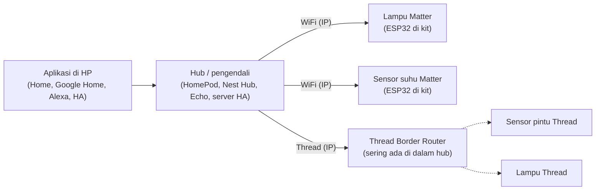
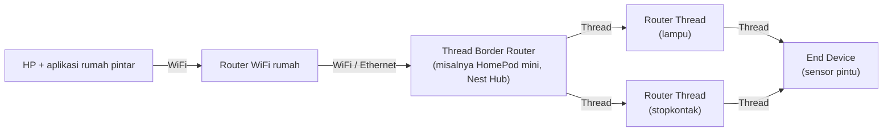
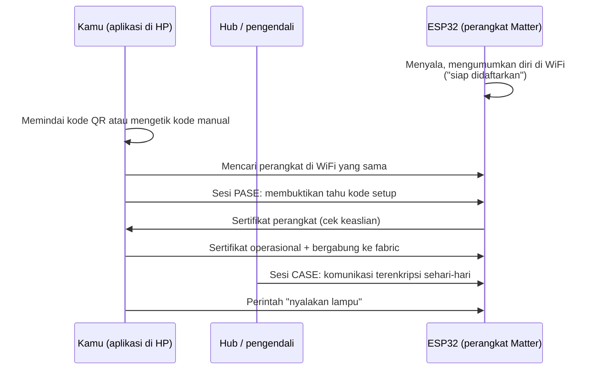
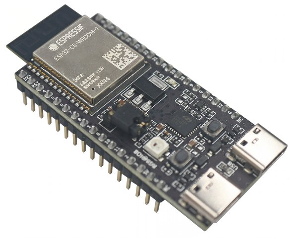

# BAB 56: Protokol Modern — Matter & Thread

> ✅ **Prasyarat:** Selesaikan **BAB 42 (WiFi Station Mode — Koneksi Internet ESP32)** — ESP32-mu sudah bisa tersambung ke WiFi dan menampilkan alamat IP di Serial Monitor. Program di BAB ini juga memakai *relay* dari **BAB 37 (*Relay* — Kontrol AC/DC)**, sensor dari **BAB 26 (DHT11 — Suhu & Kelembapan)**, penyimpanan `Preferences` dari **BAB 39 (NVS — Non-Volatile Storage)**, dan pola `struct Timer` dari **BAB 16 (Non-Blocking Programming)**. Konsep jaringan *mesh* dari **BAB 55 (ESP-MESH)** membantu saat membahas Thread, tetapi tidak wajib.

Di rumah pintar zaman sekarang, lampu merek A sering hanya bisa diatur dari aplikasi merek A, sedangkan kipas merek B butuh aplikasi B. Rasanya seperti punya banyak tamu yang berbicara dengan bahasa berbeda-beda. **Matter** adalah "bahasa bersama" untuk perangkat rumah pintar: sekali sebuah perangkat berbicara Matter, perangkat itu bisa diatur dari Apple Home, Google Home, Amazon Alexa, maupun Home Assistant. Di BAB ini kamu menjadikan ESP32 di kit sebagai **lampu Matter** dan **sensor suhu Matter** sungguhan, sekaligus berkenalan dengan **Thread**, jaringan *mesh* hemat daya yang sering dipakai bersama Matter.

## 📌 Tujuan Pembelajaran

Setelah mempelajari BAB ini, kamu bisa:

- Menjelaskan masalah yang diselesaikan Matter dan bedanya dengan protokol yang sudah kamu pelajari (HTTP, MQTT, BLE, ESP-NOW).
- Menjelaskan Thread, radio IEEE 802.15.4, peran-peran di jaringan Thread, dan fungsi ***Thread Border Router***.
- Membedakan Matter lewat WiFi, Matter lewat Thread, dan Matter lewat Ethernet, serta chip ESP32 mana yang mendukung masing-masing.
- Membaca model data Matter: *node*, *endpoint*, *cluster*, atribut, dan perintah.
- Mendaftarkan (*commissioning*) perangkat ke aplikasi rumah pintar dengan kode QR atau kode *pairing* manual, lalu menghapusnya lagi (*decommission*).
- Memakai *library* **Matter** bawaan core esp32 3.3.x untuk membuat lampu *on/off* (LED merah + *relay*) dan sensor suhu-kelembapan (DHT11).
- Membuat jaringan Thread kecil dengan *library* **OpenThread** di ESP32-C6/ESP32-H2 (opsional, butuh *board* tambahan).
- Menyebutkan keterbatasan perangkat Matter buatan sendiri: kode uji, status belum bersertifikat, dan risiko keamanannya.

## 🧰 Yang Perlu Disiapkan

| Kebutuhan | Keterangan |
|---|---|
| *Hardware* | Kit Bluino ESP32 IoT Starter Shield + kabel USB **data** (Program 1 dan 2) |
| Kabel *jumper* | 4 kabel *female-female* (sudah ada di kit): `LED1` (merah) → IO4, `RELAY` → IO26, dan `SW1` → IO15 (Program 1); `DHT` → IO27 dan `SW1` → IO15 (Program 2) |
| Komponen tambahan | Program 1 dan 2: tidak ada. *Relay* cukup dicoba **tanpa beban**. Program 3 (opsional): **2 *board* ESP32-C6 atau ESP32-H2** — **tidak termasuk kit** |
| Perangkat rumah pintar | Salah satu *(lihat [56.5](#565-aplikasi-dan-hub-yang-dibutuhkan))*: iPhone dengan aplikasi **Home** (iOS 18 atau lebih baru); **Google Home** + *hub* Google (misalnya Nest Hub atau Nest Mini) + proyek di Google Home Developer Console; **Amazon Alexa** + Echo yang mendukung Matter; atau **Home Assistant** dengan integrasi Matter |
| *Software* | Arduino IDE 2.x + *board package* **esp32** versi 3.3.x (diuji dengan 3.3.12, lihat [BAB 5](../BAB-05/README.md)). *Library* **Matter** dan **OpenThread** sudah ikut di dalamnya |
| *Library* | **DHT sensor library** by Adafruit + **Adafruit Unified Sensor** (Program 2). Matter, WiFi, Preferences, dan OpenThread adalah *library* bawaan core — tidak perlu dipasang |
| Alat uji | **Serial Monitor** Arduino IDE (baud 115200); *browser* untuk menampilkan kode QR; aplikasi rumah pintar di HP |
| Jaringan | WiFi **2,4 GHz** (ESP32 tidak mendukung 5 GHz). HP, *hub*, dan ESP32 harus berada di **WiFi yang sama**. Hindari WiFi kampus/kantor/kafe yang memakai *client isolation* — perangkat di jaringan seperti itu tidak bisa saling menemukan |

## 📑 Daftar Isi

- [56.1 Kenapa Butuh Matter?](#561-kenapa-butuh-matter)
- [56.2 Thread: Jaringan Mesh Hemat Daya](#562-thread-jaringan-mesh-hemat-daya)
- [56.3 Model Data Matter: Node, Endpoint, Cluster](#563-model-data-matter-node-endpoint-cluster)
- [56.4 Commissioning: Mendaftarkan Perangkat Matter](#564-commissioning-mendaftarkan-perangkat-matter)
- [56.5 Aplikasi dan Hub yang Dibutuhkan](#565-aplikasi-dan-hub-yang-dibutuhkan)
- [56.6 Matter di Arduino-ESP32: Chip, Library, dan Pengaturan](#566-matter-di-arduino-esp32-chip-library-dan-pengaturan)
- [56.7 Program 1: Lampu Matter — LED Merah dan Relay](#567-program-1-lampu-matter--led-merah-dan-relay)
- [56.8 Menghapus Pendaftaran (Decommission)](#568-menghapus-pendaftaran-decommission)
- [56.9 Program 2: Sensor Suhu dan Kelembapan Matter](#569-program-2-sensor-suhu-dan-kelembapan-matter)
- [56.10 Program 3: Jaringan Thread Sederhana (ESP32-C6/H2)](#5610-program-3-jaringan-thread-sederhana-esp32-c6h2)
- [56.11 Keamanan dan Keterbatasan](#5611-keamanan-dan-keterbatasan)
- [56.12 Perbandingan Protokol IoT BAB 50–56](#5612-perbandingan-protokol-iot-bab-5056)
- [56.13 Troubleshooting](#5613-troubleshooting)
- [📝 Rangkuman](#-rangkuman)
- [💪 Latihan](#-latihan)
- [📚 Referensi](#-referensi)

---

## 56.1 Kenapa Butuh Matter?

### 56.1.1 Masalah: Banyak Merek, Banyak Bahasa

Sebelum Matter, setiap ekosistem rumah pintar punya "bahasa" sendiri. Sebuah lampu pintar biasanya hanya cocok dengan aplikasi pembuatnya atau dengan satu-dua ekosistem tertentu. Akibatnya:

- Pembeli harus mengecek label "*Works with* …" satu per satu sebelum membeli.
- Satu rumah bisa butuh beberapa aplikasi sekaligus untuk perangkat yang berbeda merek.
- Pembuat perangkat harus menulis integrasi terpisah untuk setiap ekosistem.

Kamu sendiri sudah merasakan versi kecilnya di BAB-BAB sebelumnya: perangkat MQTT ([BAB 50](../BAB-50/README.md)) hanya mengerti topik yang kamu rancang sendiri, dan perangkat ESP-NOW ([BAB 54](../BAB-54/README.md)) hanya bisa bicara dengan sesama ESP32. Aplikasi lain tidak tahu bahwa `bluino/andi-4821/perintah/led` berarti "nyalakan lampu".

### 56.1.2 Solusinya: Satu Bahasa Bersama

**Matter** adalah standar terbuka untuk perangkat rumah pintar. Analoginya seperti **bahasa Indonesia di sebuah kelas yang muridnya datang dari berbagai daerah**: setiap murid boleh punya bahasa daerah sendiri, tetapi kalau semua mengerti bahasa Indonesia, guru mana pun bisa memberi instruksi ke murid mana pun. Di Matter:

- "Murid" = perangkat (lampu, sensor, kunci pintu, AC).
- "Guru" = **pengendali** (*controller*): aplikasi Apple Home, Google Home, Amazon Alexa, Home Assistant, beserta *hub*-nya.
- "Bahasa Indonesia" = aturan Matter: cara memperkenalkan diri, cara menyebut "lampu" dan "suhu", dan cara mengirim perintah "nyalakan".

Karena aturannya sama, lampu Matter dari merek apa pun dipahami sebagai "lampu" oleh semua aplikasi Matter. Satu perangkat bahkan boleh diatur oleh **beberapa ekosistem sekaligus** (fitur ***multi-admin***), misalnya dari Apple Home dan Home Assistant bersamaan.

### 56.1.3 Fakta Singkat tentang Matter

| Hal | Keterangan |
|---|---|
| Pengembang | **CSA** (*Connectivity Standards Alliance*), dulu bernama Zigbee Alliance. Anggotanya ratusan perusahaan, termasuk Apple, Google, Amazon, dan Samsung |
| Sejarah | Dimulai akhir 2019 dengan nama *Project CHIP* (*Connected Home over IP*), versi 1.0 dirilis Oktober 2022, lalu terus diperbarui (versi 1.x) |
| Dasar jaringan | **IP** (*Internet Protocol*) — perangkat Matter punya alamat IP seperti laptop dan HP. Matter terutama memakai **IPv6**, versi alamat IP yang lebih baru dan lebih panjang (contohnya `fe80::1a2b:3cff:fe4d:5e6f`) dibanding IPv4 yang biasa kamu lihat (`192.168.1.105`) |
| Jalur kirim data | **WiFi**, **Thread**, atau **Ethernet**. Bluetooth LE hanya dipakai **saat pendaftaran** (dan hanya di chip yang mendukung) |
| Bekerja lokal | Perintah dari aplikasi ke perangkat berjalan di jaringan rumah, **tanpa harus lewat *cloud***. Internet hanya dibutuhkan untuk kendali dari luar rumah (lewat *hub* ekosistem) |
| Keamanan | Setiap perangkat didaftarkan dengan kode rahasia; komunikasi selanjutnya dienkripsi dan diautentikasi dengan sertifikat (lihat [56.4](#564-commissioning-mendaftarkan-perangkat-matter)) |
| Kode sumber | Implementasi acuannya terbuka: **connectedhomeip** di GitHub. Espressif membungkusnya menjadi **ESP-Matter**, dan core Arduino-ESP32 membungkusnya lagi menjadi *library* **Matter** |

Hubungan perangkat, pengendali, dan jaringannya bisa digambarkan seperti ini:



*Gambar 56.1 — Gambaran ekosistem Matter: aplikasi dan hub berperan sebagai pengendali, perangkat bisa tersambung lewat WiFi atau lewat Thread. Sumber: dibuat untuk materi ini.*

> 📌 **Catatan:** Matter **bukan** pengganti MQTT atau HTTP untuk semua kebutuhan. Matter dirancang khusus untuk **perangkat rumah pintar** yang dikendalikan aplikasi rumah pintar. Untuk mengirim data sensor ke *server* buatanmu sendiri, MQTT ([BAB 50](../BAB-50/README.md)) tetap lebih sederhana.

---

## 56.2 Thread: Jaringan Mesh Hemat Daya

### 56.2.1 Apa Itu Thread?

**Thread** adalah protokol jaringan nirkabel untuk perangkat kecil yang hemat daya, misalnya sensor pintu bertenaga baterai. Ciri-cirinya:

- Memakai radio **IEEE 802.15.4** di pita 2,4 GHz — radio yang sama dengan Zigbee, tetapi **bukan** WiFi dan **bukan** Bluetooth. Kecepatannya hanya 250 kbit/s, tetapi sangat hemat energi.
- Berbasis **IPv6**: setiap perangkat Thread punya alamat IP sendiri, sehingga Matter bisa berjalan di atasnya.
- Berbentuk ***mesh***: perangkat saling meneruskan pesan seperti lari estafet, mirip ESP-MESH di [BAB 55](../BAB-55/README.md). Kalau satu perangkat mati, jalur lain dipakai (*self-healing*).
- Dikembangkan oleh **Thread Group** (dibentuk 2014). Implementasi terbukanya bernama **OpenThread**, dan itulah yang dipakai ESP32-C6 dan ESP32-H2.

Analogi: kalau WiFi adalah **jalan raya** yang lebar tetapi "boros bensin", Thread adalah **jalur sepeda** antar-rumah — lebih pelan, tetapi sangat hemat dan saling menyambung sehingga tetap bisa sampai ke tujuan walaupun satu jalur ditutup.

### 56.2.2 Peran di Jaringan Thread

| Peran | Tugas | Contoh perangkat |
|---|---|---|
| ***Leader*** | Satu *router* yang mengatur data jaringan (misalnya daftar *router*). Dipilih otomatis; kalau *Leader* mati, *router* lain mengambil alih | Biasanya perangkat yang selalu menyala |
| ***Router*** | Meneruskan pesan untuk perangkat lain. Radionya selalu menyala | Lampu, stopkontak pintar |
| ***End Device*** (anak/*Child*) | Hanya berbicara dengan satu *router* "induk" (*parent*). Versi hemat daya (*Sleepy End Device*) mematikan radionya hampir sepanjang waktu | Sensor pintu, sensor suhu bertenaga baterai |
| ***Border Router*** | "Jembatan" antara jaringan Thread dan jaringan WiFi/Ethernet di rumah | HomePod mini, sebagian model Apple TV 4K, Nest Hub (gen. 2), Nest Hub Max, Nest Wifi Pro, sebagian model Echo |

Perangkat yang baru bergabung biasanya mulai sebagai *Child*, lalu bisa naik menjadi *Router* kalau jaringan membutuhkannya. Kamu akan melihat perubahan ini sendiri di Program 3.

### 56.2.3 Thread Border Router

Perangkat Thread tidak punya WiFi, jadi HP-mu tidak bisa langsung "melihat" mereka. Di sinilah ***Thread Border Router*** berperan: perangkat ini punya radio Thread **dan** WiFi/Ethernet, lalu meneruskan paket IPv6 di antara keduanya. Seperti **gerbang tol** yang menghubungkan jalur sepeda tadi dengan jalan raya.



*Gambar 56.2 — Jaringan Thread berbentuk mesh dihubungkan ke WiFi rumah oleh Thread Border Router. Sensor pintu bisa dijangkau lewat lampu maupun stopkontak. Sumber: dibuat untuk materi ini.*

> 📌 **Catatan:** Untuk memakai perangkat **Matter lewat Thread**, rumahmu wajib punya Thread Border Router. Banyak *hub* rumah pintar modern sudah berisi Border Router, jadi kamu tidak perlu membeli perangkat terpisah. Espressif juga menjual *board* Border Router sendiri (ESP Thread Border Router, gabungan ESP32-S3 + ESP32-H2).

### 56.2.4 Matter Lewat WiFi, Thread, atau Ethernet

| Jalur | Kelebihan | Kekurangan | Cocok untuk |
|---|---|---|---|
| **Matter lewat WiFi** | Tidak butuh Border Router; cepat; ESP32 di kit **bisa** | Boros daya, kurang cocok untuk baterai | Lampu, stopkontak, AC — perangkat yang selalu tersambung listrik |
| **Matter lewat Thread** | Sangat hemat daya, jangkauan diperluas oleh *mesh* | Butuh Border Router dan chip dengan radio 802.15.4 (ESP32-C6/H2/C5) — **ESP32 di kit tidak bisa** | Sensor dan perangkat bertenaga baterai |
| **Matter lewat Ethernet** | Paling stabil | Butuh kabel LAN dan *hardware* Ethernet tambahan | Perangkat tetap, misalnya *bridge* |

Jadi, untuk kit ini kamu memakai **Matter lewat WiFi**. Thread dibahas supaya kamu paham gambaran utuhnya, dan dicoba di Program 3 bagi yang punya *board* ESP32-C6/H2.

---

## 56.3 Model Data Matter: Node, Endpoint, Cluster

Supaya semua aplikasi mengerti semua perangkat, Matter menyusun "isi" setiap perangkat dengan struktur yang sama, mirip **gedung apartemen**:

| Istilah Matter | Analogi apartemen | Contoh di Program 1 |
|---|---|---|
| ***Node*** | Satu gedung | ESP32 di kit |
| ***Endpoint*** | Satu unit/kamar bernomor | *Endpoint* 1 = lampu |
| ***Device type*** (jenis perangkat) | Jenis unit: studio, dua kamar, … | *On/Off Light* |
| ***Cluster*** | Fasilitas di unit itu: listrik, air, AC | *Cluster* **OnOff** |
| **Atribut** (*attribute*) | Angka di meteran fasilitas | Atribut `OnOff` = `true`/`false` |
| **Perintah** (*command*) | Tombol yang bisa ditekan | Perintah `On`, `Off`, `Toggle` |

Gambaran lengkap Node di Program 1 dan Program 2:

```text
Node: ESP32 Program 1                    Node: ESP32 Program 2
|                                        |
+-- Endpoint 0: Root Node (wajib)        +-- Endpoint 0: Root Node (wajib)
|   +-- Basic Information                |   +-- Basic Information
|   +-- Network Commissioning, dll.      |   +-- Network Commissioning, dll.
|                                        |
+-- Endpoint 1: On/Off Light             +-- Endpoint 1: Temperature Sensor
    +-- Cluster OnOff                    |   +-- Cluster TemperatureMeasurement
    |   +-- Atribut OnOff (bool)         |       +-- Atribut MeasuredValue
    |   +-- Perintah On / Off / Toggle   |           (int16, satuan 0,01 C)
    +-- Cluster Identify, Groups, dll.   |
                                         +-- Endpoint 2: Humidity Sensor
                                             +-- Cluster RelativeHumidityMeasurement
                                                 +-- Atribut MeasuredValue
                                                     (uint16, satuan 0,01 %)
```

Beberapa hal penting:

- **Endpoint 0** selalu ada. Isinya informasi tentang perangkat itu sendiri: nama pembuat, nomor seri, versi, dan jaringan. *Library* Matter membuatnya otomatis.
- Setiap kali kamu memanggil `begin()` pada sebuah objek *endpoint* (misalnya `lampu.begin()`), *library* menambah satu *endpoint* baru dengan nomor berikutnya (1, 2, 3, …).
- Matter menyimpan angka sebagai **bilangan bulat**. Suhu 28,65 °C disimpan sebagai `2865` (satuan 0,01 °C), dan kelembapan 70 % disimpan sebagai `7000` (satuan 0,01 %). *Library* Arduino mengurus konversinya: kamu cukup memanggil `setTemperature(28.65)`.
- Aplikasi rumah pintar membaca atribut, berlangganan perubahannya (seperti *subscribe* di MQTT), dan mengirim perintah. Kamu tidak perlu menulis kode jaringan sendiri — semuanya diurus *library*.

---

## 56.4 Commissioning: Mendaftarkan Perangkat Matter

### 56.4.1 Apa Itu Commissioning?

***Commissioning*** adalah proses **mendaftarkan** perangkat baru ke sebuah ekosistem, mirip proses "*check-in*" tamu di hotel: tamu menunjukkan kode reservasi, petugas memeriksanya, lalu tamu mendapat kartu kamar. Setelah itu, tamu cukup menempelkan kartunya — tidak perlu menunjukkan kode reservasi lagi.

| Hotel | Matter |
|---|---|
| Kode reservasi | **Kode *setup*** (*setup passcode*) 8 digit, dikemas dalam **kode QR** atau **kode *pairing* manual** 11 digit |
| Petugas *check-in* | **Pengendali** yang melakukan *commissioning* (*commissioner*): aplikasi di HP bersama *hub* |
| Kartu kamar | **Sertifikat operasional** yang diberikan pengendali ke perangkat |
| Daftar tamu satu hotel | ***Fabric***: kumpulan perangkat dan pengendali yang saling percaya. Satu ekosistem = satu *fabric* |

### 56.4.2 Langkah-Langkah Commissioning



*Gambar 56.3 — Urutan commissioning perangkat Matter lewat WiFi (tanpa Bluetooth) seperti ESP32 di kit. Sumber: dibuat untuk materi ini.*

Penjelasan setiap langkah:

1. **Perangkat mengumumkan diri.** Setelah menyala dan tersambung ke WiFi, ESP32 mengiklankan dirinya di jaringan lokal (memakai mDNS/DNS-SD, mirip `esp32.local` di [BAB 45](../BAB-45/README.md)). Perangkat yang mendukung Bluetooth LE juga bisa mengiklankan diri lewat BLE, tetapi ESP32 di kit **tidak** memakai cara ini (lihat [56.6](#566-matter-di-arduino-esp32-chip-library-dan-pengaturan)).
2. **Kamu memberikan kode.** Pindai kode QR, atau ketik kode *pairing* manual 11 digit di aplikasi.
3. **PASE** (*Passcode-Authenticated Session Establishment*). HP dan ESP32 membuktikan bahwa keduanya tahu kode *setup* yang sama **tanpa** mengirim kodenya lewat udara, lalu membuat saluran terenkripsi sementara.
4. **Cek keaslian perangkat** (*device attestation*). ESP32 menunjukkan sertifikat yang menyatakan siapa pembuatnya. Perangkat bersertifikat resmi punya sertifikat dari pembuat yang terdaftar di CSA; ESP32 di BAB ini memakai **sertifikat uji**, sehingga aplikasi bisa memberi peringatan (lihat [56.5.2](#5652-perangkat-uji-vs-perangkat-bersertifikat)).
5. **Bergabung ke *fabric*.** Pengendali memberi ESP32 sertifikat operasional. Sejak itu, ESP32 resmi menjadi anggota *fabric* ekosistem tersebut. Data ini disimpan di NVS ([BAB 39](../BAB-39/README.md)), jadi tidak hilang saat listrik padam.
6. **CASE** (*Certificate-Authenticated Session Establishment*). Untuk komunikasi sehari-hari, pengendali dan ESP32 saling memeriksa sertifikat operasional, lalu membuat sesi terenkripsi. Kode *setup* tidak dipakai lagi.

### 56.4.3 Kode QR dan Kode Pairing Manual

ESP32 yang belum terdaftar akan mencetak dua hal di Serial Monitor:

| Kode | Contoh (kode uji bawaan) | Cara memakainya |
|---|---|---|
| Kode *pairing* manual | `34970112332` | Diketik di aplikasi (pilih menu seperti **Enter code manually** atau **I Don't Have a Code or Cannot Scan**). Di aplikasi sering ditampilkan berkelompok: `3497-011-2332` |
| URL kode QR | `https://project-chip.github.io/connectedhomeip/qrcode.html?data=MT%3AY.K90AFN00KA0648G00` | Buka URL ini di *browser* laptop. Halaman itu menggambar kode QR yang lalu kamu pindai dengan kamera HP dari aplikasi rumah pintar |

Isi kode QR selalu diawali `MT:`. Di dalamnya ada kode *setup* (`20202021`), nomor pembeda perangkat (*discriminator*), nomor pembuat (*Vendor ID*), nomor produk (*Product ID*), dan cara perangkat bisa ditemukan (WiFi, BLE, dan sebagainya). Kode manual berisi data yang lebih sedikit, tetapi cukup untuk mendaftarkan perangkat.

> ⚠️ **Perhatian:** Kode di atas adalah **kode uji bawaan** yang sama untuk semua orang yang memakai contoh *library* Matter. Siapa pun di WiFi yang sama bisa memakai kode itu selama perangkatmu belum terdaftar. Daftarkan perangkatmu segera, dan baca [56.11](#5611-keamanan-dan-keterbatasan) untuk cara mengganti kodenya.

### 56.4.4 Jendela Pendaftaran

Perangkat yang belum terdaftar membuka **jendela pendaftaran** (*commissioning window*) saat menyala. Di core esp32 3.3.12, jendela ini tertutup otomatis setelah **15 menit**. Karena itu, program di BAB ini me-*restart* ESP32 sendiri kalau sudah 10 menit belum didaftarkan, supaya jendelanya terbuka lagi. Kalau ESP32 sudah terdaftar, tidak ada jendela yang terbuka — pihak luar tidak bisa mendaftarkannya lagi tanpa izin pengendali.

---

## 56.5 Aplikasi dan Hub yang Dibutuhkan

### 56.5.1 Pilihan Ekosistem

Kamu cukup memilih **salah satu** ekosistem di bawah ini. Syaratnya bisa berubah seiring pembaruan aplikasi, jadi cek juga halaman bantuan resminya (ada di [📚 Referensi](#-referensi)).

| Ekosistem | Yang dibutuhkan | Catatan untuk perangkat buatan sendiri |
|---|---|---|
| **Apple Home** | iPhone/iPad dengan aplikasi **Home**. Mulai iOS 18, perangkat Matter bisa ditambahkan dan dikendalikan **tanpa *hub*** (kendali lokal). *Hub* (HomePod, HomePod mini, Apple TV) dibutuhkan untuk otomasi dan kendali dari luar rumah | Muncul peringatan aksesori belum bersertifikat (*uncertified accessory*); pilih **Add Anyway** untuk melanjutkan |
| **Google Home** | Aplikasi **Google Home** + ***hub*** Google yang mendukung Matter (misalnya Nest Mini, Nest Audio, Nest Hub, Nest Hub Max, Nest Wifi Pro, Google TV Streamer). Google menyatakan *hub* wajib untuk menambahkan dan mengendalikan perangkat Matter | Perangkat dengan Vendor ID uji (`0xFFF1`) hanya bisa ditambahkan kalau kamu membuat proyek dan integrasi Matter di **Google Home Developer Console** dengan VID `0xFFF1` dan PID `0x8000`, memakai akun Google yang sama |
| **Amazon Alexa** | Aplikasi **Amazon Alexa** + perangkat Echo yang mendukung Matter | Dukungan untuk perangkat uji belum terdokumentasi resmi — bisa berhasil, bisa juga ditolak |
| **Home Assistant** | *Server* Home Assistant (misalnya di Raspberry Pi atau PC 64-bit) dengan aplikasi **Matter Server** dan integrasi **Matter**, IPv6 diaktifkan, + aplikasi **Home Assistant Companion** di HP untuk proses penambahan | Gratis dan terbuka, cocok untuk belajar karena semua atribut dan log-nya bisa dilihat. Penambahan dari iPhone memunculkan peringatan *Uncertified Accessory* (pilih **Add Anyway**). Penambahan dari Android memakai layanan Google, sehingga perangkat uji juga perlu didaftarkan di Google Home Developer Console |

> 💡 **Tips:** Kalau di rumahmu belum ada perangkat rumah pintar sama sekali, pilihan termudah biasanya **iPhone dengan iOS 18 atau lebih baru** (tanpa *hub*) atau **Home Assistant** (kalau kamu punya Raspberry Pi/PC yang bisa menyala terus). Kalau tidak ada keduanya, kamu tetap bisa mengikuti Program 1 dan 2: LED, *relay*, tombol, dan pembacaan DHT11 tetap berjalan dan terlihat di Serial Monitor, hanya bagian "kendali dari aplikasi" yang tidak bisa dicoba.

### 56.5.2 Perangkat Uji vs Perangkat Bersertifikat

Perangkat Matter yang dijual di toko sudah lulus **sertifikasi CSA**. Pembuatnya punya *Vendor ID* resmi, dan setiap unit membawa sertifikat keaslian (DAC, *Device Attestation Certificate*) yang ditandatangani pihak yang dipercaya CSA. ESP32 di BAB ini berbeda:

| Hal | ESP32 di BAB ini | Produk Matter bersertifikat |
|---|---|---|
| *Vendor ID* / *Product ID* | `0xFFF1` / `0x8000` — nomor **khusus uji** dari CSA | Nomor resmi milik pembuat |
| Sertifikat keaslian | Sertifikat uji (sama untuk semua contoh) | Sertifikat unik per unit |
| Kode *setup* | `20202021` (sama untuk semua contoh) | Unik per unit, tercetak di kemasan |
| Di aplikasi | Bisa muncul peringatan "belum bersertifikat", atau ditolak | Langsung diterima |
| Boleh dijual? | **Tidak.** Nomor uji tidak boleh dipakai di produk konsumen | Ya |

Jadi, program di BAB ini cocok untuk **belajar dan bereksperimen** di rumah sendiri, bukan untuk dijual atau dipasang di rumah orang lain.

---

## 56.6 Matter di Arduino-ESP32: Chip, Library, dan Pengaturan

### 56.6.1 Chip ESP32 Mana yang Bisa Apa?

| Chip | WiFi | Bluetooth | Radio 802.15.4 (Thread) | Matter lewat WiFi | Matter lewat Thread | Pendaftaran lewat BLE (Arduino) |
|---|---|---|---|---|---|---|
| **ESP32** (yang ada di kit) | ✅ 2,4 GHz | Classic + BLE | ❌ | ✅ | ❌ | ❌ — didaftarkan lewat WiFi |
| ESP32-S2 | ✅ 2,4 GHz | ❌ | ❌ | ✅ | ❌ | ❌ |
| ESP32-S3 / ESP32-C3 | ✅ 2,4 GHz | BLE | ❌ | ✅ | ❌ | ✅ |
| ESP32-C6 | ✅ WiFi 6, 2,4 GHz | BLE | ✅ | ✅ | ✅ (pilih salah satu: WiFi **atau** Thread) | ✅ |
| ESP32-C5 | ✅ WiFi 6, 2,4 + 5 GHz | BLE | ✅ | ✅ | ✅ (lewat menu **Tools → Matter Network**) | ✅ |
| ESP32-H2 | ❌ | BLE | ✅ | ❌ | ✅ | ✅ |

Hal penting dari tabel ini:

- **ESP32 di kit bisa menjadi perangkat Matter lewat WiFi.** Kode lama yang beredar di internet sering menyebut ESP32 "klasik" tidak bisa Matter — itu sudah tidak berlaku sejak core Arduino-ESP32 3.x membawa *library* Matter.
- **ESP32 di kit tidak bisa Thread**, karena tidak punya radio IEEE 802.15.4. Untuk Thread, kamu butuh ESP32-C6, ESP32-H2, atau ESP32-C5.
- Pada *library* Matter versi Arduino IDE, **ESP32 di kit tidak bisa didaftarkan lewat Bluetooth**. Karena itu, nama dan kata sandi WiFi **ditulis di program**: ESP32 tersambung ke WiFi dulu, baru kemudian didaftarkan lewat jaringan (*on-network commissioning*). Chip lain (S3, C3, C6, H2) biasanya didaftarkan lewat BLE, lalu *hub* yang mengirimkan nama dan kata sandi WiFi-nya.

### 56.6.2 Library Matter Bawaan Core

*Library* **Matter** ikut terpasang bersama *board package* esp32 3.3.x, jadi kamu tidak perlu memasang apa pun lewat Library Manager. Cukup tulis `#include <Matter.h>`. Kamu juga bisa melihat contoh resminya di Arduino IDE: **File → Examples → Matter**.

Fungsi dan kelas yang dipakai di BAB ini:

| Kode | Kegunaan |
|---|---|
| `MatterOnOffLight lampu;` | Membuat objek *endpoint* jenis *On/Off Light* |
| `MatterTemperatureSensor` / `MatterHumiditySensor` | *Endpoint* sensor suhu / sensor kelembapan |
| `lampu.begin(keadaanAwal)` | Mendaftarkan *endpoint* ke Node. **Wajib dipanggil sebelum `Matter.begin()`** |
| `lampu.onChange(fungsi)` | Fungsi yang dipanggil setiap kali keadaan lampu berubah (dari aplikasi maupun dari kode) |
| `lampu.toggle()` / `lampu.setOnOff(x)` / `lampu.getOnOff()` | Membalik / mengatur / membaca keadaan lampu dan melaporkannya ke aplikasi |
| `sensorSuhu.setTemperature(28.5)` | Mengirim nilai suhu baru (°C) |
| `sensorKelembapan.setHumidity(70)` | Mengirim nilai kelembapan baru (%) |
| `Matter.begin()` | Menyalakan Matter. **Selalu langkah terakhir**, setelah semua *endpoint* di-`begin()` |
| `Matter.isDeviceCommissioned()` | `true` kalau ESP32 sudah terdaftar di minimal satu *fabric* |
| `Matter.getManualPairingCode()` / `Matter.getOnboardingQRCodeUrl()` | Kode *pairing* manual / URL kode QR (baru tersedia setelah `Matter.begin()`) |
| `Matter.decommission()` | Menghapus semua data Matter (*factory reset* Matter), lalu ESP32 *restart* |
| `MatterButton` | Pembaca tombol dari *library* Matter: membedakan tekan sebentar (`MATTER_BUTTON_CLICK`) dan tahan 5 detik (`MATTER_BUTTON_LONG_HOLD`) |

> ⚠️ **Perhatian:** Jangan memakai *library* `BLE.h` ([BAB 53](../BAB-53/README.md)) atau `ESPmDNS` ([BAB 45](../BAB-45/README.md)) di program Matter. Matter mengurus Bluetooth dan mDNS sendiri, dan keduanya bisa bentrok.

### 56.6.3 Pengaturan Arduino IDE untuk Program Matter

Program Matter jauh lebih besar daripada program biasa — Program 1 di BAB ini sekitar 1,5 MB, sedangkan pembagian *flash* bawaan hanya menyediakan sekitar 1,25 MB untuk program ([BAB 20](../BAB-20/README.md)). Karena itu, ada dua pengaturan khusus di menu **Tools**:

| Menu | Pilihan | Kenapa |
|---|---|---|
| **Tools → Board** | **ESP32 Dev Module** | Seperti biasa |
| **Tools → Partition Scheme** | **Huge APP (3MB No OTA/1MB SPIFFS)** | Memberi ruang 3 MB untuk program. Tanpa ini, *compile* gagal dengan pesan `Sketch too big` |
| **Tools → Erase All Flash Before Sketch Upload** | **Enabled** hanya saat *upload* pertama program Matter, atau saat berganti dari Program 1 ke Program 2. Setelah itu kembalikan ke **Disabled** | Menghapus sisa data Matter lama di NVS. Kalau dibiarkan **Enabled**, setiap *upload* menghapus pendaftaran dan kamu harus mendaftarkan ulang |

> 📌 **Catatan:** *Compile* program Matter pertama kali bisa memakan waktu beberapa menit karena *library*-nya besar. Tunggu sampai muncul **Done compiling**/**Done uploading**. *Compile* berikutnya biasanya lebih cepat.

---

## 56.7 Program 1: Lampu Matter — LED Merah dan Relay

**Tujuan:** ESP32 menjadi perangkat Matter jenis *On/Off Light* yang tersambung lewat WiFi. Setelah didaftarkan, LED merah dan *relay* bisa dinyalakan atau dimatikan dari aplikasi rumah pintar. Tombol S1 juga bisa membalik keadaan lampu, dan aplikasi langsung ikut berubah. Keadaan terakhir disimpan, jadi lampu kembali ke keadaan semula setelah listrik padam.

**Rangkaian:**

| Pin **Custom** di kit | Sambungkan ke pin ESP32 |
|---|---|
| `LED1` — LED merah (header LED) | IO4 |
| `RELAY` (header biru, di **kanan** `BUZZ`) | IO26 |
| `SW1` — tombol S1 (header kuning) | IO15 |

*Relay* boleh tidak dipasang kalau kamu hanya ingin melihat LED. Hati-hati: label `15` di deretan bawah ESP32 bersebelahan dengan `G`, dan `RELAY` bersebelahan dengan `BUZZ`.


*Gambar 56.4 — Rangkaian driver relay pada kit: pin `RELAY` → resistor 10 kΩ → transistor BC547 → koil relay 5 V. Relay aktif HIGH. Sumber: skematik ESP32 Starter Shield 3.2, [Bluino](http://www.bluino.com).*


*Gambar 56.5 — Rangkaian tombol S1 dan S2. Resistor 10 kΩ menarik pin ke GND (pull-down), jadi pin bernilai HIGH saat tombol ditekan. Sumber: skematik ESP32 Starter Shield 3.2, [Bluino](http://www.bluino.com).*

> 🚨 **Bahaya:** Coba *relay* **tanpa beban**. Bunyi "klik" dan LED indikator kecil di dekat *relay* sudah cukup sebagai tanda bahwa *relay* bekerja. **Jangan pernah menyambungkan listrik PLN 220 V ke *relay* kit** ([BAB 37](../BAB-37/README.md#374-keselamatan-kit-ini-bukan-untuk-listrik-pln)). Ingat juga bahwa perangkat ini memakai kode uji yang diketahui umum.

**Cara Menjalankan:**

1. Sambungkan kabel *jumper* sesuai tabel **Rangkaian** di atas.
2. Buka Arduino IDE → **File → New Sketch**, hapus isinya, lalu salin kode di bawah. Kode yang sama juga tersedia di *file* [`p1_matter_lampu.ino`](p1_matter_lampu/p1_matter_lampu.ino).
3. Ganti `NamaWiFiKamu` dan `PasswordWiFiKamu` dengan WiFi **2,4 GHz** di rumahmu — WiFi yang sama dengan HP dan *hub*-mu. Huruf besar-kecil harus persis.
4. Atur menu **Tools**:
   - **Board** = **ESP32 Dev Module**, **Port** = *port* ESP32 kamu (misalnya `COM5` di Windows atau `/dev/ttyUSB0` di Linux).
   - **Partition Scheme** = **Huge APP (3MB No OTA/1MB SPIFFS)**.
   - **Erase All Flash Before Sketch Upload** = **Enabled** (hanya untuk *upload* pertama ini).
5. Klik **Upload** (ikon panah →) dan tunggu sampai muncul **Done uploading**. *Compile* pertama bisa beberapa menit.
6. Kembalikan **Tools → Erase All Flash Before Sketch Upload** ke **Disabled**, supaya *upload* berikutnya tidak menghapus pendaftaran.
7. Buka **Serial Monitor** (**Tools → Serial Monitor**) dengan baud **115200**, lalu tekan tombol **EN** di *board* ESP32 supaya pesan dari awal terlihat.
8. Coba tekan tombol S1 sebentar: LED merah menyala, *relay* berbunyi "klik". Tekan lagi untuk mematikan.
9. Daftarkan ESP32 ke aplikasi rumah pintar dengan langkah di [56.7.1](#5671-mendaftarkan-ke-aplikasi-rumah-pintar).

**Kode Program:**

<!-- sketch: p1_matter_lampu fqbn=esp32:esp32:esp32:PartitionScheme=huge_app -->
```cpp
/*
 * BAB 56 - Program 1: Lampu Matter (LED Merah + Relay)
 * ESP32 menjadi perangkat Matter jenis "On/Off Light" lewat WiFi.
 * Setelah didaftarkan (commissioning), LED merah dan relay bisa
 * dikendalikan dari Apple Home, Google Home, Amazon Alexa, atau
 * Home Assistant.
 *
 * Rangkaian: LED1 (merah) -> IO4, RELAY -> IO26, SW1 -> IO15
 * Board    : ESP32 Dev Module
 *            Tools -> Partition Scheme -> Huge APP (3MB No OTA/1MB SPIFFS)
 * Library  : Matter, WiFi, Preferences (bawaan core esp32 3.3.x)
 *
 * Tombol S1: tekan sebentar -> lampu ganti nyala/mati
 *            tahan 5 detik  -> hapus pendaftaran Matter (decommission)
 * Relay dicoba tanpa beban. Jangan pernah menyambungkan listrik PLN 220 V!
 */

#include <WiFi.h>
#include <Matter.h>
#include <Preferences.h>

const char *NAMA_WIFI = "NamaWiFiKamu";          // ← ganti dengan WiFi kamu
const char *PASSWORD_WIFI = "PasswordWiFiKamu";  // ← ganti dengan WiFi kamu

#define PIN_LED_MERAH 4   // LED1 (merah), aktif HIGH
#define PIN_RELAY 26      // relay, aktif HIGH
#define PIN_TOMBOL_S1 15  // SW1, ditekan = HIGH (pull-down 10 kOhm di PCB)

// Jendela pendaftaran Matter tertutup 15 menit setelah menyala,
// jadi ESP32 di-restart kalau 10 menit belum didaftarkan
const unsigned long BATAS_TUNGGU_DAFTAR = 10UL * 60UL * 1000UL;

MatterOnOffLight lampu;  // endpoint Matter jenis On/Off Light
MatterButton tombolS1;   // pembaca tombol dari library Matter
Preferences memori;      // menyimpan keadaan lampu terakhir di NVS

bool sudahTerdaftar = false;     // status pendaftaran yang terakhir dilihat
bool sedangReset = false;        // true setelah Matter.decommission()
unsigned long waktuReset = 0;

// Dipanggil setiap kali keadaan lampu berubah: dari aplikasi,
// dari tombol S1, atau dari updateAccessory() saat menyala
bool ubahLampu(bool nyala) {
  digitalWrite(PIN_LED_MERAH, nyala ? HIGH : LOW);
  digitalWrite(PIN_RELAY, nyala ? HIGH : LOW);
  memori.putBool("nyala", nyala);  // ingat keadaan terakhir
  Serial.printf("[LAMPU] %s\n", nyala ? "NYALA" : "MATI");
  return true;  // true = perubahan diterima
}

void sambungWiFi() {
  Serial.printf("[WiFi] Menyambung ke %s", NAMA_WIFI);
  WiFi.mode(WIFI_STA);
  WiFi.enableIPv6(true);  // Matter berjalan di atas IPv6
  WiFi.begin(NAMA_WIFI, PASSWORD_WIFI);
  unsigned long mulai = millis();
  while (WiFi.status() != WL_CONNECTED) {
    delay(500);
    Serial.print(".");
    if (millis() - mulai >= 20000) {
      Serial.println();
      Serial.println("[WiFi] Belum tersambung. Cek nama/password dan pastikan WiFi 2,4 GHz.");
      mulai = millis();
    }
  }
  Serial.println();
  Serial.printf("[WiFi] Tersambung, IP: %s\n", WiFi.localIP().toString().c_str());
}

void tampilkanKodePairing() {
  Serial.println();
  Serial.println("[MATTER] Belum terdaftar. Daftarkan dari aplikasi rumah pintar:");
  Serial.printf("[MATTER] Kode pairing manual: %s\n", Matter.getManualPairingCode().c_str());
  Serial.println("[MATTER] Buka URL ini di browser untuk melihat kode QR:");
  Serial.println(Matter.getOnboardingQRCodeUrl());
  Serial.println();
}

// Memantau perubahan status pendaftaran Matter
void cekStatusMatter() {
  if (sedangReset) {
    // Matter.decommission() akan me-restart ESP32 sendiri.
    // Kalau 10 detik belum restart juga, restart manual.
    if (millis() - waktuReset >= 10000) {
      ESP.restart();
    }
    return;
  }

  bool terdaftar = Matter.isDeviceCommissioned();
  if (terdaftar && !sudahTerdaftar) {
    Serial.println("[MATTER] Berhasil didaftarkan ke aplikasi rumah pintar!");
  } else if (!terdaftar && sudahTerdaftar) {
    Serial.println("[MATTER] Perangkat dihapus dari aplikasi. Restart...");
    delay(500);
    ESP.restart();  // setelah restart, siap didaftarkan lagi
  } else if (!terdaftar && millis() >= BATAS_TUNGGU_DAFTAR) {
    Serial.println("[MATTER] 10 menit belum didaftarkan. Restart supaya jendela pendaftaran terbuka lagi...");
    delay(500);
    ESP.restart();
  }
  sudahTerdaftar = terdaftar;
}

void setup() {
  Serial.begin(115200);
  delay(500);
  Serial.println();
  Serial.println("=== BAB 56 - Program 1: Lampu Matter ===");

  pinMode(PIN_LED_MERAH, OUTPUT);
  pinMode(PIN_RELAY, OUTPUT);
  digitalWrite(PIN_LED_MERAH, LOW);
  digitalWrite(PIN_RELAY, LOW);

  tombolS1.begin(PIN_TOMBOL_S1, INPUT);  // kit sudah punya pull-down
  tombolS1.setActiveLow(false);          // ditekan = HIGH

  sambungWiFi();

  memori.begin("lampuMatter", false);
  bool keadaanAwal = memori.getBool("nyala", false);

  lampu.begin(keadaanAwal);   // 1) daftarkan endpoint lampu
  lampu.onChange(ubahLampu);  // 2) pasang fungsi pengubah LED/relay
  Matter.begin();             // 3) nyalakan Matter (selalu terakhir)
  lampu.updateAccessory();    // samakan LED/relay dengan keadaan awal

  sudahTerdaftar = Matter.isDeviceCommissioned();
  if (sudahTerdaftar) {
    Serial.println("[MATTER] Sudah terdaftar. Kendalikan lampu dari aplikasi.");
  } else {
    tampilkanKodePairing();
  }
}

void loop() {
  cekStatusMatter();

  matterButtonEvent_t kejadian;
  while ((kejadian = tombolS1.poll()) != MATTER_BUTTON_NONE) {
    if (kejadian == MATTER_BUTTON_CLICK && !sedangReset) {
      Serial.println("[TOMBOL] S1 ditekan -> balik keadaan lampu");
      lampu.toggle();  // aplikasi ikut melihat perubahannya
    } else if (kejadian == MATTER_BUTTON_LONG_HOLD && !sedangReset) {
      Serial.println("[TOMBOL] S1 ditahan 5 detik -> hapus pendaftaran Matter");
      lampu.setOnOff(false);
      sedangReset = true;
      waktuReset = millis();
      Matter.decommission();  // hapus data Matter, lalu ESP32 restart
    }
  }
  delay(10);
}
```

**Penjelasan Kode:**

- **Tiga langkah wajib Matter** ada di `setup()`: `lampu.begin()` mendaftarkan *endpoint* lampu, `lampu.onChange(ubahLampu)` memasang fungsi yang menggerakkan LED dan *relay*, lalu `Matter.begin()` menyalakan seluruh Matter. Urutannya penting: semua *endpoint* harus di-`begin()` **sebelum** `Matter.begin()`.
- **`ubahLampu()` adalah *callback*** ([BAB 18](../BAB-18/README.md)). Kamu tidak memanggilnya sendiri; *library* yang memanggilnya setiap kali atribut `OnOff` berubah — baik karena perintah dari aplikasi maupun karena `lampu.toggle()` dari tombol. Fungsi ini mengembalikan `true` supaya perubahan diterima. Kalau mengembalikan `false`, perintah dari aplikasi ditolak.
- **`sambungWiFi()`** menyambung ke WiFi **sebelum** Matter dinyalakan, karena ESP32 di kit didaftarkan lewat jaringan, bukan lewat Bluetooth ([56.6.1](#5661-chip-esp32-mana-yang-bisa-apa)). `WiFi.enableIPv6(true)` wajib karena Matter memakai IPv6. Kalau 20 detik belum tersambung, muncul petunjuk, lalu ESP32 terus mencoba.
- **`Preferences`** ([BAB 39](../BAB-39/README.md)) menyimpan keadaan lampu terakhir dengan kunci `"nyala"`. Saat menyala, `lampu.begin(keadaanAwal)` memakai nilai itu, lalu `lampu.updateAccessory()` memanggil `ubahLampu()` sekali supaya LED dan *relay* sama dengan keadaan yang tersimpan.
- **`MatterButton`** membaca tombol S1 di latar belakang dengan *debounce* 50 ms. Bawaannya untuk tombol aktif LOW (tombol **BOOT**), jadi diubah dengan `begin(PIN_TOMBOL_S1, INPUT)` dan `setActiveLow(false)` karena tombol di kit aktif HIGH dengan *pull-down*. `poll()` mengambil kejadian dari antrean: `MATTER_BUTTON_CLICK` (tekan sebentar) atau `MATTER_BUTTON_LONG_HOLD` (ditahan 5 detik).
- **`cekStatusMatter()`** memantau `Matter.isDeviceCommissioned()`. Ada tiga kejadian: baru berhasil didaftarkan (cetak pesan), dihapus dari aplikasi (*restart* supaya siap didaftarkan lagi), dan 10 menit belum didaftarkan (*restart* supaya jendela pendaftaran 15 menit terbuka lagi).
- **`Matter.decommission()`** menghapus semua data Matter di NVS lalu me-*restart* ESP32. Variabel `sedangReset` mencegah pesan yang membingungkan selama proses itu, dan menjadi cadangan kalau ESP32 belum juga *restart* setelah 10 detik.

**Contoh Output:**

Saat pertama kali menyala (belum terdaftar):

```text
=== BAB 56 - Program 1: Lampu Matter ===
[WiFi] Menyambung ke NamaWiFiKamu.....
[WiFi] Tersambung, IP: 192.168.1.105
[LAMPU] MATI

[MATTER] Belum terdaftar. Daftarkan dari aplikasi rumah pintar:
[MATTER] Kode pairing manual: 34970112332
[MATTER] Buka URL ini di browser untuk melihat kode QR:
https://project-chip.github.io/connectedhomeip/qrcode.html?data=MT%3AY.K90AFN00KA0648G00

[TOMBOL] S1 ditekan -> balik keadaan lampu
[LAMPU] NYALA
[MATTER] Berhasil didaftarkan ke aplikasi rumah pintar!
[LAMPU] MATI
[LAMPU] NYALA
```

Baris `[LAMPU] MATI` dan `[LAMPU] NYALA` terakhir muncul saat kamu menekan sakelar lampu di aplikasi. Alamat IP-mu bisa berbeda. Kalau URL kode QR-mu sedikit berbeda, pakai yang muncul di Serial Monitor-mu. Bisa juga muncul baris log tambahan berawalan `E (...)` atau `W (...)` dari *library* Matter; selama urutan pesan di atas muncul, kamu boleh mengabaikannya.

Saat dinyalakan ulang setelah terdaftar, kode *pairing* tidak dicetak lagi:

```text
=== BAB 56 - Program 1: Lampu Matter ===
[WiFi] Menyambung ke NamaWiFiKamu....
[WiFi] Tersambung, IP: 192.168.1.105
[LAMPU] NYALA
[MATTER] Sudah terdaftar. Kendalikan lampu dari aplikasi.
```

Di kit: LED merah dan LED indikator *relay* menyala bersamaan, dan *relay* berbunyi "klik" setiap kali berganti keadaan. Di aplikasi, perangkat muncul sebagai **lampu** dengan sakelar *on/off*. Tekan tombol S1, dan dalam satu-dua detik ikon lampu di aplikasi ikut berubah.

### 56.7.1 Mendaftarkan ke Aplikasi Rumah Pintar

Langkah umumnya sama untuk semua ekosistem: buka aplikasi → tambah perangkat → pilih Matter → pindai kode QR atau ketik kode manual. Pastikan HP terhubung ke **WiFi yang sama** dengan ESP32, dan Bluetooth HP menyala (beberapa aplikasi memintanya walaupun ESP32 tidak memakai Bluetooth).

Cara menampilkan kode QR:

1. Di Serial Monitor, *blok* URL yang diawali `https://project-chip.github.io/...`, lalu salin dengan **Ctrl+C**.
2. Buka *browser* di laptop (Chrome, Edge, Firefox), tempel di kolom alamat, lalu tekan Enter.
3. Halaman itu menampilkan gambar kode QR. Arahkan kamera dari aplikasi rumah pintar ke layar laptop.

Langkah per aplikasi (nama menu bisa sedikit berbeda tergantung versi aplikasi):

| Aplikasi | Langkah |
|---|---|
| **Apple Home** (iPhone) | Ketuk **+** → **Add Accessory** → pindai kode QR. Kalau tidak bisa memindai, ketuk **More options…** atau **I Don't Have a Code or Cannot Scan**, lalu ketik `34970112332`. Saat muncul peringatan *Uncertified Accessory*, pilih **Add Anyway** |
| **Google Home** | Siapkan dulu proyek di Google Home Developer Console (lihat [56.5.1](#5651-pilihan-ekosistem)). Lalu ketuk **+** → **Set up device** → **New device** → pilih rumah → **Matter-enabled device** → pindai kode QR atau masukkan kode |
| **Amazon Alexa** | Ketuk **More** → **Add Device** → **Matter** → pindai kode QR atau masukkan kode manual |
| **Home Assistant** | Di aplikasi Home Assistant Companion: **Settings → Connectivity → Matter → Add device** → **No. It's new.** → pindai kode QR, atau ketik kode manual lewat **More options…** (iOS) / **Setup without QR-code** (Android). Di versi lama, menunya ada di **Settings → Devices & services → Add device** |

Proses pendaftaran biasanya selesai dalam 30–90 detik. Setelah selesai, beri nama perangkat (misalnya "Lampu Kit") dan pilih ruangannya.

**Kalau Belum Berhasil:**

- ***Compile* gagal dengan `Sketch too big` atau `text section exceeds available space`** → **Tools → Partition Scheme** belum diubah ke **Huge APP (3MB No OTA/1MB SPIFFS)**.
- **Aplikasi tidak menemukan perangkat / "Can't reach device"** → HP dan ESP32 tidak di WiFi yang sama, WiFi memakai *client isolation* (WiFi kampus/kantor), atau sudah lewat 10 menit (ESP32 sedang *restart*). Pakai WiFi rumah, dekatkan HP, lalu coba lagi setelah kode *pairing* muncul ulang.
- **Google Home menolak perangkat** → Belum ada integrasi Matter dengan VID `0xFFF1`/PID `0x8000` di Google Home Developer Console, atau tidak ada *hub* Google di rumah.
- **Tombol S1 tidak berpengaruh** → Kabel `SW1` belum dipasang ke IO15, atau terpasang ke pin di sebelahnya. Coba tekan lebih mantap; tekan-lepas yang sangat cepat (< 50 ms) dianggap gangguan.

---

## 56.8 Menghapus Pendaftaran (Decommission)

Suatu saat kamu perlu menghapus ESP32 dari aplikasi: saat berganti ke Program 2, saat pindah ke ekosistem lain, atau saat pendaftaran gagal di tengah jalan. Ada tiga cara, dari yang paling dianjurkan:

| Cara | Langkah | Yang terjadi |
|---|---|---|
| **1. Hapus dari aplikasi** | Buka perangkat di aplikasi → pengaturan (ikon roda gigi) → **Remove Accessory** / **Remove device** / **Delete** | Aplikasi memberi tahu ESP32 bahwa *fabric*-nya dihapus. Program mendeteksinya, mencetak `[MATTER] Perangkat dihapus dari aplikasi. Restart...`, lalu siap didaftarkan lagi |
| **2. Tahan tombol S1 selama 5 detik** | Tekan dan tahan S1 sampai muncul `[TOMBOL] S1 ditahan 5 detik -> hapus pendaftaran Matter` | ESP32 menghapus semua data Matter-nya sendiri lalu *restart*. **Hapus juga perangkatnya dari aplikasi**, karena aplikasi tidak tahu ESP32 sudah di-*reset* |
| **3. Hapus seluruh *flash*** | **Tools → Erase All Flash Before Sketch Upload** = **Enabled**, lalu *upload* ulang | Semua isi *flash* terhapus, termasuk data Matter dan keadaan lampu. Pakai kalau cara 1 dan 2 tidak berhasil. Jangan lupa kembalikan ke **Disabled** |

Contoh *output* saat tombol S1 ditahan 5 detik:

```text
[TOMBOL] S1 ditahan 5 detik -> hapus pendaftaran Matter
[LAMPU] MATI

=== BAB 56 - Program 1: Lampu Matter ===
[WiFi] Menyambung ke NamaWiFiKamu.....
[WiFi] Tersambung, IP: 192.168.1.105
[LAMPU] MATI

[MATTER] Belum terdaftar. Daftarkan dari aplikasi rumah pintar:
[MATTER] Kode pairing manual: 34970112332
...
```

Baris `[LAMPU] MATI` pertama hanya muncul kalau lampu sedang menyala saat S1 ditahan. Di antara kedua bagian itu bisa muncul beberapa karakter acak atau pesan *boot* ESP32 — itu normal saat ESP32 *restart*.

> 💡 **Tips:** Satu perangkat bisa didaftarkan ke beberapa ekosistem sekaligus (*multi-admin*). Caranya bukan dengan memindai kode QR yang sama di aplikasi kedua, melainkan membuka menu "bagikan/pasangkan ke aplikasi lain" di aplikasi **pertama** (misalnya **Turn On Pairing Mode** di Apple Home atau **Linked Matter apps & services** di Google Home). Aplikasi pertama akan membuat kode *pairing* baru yang sementara.

> ⚠️ **Perhatian:** Sebelum meng-*upload* Program 2, **hapus dulu Program 1 dari aplikasi** (cara 1), lalu *upload* Program 2 dengan **Erase All Flash Before Sketch Upload** = **Enabled**. Program 2 punya *endpoint* yang berbeda (sensor, bukan lampu). Kalau data pendaftaran lama tetap ada, aplikasi masih mengira ESP32 adalah lampu dan bisa menampilkan perangkat yang "tidak merespons".

---

## 56.9 Program 2: Sensor Suhu dan Kelembapan Matter

**Tujuan:** ESP32 menjadi perangkat Matter dengan dua *endpoint*: **sensor suhu** dan **sensor kelembapan**. Data dari DHT11 dibaca setiap 10 detik lalu dikirim ke Matter, sehingga aplikasi rumah pintar menampilkan suhu dan kelembapan ruanganmu. Tekan S1 sebentar untuk membaca sekarang juga; tahan 5 detik untuk menghapus pendaftaran.

**Rangkaian:**

| Pin **Custom** di kit | Sambungkan ke pin ESP32 |
|---|---|
| `DHT` (header hijau, urutan ke-3 dari atas) | IO27 |
| `SW1` — tombol S1 (header kuning) | IO15 |

Kabel `LED1` dan `RELAY` dari Program 1 boleh dilepas atau dibiarkan; Program 2 tidak memakainya.


*Gambar 56.6 — Rangkaian DHT11 pada kit. Resistor pull-up 4,7 kΩ sudah terpasang di PCB, jadi cukup satu kabel jumper dari `DHT` ke IO27. Sumber: skematik ESP32 Starter Shield 3.2, [Bluino](http://www.bluino.com).*

**Cara Menjalankan:**

1. Hapus dulu Program 1 dari aplikasi rumah pintar ([56.8](#568-menghapus-pendaftaran-decommission), cara 1).
2. Sambungkan kabel *jumper* sesuai tabel **Rangkaian** di atas.
3. Pastikan *library* **DHT sensor library** by Adafruit dan **Adafruit Unified Sensor** sudah terpasang. Kalau belum: **Sketch → Include Library → Manage Libraries…**, cari `DHT sensor library`, pilih buatan **Adafruit**, klik **Install**, lalu pilih **Install All** supaya Adafruit Unified Sensor ikut terpasang ([BAB 26](../BAB-26/README.md)).
4. Buka **File → New Sketch**, hapus isinya, lalu salin kode di bawah. Kode yang sama juga tersedia di *file* [`p2_matter_sensor_dht.ino`](p2_matter_sensor_dht/p2_matter_sensor_dht.ino).
5. Ganti `NamaWiFiKamu` dan `PasswordWiFiKamu` dengan WiFi **2,4 GHz** milikmu.
6. Atur menu **Tools** seperti Program 1: **ESP32 Dev Module**, **Partition Scheme** = **Huge APP (3MB No OTA/1MB SPIFFS)**, dan **Erase All Flash Before Sketch Upload** = **Enabled** untuk *upload* ini saja.
7. Klik **Upload**, tunggu **Done uploading**, lalu kembalikan **Erase All Flash Before Sketch Upload** ke **Disabled**.
8. Buka **Serial Monitor** (baud **115200**) dan tekan tombol **EN**.
9. Daftarkan ESP32 seperti di [56.7.1](#5671-mendaftarkan-ke-aplikasi-rumah-pintar). Di aplikasi akan muncul **dua** perangkat/sensor: suhu dan kelembapan.

**Kode Program:**

<!-- sketch: p2_matter_sensor_dht fqbn=esp32:esp32:esp32:PartitionScheme=huge_app -->
```cpp
/*
 * BAB 56 - Program 2: Sensor Suhu & Kelembapan Matter (DHT11)
 * ESP32 menjadi perangkat Matter dengan dua endpoint:
 *   - Temperature Sensor : suhu dari DHT11
 *   - Humidity Sensor    : kelembapan dari DHT11
 * Nilainya muncul di aplikasi rumah pintar dan diperbarui setiap 10 detik.
 *
 * Rangkaian: DHT -> IO27, SW1 -> IO15
 * Board    : ESP32 Dev Module
 *            Tools -> Partition Scheme -> Huge APP (3MB No OTA/1MB SPIFFS)
 * Library  : Matter, WiFi (bawaan core esp32 3.3.x)
 *            DHT sensor library + Adafruit Unified Sensor (Adafruit)
 *
 * Tombol S1: tekan sebentar -> baca DHT11 sekarang
 *            tahan 5 detik  -> hapus pendaftaran Matter (decommission)
 */

#include <WiFi.h>
#include <Matter.h>
#include <DHT.h>

const char *NAMA_WIFI = "NamaWiFiKamu";          // ← ganti dengan WiFi kamu
const char *PASSWORD_WIFI = "PasswordWiFiKamu";  // ← ganti dengan WiFi kamu

#define PIN_DHT 27        // DHT11 (header hijau DHT)
#define PIN_TOMBOL_S1 15  // SW1, ditekan = HIGH (pull-down 10 kOhm di PCB)

const unsigned long BATAS_TUNGGU_DAFTAR = 10UL * 60UL * 1000UL;  // 10 menit

// Pola struct Timer dari BAB 16, diberi nama Pewaktu karena nama
// "Timer" sudah dipakai library Matter (cluster Timer)
struct Pewaktu {
  unsigned long interval;   // ms
  unsigned long waktuLalu;  // hasil millis() saat terakhir dijalankan

  bool sudahWaktunya(unsigned long sekarang) {
    if (sekarang - waktuLalu >= interval) {
      waktuLalu = sekarang;
      return true;
    }
    return false;
  }
};

DHT dht(PIN_DHT, DHT11);
MatterTemperatureSensor sensorSuhu;     // endpoint sensor suhu
MatterHumiditySensor sensorKelembapan;  // endpoint sensor kelembapan
MatterButton tombolS1;
Pewaktu timerBaca = {10000, 0};  // baca DHT11 setiap 10 detik

bool sudahTerdaftar = false;
bool sedangReset = false;
unsigned long waktuReset = 0;

void sambungWiFi() {
  Serial.printf("[WiFi] Menyambung ke %s", NAMA_WIFI);
  WiFi.mode(WIFI_STA);
  WiFi.enableIPv6(true);  // Matter berjalan di atas IPv6
  WiFi.begin(NAMA_WIFI, PASSWORD_WIFI);
  unsigned long mulai = millis();
  while (WiFi.status() != WL_CONNECTED) {
    delay(500);
    Serial.print(".");
    if (millis() - mulai >= 20000) {
      Serial.println();
      Serial.println("[WiFi] Belum tersambung. Cek nama/password dan pastikan WiFi 2,4 GHz.");
      mulai = millis();
    }
  }
  Serial.println();
  Serial.printf("[WiFi] Tersambung, IP: %s\n", WiFi.localIP().toString().c_str());
}

void tampilkanKodePairing() {
  Serial.println();
  Serial.println("[MATTER] Belum terdaftar. Daftarkan dari aplikasi rumah pintar:");
  Serial.printf("[MATTER] Kode pairing manual: %s\n", Matter.getManualPairingCode().c_str());
  Serial.println("[MATTER] Buka URL ini di browser untuk melihat kode QR:");
  Serial.println(Matter.getOnboardingQRCodeUrl());
  Serial.println();
}

void cekStatusMatter() {
  if (sedangReset) {
    if (millis() - waktuReset >= 10000) {
      ESP.restart();  // cadangan kalau belum restart sendiri
    }
    return;
  }

  bool terdaftar = Matter.isDeviceCommissioned();
  if (terdaftar && !sudahTerdaftar) {
    Serial.println("[MATTER] Berhasil didaftarkan ke aplikasi rumah pintar!");
  } else if (!terdaftar && sudahTerdaftar) {
    Serial.println("[MATTER] Perangkat dihapus dari aplikasi. Restart...");
    delay(500);
    ESP.restart();
  } else if (!terdaftar && millis() >= BATAS_TUNGGU_DAFTAR) {
    Serial.println("[MATTER] 10 menit belum didaftarkan. Restart supaya jendela pendaftaran terbuka lagi...");
    delay(500);
    ESP.restart();
  }
  sudahTerdaftar = terdaftar;
}

// Membaca DHT11 lalu mengirim hasilnya ke kedua endpoint Matter
void bacaDanKirim() {
  float suhu = dht.readTemperature();
  float kelembapan = dht.readHumidity();
  if (isnan(suhu) || isnan(kelembapan)) {
    Serial.println("[DHT11] Gagal membaca. Cek kabel DHT -> IO27.");
    return;  // nilai lama tetap dipakai di Matter
  }
  sensorSuhu.setTemperature(suhu);
  sensorKelembapan.setHumidity(kelembapan);
  Serial.printf("[DHT11] Suhu %.1f °C | Kelembapan %.0f %% -> dikirim ke Matter\n",
                suhu, kelembapan);
}

void setup() {
  Serial.begin(115200);
  delay(500);
  Serial.println();
  Serial.println("=== BAB 56 - Program 2: Sensor Suhu & Kelembapan Matter ===");

  tombolS1.begin(PIN_TOMBOL_S1, INPUT);  // kit sudah punya pull-down
  tombolS1.setActiveLow(false);          // ditekan = HIGH
  dht.begin();

  sambungWiFi();
  delay(1000);  // beri waktu DHT11 siap setelah dinyalakan

  // Nilai awal untuk endpoint (harus ada sebelum Matter.begin())
  float suhuAwal = dht.readTemperature();
  float kelembapanAwal = dht.readHumidity();
  if (isnan(suhuAwal) || isnan(kelembapanAwal)) {
    Serial.println("[DHT11] Pembacaan awal gagal, sementara dipakai 0. Cek kabel DHT -> IO27.");
    suhuAwal = 0;
    kelembapanAwal = 0;
  } else {
    Serial.printf("[DHT11] Nilai awal: %.1f °C, %.0f %%\n", suhuAwal, kelembapanAwal);
  }

  sensorSuhu.begin(suhuAwal);              // endpoint 1: suhu
  sensorKelembapan.begin(kelembapanAwal);  // endpoint 2: kelembapan
  Matter.begin();                          // selalu terakhir

  sudahTerdaftar = Matter.isDeviceCommissioned();
  if (sudahTerdaftar) {
    Serial.println("[MATTER] Sudah terdaftar. Lihat suhu dan kelembapan di aplikasi.");
  } else {
    tampilkanKodePairing();
  }
}

void loop() {
  cekStatusMatter();

  if (!sedangReset && timerBaca.sudahWaktunya(millis())) {
    bacaDanKirim();
  }

  matterButtonEvent_t kejadian;
  while ((kejadian = tombolS1.poll()) != MATTER_BUTTON_NONE) {
    if (kejadian == MATTER_BUTTON_CLICK && !sedangReset) {
      Serial.println("[TOMBOL] S1 ditekan -> baca DHT11 sekarang");
      bacaDanKirim();
    } else if (kejadian == MATTER_BUTTON_LONG_HOLD && !sedangReset) {
      Serial.println("[TOMBOL] S1 ditahan 5 detik -> hapus pendaftaran Matter");
      sedangReset = true;
      waktuReset = millis();
      Matter.decommission();  // hapus data Matter, lalu ESP32 restart
    }
  }
  delay(10);
}
```

**Penjelasan Kode:**

- **Dua *endpoint* dalam satu Node.** `sensorSuhu.begin()` membuat *endpoint* 1 (jenis *Temperature Sensor*), lalu `sensorKelembapan.begin()` membuat *endpoint* 2 (jenis *Humidity Sensor*). Keduanya harus di-`begin()` sebelum `Matter.begin()`. Ini persis seperti diagram di [56.3](#563-model-data-matter-node-endpoint-cluster).
- **Nilai awal.** `begin()` butuh nilai awal. Program membaca DHT11 sekali setelah WiFi tersambung (ditambah jeda 1 detik supaya DHT11 siap). Kalau gagal, dipakai 0 sementara — Serial Monitor memberi tahu kamu, dan nilainya diganti begitu pembacaan berikutnya berhasil.
- **`bacaDanKirim()`** memanggil `setTemperature()` dan `setHumidity()`. *Library* mengubahnya ke satuan Matter (0,01 °C dan 0,01 %) dan memberi tahu aplikasi yang sedang berlangganan. Kalau nilainya sama dengan sebelumnya, tidak ada yang dikirim. Kalau pembacaan gagal (`NaN`, lihat [BAB 26](../BAB-26/README.md)), nilai lama tetap dipakai.
- **`timerBaca`** memakai pola `struct Timer` dari [BAB 16](../BAB-16/README.md) supaya `loop()` tetap berjalan tanpa `delay()` panjang. Jeda 10 detik jauh di atas jeda minimal DHT11 (2 detik).
- **Kenapa namanya `Pewaktu`, bukan `Timer`?** `Matter.h` ikut membawa ribuan nama dari *library* Matter, termasuk *cluster* bernama `Timer`. Kalau kamu menulis `struct Timer`, *compiler* bingung memilih yang mana dan muncul *error* `reference to 'Timer' is ambiguous`. Solusinya cukup memakai nama lain. Hal yang sama bisa terjadi dengan nama umum lain, jadi kalau muncul *error* *ambiguous* di program Matter, ganti nama milikmu.
- Bagian WiFi, kode *pairing*, `cekStatusMatter()`, dan tombol S1 sama dengan Program 1.

**Contoh Output:**

```text
=== BAB 56 - Program 2: Sensor Suhu & Kelembapan Matter ===
[WiFi] Menyambung ke NamaWiFiKamu.....
[WiFi] Tersambung, IP: 192.168.1.105
[DHT11] Nilai awal: 28.0 °C, 70 %

[MATTER] Belum terdaftar. Daftarkan dari aplikasi rumah pintar:
[MATTER] Kode pairing manual: 34970112332
[MATTER] Buka URL ini di browser untuk melihat kode QR:
https://project-chip.github.io/connectedhomeip/qrcode.html?data=MT%3AY.K90AFN00KA0648G00

[DHT11] Suhu 28.0 °C | Kelembapan 70 % -> dikirim ke Matter
[DHT11] Suhu 28.0 °C | Kelembapan 71 % -> dikirim ke Matter
[MATTER] Berhasil didaftarkan ke aplikasi rumah pintar!
[DHT11] Suhu 29.0 °C | Kelembapan 71 % -> dikirim ke Matter
[TOMBOL] S1 ditekan -> baca DHT11 sekarang
[DHT11] Suhu 29.0 °C | Kelembapan 71 % -> dikirim ke Matter
```

Angka suhu dan kelembapanmu bisa berbeda. Di aplikasi, buka perangkatnya: suhu tampil sekitar 28 °C dan kelembapan 70 %. Coba genggam DHT11 dengan jarimu atau embuskan napas ke arahnya — dalam 10–20 detik angka di aplikasi ikut naik.

> 📌 **Catatan:** Beberapa aplikasi menampilkan suhu dan kelembapan sebagai dua "perangkat" terpisah, ada juga yang menggabungkannya dalam satu kartu. Apple Home biasanya hanya menampilkan sensor di halaman ruangan, bukan di halaman utama. Jangan khawatir kalau tampilannya berbeda dengan HP temanmu.

**Kalau Belum Berhasil:**

- **`[DHT11] Gagal membaca` terus-menerus** → Kabel `DHT` belum dipasang ke IO27 atau terpasang ke `DS`/`PIR` di sebelahnya. Periksa urutan header hijau dari atas: `Ec`, `Tr`, `DHT`, `DS`, `PIR`, `SRV`.
- ***Compile* gagal: `DHT.h: No such file or directory`** → Pasang **DHT sensor library** by Adafruit beserta **Adafruit Unified Sensor**.
- **Aplikasi masih menampilkan lampu dari Program 1 yang "tidak merespons"** → Hapus perangkat lama itu dari aplikasi, lalu *upload* ulang Program 2 dengan **Erase All Flash Before Sketch Upload** = **Enabled**.
- **Nilai di aplikasi tidak berubah** → Pastikan baris `[DHT11] Suhu ...` terus muncul di Serial Monitor. Beberapa aplikasi menyegarkan tampilan sensor dengan lambat; tutup lalu buka lagi halaman perangkatnya.

---

## 56.10 Program 3: Jaringan Thread Sederhana (ESP32-C6/H2)

> ⚠️ **Perhatian:** Program ini **butuh 2 *board* ESP32-C6 atau ESP32-H2** (misalnya ESP32-C6-DevKitC-1 atau ESP32-H2-DevKitM-1). *Board* ini **tidak termasuk kit**, dan **ESP32 di kit tidak bisa menjalankan Thread** karena tidak punya radio IEEE 802.15.4. Kalau kamu tidak punya *board*-nya, cukup baca bagian ini untuk memahami cara kerja Thread.



*Gambar 56.7 — Contoh board ESP32-C6-DevKitC-1. Bentuknya mirip ESP32 DEVKIT V1 di kit, tetapi chipnya punya radio IEEE 802.15.4 untuk Thread. Perhatikan dua colokan USB-C: satu berlabel UART, satu berlabel USB. Sumber: [Espressif Systems — ESP32-C6-DevKitC-1 User Guide](https://docs.espressif.com/projects/esp-dev-kits/en/latest/esp32c6/esp32-c6-devkitc-1/user_guide.html), lisensi CC BY-SA 4.0.*

**Tujuan:** Dua *board* membentuk jaringan Thread kecil tanpa *router* WiFi. *Board* pertama membuat jaringan baru (menjadi *Leader*), *board* kedua bergabung memakai **kunci jaringan** (*network key*) yang sama. Setiap 10 detik, setiap *board* mengirim pesan UDP ke semua perangkat di jaringan Thread, dan pesan dari *board* lain ditampilkan di Serial Monitor.

**Rangkaian:** Tidak perlu merangkai — cukup dua *board* ESP32-C6/H2, masing-masing dengan kabel USB **data**.

**Cara Menjalankan:**

1. Buka **File → New Sketch**, hapus isinya, lalu salin kode di bawah. Kode yang sama juga tersedia di *file* [`p3_thread_sederhana.ino`](p3_thread_sederhana/p3_thread_sederhana.ino).
2. Pilih **Tools → Board → esp32 → ESP32C6 Dev Module** (atau **ESP32H2 Dev Module** untuk ESP32-H2), lalu pilih *port*-nya. Banyak *board* ESP32-C6 punya dua colokan USB; pakai yang berlabel **UART**. Kalau memakai colokan berlabel **USB**, atur **Tools → USB CDC On Boot** = **Enabled** supaya Serial Monitor menampilkan pesan.
3. *Board* pertama: biarkan `#define JADI_LEADER true`, lalu klik **Upload**.
4. Buka **Serial Monitor** (baud **115200**). Tunggu sampai muncul `Peran berubah: Detached -> Leader`.
5. *Board* kedua: ubah baris itu menjadi `#define JADI_LEADER false`, pilih *port* *board* kedua, lalu klik **Upload**.
6. Buka jendela Serial Monitor kedua untuk *board* kedua. Di Arduino IDE 2, cara termudah adalah membuka jendela Arduino IDE baru (**File → New Sketch**), memilih *port* *board* kedua di jendela itu, lalu membuka Serial Monitor-nya.
7. Amati: *board* kedua menjadi `Child`, lalu biasanya naik menjadi `Router` dalam beberapa menit. Pesan `Halo dari ...` mulai saling diterima.

**Kode Program:**

<!-- sketch: p3_thread_sederhana fqbn=esp32:esp32:esp32c6 -->
```cpp
/*
 * BAB 56 - Program 3: Jaringan Thread Sederhana
 * BUTUH 2 board ESP32-C6 atau ESP32-H2 (punya radio IEEE 802.15.4).
 * Board ini TIDAK termasuk kit. ESP32 di kit tidak bisa Thread.
 *
 * Board pertama : JADI_LEADER true  -> membuat jaringan Thread baru
 * Board kedua   : JADI_LEADER false -> bergabung dengan kunci yang sama
 * Setiap 10 detik, setiap board mengirim pesan UDP ke semua node
 * (alamat multicast ff03::1) dan menampilkan pesan dari node lain.
 *
 * Board   : ESP32C6 Dev Module (atau ESP32H2 Dev Module)
 * Library : OpenThread (bawaan core esp32 3.3.x)
 */

#include <Arduino.h>
#include "OThread.h"
#include "OThreadUDP.h"

#define JADI_LEADER true  // ← ubah menjadi false untuk board kedua

// Pengaturan jaringan: harus SAMA di semua board
const char *NAMA_JARINGAN = "BluinoThread";
const uint8_t KANAL = 15;        // kanal 802.15.4: 11 sampai 26
const uint16_t PAN_ID = 0x1234;  // nomor jaringan 16-bit
const uint8_t EXT_PAN_ID[OT_EXT_PAN_ID_SIZE] = {0xB1, 0x0E, 0x00, 0x56, 0x00, 0x00, 0x00, 0x01};
// Kunci jaringan 16 byte (seperti password WiFi). Ganti dengan angka acakmu sendiri!
const uint8_t KUNCI_JARINGAN[OT_NETWORK_KEY_SIZE] = {
  0x00, 0x11, 0x22, 0x33, 0x44, 0x55, 0x66, 0x77,
  0x88, 0x99, 0xAA, 0xBB, 0xCC, 0xDD, 0xEE, 0xFF
};
const uint16_t PORT_UDP = 5050;  // jangan pakai port milik Thread (misalnya 61631)

// struct Timer dari BAB 16
struct Timer {
  unsigned long interval;   // ms
  unsigned long waktuLalu;  // hasil millis() saat terakhir dijalankan

  bool sudahWaktunya(unsigned long sekarang) {
    if (sekarang - waktuLalu >= interval) {
      waktuLalu = sekarang;
      return true;
    }
    return false;
  }
};

DataSet dataset;  // kumpulan pengaturan jaringan Thread
OThreadUDP udp;   // UDP lewat Thread
Timer timerKirim = {10000, 0};

char idNode[9];  // 4 byte terakhir alamat EUI-64, misalnya "1A2B3C4D"
bool udpSiap = false;
unsigned long nomorPesan = 0;
ot_device_role_t peranLalu = OT_ROLE_DISABLED;

void buatIdNode() {
  uint8_t eui[8] = {0};
  OThread.getEui64(eui);
  snprintf(idNode, sizeof(idNode), "%02X%02X%02X%02X", eui[4], eui[5], eui[6], eui[7]);
}

// Menampilkan perubahan peran (Detached, Child, Router, Leader)
void cekPeran() {
  ot_device_role_t peran = OThread.otGetDeviceRole();
  if (peran == peranLalu) {
    return;
  }
  Serial.printf("[THREAD] Peran berubah: %s -> %s\n", otRoleString[peranLalu], OThread.otGetStringDeviceRole());
  peranLalu = peran;
  if (peran >= OT_ROLE_CHILD) {
    OThread.clearAllAddressCache();  // alamat bisa berubah saat peran berubah
    Serial.printf("[THREAD] Jaringan: %s | Kanal: %u | PAN ID: 0x%04X | RLOC16: 0x%04X\n",
                  OThread.getNetworkName().c_str(), OThread.getChannel(), OThread.getPanId(), OThread.getRloc16());
    Serial.printf("[THREAD] Alamat IPv6 (mesh-local): %s\n", OThread.getMeshLocalEid().toString().c_str());
  }
}

void kirimSapaan() {
  nomorPesan = nomorPesan + 1;
  char pesan[64];
  snprintf(pesan, sizeof(pesan), "Halo dari %s, pesan ke-%lu", idNode, nomorPesan);
  bool berhasil = udp.beginPacket("ff03::1", PORT_UDP);  // ff03::1 = semua node Thread
  if (berhasil) {
    udp.write((const uint8_t *)pesan, strlen(pesan));
    berhasil = udp.endPacket();
  }
  Serial.printf("[KIRIM] %s (%s)\n", pesan, berhasil ? "OK" : "gagal");
}

void bacaPesanMasuk() {
  while (udp.parsePacket() > 0) {
    char isi[80];
    int panjang = udp.read(isi, sizeof(isi) - 1);
    if (panjang < 0) {
      panjang = 0;
    }
    isi[panjang] = '\0';
    if (strstr(isi, idNode) != NULL) {
      continue;  // abaikan pesan buatan sendiri
    }
    Serial.printf("[TERIMA] dari %s: %s\n", udp.remoteIP().toString().c_str(), isi);
  }
}

void setup() {
  Serial.begin(115200);
  delay(1000);
  Serial.println();
  Serial.println("=== BAB 56 - Program 3: Jaringan Thread Sederhana ===");

  OThread.begin(false);  // false = jangan langsung memakai pengaturan lama
  buatIdNode();
  Serial.printf("[THREAD] ID node ini: %s\n", idNode);

#if JADI_LEADER
  dataset.initNew();  // isi acak untuk bagian yang tidak diatur di bawah
  dataset.setNetworkName(NAMA_JARINGAN);
  dataset.setExtendedPanId(EXT_PAN_ID);
  dataset.setPanId(PAN_ID);
  Serial.println("[THREAD] Mode: membuat jaringan baru");
#else
  dataset.clear();  // sisanya dipelajari dari Leader setelah bergabung
  Serial.println("[THREAD] Mode: bergabung ke jaringan yang sudah ada");
#endif
  dataset.setNetworkKey(KUNCI_JARINGAN);
  dataset.setChannel(KANAL);

  OThread.commitDataSet(dataset);  // simpan sebagai pengaturan aktif
  OThread.networkInterfaceUp();    // nyalakan antarmuka (seperti "ifconfig up")
  OThread.start();                 // mulai mencari/membentuk jaringan
  Serial.println("[THREAD] Menunggu tersambung ke jaringan Thread...");
}

void loop() {
  cekPeran();

  // UDP baru dibuka setelah tergabung (Child, Router, atau Leader)
  if (!udpSiap && OThread.otGetDeviceRole() >= OT_ROLE_CHILD) {
    udpSiap = udp.begin(PORT_UDP);
    Serial.printf("[UDP] Port %u %s\n", PORT_UDP, udpSiap ? "siap" : "gagal dibuka");
  }

  if (udpSiap) {
    bacaPesanMasuk();
    if (timerKirim.sudahWaktunya(millis())) {
      kirimSapaan();
    }
  }
  delay(10);
}
```

**Penjelasan Kode:**

- **`OThread`** adalah objek bawaan *library* OpenThread yang mewakili tumpukan (*stack*) Thread di chip. `OThread.begin(false)` menyalakannya tanpa langsung bergabung ke jaringan yang pernah tersimpan, supaya pengaturan di program ini yang dipakai.
- **`DataSet`** berisi pengaturan jaringan Thread (*operational dataset*): nama jaringan, kanal, PAN ID, Extended PAN ID, dan **kunci jaringan**. Kunci inilah "kata sandi" jaringan Thread — perangkat dengan kunci berbeda tidak bisa bergabung atau membaca isi pesannya.
  - *Leader*: `initNew()` membuat pengaturan lengkap berisi nilai acak, lalu sebagian ditimpa dengan nilai tetap supaya mudah dikenali.
  - *Board* yang bergabung: cukup tahu kunci dan kanal. Sisanya (nama, PAN ID, dan lain-lain) dipelajari dari *Leader* setelah tersambung.
- **`commitDataSet()` → `networkInterfaceUp()` → `start()`** sama dengan perintah CLI OpenThread `dataset commit active`, `ifconfig up`, dan `thread start`.
- **`cekPeran()`** mencetak setiap perubahan peran. `RLOC16` adalah alamat pendek 16-bit yang menunjukkan posisi node di jaringan; nilainya berubah saat peran berubah. Alamat *mesh-local* adalah alamat IPv6 yang tetap selama node berada di jaringan yang sama.
- **`OThreadUDP`** dipakai seperti `WiFiUDP`: `beginPacket()` → `write()` → `endPacket()` untuk mengirim, `parsePacket()` → `read()` untuk menerima. Pesan dikirim ke `ff03::1`, alamat *multicast* yang didengar **semua** node Thread di jaringan itu, jadi tidak perlu tahu alamat IP *board* lain. Pesan berisi `idNode`, sehingga *board* bisa mengabaikan pesannya sendiri.

**Contoh Output:**

*Board* pertama (`JADI_LEADER true`):

```text
=== BAB 56 - Program 3: Jaringan Thread Sederhana ===
[THREAD] ID node ini: 1A2B3C4D
[THREAD] Mode: membuat jaringan baru
[THREAD] Menunggu tersambung ke jaringan Thread...
[THREAD] Peran berubah: Disabled -> Detached
[THREAD] Peran berubah: Detached -> Leader
[THREAD] Jaringan: BluinoThread | Kanal: 15 | PAN ID: 0x1234 | RLOC16: 0x5C00
[THREAD] Alamat IPv6 (mesh-local): fd7e:5c3a:9d10:1b2c:8f4e:21a7:3c90:5d11
[UDP] Port 5050 siap
[KIRIM] Halo dari 1A2B3C4D, pesan ke-1 (OK)
[KIRIM] Halo dari 1A2B3C4D, pesan ke-2 (OK)
[TERIMA] dari fd7e:5c3a:9d10:1b2c:44d0:9e12:7ab3:e802: Halo dari 5E6F7A8B, pesan ke-1
```

*Board* kedua (`JADI_LEADER false`):

```text
=== BAB 56 - Program 3: Jaringan Thread Sederhana ===
[THREAD] ID node ini: 5E6F7A8B
[THREAD] Mode: bergabung ke jaringan yang sudah ada
[THREAD] Menunggu tersambung ke jaringan Thread...
[THREAD] Peran berubah: Disabled -> Detached
[THREAD] Peran berubah: Detached -> Child
[THREAD] Jaringan: BluinoThread | Kanal: 15 | PAN ID: 0x1234 | RLOC16: 0x5C01
[THREAD] Alamat IPv6 (mesh-local): fd7e:5c3a:9d10:1b2c:44d0:9e12:7ab3:e802
[UDP] Port 5050 siap
[KIRIM] Halo dari 5E6F7A8B, pesan ke-1 (OK)
[TERIMA] dari fd7e:5c3a:9d10:1b2c:8f4e:21a7:3c90:5d11: Halo dari 1A2B3C4D, pesan ke-3
[THREAD] Peran berubah: Child -> Router
[THREAD] Jaringan: BluinoThread | Kanal: 15 | PAN ID: 0x1234 | RLOC16: 0xD400
[THREAD] Alamat IPv6 (mesh-local): fd7e:5c3a:9d10:1b2c:44d0:9e12:7ab3:e802
```

ID node, alamat IPv6, dan RLOC16 di *board*-mu pasti berbeda karena dibuat dari alamat unik chip dan nilai acak. Alamat pengirim di baris `[TERIMA]` juga bisa tampil dalam bentuk alamat RLOC, yaitu alamat yang diakhiri `ff:fe00:` + RLOC16 pengirim. Perhatikan pola RLOC16: *Child* memakai nomor *parent*-nya ditambah nomor kecil (`0x5C01` = anak pertama dari `0x5C00`), sedangkan setelah menjadi *Router*, node mendapat nomor sendiri (`0xD400`).

**Kalau Belum Berhasil:**

- ***Compile* gagal: `OThread.h: No such file or directory`** → *Board* yang dipilih bukan ESP32-C6/H2/C5. *Library* OpenThread hanya tersedia untuk chip dengan radio 802.15.4.
- ***Board* kedua tetap `Detached`** → Kunci jaringan atau kanal berbeda dengan *board* pertama, atau *board* pertama belum menjadi `Leader`. Pastikan kedua *board* memakai kode yang sama kecuali baris `JADI_LEADER`, lalu tekan tombol **RST** di *board* kedua.
- **Kedua *board* menjadi `Leader` sendiri-sendiri** → Kedua *board* di-*upload* dengan `JADI_LEADER true`. Ubah *board* kedua menjadi `false`. Kalau tetap terjadi, aktifkan **Tools → Erase All Flash Before Sketch Upload** = **Enabled** lalu *upload* ulang keduanya.
- **Serial Monitor kosong** → Colokan USB yang dipakai berlabel **USB**, bukan **UART**. Pindah colokan, atau atur **Tools → USB CDC On Boot** = **Enabled**.

<details>
<summary><b>🔬 Pendalaman (opsional): Matter lewat Thread di ESP32-C6/H2</b></summary>

Program 1 dan 2 juga bisa dijalankan di ESP32-C6 atau ESP32-H2 sebagai perangkat **Matter lewat Thread**. Perbedaannya:

- Tambahkan `Matter.selectNetwork(MATTER_NETWORK_THREAD);` **sebelum** `begin()` *endpoint* pertama. Di ESP32-H2 langkah ini tidak perlu karena chip itu hanya punya Thread.
- Hapus bagian `sambungWiFi()`. Perangkat didaftarkan lewat **Bluetooth LE** (*hub* mengirimkan pengaturan jaringan Thread-nya), jadi tidak ada nama/kata sandi WiFi di program.
- Rumahmu wajib punya **Thread Border Router** yang tergabung di ekosistem yang sama (misalnya HomePod mini untuk Apple Home, Nest Hub gen. 2 untuk Google Home).
- Pilih **Tools → Partition Scheme** yang cukup besar, sama seperti di ESP32.

Contoh lengkapnya ada di Arduino IDE: **File → Examples → Matter → Commissioning → MatterCHIPoBLEThread**.

</details>

---

## 56.11 Keamanan dan Keterbatasan

### 56.11.1 Apa yang Sudah Aman di Matter

- **Pendaftaran dengan kode rahasia.** Tanpa kode *setup* yang benar, sesi PASE gagal dan perangkat tidak bisa didaftarkan. Kode itu tidak pernah dikirim apa adanya lewat jaringan.
- **Sertifikat dan enkripsi.** Setelah terdaftar, setiap pesan dienkripsi dan diautentikasi (AES-128-CCM) memakai kunci dari sesi CASE. Orang lain di WiFi yang sama tidak bisa membaca atau memalsukan perintah, berbeda dengan MQTT tanpa TLS di [BAB 50](../BAB-50/README.md).
- **Pendaftaran tertutup setelah terdaftar.** Jendela pendaftaran hanya dibuka lagi atas izin pengendali yang sudah ada.

### 56.11.2 Keterbatasan Perangkat Buatan Sendiri

| Keterbatasan | Akibatnya | Yang bisa kamu lakukan |
|---|---|---|
| Kode *setup* uji `20202021` diketahui umum | Selama belum terdaftar, siapa pun di WiFi yang sama bisa mendaftarkan perangkatmu lebih dulu | Daftarkan segera setelah menyala. Untuk proyek serius, ganti kode dengan `Matter.setSetupPasscode()` dan `Matter.setSetupDiscriminator()` sebelum `Matter.begin()` (lihat Latihan 7) |
| Sertifikat keaslian uji | Aplikasi memberi peringatan atau menolak; Google Home butuh proyek Developer Console | Gunakan hanya untuk belajar di rumah sendiri |
| Belum bersertifikat CSA | Tidak boleh dijual sebagai produk Matter atau memakai logo Matter | Sertifikasi butuh keanggotaan CSA dan pengujian di laboratorium resmi |
| Nama dan kata sandi WiFi tertulis di program | Siapa pun yang memegang *file* `.ino` atau *flash* ESP32 bisa membacanya | Jangan membagikan *file* yang berisi kata sandi asli; lihat juga WiFiManager di [BAB 44](../BAB-44/README.md) |
| Program besar (± 1,5 MB) | Butuh **Huge APP**, sehingga tidak ada ruang untuk pembaruan lewat WiFi (OTA) | Untuk produk nyata, pakai *board* dengan *flash* lebih besar dan skema partisi khusus |
| Satu ESP32 = satu peran Matter yang sudah ditentukan | Mengganti jenis *endpoint* butuh pendaftaran ulang | Hapus dari aplikasi dan hapus *flash* sebelum mengganti program ([56.8](#568-menghapus-pendaftaran-decommission)) |

---

## 56.12 Perbandingan Protokol IoT BAB 50–56

| Protokol | BAB | Standar terbuka | Butuh internet? | Pemakaian daya | Bisa dipakai lintas merek? | Cocok untuk |
|---|---|---|---|---|---|---|
| MQTT | [50](../BAB-50/README.md) | ✅ (OASIS) | Ya, kalau *broker* di internet | Sedang (WiFi) | Hanya dengan aplikasi yang memakai topik yang sama | Mengirim data ke *server*/*dashboard* |
| CoAP | [51](../BAB-51/README.md) | ✅ (IETF) | Tidak harus | Sedang (WiFi) | Terbatas | Perangkat kecil dengan pola mirip HTTP |
| Bluetooth Classic | [52](../BAB-52/README.md) | ✅ (Bluetooth SIG) | Tidak | Sedang | Aplikasi terminal di Android | Mengganti kabel serial |
| BLE | [53](../BAB-53/README.md) | ✅ (Bluetooth SIG) | Tidak | Rendah | Aplikasi BLE di HP | *Wearable*, sensor dekat HP |
| ESP-NOW | [54](../BAB-54/README.md) | ❌ (khusus Espressif) | Tidak | Rendah | Hanya sesama ESP32 | Remote, robot, sensor tanpa *router* |
| ESP-MESH | [55](../BAB-55/README.md) | ❌ (khusus Espressif/*library* komunitas) | Tidak | Sedang | Hanya sesama ESP32 | Sensor tersebar di gedung |
| **Matter** | **56** | **✅ (CSA)** | **Tidak** (lokal) | Sedang (WiFi) / rendah (Thread) | **Ya — Apple, Google, Amazon, Home Assistant** | **Perangkat rumah pintar** |
| **Thread** | **56** | **✅ (Thread Group)** | **Tidak** | **Sangat rendah** | Ya (biasanya bersama Matter) | **Sensor baterai di rumah pintar** |

---

## 56.13 Troubleshooting

| Masalah | Kemungkinan Penyebab | Solusi |
|---|---|---|
| ***Compile* gagal: `Sketch too big`** | *Partition scheme* masih bawaan | **Tools → Partition Scheme** → **Huge APP (3MB No OTA/1MB SPIFFS)** |
| ***Compile* gagal: `Matter.h: No such file or directory`** atau kelas `MatterOnOffLight` tidak dikenal | Versi core esp32 terlalu lama (2.x) | Perbarui *board package* **esp32** ke versi 3.3.x lewat **Tools → Board → Boards Manager** ([BAB 5](../BAB-05/README.md)) |
| ***Compile* gagal: `esp_matter.h`, `esp_openthread.h`, atau `app_main` tidak dikenal** | Menyalin contoh ESP-IDF (bukan Arduino) dari internet | Contoh ESP-IDF butuh lingkungan ESP-IDF, bukan Arduino IDE. Pakai program di BAB ini atau contoh di **File → Examples → Matter** |
| ***Compile* gagal: `reference to 'Timer' is ambiguous`** | Nama buatanmu (misalnya `struct Timer`) sama dengan nama di dalam *library* Matter | Ganti namanya, misalnya `struct Pewaktu` seperti di Program 2 |
| *Compile* sangat lama | Normal untuk program Matter pertama | Tunggu; *compile* berikutnya lebih cepat |
| Titik-titik `[WiFi] Menyambung` tidak berhenti | Nama/kata sandi salah, atau WiFi 5 GHz | Periksa huruf besar-kecil; pakai WiFi 2,4 GHz |
| Kode *pairing* tidak tercetak | Serial Monitor dibuka setelah pesan lewat, atau ESP32 sudah terdaftar | Tekan **EN**. Kalau muncul `Sudah terdaftar`, hapus dulu dari aplikasi atau tahan S1 5 detik |
| Aplikasi tidak menemukan perangkat | HP/*hub* dan ESP32 beda jaringan; *client isolation*; *router* memblokir *multicast*/IPv6 | Pakai WiFi rumah yang sama untuk HP, *hub*, dan ESP32. Coba matikan data seluler HP saat mendaftarkan |
| Peringatan "*Uncertified Accessory*" | Normal: ESP32 memakai sertifikat uji | Pilih **Add Anyway** (Apple Home) |
| Google Home: "*Can't connect*"/perangkat ditolak | Belum ada integrasi Matter VID `0xFFF1`/PID `0x8000` di Developer Console, atau tidak ada *hub* Google | Buat proyek dan integrasinya dengan akun Google yang sama, lalu *restart* *hub* |
| Pendaftaran gagal di tengah jalan, lalu tidak bisa diulang | Data setengah jadi tersimpan di ESP32 | Tahan S1 5 detik, atau *upload* ulang dengan **Erase All Flash Before Sketch Upload** = **Enabled** |
| Perangkat "*No Response*"/"*Offline*" di aplikasi | ESP32 mati, WiFi putus, atau ESP32 sudah di-*reset* tanpa dihapus dari aplikasi | Nyalakan ESP32; kalau baru di-*reset*, hapus perangkat lama dari aplikasi dan daftarkan ulang |
| Setiap *upload* harus mendaftarkan ulang | **Erase All Flash Before Sketch Upload** masih **Enabled** | Kembalikan ke **Disabled** |
| ESP32 *restart* sendiri setelah 10 menit | Disengaja: belum didaftarkan, jendela pendaftaran perlu dibuka ulang | Daftarkan dalam 10 menit setelah kode *pairing* muncul |
| Thread: `Detached` terus | Kunci jaringan/kanal berbeda, atau *Leader* belum jalan | Samakan pengaturan, jalankan *Leader* dulu, lalu tekan **RST** di *board* kedua |
| *Upload* gagal (`Failed to connect to ESP32`) | *Port* salah atau kabel USB hanya untuk mengisi daya | Lihat [BAB 5](../BAB-05/README.md); tahan tombol **BOOT** saat muncul `Connecting...` |

---

## 📝 Rangkuman

- **Matter** adalah standar terbuka dari CSA untuk perangkat rumah pintar. Perangkat Matter bisa dikendalikan dari Apple Home, Google Home, Amazon Alexa, dan Home Assistant — bahkan dari beberapa ekosistem sekaligus (*multi-admin*). Kendalinya berjalan lokal di jaringan rumah.
- Matter berjalan di atas IP lewat **WiFi**, **Thread**, atau **Ethernet**. Bluetooth LE hanya untuk pendaftaran, dan ESP32 di kit tidak memakainya.
- **Thread** adalah jaringan *mesh* IPv6 hemat daya di radio IEEE 802.15.4. Perannya: *Leader*, *Router*, *End Device*, dan **Border Router** (jembatan ke WiFi/Ethernet). Thread hanya bisa di ESP32-C6, ESP32-H2, dan ESP32-C5 — **tidak** di ESP32 kit.
- Model data Matter: **Node** → ***Endpoint*** (0 = Root, 1, 2, …) → ***Cluster*** → **atribut** dan **perintah**. Suhu disimpan dalam 0,01 °C, kelembapan dalam 0,01 %.
- ***Commissioning***: pindai kode QR (`MT:...`) atau ketik kode manual 11 digit → PASE → cek sertifikat → bergabung ke *fabric* → CASE. Jendela pendaftaran tertutup setelah 15 menit.
- Di Arduino IDE: `#include <Matter.h>`, `begin()` setiap *endpoint*, lalu `Matter.begin()` paling akhir. Pilih **Huge APP (3MB No OTA/1MB SPIFFS)**. ESP32 kit tersambung ke WiFi sendiri (nama/kata sandi di program) sebelum didaftarkan.
- Hapus pendaftaran dari aplikasi, dengan `Matter.decommission()` (tahan S1 5 detik), atau dengan **Erase All Flash Before Sketch Upload**.
- Perangkat buatan sendiri memakai **kode dan sertifikat uji** (VID `0xFFF1`, PID `0x8000`, kode `20202021`): bisa diberi peringatan, Google Home butuh Developer Console, dan tidak boleh dijual.

| Istilah | Arti singkat |
|---|---|
| CSA | *Connectivity Standards Alliance*, pengembang Matter (dulu Zigbee Alliance) |
| *Node* | Satu perangkat fisik Matter (satu ESP32) |
| *Endpoint* | "Unit" bernomor di dalam Node, misalnya lampu atau sensor suhu |
| *Cluster* | Kumpulan fungsi standar, misalnya OnOff atau TemperatureMeasurement |
| Atribut / perintah | Nilai yang bisa dibaca/ditulis / aksi yang bisa dipicu |
| *Fabric* | Kumpulan perangkat dan pengendali yang saling percaya (satu ekosistem) |
| *Commissioning* | Proses mendaftarkan perangkat ke *fabric* |
| PASE / CASE | Sesi aman saat pendaftaran (pakai kode *setup*) / sesi aman sehari-hari (pakai sertifikat) |
| *Border Router* | Jembatan antara jaringan Thread dan WiFi/Ethernet |
| OpenThread | Implementasi Thread *open source* yang dipakai ESP32-C6/H2 |

---

## 💪 Latihan

### Latihan Dasar

1. **Kendali dua arah:** Jalankan Program 1 dan daftarkan ke aplikasimu. Nyalakan lampu dari aplikasi, lalu matikan dengan tombol S1. Ukur kira-kira berapa detik aplikasi ikut berubah.
   *Petunjuk:* Perhatikan baris `[LAMPU]` di Serial Monitor. Perubahan dari tombol dilaporkan lewat `lampu.toggle()`, yang memperbarui atribut `OnOff` sehingga aplikasi yang berlangganan diberi tahu.
2. **Ingatan setelah padam:** Nyalakan lampu dari aplikasi, cabut kabel USB, lalu pasang lagi. Apakah LED langsung menyala? Apa yang ditampilkan aplikasi?
   *Petunjuk:* Lihat peran `Preferences` dan `lampu.updateAccessory()` di Program 1. Data pendaftaran Matter juga tersimpan di NVS, jadi ESP32 tidak perlu didaftarkan ulang.
3. **Membaca kode QR:** Buka URL kode QR dari Serial Monitor di *browser*, lalu pindai dengan aplikasi kamera biasa di HP (bukan aplikasi rumah pintar). Teks apa yang terbaca?
   *Petunjuk:* Teksnya diawali `MT:`. Bandingkan dengan penjelasan isi kode QR di [56.4.3](#5643-kode-qr-dan-kode-pairing-manual).

### Latihan Menengah

4. **Ganti jenis perangkat:** Ubah Program 1 supaya ESP32 muncul sebagai **stopkontak pintar** (*plug*), bukan lampu.
   *Petunjuk:* Ganti `MatterOnOffLight` dengan `MatterOnOffPlugin`. Fungsinya (`begin()`, `onChange()`, `toggle()`, `updateAccessory()`) sama. Hapus dulu perangkat lama dari aplikasi dan *upload* dengan **Erase All Flash Before Sketch Upload** = **Enabled**.
5. **Lampu dan sensor dalam satu ESP32:** Gabungkan Program 1 dan Program 2 menjadi satu Node dengan tiga *endpoint*: lampu (LED merah + *relay*), sensor suhu, dan sensor kelembapan.
   *Petunjuk:* Buat ketiga objeknya, panggil ketiga `begin()`, lalu satu `Matter.begin()`. Tombol S1: tekan sebentar = balik lampu, tahan 5 detik = *decommission*. Pakai `struct Pewaktu` dari Program 2 untuk DHT11 (nama `Timer` bentrok dengan *library* Matter).
6. **Kipas otomatis dari aplikasi:** Dengan hasil Latihan 5 yang sudah terdaftar, buat otomasi di aplikasi rumah pintar: "kalau suhu di atas 30 °C, nyalakan lampu/*relay*" (bayangkan *relay* itu menyalakan kipas).
   *Petunjuk:* Logikanya tidak ditulis di ESP32, melainkan di aplikasi. Di Apple Home: tab **Automation** → **+** → **A Sensor Detects Something** → pilih sensor suhu. Di Home Assistant: **Settings → Automations & scenes**. Otomasi di Apple Home dan Google Home butuh *hub*. Uji dengan menggenggam DHT11 atau mengubah batasnya sementara menjadi sedikit di atas suhu ruangan.

### Tantangan Lanjutan

7. **Kode *setup* milikmu sendiri:** Ganti kode uji bawaan supaya orang lain tidak bisa mendaftarkan perangkatmu dengan kode umum.
   *Petunjuk:* Sebelum `Matter.begin()`, panggil `Matter.setSetupPasscode(...)` dengan angka 8 digit buatanmu dan `Matter.setSetupDiscriminator(...)` dengan nilai 0–4095 (`0xFFF`). Kode yang terlalu mudah (misalnya `11111111`, `12345678`, `87654321`) ditolak. Kode *pairing* dan URL kode QR di Serial Monitor akan ikut berubah. Bahas: kenapa kode ini tetap kurang aman kalau ditulis di program yang dibagikan?
8. **Nama perangkat:** Atur nama pembuat, nama produk, dan nomor seri yang tampil di aplikasi.
   *Petunjuk:* Sebelum `Matter.begin()`, panggil `Matter.setVendorName("Bluino")`, `Matter.setProductName("Lampu Kit")`, dan `Matter.setSerialNumber("BAB56-001")` (maksimal 32 karakter). Jangan mengubah *Vendor ID*/*Product ID* — keduanya harus cocok dengan sertifikat uji.
9. **Sensor Thread (butuh ESP32-C6/H2):** Ubah Program 3 supaya *board* kedua mengirim nilai `temperatureRead()` setiap 30 detik dan *board* pertama menampilkannya.
   *Petunjuk:* Ganti isi `kirimSapaan()` di *board* kedua dengan `snprintf(pesan, sizeof(pesan), "%s suhu chip %.1f C", idNode, temperatureRead());`. Ingat, `temperatureRead()` adalah suhu chip, bukan suhu ruangan ([BAB 33](../BAB-33/README.md)). Bahas: kenapa Thread cocok untuk sensor bertenaga baterai?

---

## 📚 Referensi

- [Matter — Connectivity Standards Alliance](https://csa-iot.org/all-solutions/matter/) — halaman resmi Matter: tujuan standar, jalur WiFi/Thread, dan peran Bluetooth LE untuk pendaftaran.
- [Matter (standard) — Wikipedia](https://en.wikipedia.org/wiki/Matter_(standard)) — sejarah singkat: *Project CHIP* (Desember 2019), perubahan nama Zigbee Alliance menjadi CSA, dan rilis Matter 1.0 (Oktober 2022).
- [Matter Specifications — CSA](https://csa-iot.org/developer-resource/specifications-download-request/) — unduhan spesifikasi resmi (*Core*, *Device Library*, *Application Cluster*).
- [project-chip/connectedhomeip (GitHub)](https://github.com/project-chip/connectedhomeip) — implementasi acuan Matter; berkas `CHIPDeviceConfig.h` dan `OnboardingCodesUtil` dipakai untuk memastikan jendela pendaftaran 15 menit dan format URL kode QR.
- [Matter — Arduino-ESP32 Documentation (Espressif)](https://docs.espressif.com/projects/arduino-esp32/en/latest/matter/matter.html) — dokumentasi *library* Matter: kelas *endpoint*, `Matter.begin()`, dan pemilihan jaringan.
- [Library Matter di espressif/arduino-esp32 (GitHub)](https://github.com/espressif/arduino-esp32/tree/master/libraries/Matter) — kode sumber dan contoh resmi (`MatterOnOffLight`, `MatterTemperatureSensor`, `MatterOnNetworkWiFi`, `MatterCHIPoBLEThread`), termasuk tabel dukungan chip dan petunjuk **Huge APP** + **Erase All Flash Before Sketch Upload**.
- [Library OpenThread di espressif/arduino-esp32 (GitHub)](https://github.com/espressif/arduino-esp32/tree/master/libraries/OpenThread) — `OThread`, `DataSet`, `OThreadUDP`, dan contoh *SimpleThreadNetwork* yang menjadi dasar Program 3.
- [ESP-Matter Programming Guide — Espressif](https://docs.espressif.com/projects/esp-matter/en/latest/) — SDK Matter Espressif yang dibungkus *library* Arduino; penjelasan *commissioning* dan *device attestation*.
- [What is Thread? — OpenThread](https://openthread.io/guides/thread-primer) dan [Node Roles and Types — OpenThread](https://openthread.io/guides/thread-primer/node-roles-and-types) — *Thread Primer*: Thread di atas IEEE 802.15.4, *mesh* yang memperbaiki diri, peran *Leader*, *Router*, *End Device*, dan *Border Router*.
- [Thread Group](https://www.threadgroup.org/) — organisasi pengelola standar Thread.
- [Pair and manage your Matter accessories — Apple Support](https://support.apple.com/en-us/HT213441) — langkah menambahkan aksesori Matter; mulai iOS 18 tidak wajib memakai *hub*.
- [Prepare your smart home for Matter — Google Nest Help](https://support.google.com/googlehome/answer/12391458) — daftar *hub* Google untuk Matter dan Thread Border Router.
- [Create a Matter integration — Google Home Developers](https://developers.home.google.com/matter/integration/create) — membuat integrasi di Developer Console dengan VID uji `0xFFF1` dan PID yang cocok.
- [Matter — Home Assistant](https://www.home-assistant.io/integrations/matter/) — integrasi Matter di Home Assistant dan cara menambahkan perangkat lewat aplikasi Companion.

---

[⬅️ BAB 55: ESP-MESH](../BAB-55/README.md) · [🏠 Daftar Isi](../README.md) · BAB 57 segera hadir 🚧

---

## ☕ Dukung Proyek Ini

Bab ini disusun dengan dedikasi waktu dan keahlian yang tidak sedikit. Kalau materi ini bermanfaat untuk proses belajar, riset, atau proyekmu, bentuk apresiasi terbaik yang bisa kamu berikan adalah mentraktir penulis secangkir kopi:

[](https://trakteer.id/limitless7/tip)

**💬 Konsultasi & Kolaborasi:**
Punya kritik, saran, atau butuh pendampingan khusus ESP32 & IoT? Silakan hubungi:
- ✉️ **Email:** [antonprafanto@unmul.ac.id](mailto:antonprafanto@unmul.ac.id)
- 📞 **WhatsApp:** [0811-553-393](https://wa.me/62811553393) / [0852-5069-0673](https://wa.me/6285250690673)
