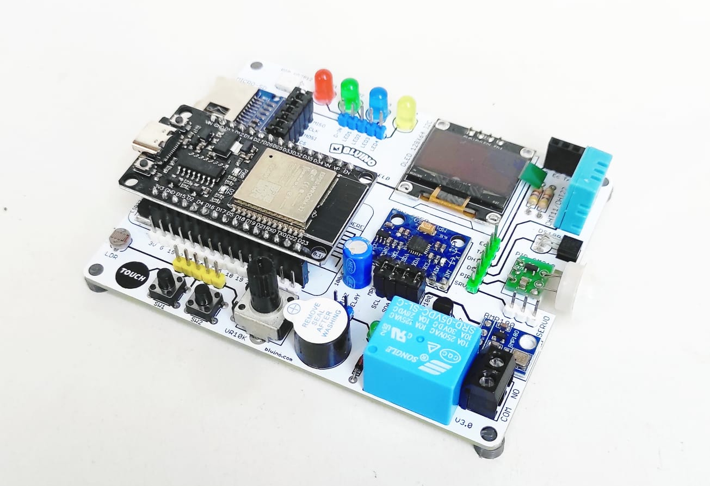
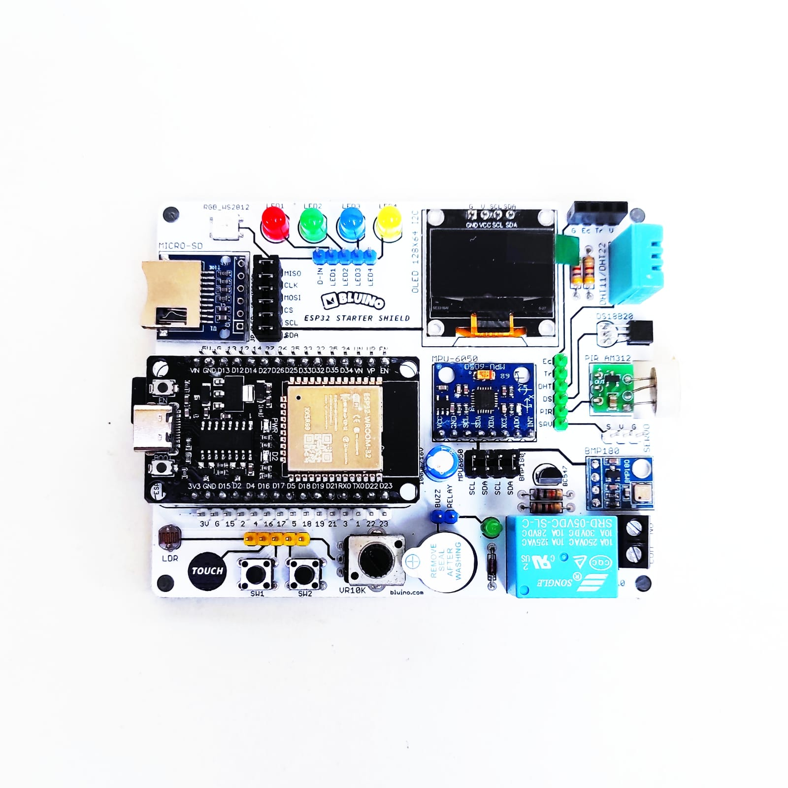
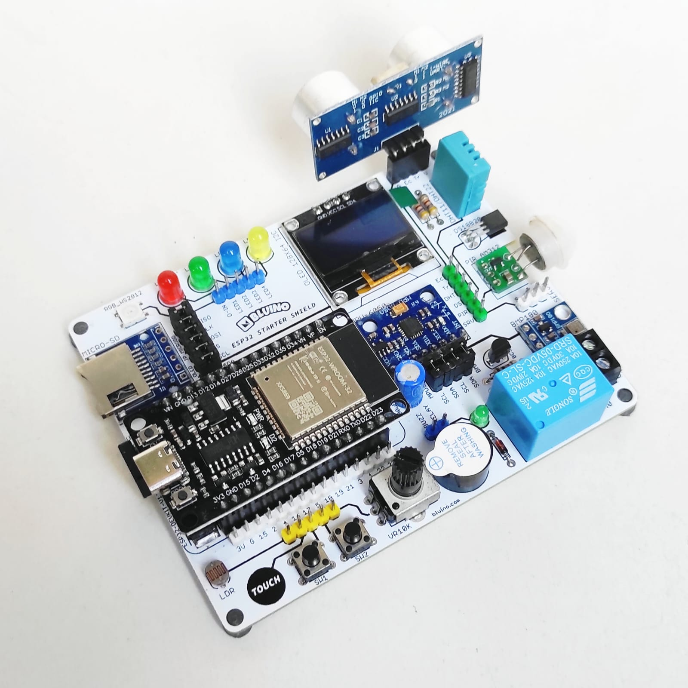

# 📘 ESP32 IoT Mastery — Kit Bluino

   
  
  

## 📋 Tentang Repositori Ini

Repositori ini berisi **materi belajar ESP32 dan IoT (*Internet of Things*) berbahasa Indonesia** yang memakai kit **Bluino ESP32 IoT Starter Shield v3.2**. Materinya dibagi menjadi BAB-BAB berurutan, mulai dari "apa itu IoT" sampai protokol modern seperti MQTT, BLE, ESP-NOW, dan Matter. Kamu bisa memakainya untuk kuliah/kursus terstruktur maupun belajar mandiri.

Setiap BAB ditulis untuk **pemula total**: ada daftar alat yang perlu disiapkan, langkah demi langkah menjalankan program, contoh hasil yang seharusnya muncul, dan tips kalau ada yang belum berhasil.

> ⏳ **Status pengembangan:** BAB 1–56 sudah tersedia dan sedang diseragamkan supaya makin ramah pemula. Semua programnya sedang diuji ulang dengan **esp32 core 3.3.12**. BAB 57–80 dan Lampiran sedang disusun.

## 🚀 Mulai dari Sini

**1. Siapkan perlengkapan**

- Kit Bluino ESP32 IoT Starter Shield. Isinya sudah termasuk ESP32 DEVKIT V1, kabel USB, dan 10 kabel *jumper* *female-female*.
- Laptop/komputer (Windows, macOS, atau Linux) dan koneksi internet.
- Kalau memakai kabel USB milikmu sendiri, pastikan itu kabel **data**, bukan kabel yang hanya untuk mengisi daya.

**2. Pasang software** — ikuti [BAB 5: Setup Lingkungan Pengembangan](BAB-05/README.md):

| Software | Versi yang dipakai di materi ini |
|---|---|
| Arduino IDE | 2.x (versi terbaru) |
| *Board package* **esp32 by Espressif Systems** | **3.3.x** (diuji dengan 3.3.12) |
| *Board* yang dipilih | **ESP32 Dev Module** |

> ⚠️ **Perhatian:** Kode di materi ini memakai API esp32 core **3.x**. Banyak contoh lama di internet masih memakai core 2.x sehingga bisa *error* kalau dicampur.

**3. Unduh materi ini.** Klik tombol hijau **Code → Download ZIP** di bagian atas halaman GitHub, lalu ekstrak. Setiap BAB punya:

- `BAB-XX/README.md` — materi yang kamu baca (bisa langsung dibaca di GitHub);
- `BAB-XX/pK_nama/pK_nama.ino` — program siap buka di Arduino IDE (**File → Open**).

**4. Belajar berurutan.** Mulai dari [BAB 1](BAB-01/README.md). Setiap BAB menyebutkan prasyaratnya di bagian paling atas.

## ☕ Dukung Proyek Ini

Kurikulum ini dikembangkan dengan dedikasi penuh untuk mendukung kemajuan talenta IoT di Indonesia. Kalau repositori ini bermanfaat untuk proses belajar, menjadi referensi riset, atau sekadar membantu kelancaran proyekmu, dukunganmu akan sangat berarti untuk keberlanjutan penulisan bab-bab berikutnya.

Kamu bisa memberi apresiasi dan semangat dengan mentraktir penulis secangkir kopi melalui tautan berikut:

**💬 Kontak Penulis (Kritik & Saran):**
Bagi instansi atau individu yang membutuhkan pendampingan teknis, kerja sama riset, pelatihan khusus seputar IoT & ESP32, atau ingin memberikan **kritik, saran, dan masukan** untuk perbaikan kurikulum ini, silakan hubungi:
- ✉️ **Email:** [antonprafanto@unmul.ac.id](mailto:antonprafanto@unmul.ac.id)
- 📞 **WhatsApp:** [0811-553-393](https://wa.me/62811553393) / [0852-5069-0673](https://wa.me/6285250690673)

Kamu juga bisa berkontribusi langsung dengan membuka **Issue** atau **Pull Request** kalau menemukan *bug* pada kode atau kesalahan penulisan (*typo*). Baca dulu [Panduan Kontribusi & Gaya Penulisan](CONTRIBUTING.md).

## 🔧 Komponen Kit

| # | Komponen | Koneksi | Protokol |
|---|----------|---------|----------|
| 1 | ESP32 DEVKIT V1 | — | — |
| 2 | OLED 0,96" 128×64 | SDA = IO21, SCL = IO22 | I2C |
| 3 | DHT11 (suhu & kelembapan) | IO27 + *pull-up* 4,7 kΩ | Digital |
| 4 | DS18B20 (suhu presisi) | IO14 + *pull-up* 4,7 kΩ | OneWire |
| 5 | BMP180 (tekanan udara) | SDA = IO21, SCL = IO22 | I2C |
| 6 | MPU-6050 (akselerometer & giroskop) | SDA = IO21, SCL = IO22 | I2C |
| 7 | RGB LED WS2812 (NeoPixel) | IO12 | Data satu kabel |
| 8 | Adaptor microSD | CS = IO5, MOSI = IO23, CLK = IO18, MISO = IO19 | SPI |
| 9 | *Touch pad* | Custom → IO33 (T8) | Kapasitif |
| 10 | 4 LED (merah, kuning, hijau, biru) | Custom → IO4, IO16, IO17, IO2 (+ resistor 330 Ω) | Digital |
| 11 | 2 tombol (S1, S2) | Custom → IO15, IO25 (+ *pull-down* 10 kΩ) | Digital |
| 12 | *Buzzer* aktif | Custom → IO13 | Digital |
| 13 | Potensiometer 10 kΩ | Custom → IO34 | Analog (ADC1) |
| 14 | LDR (sensor cahaya) | Custom → IO35 (+ resistor 10 kΩ) | Analog (ADC1) |
| 15 | PIR AM312 (sensor gerak) | Custom → IO33 | Digital |
| 16 | *Relay* 5 V + *driver* BC547 | Custom → IO26 | Digital |
| 17 | Konektor HC-SR04 (ultrasonik) | Custom → Trig IO25, Echo IO36 (wajib pembagi tegangan) | Digital |
| 18 | Konektor servo | Custom → IO32 | PWM |

> 📌 **Catatan:** **"Custom"** berarti komponen berakhir di pin header bertanda Custom. Kamu menyambungkannya sendiri ke pin ESP32 dengan kabel *jumper* *female-female*. Pin yang tertulis di tabel adalah **pin standar** yang dipakai di seluruh materi — lihat [BAB 6](BAB-06/README.md) untuk penjelasan lengkapnya.

> 🛒 **Tidak termasuk kit:** sensor HC-SR04 (hanya konektornya), motor servo, kartu microSD, dan ESP32 tambahan untuk BAB yang membutuhkan dua *board* (misalnya ESP-NOW dan ESP-MESH).

## 📌 Peta Pin Standar

### Sudah terpasang di PCB (tidak perlu kabel)

| Pin ESP32 | Komponen |
|---|---|
| IO21 (SDA), IO22 (SCL) | Bus I2C bersama: OLED (`0x3C`), MPU-6050 (`0x68`), BMP180 (`0x77`) |
| IO5 (CS), IO23 (MOSI), IO18 (CLK), IO19 (MISO) | Bus SPI: adaptor microSD |
| IO27 | DHT11 |
| IO14 | DS18B20 |
| IO12 | RGB LED WS2812 |

### Pin Custom (disambung dengan kabel *jumper*)

| Pin ESP32 | Komponen | Catatan |
|---|---|---|
| IO4 / IO16 / IO17 / IO2 | LED merah / kuning / hijau / biru | IO2 juga terhubung ke LED biru bawaan *board* |
| IO13 | *Buzzer* aktif | |
| IO26 | *Relay* | |
| IO15 / IO25 | Tombol S1 / S2 | Ditekan = HIGH |
| IO33 | PIR **atau** *touch pad* | Pasang salah satu saja |
| IO34 / IO35 | Potensiometer / LDR | ADC1, aman dipakai bersama WiFi |
| IO32 | Servo | |
| IO25 / IO36 | HC-SR04 Trig / Echo | Trig bergantian dengan S2; Echo **wajib** lewat pembagi tegangan |

## ⚠️ Restriksi GPIO ESP32

| GPIO | Status | Keterangan |
|------|--------|------------|
| IO0 | ⚠️ *Strapping* | Terhubung ke tombol BOOT; LOW saat *reset* = mode unggah program. Hindari untuk I/O umum |
| IO1, IO3 | ❌ TX0/RX0 | Dipakai Serial Monitor — jangan dipakai |
| IO2 | ⚠️ *Strapping* | Harus LOW/mengambang saat masuk mode unggah. Aman dipakai untuk LED |
| IO5 | ⚠️ *Strapping* | Dipakai CS microSD pada kit ini |
| IO6–IO11 | 🚫 Dilarang | Terhubung ke *flash* SPI internal |
| IO12 | ⚠️ *Strapping* | Menentukan tegangan *flash* saat *boot* (harus LOW). Dipakai WS2812 pada kit ini |
| IO15 | ⚠️ *Strapping* | LOW saat *boot* hanya mematikan log *boot*; aman untuk tombol S1 |
| IO34–IO39 | ℹ️ Hanya input | Tanpa *pull-up/pull-down* internal; IO36/IO39 jangan dipakai untuk *interrupt* |
| ADC2 (IO0, 2, 4, 12–15, 25–27) | ⚠️ ADC2 | Tidak bisa membaca analog saat WiFi aktif — pakai ADC1 (IO32–IO39) |

## 📚 Daftar BAB

### Bagian I — Fondasi & Persiapan
| BAB | Topik |
|-----|-------|
| [BAB 01](BAB-01/README.md) | Apa Itu IoT & Embedded System |
| [BAB 02](BAB-02/README.md) | Pengenalan ESP32 |
| [BAB 03](BAB-03/README.md) | Dasar Elektronika untuk Mikrokontroler |
| [BAB 04](BAB-04/README.md) | Membaca Skematik & *Datasheet* |
| [BAB 05](BAB-05/README.md) | Setup Lingkungan Pengembangan |
| [BAB 06](BAB-06/README.md) | Pin Mapping Kit Bluino & Restriksi GPIO |
| [BAB 07](BAB-07/README.md) | Program Pertama — Hello World |

### Bagian II — GPIO & Sinyal
| BAB | Topik |
|-----|-------|
| [BAB 08](BAB-08/README.md) | Digital Output — LED & *Buzzer* |
| [BAB 09](BAB-09/README.md) | Digital Input — Push Button |
| [BAB 10](BAB-10/README.md) | Interrupt & ISR |
| [BAB 11](BAB-11/README.md) | Analog Input & ADC |
| [BAB 12](BAB-12/README.md) | PWM dengan LEDC |
| [BAB 13](BAB-13/README.md) | DAC — Output Analog Asli |
| [BAB 14](BAB-14/README.md) | Capacitive Touch |
| [BAB 15](BAB-15/README.md) | Timer Hardware |

### Bagian III — Pemrograman Embedded Profesional
| BAB | Topik |
|-----|-------|
| [BAB 16](BAB-16/README.md) | Non-Blocking Programming |
| [BAB 17](BAB-17/README.md) | State Machine |
| [BAB 18](BAB-18/README.md) | Callback & Event-Driven Programming |
| [BAB 19](BAB-19/README.md) | Kode Terstruktur — Multi-File |
| [BAB 20](BAB-20/README.md) | Memory Management |
| [BAB 21](BAB-21/README.md) | Debugging & Troubleshooting |

### Bagian IV — Protokol Komunikasi
| BAB | Topik |
|-----|-------|
| [BAB 22](BAB-22/README.md) | UART / Serial Communication |
| [BAB 23](BAB-23/README.md) | I2C — Inter-Integrated Circuit |
| [BAB 24](BAB-24/README.md) | SPI — Serial Peripheral Interface |
| [BAB 25](BAB-25/README.md) | OneWire Protocol |

### Bagian V — Sensor
| BAB | Topik |
|-----|-------|
| [BAB 26](BAB-26/README.md) | DHT11 — Suhu & Kelembapan |
| [BAB 27](BAB-27/README.md) | DS18B20 Lanjutan — Deep Sleep, Parasitic Power & Data Filter |
| [BAB 28](BAB-28/README.md) | BMP180 — Tekanan Udara & Ketinggian |
| [BAB 29](BAB-29/README.md) | MPU-6050 — Akselerometer, Giroskop & Filter Orientasi |
| [BAB 30](BAB-30/README.md) | HC-SR04 — Sensor Jarak Ultrasonik & Deteksi Objek |
| [BAB 31](BAB-31/README.md) | PIR AM312 — Deteksi Gerakan |
| [BAB 32](BAB-32/README.md) | LDR — Sensor Cahaya |
| [BAB 33](BAB-33/README.md) | Sensor Internal ESP32 |
| [BAB 34](BAB-34/README.md) | Pemrosesan Data Sensor |

### Bagian VI — Aktuator & Tampilan
| BAB | Topik |
|-----|-------|
| [BAB 35](BAB-35/README.md) | OLED Display 128×64 |
| [BAB 36](BAB-36/README.md) | RGB LED WS2812 (NeoPixel) |
| [BAB 37](BAB-37/README.md) | *Relay* — Kontrol AC/DC |
| [BAB 38](BAB-38/README.md) | Motor Servo |

### Bagian VII — Penyimpanan Data
| BAB | Topik |
|-----|-------|
| [BAB 39](BAB-39/README.md) | NVS — Non-Volatile Storage |
| [BAB 40](BAB-40/README.md) | SPIFFS / LittleFS |
| [BAB 41](BAB-41/README.md) | MicroSD Card — Data Logging |

### Bagian VIII — WiFi & Web
| BAB | Topik |
|-----|-------|
| [BAB 42](BAB-42/README.md) | WiFi Station Mode |
| [BAB 43](BAB-43/README.md) | WiFi Access Point |
| [BAB 44](BAB-44/README.md) | WiFiManager & Captive Portal |
| [BAB 45](BAB-45/README.md) | mDNS |
| [BAB 46](BAB-46/README.md) | Web Server |
| [BAB 47](BAB-47/README.md) | WebSocket — Real-time |
| [BAB 48](BAB-48/README.md) | HTTP Client & REST API |
| [BAB 49](BAB-49/README.md) | HTTPS & Keamanan |

### Bagian IX — Protokol IoT
| BAB | Topik |
|-----|-------|
| [BAB 50](BAB-50/README.md) | MQTT |
| [BAB 51](BAB-51/README.md) | CoAP |
| [BAB 52](BAB-52/README.md) | Bluetooth Classic |
| [BAB 53](BAB-53/README.md) | BLE — Bluetooth Low Energy |
| [BAB 54](BAB-54/README.md) | ESP-NOW |
| [BAB 55](BAB-55/README.md) | ESP-MESH |
| [BAB 56](BAB-56/README.md) | Protokol Modern — Matter & Thread |

### 🚧 Segera Hadir

Bagian berikut sedang disusun dan belum tersedia:

| Bagian | BAB |
|--------|-----|
| X — IoT Platform & Integrasi | 57 Blynk · 58 Firebase · 59 ThingsBoard/ThingSpeak · 60 Node-RED · 61 Telegram Bot · 62 Google Sheets · 63 IFTTT · 64 Home Assistant & ESPHome · 65 Cloud IoT Enterprise |
| XI — Teknik Lanjutan | 66 FreeRTOS · 67 Dual-Core · 68 Deep Sleep & ULP · 69 OTA & Partition Table · 70 Watchdog Timer · 71 Flash Encryption & Secure Boot · 72 Edge Computing & Offline Buffering · 73 Peripheral Lanjutan (I2S, CAN, DMA) · 74 Pengenalan ESP-IDF · 75 Pengenalan MicroPython |
| XII — Proyek Terpadu | 76 Smart Home Mini · 77 Weather Station IoT · 78 Security System · 79 Data Logger Portable · 80 Proyek Mandiri |
| Lampiran | A Pin Mapping Lengkap · B Daftar Library · C Troubleshooting & FAQ · D Keamanan Hardware · E Git untuk Firmware · F Referensi & Sumber Belajar |

## 🛠️ Untuk Kontributor

- [Panduan Kontribusi & Gaya Penulisan](CONTRIBUTING.md) — template BAB, aturan EYD, peta pin, dan aturan kode.
- [Sumber Gambar](SUMBER_GAMBAR.md) — daftar semua gambar beserta sumber dan lisensinya.
- Kode di README adalah sumber utama; file `.ino` dibuat otomatis dengan `python tools/sketch_tool.py extract`.
- Setiap perubahan dicek otomatis oleh GitHub Actions: tautan, format, sinkronisasi kode, dan *compile* semua program.

## 📝 Lisensi

Materi ini dibuat untuk tujuan edukasi.

## 🔗 Tautan

- [Tokopedia — Bluino ESP32 IoT Starter Kit](https://www.tokopedia.com/bluino/esp32-starter-shield-modul-belajar-iot-kit-wifi-bluetooth-1731230521580291235)
- [Bluino Official](http://www.bluino.com)
